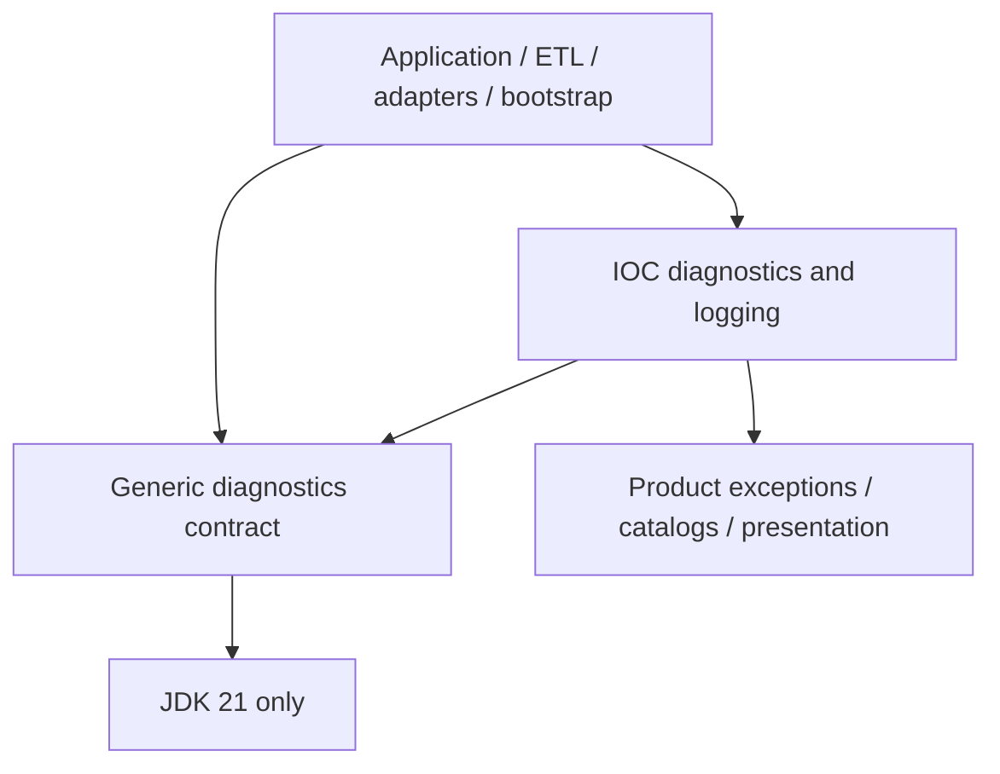

# ADR 0044: Extract a JDK-only diagnostics contract

## Status

Accepted, 2026-10-18. The owner fixed the contract before extraction and
authorized its final admission review. The implementation, IOC migration and
local standalone-consumer qualification are complete. Remote publication and
consumption from each target repository require a separately authorized release.

This decision refines the code ownership and policy-enforcement boundary of
[ADR 0017](0017-diagnostics-first-class-outcome.md). Its IOC outcome,
prepare/checkpoint/commit and product-exception contracts remain in force.
It extends the component publication model of
[ADR 0028](0028-pilot-library-publication.md) and
[ADR 0029](0029-release-branch-library-publication.md) to diagnostics.

## Context

IOC already uses diagnostics, results, failure decisions and bounded detail
across application, ETL, adapters and bootstrap. The planned feeds collector
needs these mechanics while owning its own codes, categories and text.
Publishing the former diagnostics module unchanged would expose IOC catalogs,
rendering metadata and `IocExtractorException`; its resilient sink also depended
on SLF4J. Another real production-service integration is future validation.

The reusable contract must preserve occurrence counts, built-in stopping signals
and IOC behavior while removing that service coupling. Java 21, inward
dependencies, lockstep product/library versions and protected immutable
publication are constraints. Diagnostic delivery must remain synchronous and
observational. No remote protocol, concurrent registry, logging framework or
durable audit store is required.

## Decision

### Artifact and ownership

Use `io.github.xorex-lc:ioc-platform-diagnostics-api` in
`platform/platform-diagnostics-api`, with packages
`com.iocextractor.platform.diagnostics`, `.result` and `.sink`. It has zero
non-JDK production dependencies. Its 18 public types form one publication unit:

| Responsibility | Public types |
|---|---|
| Occurrences and codes | `Diagnostic`, `DiagnosticBuilder`, `DiagnosticCode`, `DiagnosticFactory`, `DiagnosticImpact`, `DiagnosticSeverity` |
| Results, decisions and counts | `Result`, `Notification`, `FailurePolicy`, `FailureDecision`, `DiagnosticSummary`, `DiagnosticBatch`, `BoundedDiagnosticCollector`, `BoundedNotification` |
| Synchronous delivery | `DiagnosticSink`, `NoopDiagnosticSink`, `CollectingDiagnosticSink`, `ResilientDiagnosticSink` |

Keep IOC categories, catalogs, context vocabulary, rendering, logging composition
and exceptions in local modules. `IocDiagnosticCode` extends the generic code
with category, message key and template; generic codes require only stable ID,
default severity and impact. Use one diagnostic value model across IOC, with no
old-package aliases or duplicate conversion model.

Misyurkeev Denis (`xORex-LC`), the project publication maintainer, owns the API
and its releases. Keep `${revision}` in lockstep with the product. Public
signature or documented behavior changes require compatibility review. During
0.x, a breaking change requires a minor version and migration notes; patches
preserve the contract. The initial relocation is an unpublished reactor
migration. Relocating a published Java package later is a breaking change.

### Occurrences, decisions and bounded detail

Diagnostic equality uses the code object, context and effective severity,
excluding timestamp and cause. Counters count every occurrence without
deduplication. Consumers own catalog uniqueness and stable code metadata and
equality. Collection snapshots are shallow; their values and causes remain
shared references. Callers must keep them stable and redact sensitive values
before logging. `toString()` is not a safe operational log representation.

Policies return pure, non-null decisions. Callers enforce them at their own
checkpoints and own exceptions, transactions, skipping and retry. Fail-fast
selects the first ERROR/FATAL in the supplied list; collect-and-continue selects
the first FATAL. Compaction preserves stopping signals, not the original first
failure reason or arbitrary policies over omitted codes.

Preserve the two retention algorithms. A stage retains the first N budgeted
occurrences plus its first ERROR/FATAL when necessary, up to N+2. A run retains
at most N budgeted occurrences, replacing the earliest lowest-severity list
slot when its first ERROR/FATAL requires it. Replacement can change sample
order relative to input order. Both retain every OPERATION occurrence outside
the budget. Equal stage/run budgets preserve the direct-run sample; a smaller
stage budget can lose detail while keeping exact totals.

Use `DiagnosticBatch.of` to validate retained size, severity counts and
rejecting signals against exact observed counts. It excludes synthetic markers.
Reject null metadata, blank IDs, invalid counts and the configured marker as a
real occurrence; count overflow throws `ArithmeticException`. A consumer-owned
stable suppression code is shared across the aggregation tree. The caller owns
the truth of omitted counts: summaries cannot prove provenance or detect an
unrelated marker hidden among omitted observations.

Builders and accumulators belong to one task and are not thread-safe. Retained
ELEMENT/RUN detail is bounded, but OPERATION input, context values, unbounded
notifications and collecting sinks can grow memory. Immutable batches can cross
task boundaries only with stable shared values. No throughput target is implied.

### Delivery and failure ownership

The resilient sink takes a delegate and a service-owned failure callback. It
contains `RuntimeException` from either callback, with no recursion or retry,
and propagates `Error`. Null input is rejected before callbacks. The service
owns callback latency, resource lifetime and thread safety. The wrapper owns
no queue, worker, timeout or durable delivery state.

Bulk additions and raw merge callbacks can fail after partial mutation.
A failing delivery occurrence has already been counted and retained; later
occurrences and the batch's omitted counts have not been merged. Earlier accepted
counts also remain after overflow. There is no rollback or retry identity, so
replaying a whole batch can double-count or redeliver accepted occurrences.
Retention is not a lifetime limit on callback traffic.

### Documentation and publication admission

Maintain public/package Javadoc, module/package READMEs and the
[consumer guide](../guides/diagnostics-library.md) together. Compile and execute
its examples both in module tests and in the standalone consumer. Use strict
Javadoc generation and review rendered output; a passing doclint alone does not
establish that documented semantics match the code.

Maven Central is primary; GitHub Packages is the identical-byte mirror. An
explicit allowlist selects module, artifact, archive package and consumer fixture.
`concurrency` remains the default and its existing published version/tag remain
unchanged. Diagnostics uses an annotated
`ioc-platform-diagnostics-api-vX.Y.Z[-rc.N]` tag on the matching `release-X.Y.Z`
branch. Adding this component does not admit dependency-bearing POMs.

Build without publication credentials, qualify a parent-independent POM,
main/sources/Javadoc/license archives and a cold consumer, then sign once after
protected environment approval. Reuse the existing configured maintainer key
and Central user-token pair. Bind recovery to component, version, source commit,
manifest hashes and the original deployment; reuse signed bytes without rebuild
or resigning. Reject symbolic manifest, repository, artifact and recovery paths before
signing or repository access. The bundle manifest is not a detached signature
over its JSON: trusted workflow provenance and protected release review remain
part of this boundary. See the
[publication procedure](../guides/library-publication.md).

## Alternatives considered

- **Publish the former module unchanged:** smaller migration, but consumers
  inherit IOC taxonomy, presentation metadata and product exception ancestry.
- **Duplicate mechanics in each service or use JDK collections alone:** avoids
  release coordination, but duplicates result/policy/retention behavior and tests.
- **Adopt a validation/logging framework:** adds dependencies and changes the
  existing contract without resolving service ownership.
- **Split interfaces from small implementations:** adds coordinates and release
  edges without isolating dependencies or meeting a second implementation need.
- **Share categories, renderers or a built-in suppression code:** couples
  service catalog evolution to the library and broadens it into a registry.
- **Compare diagnostics by code ID alone:** equates unrelated code objects and
  changes identity semantics; stable catalog IDs remain a consumer obligation.

## Consequences

Independent services can reuse the mechanics without IOC or framework
dependencies. IOC import paths, category checks, exception enforcement, batches,
runner continuation and catalog generation must agree on the shared model.
ArchUnit and dependency/archive checks enforce the dependency boundary; public
boundary and IOC integration tests protect the behavioral migration.

The artifact adds compatibility and support obligations. Bounded samples cannot
serve as a complete audit trail, callbacks cannot guarantee delivery, and raw
context cannot safely be logged without a service policy. No wire or persistence
compatibility is promised. These limits must remain visible to consumers.

Local packaging and synthetic consumers qualify the release inputs. They do not
prove protected signing acceptance, registry visibility or operation in another
production service. Actual publication requires explicit owner instruction and
separate cold consumers from both claimed repositories.

## References

- [Module reference](../../platform/platform-diagnostics-api/README.md)
- [Consumer guide and executable examples](../guides/diagnostics-library.md)
- [IOC diagnostics and observability](../dev/observability.md)
- [Module map](../MODULARIZATION.md) and [executable boundaries](../BOUNDARIES.md)
- [Build and analyzer controls](../dev/build-quality.md)
