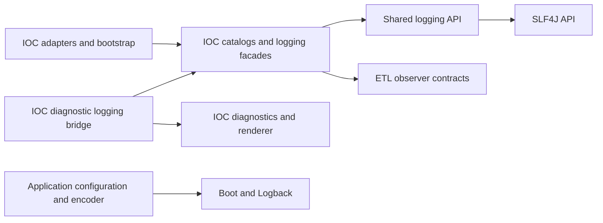

# ADR 0045: Extract typed SLF4J logging and a scalar ECS profile

## Status

Accepted, 2026-10-20. The owner fixed the contract before implementation and
authorized the L3-3 integration review and ADR promotion. The library and IOC
migration are implemented; publication-tool admission and cold repository
consumption remain the separate L3-4 gate. Acceptance does not authorize a
publication or assert that a second production service already consumes it.

This refines the code ownership of [ADR 0018](0018-typed-ecs-structured-logging.md)
and its [Boot 4 nested representation](0019-spring-boot-4-nested-ecs.md).
Their IOC logging/disclosure and runtime backend policies remain local.
The selected producer wire corrections below supersede only their former
`event.type` usage and the affected informational outcomes. Component publishing
continues under [ADR 0028](0028-pilot-library-publication.md) and
[ADR 0029](0029-release-branch-library-publication.md).

## Context

IOC has typed operational records, restoring MDC scopes and explicit URL
preparation. Future services need those mechanics and consistent standard field
meanings while owning their catalogs, actions, observers and disclosure policy.
Publishing the old observability module would export IOC vocabulary and ETL
dependencies. Sharing raw key/value helpers alone would leave standard semantics
and backend collisions unresolved.

Qualification also exposed two service defects: internal event names and no-op
dispositions occupied ECS `event.type`, whose supported shape is an array; an
explicit error type together with a Throwable could make Boot drop the record.
The library cannot validate a complete service schema or promise that appender
acceptance means bytes were written. Error ownership and backend tests are part
of the consuming application's contract.

Constraints are Java 21, inward dependencies, product/library lockstep versions,
one selected provider per application and bounded ownership of each builder and
scope. No logging provider, Boot starter, event bus, automatic propagation,
global registry or universal ECS model is needed in the shared JAR.

## Decision

### Artifact, API and ownership

Use `io.github.xorex-lc:ioc-platform-logging-slf4j` in
`platform/platform-logging-slf4j`, with exactly eight public types:

| Package | Public types |
|---|---|
| `com.iocextractor.platform.logging` | `LogFieldSpec`, `LogValueType`, `LogEvent`, `LogEvents`, `MdcScope` |
| `.ecs` | `EcsFields`, `EventOutcome` |
| `.redaction` | `LogRedaction` |

The sole required main dependency is `org.slf4j:slf4j-api`; do not shade it or
publish a provider transitively. Spring, Logback, encoders, IOC catalogs,
diagnostics, ETL and application types stay outside this module. Domain and
application code continue to use their observer/diagnostic ports rather than
acquiring a new logging dependency. Architecture tests enforce both directions.

Misyurkeev Denis (`xORex-LC`), the project publication maintainer, owns the API
and releases. Keep `${revision}` in lockstep with the product. During 0.x, an
incompatible public signature or documented behavior requires a minor version
and migration notes; patches preserve the contract. Package relocation after
publication is a breaking change. Publishing this dependency-bearing component
must preserve the older libraries' zero-dependency publication guards.

### Fields and emission

Services declare immutable `LogFieldSpec` values in their own catalogs. Keys are
case-sensitive dotted paths, without trimming or case conversion. Each segment
starts with an ASCII letter or underscore and then uses letters, digits,
underscores or hyphens. The descriptor checks grammar, not schema ownership.

Within one event the wire key identifies a field. Equivalent descriptors
replace its value; a conflicting declared type fails even after null omission.
Rejected calls leave the previous declaration/value intact. Null omits the local
value; it does not hide ambient MDC. There is no global field registry.

STRING accepts CharSequence, Enum, Path and UUID as their textual representation;
LONG accepts Byte, Short, Integer and Long; BOOLEAN accepts Boolean. Other
representations fail with value-free errors. Generic fields validate scalar
representation, not ECS meaning. Validation happens before disabled-level
filtering. This retains the explicit strict-error policy; containing developer
mistakes in logging remains separate OBS-6 work.

Factories retain the caller-selected logger and level. Event-local fields hide
exactly matching MDC keys for one emission and restore them afterwards. This
does not resolve parent/child path conflicts. Builders belong to one thread;
calling `log()` twice makes two attempts. Provider failures propagate. No
durability, retry, exactly-once delivery or successful encoding is promised.

### MDC and explicit disclosure

Scopes remember the first previous value of each touched key and restore in
reverse order. Open, populate and close on the same thread; nested scopes close
in LIFO order. Untouched keys remain unchanged. Writes require STRING fields;
`hide` can temporarily remove any field's ambient string. Successful close is
idempotent and later writes fail. Workers reconstruct correlation from explicit
command metadata; task IDs are not distributed tracing IDs.

Acquire a scope before population. The IOC callback convenience closes partial
initialization and retains the original failure; a distinct cleanup failure is
suppressed, while the same exception object is not suppressed onto itself.
No scope promises restoration when the MDC provider itself fails.

`fullMask()` takes no value and returns `[redacted]`, with no prefix, suffix,
length or fingerprint. The caller selects which STRING fields need it. It does
not change messages, causes or copies in other fields and has no severity bypass.
Numeric/boolean secrets need omission or a separate STRING log representation.

`urlComponents` preserves the qualified lexical behavior: user-info is recognized
after `://` through the last `@` before `/`, `?` or `#`; content after the first
`?` is replaced through the next `#` or end. Replacement is `<redacted>`.
Paths/fragments and scheme-less user-info can remain visible, and a question
mark in a fragment is still processed. Null returns null. It is not URI parsing
or a general secret scrubber. IOC diagnostic fingerprints and severity disclosure
remain a separate local policy.

### ECS subset and backend ownership

Share five scalar descriptors: STRING `event.action`, `event.outcome`,
`error.type`, `file.path`, and LONG `event.duration`. Helpers require a nonblank
service action, success/failure/unknown outcome and nonnegative nanoseconds.
Omit an inapplicable outcome or unmeasured duration. The producer owns full path
resolution/disclosure and safe duration measurement. Generic `.field(...)` can
bypass helper semantics. ECS type/category arrays remain outside v1.

Applications own timestamp, message, `log.*`, `process.*`, `service.*`, `ecs.*`,
configured metadata and `event.dataset`. Service catalogs and permitted MDC
must avoid reserved paths and scalar/object prefix conflicts. With a Throwable,
the encoder owns all `error.*`; without one, a producer may emit type-only
`error.type`. Raw SLF4J and third-party MDC can bypass these conventions.

Keep Boot/Logback in consuming bootstrap code. The
[qualified application recipe](../guides/logging-library-boot.md) combines a
synchronous FileAppender with mutable LoggingEvent dataset enrichment, restoring
the original key/value list even after formatter failure. Its example rejects
dataset overrides and immutable snapshots. The IOC daemon retains its own
synchronous RollingFileAppender and encoder. Neither recipe qualifies
LoggingEventVO, arbitrary async transports or another provider; the generic
library's async snapshot tests are a different boundary. Static Boot JSON
dataset additions are not a tested replacement alongside dynamic `event.*`.
Consider a separate backend artifact only when a second real service needs it.

### IOC integration and wire migration

`platform-observability` retains IOC fields/actions, delegating facades and the
ETL observer. Its fields bind to shared descriptors, including all five standard
constants. Event emission, scalar normalization, MDC and lexical URL handling
have one implementation in the library. The diagnostic logging bridge continues
through local catalogs and rendering; no competing sink API is introduced.

Control-event names move from `event.type` to `ioc.event.type`. Completed legacy
import replays and current-schema no-ops use `ioc.operation.disposition=skipped`
and omit both `event.type` and their former `event.outcome=unknown`. Actions,
levels and other metadata stay unchanged. There is no dual write. Watch-service
failure logging retains its Throwable and removes the explicit error type;
type-only producers remain supported. These query migrations are documented in
the capability guide and release notes and tested through actual JSON bytes.

## Alternatives and consequences

| Alternative | Disposition |
|---|---|
| Publish observability unchanged | Reject: exports IOC vocabulary and ETL coupling |
| Raw SLF4J or generic helpers alone | Reject: lacks restoring scopes, representation checks and shared field meanings |
| Full ECS model and several profile/backend artifacts now | Defer: arrays and broad schemas lack a demonstrated consumer; extra artifacts enlarge compatibility obligations |
| Boot/Logback as required library dependencies | Reject: forces one framework/provider into generic consumers |
| Automatic scrubbing or automatic containment of every logging error | Defer: changes the agreed strict-error/disclosure boundary and adds policy without a supported contract |
| Automatic executor propagation | Reject for this API: services already own explicit correlation reconstruction |

New service fields require no shared catalog changes. The cost is explicit
service schema review, provider selection and backend qualification. Builders
and scopes allocate per-event/per-scope state; field count is not bounded by
the library and no throughput target is implied. There is no shared worker,
queue or lifecycle service. Applications own filtering, log rotation, retention
and resource budgets.

## Qualification and limits

Public API tests, provider-failure tests, async field/MDC snapshots and executed
plain Java examples live in the library. IOC catalog binding, callback ownership,
ETL correlation, diagnostic rendering and migration regressions remain local.
`LoggingBootRecipeIT` compiles the actual guide code and runs its YAML/XML through
Boot in a separate JVM with no IOC classes; strict JSON parsing and encoder
statuses cover supported output and known invalid-input boundaries.

Javadoc doclint, module/source/Javadoc packaging, dependency closure and the full
verify/PMD gates qualify the checkout. They do not qualify cold target-repository
resolution, live Elasticsearch mappings, collector ingestion, production load,
arbitrary provider versions or a second real service. Those claims require
separate evidence. Sources/Javadoc, resolved independent POM and protected
immutable publication remain L3-4 obligations.

References: [library guide](../guides/logging-library.md),
[observability capability](../dev/observability.md),
[testing policy](../TESTING.md), and
[build-quality ownership](../dev/build-quality.md).
