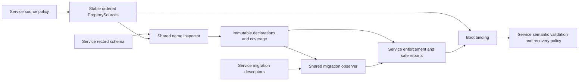

# ADR 0046: Extract Spring Boot configuration declaration inspection

## Status

Accepted, 2026-10-22. The owner authorized extraction, migration observations,
restricted-context qualification and this documentation review. The shared module
and IOC integration are implemented. Standalone POM preparation, dependency
mediation, cold repository consumption and publication remain a separate gate.
Acceptance does not establish consumption by a second deployed service.

This refines the ownership of the strict configuration boundary in
[ADR 0016](0016-config-preflight-strict-binding.md). IOC's accepted spellings,
validation, failure codes and migration policy remain service-owned, including
the compatibility alias in [ADR 0027](0027-rollback-safe-configuration-evolution.md).
Publication follows [ADR 0028](0028-pilot-library-publication.md) and
[ADR 0029](0029-release-branch-library-publication.md).

## Context

IOC already inspects declared property names before binding and reports external
declarations without printing values. Future services need these mechanics for
their own record schemas. Exporting IOC bootstrap would also export its model,
CONFIG codes, validators, command lifecycle and process-wide console handling.

Names alone cannot establish valid values or the provenance of a bound object.
Boot can replace an entire list from one higher-priority source while declarations
from both sources remain visible. Opaque sources and unsupported schema shapes
also prevent a complete name check. A shared API must report these limits rather
than classify every unmatched declaration as an operator mistake.

A small bean context and a closed set of configuration inputs are separate
choices. IOC checks effective deployment configuration, including Boot imports
and profiles. Another service may instead check one self-contained file. The
library must support both without selecting their source policy or failure scope.

## Decision

### Artifact and dependency boundary

Use `io.github.xorex-lc:ioc-config-spring-boot` in
`adapters/adapter-config-spring-boot`, requiring Java 21. Its package is
`com.iocextractor.config.boot`; it remains a Spring integration adapter consumed
explicitly by bootstrap. Domain, processing, application and framework-free
platform contracts do not depend on it.

The public surface has six top-level types: `PropertySchema`, `PropertyInspector`,
`PropertyInspection`, `PropertyMigration`, `MigrationInspector` and
`MigrationInspection`. Result records/enums are nested; reflection, tokenization
and matching helpers remain package-private.

Required direct main dependencies are `org.springframework.boot:spring-boot`
and `org.springframework:spring-core`, managed centrally. Boot also brings Spring
Context and its transitive dependencies; this is a dependency-bearing library.
No starter, required SnakeYAML dependency, IOC model, diagnostics contract, logging
provider or automatic configuration is added by the module.

Misyurkeev Denis (`xORex-LC`), the publication maintainer, owns the API and
releases. Keep `${revision}` in lockstep with the product. During 0.x, incompatible
public signatures or documented behavior require a minor version and migration
notes; patches preserve the contract. Package relocation after publication is
a breaking change.

### Name facts, coverage and lifecycle

`PropertySchema` selects one canonical namespace segment and an ordinary record
root. `PropertyInspector.inspect` receives stable property sources in precedence
order and performs one name-only traversal. It returns immutable declarations,
candidate canonical paths, schema gaps and source coverage. It reads no property
values and retains no Environment, source object or Spring context.

`KNOWN` identifies one supported path, `UNKNOWN` identifies no supported path
with no relevant unsupported subtree, `AMBIGUOUS` preserves competing paths,
and `UNSUPPORTED` discloses a limit of inspection. `complete()` describes coverage,
not configuration validity: unknown or ambiguous names can occur in a complete
inspection. An incomplete inspection cannot prove the absence of other problems.

The qualified subset includes ordinary ASCII lower camel case record fields,
nested records, indexed record/scalar lists, whole scalar lists and flat
String/enum-keyed scalar maps with single-token keys. Supported relaxed field
spellings and qualified environment conventions are defined in the
[module reference](../../adapters/adapter-config-spring-boot/README.md).
Recursive or unresolved types, JavaBeans, broader map grammar, custom conversions
and unsupported source conventions disclose coverage gaps. Boot owns conversion,
index continuity and aggregate binding. Another Boot baseline or schema shape
requires compatibility qualification before a support claim.

Source order and all declarations, including shadowed and null-valued ones, are
retained. Safe source identities use fixed categories and encounter ordinals;
arbitrary labels are omitted. Composite children are inspected separately, opaque
sources disclose incomplete coverage and Boot's attached aggregate is excluded
to avoid duplicate observations. Enumeration failures propagate with their
original identity; they do not become a partial successful report.

The caller keeps sources stable for inspection and any subsequent binding.
The library owns no context, streams, workers, retry or reload lifecycle. Source
enumeration is caller-controlled work and has no independent timeout or size
budget. Names and dynamic map keys may themselves contain sensitive text, so a
value-free result still requires an application rendering policy.

### Configuration evolution

`MigrationInspector` matches explicit deprecated/removed-name descriptors against
the same immutable inspection. It neither revisits sources nor rewrites values.
Canonical templates use `[]` for list indexes; an indexed replacement preserves
the concrete indexes in order. Removed fields can be described without restoring
them to the current schema. Their original unknown-name result is retained.

Catalog validation rejects invalid, equivalent/overlapping old paths and exact
migration chains. Observations distinguish resolved, ambiguous and unsupported
matches and retain the original coverage. Replacement text is a name hint, not
a conversion or bindability guarantee. The service owns catalog selection,
deprecation windows, severity, alias conversion and bound-field conflict checks.
An empty snapshot cannot establish the catalog's namespace identity.

### Source loading and restricted contexts

IOC keeps `SpringApplication.run` with explicit configuration/preflight beans,
without its runtime composition root. It loads effective Boot defaults, the
candidate, imports, profiles and ordinary override channels. Imports are trusted
deployment inputs; this command provides no filesystem or network sandbox.
IOC owns CLI root loading controls and rejects scalar/indexed
`spring.main.sources` before extra bean loading. It pins eager initialization,
no keep-alive, no shutdown hook and no startup-info, then closes the context.
Its temporary process-wide console suppression remains confined to the command.

The separate [closed-input recipe](../guides/configuration-library-check.md)
is application code. It loads one explicit YAML document plus literal overrides,
removes ambient environment/system sources, rejects imports, profiles, foreign
namespaces and placeholders, and never invokes ConfigData. It creates an explicit
`AnnotationConfigApplicationContext` in a closing scope before refresh and returns
an immutable bound model after closure. The application declares Spring Context,
SnakeYAML and its validator itself.

Services choose source policy, permitted beans, validators, safe failure reports
and whether an error stops one collector or the whole process. Framework logging
is a separate disclosure boundary. Neither recipe becomes a generic embedded
runner or changes the inspector's public API.

## Alternatives considered

| Alternative | Reason for rejection |
|---|---|
| Publish IOC bootstrap or its check command | Exports product models, failure policy and process-wide lifecycle choices |
| Wrap Binder as a universal strict validator | Cannot cover arbitrary conversions and opaque sources through name inspection; obscures Boot's aggregate semantics |
| Provide a starter or shared context runner | Selects source loading, beans and recovery for services before a common lifecycle is established |
| Manually recreate ConfigData for IOC | Adds parity work for profiles, imports and environment preparation without a required behavior change |
| Force every check to accept only one file | Breaks IOC's effective-deployment check; closed inputs are an explicit consumer policy |
| Return only unknown names | Loses ambiguity, coverage and declaration context needed for honest enforcement |

## Consequences and qualification

Services share one inspection/migration mechanism while keeping value semantics
and operational decisions local. IOC retains stricter spelling/environment
compatibility where generic support differs. Adding another supported shape
requires observable-name tests and actual Binder tests, with explicit unsupported
cases and no silent widening of IOC's contract.

Architecture tests enforce dependency direction. The adapter participates in
the ordinary Maven, coverage, SpotBugs, CPD and PMD scopes. Unrelated-schema tests
cover matching, immutable results, no value reads, migration hints and real list
binding. Separate JVM fixtures qualify IOC source loading, pre-bean rejection,
cleanup and the exact closed-input guide without IOC classes.

These deterministic checks do not establish a parent-independent published POM,
cold repository resolution, another framework version or a second deployed
service. Packaging admission must review the complete mediated dependency graph,
repository routing and older-library regressions before protected publication.
The [publication guide](../guides/library-publication.md#configuration-library-admission)
records that gate separately from implementation acceptance.

The durable implementation flow lives in
[configuration inspection](../dev/configuration-inspection.md); integrator steps
live in the [consumer guide](../guides/configuration-library.md).
