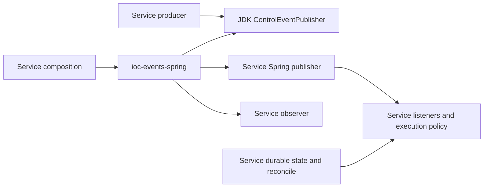

# ADR 0047: Separate local event contracts from explicit Spring delivery

## Status

Accepted, 2026-10-24. The owner authorized E2 extraction and the three known
publisher corrections after reviewing the two-unit plan. This records module
ownership and behavior; standalone POMs, published coordinates, independent
repository consumers and registry release remain separate admission steps.
[ADR 0013](0013-event-driven-coordination.md) remains unchanged: events are hints,
and service-owned durable state and reconciliation remain authoritative.

## Context

Future services need the same local event metadata and producer containment
without inheriting IOC payloads, catalogs, listeners or recovery. Packaging the
current bootstrap publisher would pull service composition into a reusable
adapter; putting it in the contracts JAR would force Spring onto plain Java
consumers.

The previous implementation swallowed an annotated listener's Error wrapped by
Spring, lost primary publication evidence if the failure observer also failed,
and allowed fallback logging failure to escape or reclassify successful delivery.
These failure boundaries must be explicit before reuse.

## Decision

Keep the seven existing JDK-only types in `platform/platform-events`. Extract
`SpringControlEventPublisher` into `adapters/adapter-events-spring`, artifact
`ioc-events-spring`, package `com.iocextractor.adapter.out.events.spring`.
Both modules currently use reactor group `com.iocextractor`; publication group
`io.github.xorex-lc` and parent-free consumer POMs are qualified in the later
packaging stage. Versions remain in product lockstep and target Java 21.

The adapter requires event contracts, Spring Context and SLF4J API. The tested
baseline is Context 7.0.9 and SLF4J 2.0.18 under IOC's Boot 4.0.8 build host.
Boot is not a main dependency. No provider, starter or auto-configuration is
included. No wider Spring compatibility range is inferred.

The constructor receives a Spring publisher and observer. It creates no beans,
multicaster, error handler or executor and owns no shutdown lifecycle. Service
composition and logging observers stay in bootstrap. Handler observation helpers
remain local; there is no new shared dispatch API.

A null event is rejected before any side effect. Ordinary runtime publication
failures are observed and contained. Direct Error and an Error immediately
wrapped by Spring in `UndeclaredThrowableException` propagate unchanged. Do not
walk arbitrary cause chains or unwrap ordinary checked/runtime wrappers.

Separate delivery from success observation. Runtime observer failures use a
best-effort WARN. On failed publication the original failure is primary, with a
distinct observer failure suppressed when supported and self-suppression guarded.
A suppression-disabled exception retains primary evidence. Runtime failure of
this final logger is contained without a recursive report; Error still propagates.

A normal return proves no all-handler or durable completion. Default synchronous
multicast may stop after partial delivery. Services configure handler isolation
with Spring facilities and decide recovery from their own state. The adapter
cannot observe failures already handled by a service error handler or occurring
after asynchronous submission. There is no retry, queue or delivery ledger.

## Alternatives and trade-offs

- Contracts alone would not share the requested producer-containment behavior.
- One Spring-dependent artifact would increase coupling for JDK-only consumers.
- Leaving the bridge in bootstrap would duplicate it in future services.
- A shared multicaster or subscriber framework would expand the API and change
  application-wide dispatch behavior; explicit service configuration is retained.

Two modules add publication and dependency-closure work. Moving the bootstrap
class changes its import before public library admission. The small adapter has
no per-call state, but concurrent callers still need a thread-safe delegate and
observer. Listener blocking, partial delivery and lost hints remain operational
costs covered by service recovery. Fallback logging cannot guarantee evidence
during backend failure and can expose exception text; services own disclosure.

## Validation

Stub tests cover original exception identity, suppression/self-suppression,
suppression-disabled exceptions, Error propagation and a throwing fallback logger.
Failsafe integration tests use actual ordered `@EventListener` methods and a real
Spring context to qualify partial delivery, wrapped Error and service-owned
multicaster/error-handler/executor configuration. ArchUnit restricts dependencies
to the module, JDK, event contracts, Spring Context and SLF4J. All build and
coverage manifests include the new production module without lowering floors.

The [guide](../guides/events-library.md) supplies explicit construction.
Independent artifact consumption remains later evidence, not a second deployed
service or a release claim.
