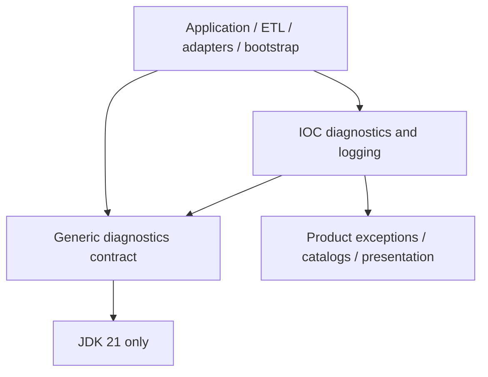

> Русский перевод исторической записи. Решение, статус и даты сохранены. [Английский оригинал](../0044-reusable-diagnostics-contract.md).

# ADR 0044: Выделение JDK-only контракта диагностики

## Статус

Принято, 2026-10-18. Владелец зафиксировал контракт до выделения и разрешил
финальное admission review. Реализация, миграция IOC и локальная квалификация
standalone consumer завершены. Remote publication и потребление из каждого
целевого репозитория требуют отдельно разрешённого релиза.

Решение уточняет границу code ownership и применения policy из
[ADR 0017](../0017-diagnostics-first-class-outcome.md). Его IOC outcome,
prepare/checkpoint/commit и product-exception contracts остаются в силе.
Оно расширяет component publication model
[ADR 0028](../0028-pilot-library-publication.md) и
[ADR 0029](../0029-release-branch-library-publication.md) на diagnostics.

## Контекст

IOC уже использует diagnostics, results, failure decisions и ограниченную
детализацию в application, ETL, adapters и bootstrap. Планируемому feeds collector
нужна эта механика при собственном владении codes, categories и text.
Публикация прежнего diagnostics module без изменений открыла бы IOC catalogs,
rendering metadata и `IocExtractorException`; его resilient sink также зависел
от SLF4J. Интеграция другого реального production service — будущая валидация.

Reusable contract должен сохранять occurrence counts, встроенные stopping
signals и поведение IOC, удаляя привязку к сервису. Java 21, inward dependencies,
lockstep product/library versions и защищённая immutable publication — ограничения.
Diagnostic delivery должна оставаться синхронной и наблюдательной. Remote
protocol, concurrent registry, logging framework или durable audit store не нужны.

## Решение

### Артефакт и владение

Использовать `io.github.xorex-lc:ioc-platform-diagnostics-api` в
`platform/platform-diagnostics-api` с пакетами
`com.iocextractor.platform.diagnostics`, `.result` и `.sink`. У него ноль
production dependencies вне JDK. Его 18 публичных типов образуют одну publication unit:

| Ответственность | Публичные типы |
|---|---|
| Occurrences и codes | `Diagnostic`, `DiagnosticBuilder`, `DiagnosticCode`, `DiagnosticFactory`, `DiagnosticImpact`, `DiagnosticSeverity` |
| Results, decisions и counts | `Result`, `Notification`, `FailurePolicy`, `FailureDecision`, `DiagnosticSummary`, `DiagnosticBatch`, `BoundedDiagnosticCollector`, `BoundedNotification` |
| Синхронная доставка | `DiagnosticSink`, `NoopDiagnosticSink`, `CollectingDiagnosticSink`, `ResilientDiagnosticSink` |

Сохранить IOC categories, catalogs, context vocabulary, rendering, logging
composition и exceptions в локальных модулях. `IocDiagnosticCode` расширяет
общий code через category, message key и template; generic codes требуют
только stable ID, default severity и impact. Использовать одну diagnostic
value model во всём IOC, без aliases старых пакетов или дублирующей conversion model.

Misyurkeev Denis (`xORex-LC`), maintainer публикаций проекта, владеет API и его
релизами. Сохранить `${revision}` в lockstep с продуктом. Изменения публичной
сигнатуры или документированного поведения требуют compatibility review.
В течение 0.x несовместимое изменение требует minor version и migration notes;
patches сохраняют контракт. Начальный перенос — миграция неопубликованного
reactor. Последующий перенос опубликованного Java package — breaking change.

### Occurrences, decisions и ограниченная детализация

Diagnostic equality использует code object, context и effective severity,
исключая timestamp и cause. Счётчики учитывают каждое occurrence без deduplication.
Потребители владеют уникальностью catalog и стабильными metadata/equality codes.
Collection snapshots поверхностны; их values и causes остаются общими references.
Callers должны сохранять их стабильность и скрывать sensitive values до logging.
`toString()` не является безопасным представлением для operational log.

Policies возвращают чистые non-null decisions. Callers применяют их на своих
checkpoints и владеют exceptions, transactions, skipping и retry. Fail-fast
выбирает первый ERROR/FATAL в переданном списке; collect-and-continue — первый
FATAL. Compaction сохраняет stopping signals, а не исходную первую failure
reason или произвольные policies над опущенными codes.

Сохранить два retention algorithms. Stage удерживает первые N бюджетируемых
occurrences плюс при необходимости свои первые ERROR/FATAL, максимум N+2.
Run удерживает не более N бюджетируемых occurrences, заменяя самый ранний
list slot с наименьшей severity, когда это нужно для его первых ERROR/FATAL.
Замена может изменить порядок samples относительно входа. Оба сохраняют
каждое OPERATION occurrence вне budget. Равные stage/run budgets сохраняют
sample прямого run; меньший stage budget может потерять детали, сохраняя
точные totals.

Использовать `DiagnosticBatch.of` для проверки retained size, severity counts
и rejecting signals относительно точных observed counts. Synthetic markers
исключаются. Отклонять null metadata, пустые IDs, неверные counts и настроенный
marker как реальное occurrence; count overflow бросает `ArithmeticException`.
Стабильный consumer-owned suppression code общий для дерева агрегации.
Caller владеет достоверностью omitted counts: summaries не могут доказать
provenance или найти посторонний marker среди опущенных наблюдений.

Builders и accumulators принадлежат одной task и не thread-safe. Retained
ELEMENT/RUN detail ограничена, но OPERATION input, context values,
неограниченные notifications и collecting sinks могут увеличивать память.
Immutable batches могут переходить между tasks только со стабильными общими
values. Throughput target не подразумевается.

### Доставка и владение ошибками

Resilient sink принимает delegate и service-owned failure callback. Он
сдерживает `RuntimeException` от любого callback без рекурсии или retry и
распространяет `Error`. Null input отклоняется до callbacks. Сервис владеет
callback latency, resource lifetime и thread safety. Wrapper не владеет queue,
worker, timeout или durable delivery state.

Bulk additions и raw merge callbacks могут отказать после частичной mutation.
Occurrence с ошибкой доставки уже посчитано и сохранено; более поздние
occurrences и omitted counts batch ещё не объединены. Ранее принятые counts
также сохраняются после overflow. Нет rollback или retry identity, поэтому
replay всего batch может повторно посчитать или доставить принятые occurrences.
Retention не ограничивает общий callback traffic за время жизни.

### Документация и допуск публикации

Сопровождать вместе public/package Javadoc, module/package README и
[руководство потребителя](../../guides/diagnostics-library.md). Компилировать
и исполнять его примеры как в module tests, так и в standalone consumer.
Использовать строгую Javadoc generation и проверять rendered output;
один успешный doclint не доказывает соответствие documented semantics коду.

Maven Central — основной репозиторий; GitHub Packages — зеркало тех же байтов.
Явный allowlist выбирает module, artifact, archive package и consumer fixture.
`concurrency` остаётся default, его существующие published version/tag
не меняются. Diagnostics использует аннотированный тег
`ioc-platform-diagnostics-api-vX.Y.Z[-rc.N]` в соответствующей ветке
`release-X.Y.Z`. Добавление компонента не допускает POM с dependencies.

Собирать без publication credentials, квалифицировать parent-independent POM,
main/sources/Javadoc/license archives и cold consumer, затем подписывать
один раз после approval защищённого environment. Переиспользовать существующие
настроенные maintainer key и Central user-token pair. Связать recovery с
component, version, source commit, manifest hashes и исходным deployment;
переиспользовать signed bytes без rebuild или resigning. Отклонять symbolic
manifest, repository, artifact и recovery paths до signing или repository
access. Bundle manifest не является detached signature над его JSON:
trusted workflow provenance и protected release review остаются частью этой
границы. См. [процедуру публикации](../../guides/library-publication.md).

## Рассмотренные альтернативы

- **Публиковать прежний модуль без изменений:** меньшая миграция, но потребители
  наследуют IOC taxonomy, presentation metadata и product exception ancestry.
- **Дублировать механику в каждом сервисе или использовать только JDK collections:**
  устраняет release coordination, но дублирует result/policy/retention behavior и tests.
- **Принять validation/logging framework:** добавляет dependencies и меняет
  контракт, не разрешая service ownership.
- **Разделить interfaces и малые implementations:** добавляет coordinates и
  release edges без изоляции dependencies или потребности во второй реализации.
- **Разделять categories, renderers или встроенный suppression code:** связывает
  эволюцию service catalog с библиотекой и расширяет её до registry.
- **Сравнивать diagnostics только по code ID:** приравнивает не связанные code
  objects и меняет identity semantics; стабильные catalog IDs остаются
  обязанностью потребителя.

## Последствия

Независимые сервисы могут переиспользовать механику без IOC/framework
dependencies. IOC import paths, category checks, exception enforcement, batches,
runner continuation и catalog generation должны согласованно использовать
общую model. ArchUnit и dependency/archive checks обеспечивают dependency
boundary; public boundary и IOC integration tests защищают behavioral migration.

Артефакт добавляет обязательства compatibility и support. Bounded samples
не могут быть полным audit trail, callbacks не гарантируют доставку, а raw
context нельзя безопасно логировать без service policy. Wire или persistence
compatibility не обещается. Эти ограничения должны оставаться видимыми потребителям.

Local packaging и synthetic consumers квалифицируют release inputs. Они не
доказывают protected signing acceptance, registry visibility или работу другого
production service. Настоящая публикация требует явного owner instruction и
отдельных cold consumers из обоих заявленных репозиториев.

## Ссылки

- [Справочник модуля](../../../platform/platform-diagnostics-api/README.md)
- [Руководство потребителя и исполняемые примеры](../../guides/diagnostics-library.md)
- [IOC diagnostics и observability](../../dev/observability.md)
- [Карта модулей](../../MODULARIZATION.md) и [исполняемые границы](../../BOUNDARIES.md)
- [Контроли сборки и анализаторов](../../dev/build-quality.md)
