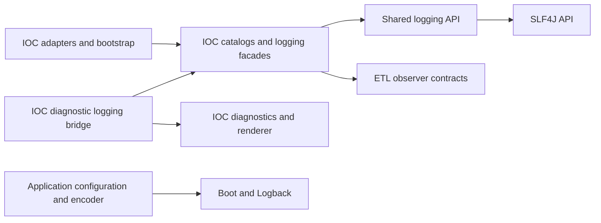

> Русский перевод исторической записи. Решение, статус и даты сохранены. [Английский оригинал](../0045-reusable-slf4j-logging-contract.md).

# ADR 0045: Выделение типизированного SLF4J logging и scalar ECS profile

## Статус

Принято, 2026-10-20. Владелец зафиксировал контракт до реализации и разрешил
L3-3 integration review и принятие ADR. Библиотека и IOC migration реализованы;
publication-tool admission и cold repository consumption остаются отдельным
gate L3-4. Принятие не разрешает публикацию и не утверждает, что библиотеку
уже потребляет второй production service.

Это уточняет code ownership [ADR 0018](../0018-typed-ecs-structured-logging.md)
и его [вложенного представления Boot 4](../0019-spring-boot-4-nested-ecs.md).
Их политики IOC logging/disclosure и runtime backend остаются локальными.
Выбранные producer wire corrections ниже заменяют только прежнее использование
`event.type` и затронутые informational outcomes. Публикация компонента
продолжается по [ADR 0028](../0028-pilot-library-publication.md) и
[ADR 0029](../0029-release-branch-library-publication.md).

## Контекст

В IOC есть typed operational records, восстанавливающие MDC scopes и явная
подготовка URL. Будущим сервисам нужны эти механизмы и согласованное значение
стандартных полей при собственном владении catalogs, actions, observers и
disclosure policy. Публикация старого observability module экспортировала бы
IOC vocabulary и ETL dependencies. Одни общие raw key/value helpers оставили бы
неразрешёнными standard semantics и backend collisions.

Квалификация также обнаружила два дефекта сервиса: внутренние event names и
no-op dispositions занимали ECS `event.type`, поддерживаемая форма которого —
array; явный error type вместе с Throwable мог приводить к отбрасыванию record
в Boot. Библиотека не может валидировать полную service schema или обещать,
что принятие appender означает запись байтов. Error ownership и backend tests —
часть контракта потребляющего приложения.

Ограничения: Java 21, inward dependencies, product/library lockstep versions,
один выбранный provider на приложение и ограниченное ownership каждого builder
и scope. Общему JAR не нужны logging provider, Boot starter, event bus,
автоматическое распространение, global registry или универсальная ECS model.

## Решение

### Артефакт, API и владение

Использовать `io.github.xorex-lc:ioc-platform-logging-slf4j` в
`platform/platform-logging-slf4j`, ровно с восемью публичными типами:

| Пакет | Публичные типы |
|---|---|
| `com.iocextractor.platform.logging` | `LogFieldSpec`, `LogValueType`, `LogEvent`, `LogEvents`, `MdcScope` |
| `.ecs` | `EcsFields`, `EventOutcome` |
| `.redaction` | `LogRedaction` |

Единственная обязательная main dependency — `org.slf4j:slf4j-api`; не включать
её через shading и не публиковать provider транзитивно. Spring, Logback,
encoders, IOC catalogs, diagnostics, ETL и application types остаются вне модуля.
Domain и application code продолжают использовать observer/diagnostic ports
вместо новой logging dependency. Architecture tests обеспечивают обе границы.

Misyurkeev Denis (`xORex-LC`), maintainer публикаций проекта, владеет API и
релизами. Сохранить `${revision}` в lockstep с продуктом. В течение 0.x
несовместимые public signature или documented behavior требуют minor version
и migration notes; patches сохраняют контракт. Перенос package после publication —
breaking change. Публикация компонента с dependency должна сохранить
zero-dependency publication guards прежних библиотек.

### Поля и отправка

Сервисы объявляют immutable `LogFieldSpec` в собственных catalogs. Keys —
чувствительные к регистру dotted paths без trimming или case conversion.
Каждый segment начинается с ASCII letter или underscore, далее допускает
letters, digits, underscores или hyphens. Descriptor проверяет grammar,
а не schema ownership.

В пределах одного event поле идентифицируется wire key. Эквивалентные
descriptors заменяют его value; конфликтующий declared type вызывает ошибку
даже после null omission. Отклонённые вызовы оставляют прежние declaration/value.
Null опускает local value; ambient MDC он не скрывает. Global field registry нет.

STRING принимает CharSequence, Enum, Path и UUID в текстовом представлении;
LONG принимает Byte, Short, Integer и Long; BOOLEAN — Boolean. Остальные
представления отклоняются с value-free errors. Generic fields проверяют scalar
representation, а не ECS meaning. Валидация выполняется до фильтрации
отключённого уровня. Сохраняется явная strict-error policy; сдерживание ошибок
разработчика в logging остаётся отдельной работой OBS-6.

Factories сохраняют выбранные caller logger и level. Event-local fields
скрывают точно совпадающие MDC keys на одну отправку и затем восстанавливают
их. Это не разрешает конфликты parent/child paths. Builders принадлежат одному
потоку; два вызова `log()` дают две attempts. Provider failures распространяются.
Durability, retry, exactly-once delivery или успешное encoding не обещаются.

### MDC и явное раскрытие данных

Scopes запоминают первое прежнее value каждого затронутого key и восстанавливают
в обратном порядке. Открывать, заполнять и закрывать на одном потоке; nested
scopes закрываются в LIFO. Незатронутые keys не меняются. Запись требует STRING
fields; `hide` временно убирает ambient string любого field. Успешный close
идемпотентен, последующие записи отклоняются. Workers восстанавливают correlation
из явных command metadata; task IDs не являются distributed tracing IDs.

Захватывать scope до заполнения. IOC callback convenience закрывает частичную
инициализацию и сохраняет исходную ошибку; отличная cleanup failure добавляется
как suppressed, тот же exception object не подавляет сам себя. Scope не обещает
восстановления при отказе самого MDC provider.

`fullMask()` не принимает value и возвращает `[redacted]` без prefix, suffix,
length или fingerprint. Caller выбирает нуждающиеся в этом STRING fields.
Метод не меняет messages, causes или копии в других fields и не имеет severity
bypass. Numeric/boolean secrets нужно опускать или логировать отдельным STRING
representation.

`urlComponents` сохраняет квалифицированное lexical behavior: user-info
распознаётся после `://` до последнего `@` перед `/`, `?` или `#`; содержимое
после первого `?` заменяется до следующего `#` или конца. Замена — `<redacted>`.
Paths/fragments и scheme-less user-info могут оставаться видимыми; question
mark во fragment всё равно обрабатывается. Null возвращает null. Это не URI
parsing и не общий secret scrubber. IOC diagnostic fingerprints и severity
disclosure остаются отдельной local policy.

### Подмножество ECS и владение backend

Разделять пять scalar descriptors: STRING `event.action`, `event.outcome`,
`error.type`, `file.path` и LONG `event.duration`. Helpers требуют непустой
service action, success/failure/unknown outcome и неотрицательные nanoseconds.
Опускать неприменимый outcome или неизмеренную duration. Producer владеет
разрешением полного path/его disclosure и безопасным измерением duration.
Generic `.field(...)` может обойти helper semantics. ECS type/category arrays
остаются вне v1.

Приложения владеют timestamp, message, `log.*`, `process.*`, `service.*`, `ecs.*`,
настроенными metadata и `event.dataset`. Service catalogs и разрешённый MDC
должны избегать reserved paths и scalar/object prefix conflicts. При Throwable
encoder владеет всеми `error.*`; без Throwable producer может выдавать type-only
`error.type`. Raw SLF4J и third-party MDC могут обходить эти соглашения.

Сохранить Boot/Logback в bootstrap потребляющего приложения.
[Квалифицированный application recipe](../../guides/logging-library-boot.md)
объединяет synchronous FileAppender с dataset enrichment изменяемого
LoggingEvent, восстанавливая исходный key/value list даже после formatter
failure. Пример отклоняет dataset overrides и immutable snapshots. IOC daemon
сохраняет собственные synchronous RollingFileAppender и encoder. Ни один
recipe не квалифицирует LoggingEventVO, произвольные async transports или
другой provider; generic library async snapshot tests — отдельная граница.
Static Boot JSON dataset additions не являются проверенной заменой рядом
с dynamic `event.*`. Рассматривать отдельный backend artifact только при
потребности второго реального сервиса.

### Интеграция IOC и wire migration

`platform-observability` сохраняет IOC fields/actions, делегирующие facades
и ETL observer. Его fields связаны с общими descriptors, включая все пять
standard constants. У event emission, scalar normalization, MDC и lexical URL
handling одна реализация в библиотеке. Diagnostic logging bridge продолжает
работать через local catalogs и rendering; конкурирующий sink API не вводится.

Имена control events переходят из `event.type` в `ioc.event.type`. Завершённые
legacy import replays и current-schema no-ops используют
`ioc.operation.disposition=skipped` и опускают как `event.type`, так и прежний
`event.outcome=unknown`. Actions, levels и прочие metadata не меняются.
Dual write нет. Watch-service failure logging сохраняет Throwable и удаляет
явный error type; type-only producers остаются поддерживаемыми. Эти миграции
запросов документируются в capability guide и release notes и проверяются
по настоящим JSON-байтам.

## Альтернативы и последствия

| Альтернатива | Решение |
|---|---|
| Публиковать observability без изменений | Отклонить: экспортирует IOC vocabulary и ETL coupling |
| Только raw SLF4J или generic helpers | Отклонить: нет restoring scopes, representation checks и общих значений полей |
| Полная ECS model и несколько profile/backend artifacts сейчас | Отложить: arrays и широкие schemas не имеют доказанного потребителя; лишние artifacts увеличивают compatibility obligations |
| Boot/Logback как обязательные library dependencies | Отклонить: навязывает generic consumers один framework/provider |
| Автоматическая очистка данных или автоматическое сдерживание всех logging errors | Отложить: меняет согласованную strict-error/disclosure boundary и добавляет policy без поддерживаемого контракта |
| Автоматическое распространение executor | Отклонить для этого API: сервисы уже владеют явным восстановлением correlation |

Новые service fields не требуют изменений shared catalog. Цена — явный service
schema review, выбор provider и backend qualification. Builders и scopes
выделяют per-event/per-scope state; количество fields библиотекой не ограничено,
throughput target не подразумевается. Общих worker, queue или lifecycle service
нет. Приложения владеют filtering, log rotation, retention и resource budgets.

## Квалификация и ограничения

Public API tests, provider-failure tests, async field/MDC snapshots и исполненные
plain Java examples находятся в библиотеке. IOC catalog binding, callback
ownership, ETL correlation, diagnostic rendering и migration regressions
остаются локальными. `LoggingBootRecipeIT` компилирует настоящий guide code
и запускает его YAML/XML через Boot в отдельной JVM без IOC classes;
strict JSON parsing и encoder statuses покрывают supported output и известные
invalid-input boundaries.

Javadoc doclint, module/source/Javadoc packaging, dependency closure и полные
verify/PMD gates квалифицируют checkout. Они не квалифицируют cold target-repository
resolution, live Elasticsearch mappings, collector ingestion, production load,
произвольные provider versions или второй реальный сервис. Для этих утверждений
нужны отдельные evidence. Sources/Javadoc, разрешённый independent POM и
protected immutable publication остаются обязательствами L3-4.

Ссылки: [руководство библиотеки](../../guides/logging-library.md),
[observability capability](../../dev/observability.md),
[политика тестирования](../../TESTING.md) и
[владение build quality](../../dev/build-quality.md).
