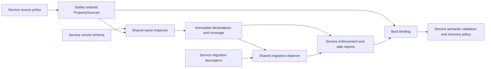

> Русский перевод исторической записи. Решение, статус и даты сохранены. [Английский оригинал](../0046-reusable-spring-boot-configuration-inspection.md).

# ADR 0046: Выделение инспекции объявлений конфигурации Spring Boot

## Статус

Принято, 2026-10-22. Владелец разрешил выделение, наблюдение миграций,
квалификацию ограниченного контекста и это review документации. Общий модуль
и IOC integration реализованы. Подготовка standalone POM, dependency mediation,
cold repository consumption и publication остаются отдельным gate. Принятие
не устанавливает потребление вторым развёрнутым сервисом.

Это уточняет владение строгой configuration boundary из
[ADR 0016](../0016-config-preflight-strict-binding.md). Допустимые написания,
validation, failure codes и migration policy IOC остаются собственностью
сервиса, включая compatibility alias из
[ADR 0027](../0027-rollback-safe-configuration-evolution.md). Публикация следует
[ADR 0028](../0028-pilot-library-publication.md) и
[ADR 0029](../0029-release-branch-library-publication.md).

## Контекст

IOC уже проверяет объявленные property names до binding и сообщает о внешних
объявлениях без печати values. Будущим сервисам нужны эти механизмы для
собственных record schemas. Экспорт IOC bootstrap также экспортировал бы его
model, CONFIG codes, validators, command lifecycle и process-wide console handling.

Одни names не могут установить корректность values или provenance связанного
объекта. Boot может заменить весь list из одного более приоритетного source,
пока объявления обоих sources остаются видимыми. Opaque sources и
неподдерживаемые schema shapes также мешают полной name check. Общий API
должен сообщать об этих ограничениях, а не объявлять каждое unmatched
объявление ошибкой оператора.

Малый bean context и закрытый набор configuration inputs — отдельные решения.
IOC проверяет effective deployment configuration, включая Boot imports и
profiles. Другой сервис может проверять один самодостаточный файл. Библиотека
должна поддерживать оба варианта, не выбирая source policy или failure scope.

## Решение

### Артефакт и граница зависимостей

Использовать `io.github.xorex-lc:ioc-config-spring-boot` в
`adapters/adapter-config-spring-boot`, требуя Java 21. Пакет —
`com.iocextractor.config.boot`; это остаётся Spring integration adapter,
явно потребляемый bootstrap. Domain, processing, application и framework-free
platform contracts от него не зависят.

Публичная поверхность имеет шесть top-level types: `PropertySchema`,
`PropertyInspector`, `PropertyInspection`, `PropertyMigration`,
`MigrationInspector` и `MigrationInspection`. Result records/enums вложены;
helpers reflection, tokenization и matching остаются package-private.

Обязательные прямые main dependencies — `org.springframework.boot:spring-boot`
и `org.springframework:spring-core`, управляемые централизованно. Boot также
приносит Spring Context и его transitive dependencies; это библиотека с
зависимостями. Модуль не добавляет starter, обязательную SnakeYAML dependency,
IOC model, diagnostics contract, logging provider или automatic configuration.

Misyurkeev Denis (`xORex-LC`), publication maintainer, владеет API и релизами.
Сохранить `${revision}` в lockstep с продуктом. В течение 0.x несовместимые
public signatures или documented behavior требуют minor version и migration
notes; patches сохраняют контракт. Перенос package после publication —
breaking change.

### Факты об именах, покрытие и lifecycle

`PropertySchema` выбирает один canonical namespace segment и обычный record
root. `PropertyInspector.inspect` получает стабильные property sources в
порядке приоритета и делает один name-only traversal. Он возвращает immutable
declarations, candidate canonical paths, schema gaps и source coverage.
Property values не читаются; Environment, source object или Spring context
не удерживаются.

`KNOWN` идентифицирует один поддерживаемый path, `UNKNOWN` — отсутствие
поддерживаемого path без относящегося к нему unsupported subtree,
`AMBIGUOUS` сохраняет конкурирующие paths, `UNSUPPORTED` раскрывает предел
inspection. `complete()` описывает coverage, а не validity конфигурации:
unknown или ambiguous names могут присутствовать в complete inspection.
Incomplete inspection не доказывает отсутствие других проблем.

Квалифицированное подмножество включает обычные record fields с ASCII lower
camel case, nested records, indexed record/scalar lists, whole scalar lists
и плоские String/enum-keyed scalar maps с single-token keys. Поддерживаемые
relaxed field spellings и qualified environment conventions определены в
[справочнике модуля](../../../adapters/adapter-config-spring-boot/README.md).
Рекурсивные или неразрешённые types, JavaBeans, более широкая map grammar,
custom conversions и неподдерживаемые source conventions раскрывают gaps
покрытия. Boot владеет conversion, index continuity и aggregate binding.
Другая Boot baseline или schema shape требует compatibility qualification
до заявления поддержки.

Сохраняются source order и все declarations, включая shadowed и null-valued.
Safe source identities используют фиксированные categories и encounter
ordinals; произвольные labels опускаются. Composite children проверяются
отдельно; opaque sources раскрывают incomplete coverage, а присоединённый
Boot aggregate исключается во избежание повторных наблюдений. Enumeration
failures распространяются с исходной identity, не превращаясь в частично
успешный отчёт.

Caller сохраняет sources стабильными для inspection и последующего binding.
Библиотека не владеет context, streams, workers, retry или reload lifecycle.
Source enumeration — работа под управлением caller, без независимого timeout
или size budget. Names и dynamic map keys сами могут содержать sensitive text,
поэтому value-free result всё равно требует application rendering policy.

### Эволюция конфигурации

`MigrationInspector` сопоставляет явные deprecated/removed-name descriptors
с тем же immutable inspection. Он не возвращается к sources и не переписывает
values. Canonical templates используют `[]` для list indexes; indexed
replacement сохраняет конкретные indexes по порядку. Removed fields можно
описать без восстановления их в current schema. Исходный unknown-name result
сохраняется.

Catalog validation отклоняет неверные, equivalent/overlapping old paths и
точные migration chains. Observations различают resolved, ambiguous и
unsupported matches и сохраняют исходное coverage. Replacement text —
подсказка имени, а не гарантия conversion или bindability. Сервис владеет
выбором catalog, deprecation windows, severity, alias conversion и проверкой
конфликтов bound fields. Пустой snapshot не устанавливает namespace identity catalog.

### Загрузка источников и ограниченные контексты

IOC сохраняет `SpringApplication.run` с явными configuration/preflight beans,
без своего runtime composition root. Он загружает effective Boot defaults,
candidate, imports, profiles и обычные override channels. Imports — доверенные
deployment inputs; команда не предоставляет filesystem или network sandbox.
IOC владеет CLI root loading controls и отклоняет scalar/indexed
`spring.main.sources` до дополнительной загрузки beans. Он фиксирует eager
initialization, отсутствие keep-alive, shutdown hook и startup-info, затем
закрывает context. Временное process-wide подавление console остаётся
ограниченным командой.

Отдельный [closed-input recipe](../../guides/configuration-library-check.md) —
application code. Он загружает один явный YAML document плюс literal overrides,
убирает ambient environment/system sources, отклоняет imports, profiles,
чужие namespaces и placeholders и никогда не вызывает ConfigData. Он создаёт
явный `AnnotationConfigApplicationContext` в закрываемом scope до refresh
и возвращает immutable bound model после закрытия. Application самостоятельно
объявляет Spring Context, SnakeYAML и свой validator.

Сервисы выбирают source policy, допустимые beans, validators, safe failure
reports и то, останавливает ли ошибка один collector или весь процесс.
Framework logging — отдельная disclosure boundary. Ни один recipe не становится
generic embedded runner и не меняет public API inspector.

## Рассмотренные альтернативы

| Альтернатива | Причина отклонения |
|---|---|
| Публиковать IOC bootstrap или его check command | Экспортирует product models, failure policy и process-wide lifecycle choices |
| Обернуть Binder как универсальный strict validator | Name inspection не покрывает произвольные conversions и opaque sources; скрывает aggregate semantics Boot |
| Предоставить starter или общий context runner | Выбирает source loading, beans и recovery за сервисы до установления общего lifecycle |
| Вручную воспроизвести ConfigData для IOC | Добавляет parity work для profiles, imports и environment preparation без требуемого изменения поведения |
| Принудить каждую проверку принимать один файл | Ломает effective-deployment check IOC; closed inputs — явная consumer policy |
| Возвращать только unknown names | Теряет ambiguity, coverage и declaration context, нужные для честного enforcement |

## Последствия и квалификация

Сервисы разделяют один inspection/migration mechanism, сохраняя value semantics
и операционные решения локальными. IOC сохраняет более строгую spelling/environment
compatibility там, где generic support отличается. Новая поддерживаемая shape
требует observable-name tests и настоящих Binder tests с явными unsupported
cases, без молчаливого расширения контракта IOC.

Architecture tests обеспечивают dependency direction. Адаптер входит в обычные
Maven, coverage, SpotBugs, CPD и PMD scopes. Тесты посторонней schema покрывают
matching, immutable results, отсутствие value reads, migration hints и реальный
list binding. Отдельные JVM fixtures квалифицируют IOC source loading,
pre-bean rejection, cleanup и точный closed-input guide без IOC classes.

Эти deterministic checks не устанавливают parent-independent published POM,
cold repository resolution, другую framework version или второй deployed
service. Packaging admission должен проверить полный mediated dependency graph,
repository routing и регрессии прежних библиотек до protected publication.
[Руководство публикации](../../guides/library-publication.md#configuration-library-admission)
фиксирует этот gate отдельно от implementation acceptance.

Устойчивая механика реализации описана в
[configuration inspection](../../dev/configuration-inspection.md); шаги
интегратора — в [consumer guide](../../guides/configuration-library.md).
