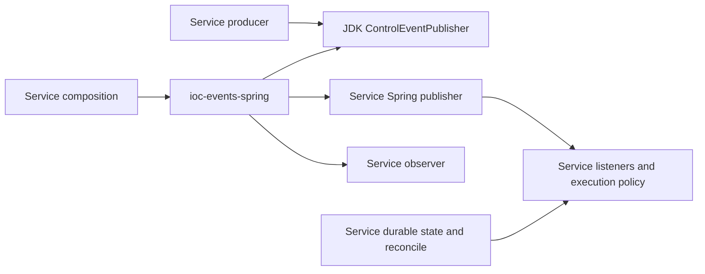

> Русский перевод исторической записи. Решение, статус и даты сохранены. [Английский оригинал](../0047-explicit-spring-control-event-adapter.md).

# ADR 0047: Разделение локальных event contracts и явной Spring-доставки

## Статус

Принято, 2026-10-24. Владелец разрешил E2 extraction и три известные
publisher corrections после review плана из двух единиц. Здесь фиксируются
module ownership и behavior; standalone POMs, published coordinates,
independent repository consumers и registry release остаются отдельными
admission steps. [ADR 0013](../0013-event-driven-coordination.md) не меняется:
events — hints; service-owned durable state и reconciliation остаются authority.

## Контекст

Будущим сервисам нужны те же local event metadata и producer containment
без наследования IOC payloads, catalogs, listeners или recovery. Упаковка
текущего bootstrap publisher протащила бы service composition в reusable
adapter; размещение его в contracts JAR навязало бы Spring plain Java consumers.

Прежняя реализация поглощала обёрнутый Spring Error аннотированного listener,
теряла primary publication evidence при отказе failure observer и позволяла
ошибке fallback logging выйти наружу или переклассифицировать успешную delivery.
До reuse эти failure boundaries должны стать явными.

## Решение

Сохранить семь существующих JDK-only types в `platform/platform-events`.
Выделить `SpringControlEventPublisher` в `adapters/adapter-events-spring`,
artifact `ioc-events-spring`, package `com.iocextractor.adapter.out.events.spring`.
Оба модуля сейчас используют reactor group `com.iocextractor`; publication
 group `io.github.xorex-lc` и parent-free consumer POMs квалифицируются на
следующем packaging stage. Versions остаются в product lockstep и нацелены на Java 21.

Адаптер требует event contracts, Spring Context и SLF4J API. Проверенная
baseline — Context 7.0.9 и SLF4J 2.0.18 под IOC build host Boot 4.0.8.
Boot не main dependency. Provider, starter или auto-configuration не включаются.
Более широкий диапазон Spring compatibility не выводится.

Конструктор получает Spring publisher и observer. Он не создаёт beans,
multicaster, error handler или executor и не владеет shutdown lifecycle.
Service composition и logging observers остаются в bootstrap. Handler
observation helpers остаются локальными; нового shared dispatch API нет.

Null event отклоняется до любого side effect. Обычные runtime publication
failures наблюдаются и сдерживаются. Прямой Error и Error, непосредственно
обёрнутый Spring в `UndeclaredThrowableException`, распространяются без
изменений. Не обходить произвольные cause chains и не разворачивать обычные
checked/runtime wrappers.

Отделить delivery от success observation. Runtime observer failures используют
best-effort WARN. При failed publication исходная failure — primary,
отличная observer failure добавляется suppressed, когда это поддерживается,
с защитой от self-suppression. Suppression-disabled exception сохраняет
primary evidence. Runtime failure этого последнего logger сдерживается
без рекурсивного report; Error всё равно распространяется.

Обычный возврат не доказывает all-handler или durable completion. Default
synchronous multicast может остановиться после частичной delivery. Сервисы
настраивают handler isolation средствами Spring и принимают recovery-решение
по собственному state. Адаптер не видит failures, уже обработанные service
error handler или возникающие после asynchronous submission. Retry, queue
или delivery ledger нет.

## Альтернативы и компромиссы

- Одни contracts не разделяли бы требуемое producer-containment behavior.
- Один Spring-dependent artifact усилил бы coupling для JDK-only consumers.
- Bridge в bootstrap пришлось бы дублировать в будущих сервисах.
- Общий multicaster или subscriber framework расширил бы API и изменил
  application-wide dispatch behavior; сохраняется явная service configuration.

Два модуля добавляют работу по publication и dependency closure. Перенос
bootstrap class меняет его import до public library admission. Малый adapter
не имеет per-call state, но concurrent callers по-прежнему требуют thread-safe
delegate и observer. Listener blocking, partial delivery и lost hints остаются
операционными издержками, покрываемыми service recovery. Fallback logging
не гарантирует evidence при backend failure и может раскрывать exception text;
сервисы владеют disclosure.

## Проверка

Stub tests покрывают identity исходного exception, suppression/self-suppression,
suppression-disabled exceptions, Error propagation и throwing fallback logger.
Failsafe integration tests используют настоящие упорядоченные `@EventListener`
methods и реальный Spring context для квалификации partial delivery, wrapped
Error и service-owned multicaster/error-handler/executor configuration.
ArchUnit ограничивает dependencies модулем, JDK, event contracts, Spring Context
и SLF4J. Все build и coverage manifests включают новый production module
без снижения floors.

[Руководство](../../guides/events-library.md) даёт явное создание.
Independent artifact consumption остаётся последующим evidence, а не вторым
развёрнутым сервисом или утверждением о релизе.
