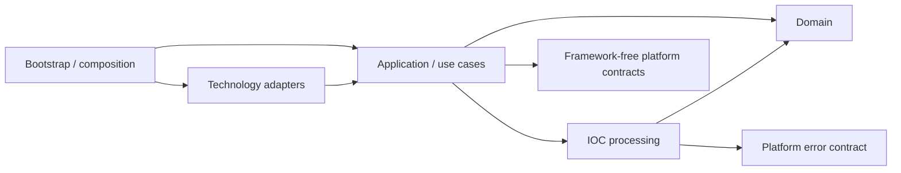

# Architecture

[Русская версия](ru/ARCHITECTURE.md)

IOC Extractor is a modular Java ETL application using Clean Hexagonal
(ports and adapters) and Onion architecture. It turns documents and managed CSV
deliveries into canonical IOC data, mutable CSV projections and immutable export
slices. It runs as a synchronous oneshot CLI or a daemon with durable intake,
recovery and remote synchronization.

## Dependency direction and responsibility



Arrows show dependency direction, not execution order or every Maven edge.
The [module map](MODULARIZATION.md) and POMs define the concrete graph;
[BOUNDARIES.md](BOUNDARIES.md) maps its executable checks.

| Responsibility | Owner |
|---|---|
| IOC values, refang/extraction protocols, attribution, features and classification contracts | Framework-free domain |
| Reusable IOC representations, classification composition and declarative field mapping | Framework-free `ioc-processing` |
| Stage order, policy checkpoints, use cases, identity/ordering and recovery contracts | Application |
| Parsing, regex engines, PSL, CSV, SQLite, SMB, CLI and local Camel execution | Their technology adapters |
| Configuration binding/preflight, dependency injection, schedulers, startup and health | Bootstrap |
| Generic diagnostics, keyed execution and local event contracts | Their framework-free reusable libraries |
| Typed logging, configuration inspection and Spring event publication | Dedicated libraries with explicit SLF4J/Spring dependency boundaries |

IOC diagnostic codes, event payloads, logging catalogs and persistence policies
remain service-owned. Shared libraries do not own business commits or recovery.
The [library catalog](guides/libraries/README.md) describes their public contracts.

## Runtime and data ownership

| State or output | Authority and lifetime |
|---|---|
| Dataframe SQLite DB | Canonical rows, lifecycle/history, observation ordering, identity, export slots and canonical commit receipts |
| Service SQLite DB | Durable coordination for ingestion runs, import deliveries, export formation and remote fetch/publish |
| Private document/import workspaces | Owned source pins, preparation/staging and repeatable rows; disposable scratch is distinct from sealed recovery pins |
| Mutable `*_generated.csv` | Regenerable projections of canonical state |
| Immutable profile slices | Consistent export snapshots with manifest/hash evidence and completion marker; remote delivery has its own ledger |

The two databases have separate local transactions. Receipts and coordination
state bridge their failure windows; they do not create one distributed transaction.
The default storage paths and selectors belong to
[application.yml](../bootstrap/ioc-app/src/main/resources/application.yml).
Supported file-ledger/journal alternatives remain part of
[ingestion](dev/ingestion.md), not another canonical data store.

### Document processing

```text
owned source -> read -> refang -> extract -> attribute
  -> required named processing plan -> observation selection
  -> sealed artifact rows -> failure-policy checkpoint
  -> canonical commit per artifact -> mutable projection
```

Application fixes the stage order. Configuration chooses registered rules,
representations, selection and mapping. Camel executes bounded local processing
plans behind an application port; it does not own identity, transactions or retries.
Attribution takes the source label from the nearest preceding configured section
marker.

Preparation owns a private workspace. Decoded/refanged text and extraction scratch
can use disk-backed storage; pure row mapping remains side-effect-free. Sealing
provides repeatable, closeable row cursors. A policy checkpoint precedes canonical
writes and ID reservation, even when diagnostic details have been bounded.
Private preparation I/O is distinct from committing business state.

An ordinary extraction commits one artifact at a time. A later artifact or
projection failure cannot roll back an earlier canonical commit. Run/receipt and
projection evidence drive recovery forward.
[IocExtractionService](../core/ioc-application/src/main/java/com/iocextractor/application/service/IocExtractionService.java)
owns the pipeline boundary; [processing](dev/processing.md) and
[storage](dev/storage.md) describe its mechanisms.

Oneshot performs the work synchronously and accumulates canonical data across runs.
Daemon intake performs short detection/admission and ownership work, prepares
documents through bounded workers, and promotes the oldest unresolved document.
Durable admission order and source-key exclusion preserve precedence independently
of preparation completion order. Full polling is the production correctness path;
filesystem notifications are optional latency hints.

### Managed dataframe import

A dedicated local/SMB source claims one delivery occurrence, pins an immutable
snapshot, recognizes exactly one versioned contract and seals staging.
`as-is` applies declared source values and transforms; `processed` uses an explicit
named route and ordinary IOC preparation.

Accepted branches and the import commit receipt enter one cross-artifact dataframe
transaction. The service delivery ledger then finalizes projection, reports and
source disposition. Receipt-based replay handles a crash after canonical commit.
Only active rows match; missing input rows do not delete or renew canonical rows.
See [managed import](dev/dataframe-import.md) and
[ADR 0024](ADR/0024-managed-dataframe-import.md).

### Identity and lifecycle

Keep these identities distinct:

- A canonical row ID and lifecycle ID are internal and non-reusable.
- A delivery/observation occurrence and its durable ordering are distinct from
  content identity; equal bytes can be a new delivery.
- With lifecycle active, immutable export IDs for slotted artifacts are stable,
  sparse, reusable slots in a `(profile, artifact)` namespace. Mutable projection
  IDs retain canonical identity; survivors are not compacted during export.

Fixed validity belongs to one canonical lifecycle. Accepted confirmation before
its deadline renews it; after expiry, a new observation creates a new lifecycle.
Active reads use `valid_until > asOf`, so equality is expired. Expiry/history
reconciliation and mutable projection work have durable backstops. Expiry alone
does not trigger an immutable slice.

Public time columns are mapping/import fields, not lifecycle authority.
Activation and coordinated rollback have explicit contracts in
[canonical lifecycle](dev/canonical-record-lifecycle.md) and its
[operator guide](guides/canonical-record-lifecycle.md).

<a id="классификация-сетевых-масок"></a>
<a id="артефакты-и-заполнение"></a>

### Classification and artifact mapping

Domain exposes classification contracts; PSL distinguishes registrable domains
from subdomains. RE2/J is the default pattern engine, with a supported JDK fallback;
configured patterns stay compatible with both. Input adapter contract tests cover
HTML, PDF, DOCX and XLSX. Other Tika formats are best-effort; parser coverage does
not itself prove the same resource behavior for every format.

The shipped mask rules use first-match priority, evaluated in this order:

| Variant | Condition | `url_match` | `host_match` |
|---|---|---|---|
| 4 | Query present | `u:hAS,pEX` | `NULL` |
| 3 | Path or port present | `u:hEX,dEX` | `NULL` |
| 2 | Exact subdomain | `u:hEX` | `h:dEX` |
| 1 | Base host/IP (default) | `u:hAS` | `h:dAS` |

`NULL` denotes an absent code. The configured rules own these values and priority;
the evaluator does not hard-code the four cases.

Providers, transforms, predicates and artifact identity/mutation policies determine
the configured output. The shipped artifacts are `masks`, `ip_list`,
`address_blacklist`, `hashes` and `ioc_aggregate`. They have independent schemas
and identity rules. `masks`, `ip_list` and `hashes` carry IDs;
`address_blacklist` and `ioc_aggregate` do not.
Within-run observation selection is distinct from canonical identity matching
across runs. Accepted field updates and lifecycle renewal follow artifact policy.
Aggregate names can update under durable observation order; the aggregate is not
reconstructed by joining the other output tables.

Rule syntax, column mapping, charsets and CSV layout are documented in
[processing](dev/processing.md), [CSV format](dev/csv-output-format.md) and the
[configuration reference](guides/configuration.md). Avoid treating one artifact's
normalization or ID scheme as a global IOC rule.

### Immutable export and remote delivery

Export reads canonical state through a consistent multi-artifact snapshot, rather
than copying mutable CSV files. One profile's data files, manifest and
`_SUCCESS` marker become visible together through an atomic directory move.
Manifest digests identify the exact files.

Formation and recovery serialize per profile through operation leases and the
service ledger. Different profiles may run concurrently within bounded worker
and reader budgets. Accepted inserts or public-field updates advance covered
revisions; a newer revision can require a new slice even when its bytes match
an older slice.
Recovery of staged/available work follows retained ledger/filesystem evidence.
See [export](dev/artifact-export.md) and
[ADR 0037](ADR/0037-profile-scoped-export-execution.md).

Remote fetch and publish serialize by endpoint through keyed execution.
Publish discovers completed immutable slices and records durable delivery work;
retention pins slices still needed for delivery. Events, SMB `CHANGE_NOTIFY`
and scheduler nudges accelerate detection. Ledgers, complete listing and periodic
reconciliation remain correctness authorities.
[sync](dev/sync.md) and [event coordination](dev/event-coordination.md) own the
detailed protocols.

## Spring composition and startup

Only `bootstrap/ioc-app` produces the runnable Boot application.
[IocExtractorApplication](../bootstrap/ioc-app/src/main/java/com/iocextractor/IocExtractorApplication.java)
handles lightweight CLI/config-check paths before the appropriate Spring context.
`AppConfig`, `SyncConfig`, `EventCoordinationConfig` and configuration preflight
compose the service; framework-free use cases are constructor-injected objects.

Typed configuration and strict name/semantic checks reject unsupported effective
settings. Configuration inspection supplies facts; IOC owns validation, diagnostics
and the startup decision. In daemon mode, a shared recovery-before-intake barrier
restores durable work and prepares lifecycle/import admission before enabling
pollers and document dispatch. Export has its own formation recovery.
[Configuration](dev/configuration.md) and [ingestion](dev/ingestion.md) explain
the startup boundaries.

The daemon exposes loopback Actuator health/info by default. Health reports intake,
storage and delivery state; diagnostics and typed ECS logs explain failures.
Observability does not replace receipts or ledger transitions.
See [observability](dev/observability.md) and [TESTING.md](TESTING.md).

## Constraints and trade-offs

The supported daemon deployment is single-daemon; process-local guards are not
a distributed lease/fencing protocol. SQLite permits one writer per database.
Fair admission cannot preempt a running transaction, and long snapshots can delay
WAL reclamation. Workspace limits and bounded queues reduce retained work but do
not establish a whole-service heap/RSS or latency guarantee.

Native SQLite is the supported canonical backend
([ADR 0042](ADR/0042-native-sqlite-production-storage.md)). Capacity evidence and
remaining resource limits belong to [native capacity](dev/native-capacity.md);
operator sizing belongs to [bulk sizing](guides/bulk-resource-sizing.md).
Parser-level hostile-input budgets and SMB server-family qualification retain
their explicit support limits.

Untrusted document/CSV input, credentials, transport encryption and protected
release inputs cross separate trust boundaries. [SECURITY-ENGINEERING.md](SECURITY-ENGINEERING.md)
and [THREAT-MODEL.md](THREAT-MODEL.md) own the controls and residual risks;
[KNOWN-ISSUES.md](KNOWN-ISSUES.md) records unresolved obligations.

Update this map when runtime ownership, transaction scope, dependency direction
or a supported execution path changes. API/type inventories belong in module
references and Javadoc; historical rationale belongs in append-only ADRs.
