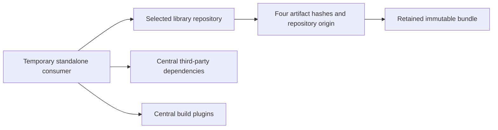

# Publishing reusable platform libraries

The reviewed components use Java 21 and have exact dependency contracts:

| Component selector | Artifact (`io.github.xorex-lc`) | Module | Required main dependencies |
|---|---|---|---|
| `concurrency` (default) | `ioc-platform-concurrency` | `platform/platform-concurrency` | None |
| `diagnostics` | `ioc-platform-diagnostics-api` | `platform/platform-diagnostics-api` | None |
| `logging` | `ioc-platform-logging-slf4j` | `platform/platform-logging-slf4j` | `org.slf4j:slf4j-api:2.0.18`, compile JAR |

Maven Central is primary; GitHub Packages receives the identical release bytes.
The concurrency pilot established the publication model in
[ADR 0028](../ADR/0028-pilot-library-publication.md) and the release-branch policy
in [ADR 0029](../ADR/0029-release-branch-library-publication.md). See the
[concurrency reference](../../platform/platform-concurrency/README.md) and
[diagnostics reference](../../platform/platform-diagnostics-api/README.md).
The diagnostics boundary is accepted in
[ADR 0044](../ADR/0044-reusable-diagnostics-contract.md); the logging boundary in
[ADR 0045](../ADR/0045-reusable-slf4j-logging-contract.md) admits the required
SLF4J dependency while keeping providers and Boot outside the reusable JAR.
Release evidence owns each component's repository qualification. Adding a
component does not authorize publishing it or republishing an existing version.
New dependencies or versions require explicit contract review, not a broader
allowlist. The older zero-dependency contracts remain enforced.
No version is claimed published until the repository checks below pass.

Logging `0.3.0-rc.1` passed protected publication and separate Central/GitHub
Packages cold plain Java and Boot consumers in
[run 39455105300](https://github.com/xORex-LC/ioc-extractor/actions/runs/39455105300).
Its [consumer guide](logging-library.md) supplies the released dependency;
the [module reference](../../platform/platform-logging-slf4j/README.md) describes
the qualified API/backend boundary. This does not qualify a later version.

## Configuration library admission

`io.github.xorex-lc:ioc-config-spring-boot` is implemented in the reactor and its
ownership is accepted in
[ADR 0046](../ADR/0046-reusable-spring-boot-configuration-inspection.md).
It is not yet an admitted component selector or a published artifact. The
[consumer guide](configuration-library.md) and executable
[restricted-context recipe](configuration-library-check.md) qualify application
integration separately from repository resolution.

Before adding this component to the publication commands or protected workflow:

1. Review a parent-independent, resolved POM with exactly the required direct
   compile JAR dependencies, `spring-boot` and `spring-core`, at the selected
   versions. Preserve central version management in the reactor. Reject leaked
   IOC dependencies, private parents, BOM imports, starters and executable Boot
   packaging; retain exact main/sources/Javadoc/POM identity checks.
2. Qualify the complete transitive graph and application mediation. The current
   reactor resolves Boot 4.0.8 and Spring 7.0.9, including Spring Context,
   AOP/Beans/Expression, Micrometer, Commons Logging and JSpecify. The two direct
   dependencies do not imply a two-JAR runtime. Exercise a standalone application
   with its own version management and fail incompatible mediation explicitly.
3. Separate selected-library resolution from public third-party/plugin resolution
   in empty-cache consumers. Own artifacts must resolve only from the selected
   repository; approved public repositories may supply Spring and other external
   dependencies. Qualify routing on the Maven wrapper's actual Resolver, including
   missing-own-artifact negatives and successful third-party resolution. Repository
   order alone does not prove isolation; include transitive own-artifact negatives
   if that dependency family is later admitted.
4. Run the actual inspection/migration and closed-input guide behavior from the
   packaged dependency outside the checkout, without reactor class directories.
   Retain manifests, origin checks and negative-case evidence. Re-run the older
   components' publication contracts and the concurrency bundle/consumer regression
   without weakening their exact dependency contracts.
5. Integrate reviewed changes into the release branch before the separately
   authorized protected validation/publication sequence. Preserve existing
   component versions, signed bundles and tags.

Current reactor tests and analyzer/coverage gates establish local integration.
They do not establish the POM, mediation or repository guarantees above. No
configuration publication command is available at this checkpoint.

## Local packaging qualification

Use a complete JDK 21 (including `javadoc`), Python 3, GnuPG 2, the Maven wrapper and
network access for build tools and the empty-cache consumer:

```sh
make library-publication-test
make library-bundle
make library-consumer

make library-bundle LIBRARY_COMPONENT=diagnostics LIBRARY_BUNDLE=.dev/diagnostics-bundle
make library-consumer LIBRARY_COMPONENT=diagnostics LIBRARY_BUNDLE=.dev/diagnostics-bundle

make library-bundle LIBRARY_COMPONENT=logging LIBRARY_BUNDLE=.dev/logging-bundle
make library-consumer LIBRARY_COMPONENT=logging LIBRARY_BUNDLE=.dev/logging-bundle
```

`LIBRARY_VERSION` defaults to `0.3.0-SNAPSHOT`; `LIBRARY_BUNDLE` defaults to
`.dev/library-bundle`. The output must not already exist. Choose another output
path for a new build. This creates the main JAR, sources, Javadoc and a flattened
POM without the private reactor parent. The consumer copies its project outside
the checkout, uses an empty Maven cache, and compares all four resolved artifacts
to the bundle manifest. The default concurrency fixture checks FIFO, queue
rejection, independent keys, shutdown and synchronous nested execution/failure
propagation. The diagnostics fixture runs the three
[guide examples](diagnostics-library.md) with its own codes: results and policy
decisions, bounded stage/run counts and delivery failure callbacks. Both consumer
POMs stand alone, with no IOC parent or reactor class directories.

Logging runs two standalone consumers, each with its own empty cache. The plain
SLF4J consumer executes the three actual guide classes. Its provider and
sources/Javadoc dependencies exclude SLF4J API so only the library's main POM
can supply it. Two further offline checks use that warmed cache: excluding API
must fail compilation, and selecting an unavailable API version must fail
dependency resolution. An unrelated failure is not a passing negative check.
The Boot consumer compiles the actual [recipe](logging-library-boot.md), loads
its YAML/XML and checks five JSON records plus encoder status. It selects its
own Boot/Logback dependencies; these are not dependencies of the library.

The fixture is a packaging/API consumer, not a feeds-collector implementation.
Its Maven plugins resolve from Central independently of the selected library
repository. These checks need network access and do not replace `make verify`
or `make pmd-analysis`. CI runs one unprivileged matrix job per component.
The selector is allowlisted; the CLI's `--component` defaults to `concurrency`
for compatibility. Pass `--component diagnostics` on every diagnostics operation,
including `check`, signing and recovery. Use `--component logging` for the new
component in the same way. A bundle from another component is
rejected before signing or repository access. The manifest retains the exact
artifact, version, source commit and file hashes; existing concurrency manifests
remain valid without rewriting them.

Packaging and every bundle read validate the resolved POM against the selected
component's dependency contract before signing or repository access. Logging
requires exactly the pinned required compile JAR; optional/provided/runtime/test
scope, classifiers, exclusions, unresolved properties, extra dependencies and
provider/IOC dependencies fail admission. Parent, dependency management, build,
profile and repository coupling are rejected for every component. The embedded
main-JAR POM must match the standalone POM at packaging time. No new manifest
field is required, preserving older signed-bundle identities.

For logging consumers, the selected repository supplies the library; a separate
`public-dependencies` repository supplies third-party artifacts from Central.
Plugin downloads also remain separate. Maven Resolver tracks artifact origin;
the wrapper's Maven 3.9.9 `_remote.repositories` markers must identify
`library-target` for every POM/main/sources/Javadoc download, and all hashes must
match the bundle. A Central fallback cannot qualify a GitHub download. Missing
or changed provenance format fails closed and requires a tooling review when
upgrading Maven. See [Resolver local repository ownership](https://maven.apache.org/resolver/local-repository.html).



Manifest, repository and artifact paths must be regular, with no symbolic links
in the repository directory chain or recovery files. A linked path could redirect signing
or recovery writes outside the retained bundle even when each artifact is a
regular file. These checks run before key import or repository access. Manifest
hashes and a recorded signer fingerprint do not authenticate arbitrary JSON:
recovery also relies on the original trusted Actions artifact and protected
review. Preserve that provenance with the bundle.

When outbound HTTPS requires a proxy, the consumer translates `https_proxy` or
`HTTPS_PROXY` into its temporary Maven settings. It still uses a fresh cache and
empty global settings; it imports no developer mirrors or repositories. Proxy
credentials, if present, remain in the temporary directory and are removed with
it. A network or plugin-download failure is not a passing consumer result.

## Account and workflow setup

The owner supplies the verified `io.github.xorex-lc` Central namespace and the
GitHub Environment **`LIBRARY PUBLISHING`**. Store these environment secrets:

- `MAVEN_CENTRAL_USERNAME`, `MAVEN_CENTRAL_PASSWORD`: Central user-token pair.
- `GPG_PRIVATE_KEY`, `GPG_PASSPHRASE`: armored signing key and passphrase.

The configured public fingerprint is
`F69BA7E0F7494982E6E1B483DF54073D8BBFA9F9`. Signing verifies the imported key
against it. The reported key expiration is `2027-03-06T12:39:38Z`; the Central
token expires on `2027-03-07`. Renew before those dates and review fingerprint
changes explicitly. Publish the public key to a supported keyserver and verify
that Central can retrieve it. Never put private keys or token values in Git,
workflow inputs, command-line properties or evidence attachments.

Before the first live run, configure `LIBRARY PUBLISHING` with required reviewer
`xORex-LC` and **Selected branches and tags** matching `release-*`. Keep
prevent-self-review disabled while there is only one maintainer; otherwise the
person starting the run cannot approve it. Revisit that setting when a second
trusted maintainer joins. Do not select **Protected branches only** while the
repository has no branch-protection rules: GitHub treats that state as allowing
all branches. Environment secrets remain unavailable until its review passes.

Use default-branch protection as the project governance permits. GitHub requires
the workflow file to exist on the default branch before it can be dispatched
manually. Select the matching `release-X.Y.Z` branch when running it; `main` and
development branches also fail workflow admission. Each new component still
needs its own protected run and repository qualification; the concurrency pilot's
success does not qualify diagnostics. GitHub
publishing uses the repository's `GITHUB_TOKEN` with `packages: write`; a separate
publishing PAT is unnecessary. Existing `SECURITY CHECKS` remains independent.

## First release

1. Merge the implementation into `release-X.Y.Z` and pass its normal CI gates.
   Keep the publication workflow discovery copy on `main` current so GitHub
   registers the manual workflow and its component choices; this does not move
   application code into `main`.
2. Create an annotated `<artifactId>-vX.Y.Z` or `<artifactId>-vX.Y.Z-rc.N`
   tag for the selected component on the reviewed release-branch commit, for
   example `ioc-platform-diagnostics-api-v0.3.0-rc.1`. Do not move an existing
   tag or reuse concurrency's published tag for another component. Library and
   product versions remain aligned even though their tags and release moments
   are separate.
3. Dispatch **Library publication**, select the corresponding
   `release-X.Y.Z` branch, choose `component`, enter its matching tag, and keep
   `operation=validate`. Leave recovery inputs empty. The job builds
   and verifies without publishing credentials, runs the independent consumer,
   signs once, and retains `signed-library` before contacting either repository.
4. Download and preserve `signed-library` and `central-deployment` artifacts.
   Record the source SHA, run ID, manifest hashes and Central deployment ID.
   `VALIDATED` means staged successfully; it does not mean publicly released.
5. Dispatch again against the same release branch with the same component and tag,
   `operation=publish`, the original `resume_run_id` and
   `central_deployment_id`. The workflow verifies recovery provenance and
   component/source/version identity, reuses the signed bundle, publishes Central,
   mirrors missing files to GitHub Packages, then resolves each repository
   separately using fresh consumer caches.
6. Retain both repository URLs, the successful consumer logs and artifact hashes
   in release evidence. Only these live downloads close publication qualification.

A direct `operation=publish` without recovery inputs is supported for an
explicitly approved new release; it performs the same build and retention steps
before publication. Default validation is preferable for the first release.

## Partial failure and recovery

Never repair an existing version with a new build or new signatures. Use the
original signed artifact and Central deployment ID. Artifacts expire after
90 days in Actions, so preserve them externally with the release evidence.
A normal rerun of the old job is not the recovery interface: dispatch a new run
with recovery inputs. A failed run is an acceptable artifact source if it is
from this workflow on the same release branch and has completed.

The first attempt executes publication tooling from the immutable component
tag. A recovery dispatch may need a transport fix discovered only by the live
registry. In that case, the privileged jobs execute the tooling frozen at the
selected release-branch SHA after the `LIBRARY PUBLISHING` approval, while the
downloaded signed bundle must still match the original tag commit, version and
manifest. Recovery never rebuilds, resigns or moves the component tag. Review
and pass normal branch CI for any such tooling fix before approving the run.

If Central accepted an upload but the response was lost, find the deployment in
Portal by the artifact/version/manifest-hash name before retrying. If validation
failed, inspect Portal diagnostics and retain the deployment. If bytes must
change, prepare a new version/tag rather than replacing a released version.
A partially visible Central release stops until propagation completes; matching
published bytes are skipped. GitHub upload compares existing files first and
only sends missing files; any mismatch stops the operation. GitHub artifact
downloads can redirect to external HTTPS blob storage; the client follows only
read redirects, strips authorization on an origin change and verifies the
downloaded bytes against the retained bundle manifest. Write redirects remain rejected.
A successful upload without both consumers is still incomplete qualification.
The first live run must establish registry behavior, signing acceptance and
package visibility.

## Consumption

After a version has passed publication qualification, add:

```xml
<dependency>
  <groupId>io.github.xorex-lc</groupId>
  <artifactId>ioc-platform-concurrency</artifactId>
  <version>0.3.0-rc.1</version>
</dependency>
```

The example uses the qualified concurrency pilot release. The
[diagnostics guide](diagnostics-library.md) supplies its released dependency.
Central needs no additional repository configuration. For GitHub Packages use
`https://maven.pkg.github.com/xorex-lc/ioc-extractor` and matching Maven server
credentials with package read access. Even public GitHub Maven packages require
authentication; use the Central coordinate for ordinary public consumption.

Authoritative service documentation: [Central Publisher API](https://central.sonatype.org/publish/publish-portal-api/)
and [GitHub Maven registry](https://docs.github.com/en/packages/working-with-a-github-packages-registry/working-with-the-apache-maven-registry).
