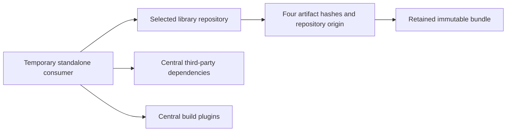

# Publishing reusable platform libraries

[Русская версия](ru/library-publication.md)

For choosing and using a library, start with the
[library catalog](libraries/README.md). For reuse, API changes and version
ownership, follow the [development guide](libraries/development.md) and
[release policy](../RELEASE-PROCESS.md#reusable-library-versions).

**Current publication implementation:** source versions and release admission
remain product/library lockstep. Independent library versions are accepted in
[ADR 0048](../ADR/0048-independent-library-versions-and-reuse.md), but their Maven
and CI activation is pending as TOOL-9. The commands below describe the existing
process. A global `-Drevision` or another `LIBRARY_VERSION` does not implement
per-library versions, and a component version must still match the admitted
product release branch. Component publication does not release the application.

## Choose the operation and evidence

| Stage | What it establishes | What remains |
|---|---|---|
| Local bundle and local consumer | Packaged API/POM/examples work from explicit bytes in an isolated project | No public repository qualification or release signing |
| Unprivileged workflow build | Tagged source passes full verify, packaged consumer and the separate PMD profile | Protected review, signing and repository operations |
| `operation=validate` | Protected signing and a USER_MANAGED upload validated by Central | Public publication and both destination consumers |
| `operation=publish` | Publishes/reuses the same bundle, mirrors missing GitHub files and runs both consumers | Reviewed evidence and component release record; service/deployment acceptance remains separate |

`validate` is a credentialed remote operation, not an offline dry run: it can
create a Central deployment. Use local commands for development feedback.
Local bundles may record dirty source/SNAPSHOT versions; release signing rejects
them. Use a new output directory for each candidate. Signatures, coordinates and
component tags of a published RC are as immutable as a final release.

For a new release, follow account setup → release identity → protected validation
→ preservation → publish/recovery → repository consumers. For an interrupted
release, start from its retained signed bundle and deployment ID, not a new build.
The historical notes below retain qualification limits for the admitted components.

Concurrency's immutable first-release
evidence is retained in its
[release record](../../.github/release-notes/ioc-platform-concurrency-0.3.0-rc.1.md).
Diagnostics has its own
[release record](../../.github/release-notes/ioc-platform-diagnostics-api-0.3.0-rc.1.md),
with the original tagged source, signed bundle and both repository consumers.
Configuration's [release record](../../.github/release-notes/ioc-config-spring-boot-0.3.0-rc.1.md)
separately retains the original Central CI failure and successful local recovery.
Logging's [release record](../../.github/release-notes/ioc-platform-logging-slf4j-0.3.0-rc.1.md)
retains its exact signed files and separate plain/Boot repository consumers. Events retain separate
[core](../../.github/release-notes/ioc-platform-events-0.3.0-rc.1.md) and
[adapter](../../.github/release-notes/ioc-events-spring-0.3.0-rc.1.md) records,
including the original qualified core handoff and immutable pair recovery.

The reviewed components use Java 21 and have exact dependency contracts:

| Component selector | Artifact (`io.github.xorex-lc`) | Module | Required main dependencies |
|---|---|---|---|
| `concurrency` (default) | `ioc-platform-concurrency` | `platform/platform-concurrency` | None |
| `diagnostics` | `ioc-platform-diagnostics-api` | `platform/platform-diagnostics-api` | None |
| `logging` | `ioc-platform-logging-slf4j` | `platform/platform-logging-slf4j` | `org.slf4j:slf4j-api:2.0.18`, compile JAR |
| `configuration` | `ioc-config-spring-boot` | `adapters/adapter-config-spring-boot` | `org.springframework.boot:spring-boot:4.0.8` and `org.springframework:spring-core:7.0.9`, compile JARs |
| `events` | `ioc-platform-events` | `platform/platform-events` | None |
| `events-spring` | `ioc-events-spring` | `adapters/adapter-events-spring` | Same-version `ioc-platform-events`, Spring Context 7.0.9 and SLF4J API 2.0.18, compile JARs |

Maven Central is primary; GitHub Packages receives the identical release bytes.
The concurrency pilot established the publication model in
[ADR 0028](../ADR/0028-pilot-library-publication.md) and the release-branch policy
in [ADR 0029](../ADR/0029-release-branch-library-publication.md). See the
[concurrency reference](../../platform/platform-concurrency/README.md) and
[diagnostics reference](../../platform/platform-diagnostics-api/README.md).
The diagnostics boundary is accepted in
[ADR 0044](../ADR/0044-reusable-diagnostics-contract.md); the logging boundary in
[ADR 0045](../ADR/0045-reusable-slf4j-logging-contract.md) admits the required
SLF4J dependency while keeping providers and Boot outside the reusable JAR.
Release evidence owns each component's repository qualification. Adding a
component does not authorize publishing it or republishing an existing version.
New dependencies or versions require explicit contract review, not a broader
allowlist. The older zero-dependency contracts remain enforced.
No version is claimed published until the repository checks below pass.

Logging `0.3.0-rc.1` passed protected publication and separate Central/GitHub
Packages cold plain Java and Boot consumers in
[run 39455105300](https://github.com/xORex-LC/ioc-extractor/actions/runs/39455105300).
Its [consumer guide](libraries/logging-slf4j.md) supplies the released dependency;
the [module reference](../../platform/platform-logging-slf4j/README.md) describes
the qualified API/backend boundary. This does not qualify a later version.

## Events packaging preparation

Two additional selectors prepare separate bundles and run isolated consumers:

| Selector | Coordinate in `io.github.xorex-lc` | Required compile JARs in its consumer POM |
|---|---|---|
| `events` | `ioc-platform-events` | None; JDK 21 only |
| `events-spring` | `ioc-events-spring` | `ioc-platform-events` at the bundle's exact version, Spring Context 7.0.9, SLF4J API 2.0.18 |

Both currently inherit the reactor's lockstep version and build settings during
development. Independent-version activation preserves their shared family version.
The flattened distribution POM resolves those settings and removes the parent,
test dependencies and build configuration. This uses the existing
[Flatten plugin behavior](https://www.mojohaus.org/flatten-maven-plugin/flatten-mojo.html).
The packaging checker requires exact dependency identities and required compile
scope; it rejects optional/provided APIs, ranges, unresolved properties, extra
dependencies, repositories, BOMs and private parents. Main JARs must contain the
same POM, MIT license and Java 21 classes from only their own public package.
Sources and strict Javadoc are checked for the real public types.

```sh
make library-bundle LIBRARY_COMPONENT=events LIBRARY_BUNDLE=.dev/events-bundle
make library-bundle LIBRARY_COMPONENT=events-spring LIBRARY_BUNDLE=.dev/events-spring-bundle
python3 tools/ci/library-publication.py check --component events --bundle .dev/events-bundle --version 0.3.0-SNAPSHOT
python3 tools/ci/library-publication.py check --component events-spring --bundle .dev/events-spring-bundle --version 0.3.0-SNAPSHOT
make library-consumer LIBRARY_COMPONENT=events LIBRARY_BUNDLE=.dev/events-bundle
make library-consumer LIBRARY_COMPONENT=events-spring LIBRARY_BUNDLE=.dev/events-spring-bundle LIBRARY_DEPENDENCY_BUNDLE=.dev/events-bundle
```

Each bundle has four primary files and its own identity/hashes. The Spring bundle
contains only the adapter; contracts are a normal dependency, never shaded or
silently copied into it. A release must publish and qualify the contracts
first in **each selected repository**, then release the adapter at the same
version. Their component tags use `ioc-platform-events-v<version>` and
`ioc-events-spring-v<version>`; existing component tags and bundles are unchanged.

The JDK fixture has no framework dependencies. The Spring fixture's **main**
adapter POM alone must supply core, Context and SLF4J; classifier dependencies
exclude these APIs. Both compile and run the exact Java guide blocks, including
an unrelated service event. The Spring checks exercise real synchronous ordered
listeners, partial delivery, direct/Spring-wrapped Error identity, publication
and observer failure boundaries, and service ownership of dispatch configuration.
All contexts close; its inline service executor creates no worker.

Every run starts outside the checkout with an empty cache and empty user/global
settings. Local consumption assembles a temporary selected repository from the
two explicitly supplied bundles, without changing either bundle or using
`mvn install`. `--dependency-bundle` is required for `events-spring` consumption
and must be the same-version `events` bundle. Other components reject that flag.
All four files of **each** own artifact must match their individual manifests and
record only `library-target` as origin. Remote consumers, when authorized later,
compare both bundles against the same selected endpoint before running Maven.

The tool reviews the whole graph: core has no third-party JARs; the adapter has
the same-version core and ten public JARs in the Context/SLF4J closure. Default
resolution and application-owned Boot 4.0.8 BOM mediation retain Context 7.0.9
and SLF4J 2.0.18; the BOM selects Commons Logging 1.3.6 and JSpecify 1.0.1 instead
of their plain 1.3.5/1.0.0 versions. The BOM adds no Boot runtime. The tool also
runs plain Java with the resolved classpath, excluding Maven's plugin classloader
and any checkout path. This qualifies these exact baselines, not arbitrary
dependency upgrades or a refreshed vulnerability scan.

Negative profiles independently exclude core, Context and SLF4J, then select
unavailable versions offline. Compilation/resolution must fail for the specific
missing API; an unrelated network/tool error is not a pass. An incompatible
Spring Core selection must fail the consumer's upper-bound rule. The library
does not install an application BOM or enforce dependency versions at runtime.

Cold routing probes first remove the selected component entirely, then leave the
adapter present while removing core. The populated alternate holds exact copies
of both bundles. Group filters must reject fallback in both probes; separate
unfiltered controls must resolve the same four/eight bytes with the expected
origins, including core from the alternate when only core is missing. This
prevents a warm cache or another repository from hiding an unpublished core.
Projects, repositories and caches are temporary and removed on exit. A failed
scenario fails the command, with no automatic retry.

Regular CI builds both artifacts once and runs both consumers without publication
credentials; the existing library gate requires this job and the four existing
components' consumer jobs. All six selectors are admitted to the protected
workflow. An empty fixture list or an unreviewed descriptor still fails admission.
Local results are not public-repository or deployed-service evidence.

### Events API and version ownership

The library maintains seven JDK public types and one explicit Spring publisher,
including their documented validation, observation, failure and concurrency
behavior. Services own event payloads, event type/version catalogs, timestamps,
IDs, listeners, safe exception text and durable recovery. The metadata's event
`eventVersion` describes a service-owned payload; it is unrelated to the Maven version.

The current POM/workflow implementation keeps product and library versions
lockstep, including release candidates. ADR 0048 accepts independent library
versions after TOOL-9; events retains a shared core/adapter family version.
The adapter requires the exact same core version. A change to public signatures,
validation or failure behavior needs contract review, regression/consumer checks
and release notes. An already released coordinate is immutable: a correction uses
a new version and new component tags. Follow the project's
[versioning policy](../RELEASE-PROCESS.md): compatible fixes use PATCH;
incompatible supported-contract changes during 0.x normally increment MINOR.
Release candidates keep their own immutable coordinates and tags.

The supported baseline is Java 21, Context 7.0.9 and SLF4J API 2.0.18, with the
plain and Boot 4.0.8 BOM-managed graphs qualified above. Services choose their
Boot integration, logging provider, multicaster and executor. Other Spring/Boot
baselines, asynchronous handler completion and a deployed second service have
not been qualified by these consumers.

### Events release order and retained dependency

1. Release `events` with its own annotated tag using the first-release procedure
   below. Wait for a successful **publish** run, including both cold repository
   consumers. A successful validate-only run is insufficient.
2. Start `events-spring` at the same version with its own annotated tag and
   `events_core_run_id` set to that successful core publication run. Keep
   `resume_run_id` and `central_deployment_id` empty on this first attempt.
   Admission downloads the core run's `signed-library` and `repository-consumers`
   artifacts. Its `qualification.json` binds the run, release branch, coordinates,
   source commit, signed manifest hash, two destination URLs and both log hashes.
   Admission checks the annotated core tag/ancestry, successful workflow provenance
   and all twenty signed core files at **both** repositories before privileged
   review. Missing/changed bytes or missing qualification stop admission.
3. Admission retains this original signed core plus qualification as `events-core`
   for all adapter jobs. The build uses it for the cold local consumer. Signing
   requires the qualified core; each repository write rechecks core at that
   destination. Each remote adapter consumer checks all eight primary artifacts
   against the separate manifests and selected-repository origins.
4. To publish a staged adapter or recover a partial adapter release, supply its
   original `resume_run_id` and Central deployment ID, and leave
   `events_core_run_id` **empty**. Recovery retrieves `signed-library` and
   `events-core` from that adapter run, revalidates both source identities and
   the original core's qualification, and skips build/signing. It cannot replace
   the retained dependency with a new core run. Preserve both artifacts and the
   core's qualification externally before their 90-day Actions retention expires.

Other selectors reject `events_core_run_id`. CLI signing/repository commands for
`events-spring` also require `--dependency-bundle` with that retained qualified
core; the consumer command alone permits unsigned local development bundles.
`record-qualification` runs after both successful consumers under `pipefail`;
failed consumers retain logs without a success receipt. These receipts rely on
trusted Actions artifact provenance and protected review, just like the bundle
manifest; they do not independently authenticate arbitrary local JSON.

No events version is published by release admission. Merge the reviewed changes,
pass release-branch CI and create clean immutable release inputs before explicitly
authorizing validation/signing and publication. Dirty SNAPSHOT bundles remain
local test inputs. Version `0.3.0-rc.1` is published and qualified in both
repositories: [core run 40160627532](https://github.com/xORex-LC/ioc-extractor/actions/runs/40160627532)
and [adapter run 40162675262](https://github.com/xORex-LC/ioc-extractor/actions/runs/40162675262)
reused the original signed bundles after protected validation. Both actual
consumer logs and qualification receipts were reviewed. This qualifies the
documented Java/Spring baseline, not a second deployed service.

## Configuration library admission

Configuration `0.3.0-rc.1` passed protected publication and the GitHub Packages
cold consumer in
[run 40088095516](https://github.com/xORex-LC/ioc-extractor/actions/runs/40088095516).
The original Central consumer failed because Resolver grouped identical Central
URLs under a restrictive target filter. The shell also concealed the failure
behind `tee`, so that workflow's green status is not Central qualification.
A local recovery consumer passed on 2026-10-24 with corrected routing, the same
signed bundle and empty caches. The workflow now propagates pipeline failures;
PR 19 integrated these tooling corrections into `release-0.3.0`. A protected CI
recovery run remains pending as [TOOL-8](../KNOWN-ISSUES.md). The original failed
log is retained. Its
[consumer guide](libraries/config-spring-boot.md) supplies the released dependency
and the [restricted-context recipe](libraries/config-spring-boot-check.md) qualifies
service-owned binding and validation. This evidence covers that version and the
documented Boot baseline; it does not qualify a deployed second service.

`io.github.xorex-lc:ioc-config-spring-boot` is implemented in the reactor and its
ownership is accepted in
[ADR 0046](../ADR/0046-reusable-spring-boot-configuration-inspection.md).
The `configuration` selector prepares a parent-independent POM with exactly two
required compile JAR dependencies: Boot 4.0.8 and Spring Core 7.0.9. The JAR's
embedded POM must match it. Private parents, BOM imports, build/profiles/repository
leaks, starters, extra dependencies and executable Boot packaging are rejected.
The current POM/workflow implementation keeps versions centrally managed and
lockstep with the product. Its independent version is an accepted target, pending
the activation criteria in the release policy.

The [standalone consumer](../../tools/fixtures/configuration-consumer/README.md)
checks inspection/migration and the exact
[closed-input guide](libraries/config-spring-boot-check.md) from packaged artifacts.
It qualifies the ten-JAR library closure plus application-owned SnakeYAML 2.6,
then repeats the guide with the application's Boot 4.0.8 BOM. Default mediation
selects Commons Logging 1.3.5 and JSpecify 1.0.0; the application BOM selects
1.3.6 and 1.0.1 respectively. Both complete graphs are asserted. A deliberately
incompatible Core 5.3.39 selection must fail Enforcer's upper-bound rule; an
unavailable managed Boot version must fail resolution. Only the documented
baseline is qualified; other version choices need their own compatibility checks.
The library does not install an application BOM or enforce versions at runtime.

### Selected repository routing

Every component's standalone consumer uses Maven 3.9.9's bundled Resolver 1.9.22.
The group filter needs an input file for each repository: without one it abstains,
as described in the [Resolver documentation](https://maven.apache.org/resolver-1.x/remote-repository-filtering.html).
The tool writes explicit rule files for `central`, `library-target`,
`public-dependencies`, `public-plugins` and `public-fallback`. Local and GitHub
targets admit only `io.github.xorex-lc`; public routes admit only the reviewed literal
[external groups](../../tools/ci/library-publication-groups.txt). A wildcard mirror
redirects other repository IDs to the approved Central route. There is no
unfiltered repository route in the qualification settings.

When Central itself is selected, the selected endpoint also admits those same
reviewed public groups. Resolver 1.9.22
[groups downloads by URL](https://github.com/apache/maven-resolver/blob/maven-resolver-1.9.22/maven-resolver-impl/src/main/java/org/eclipse/aether/internal/impl/DefaultArtifactResolver.java#L649-L653),
so different repository IDs at the same Central URL cannot use conflicting
filters. Public routes still exclude own groups, and own artifacts must retain
only `library-target` as origin. No additional external group is admitted.

This allows Spring dependencies and Maven plugins to come from Central while
own artifacts resolve only from the selected local/Central/GitHub target.
All four own artifacts must also match the manifest and record `library-target`
as their origin. Configuration adds two empty-cache routing probes: an empty
selected repository must fail even when an alternate contains the same library;
an unfiltered control must compile and record that alternate origin. New public
groups or own transitive dependencies require extending and reviewing these
checks. Repository order is not the isolation mechanism.

Local packaging qualification does not publish a version or establish a second
deployed service. Integrate the reviewed changes into the release branch before
the separately authorized protected validation/publication sequence. Preserve
existing component versions, signed bundles and tags.

## Local packaging qualification

Use a complete JDK 21 (including `javadoc`), Python 3, GnuPG 2, the Maven wrapper and
network access for build tools and the empty-cache consumer:

```sh
make library-publication-test
make library-bundle
make library-consumer

make library-bundle LIBRARY_COMPONENT=diagnostics LIBRARY_BUNDLE=.dev/diagnostics-bundle
make library-consumer LIBRARY_COMPONENT=diagnostics LIBRARY_BUNDLE=.dev/diagnostics-bundle

make library-bundle LIBRARY_COMPONENT=logging LIBRARY_BUNDLE=.dev/logging-bundle
make library-consumer LIBRARY_COMPONENT=logging LIBRARY_BUNDLE=.dev/logging-bundle

make library-bundle LIBRARY_COMPONENT=configuration LIBRARY_BUNDLE=.dev/configuration-bundle
make library-consumer LIBRARY_COMPONENT=configuration LIBRARY_BUNDLE=.dev/configuration-bundle
```

`LIBRARY_VERSION` defaults to `0.3.0-SNAPSHOT`; `LIBRARY_BUNDLE` defaults to
`.dev/library-bundle`. The output must not already exist. Choose another output
path for a new build. This creates the main JAR, sources, Javadoc and a flattened
POM without the private reactor parent. The consumer copies its project outside
the checkout, uses an empty Maven cache, and compares all four resolved artifacts
to the bundle manifest. The default concurrency fixture checks FIFO, queue
rejection, independent keys, shutdown and synchronous nested execution/failure
propagation. The diagnostics fixture runs the three
[guide examples](libraries/diagnostics.md) with its own codes: results and policy
decisions, bounded stage/run counts and delivery failure callbacks. Both consumer
POMs stand alone, with no IOC parent or reactor class directories.

The facade builds the selected module and upstreams with the publication profile,
then prepares the bundle; it does not run the full release gate. `LIBRARY_VERSION`
is passed through the existing shared reactor revision. Prepare/consume can run
on a dirty development tree, recording that identity. No private key, publishing
token, tag creation or registry write is needed for this local sequence.

Logging runs two standalone consumers, each with its own empty cache. The plain
SLF4J consumer executes the three actual guide classes. Its provider and
sources/Javadoc dependencies exclude SLF4J API so only the library's main POM
can supply it. Two further offline checks use that warmed cache: excluding API
must fail compilation, and selecting an unavailable API version must fail
dependency resolution. An unrelated failure is not a passing negative check.
The Boot consumer compiles the actual [recipe](libraries/logging-slf4j-boot.md), loads
its YAML/XML and checks five JSON records plus encoder status. It selects its
own Boot/Logback dependencies; these are not dependencies of the library.

The fixture is a packaging/API consumer, not a feeds-collector implementation.
Its Maven plugins resolve from Central independently of the selected library
repository. These checks need network access and do not replace `make verify`
or `make pmd-analysis`. CI runs one unprivileged matrix job per component.
The selector is allowlisted; the CLI's `--component` defaults to `concurrency`
for compatibility. Pass `--component diagnostics` on every diagnostics operation,
including `check`, signing and recovery. Use `--component logging` or `--component configuration` for those
components in the same way. A bundle from another component is
rejected before signing or repository access. The manifest retains the exact
artifact, version, source commit and file hashes; existing concurrency manifests
remain valid without rewriting them.

Packaging and every bundle read validate the resolved POM against the selected
component's dependency contract before signing or repository access. Logging
requires exactly the pinned required compile JAR; optional/provided/runtime/test
scope, classifiers, exclusions, unresolved properties, extra dependencies and
provider/IOC dependencies fail admission. Parent, dependency management, build,
profile and repository coupling are rejected for every component. The embedded
main-JAR POM must match the standalone POM at packaging time. No new manifest
field is required, preserving older signed-bundle identities.

For logging consumers, the selected repository supplies the library; a separate
`public-dependencies` repository supplies third-party artifacts from Central.
Plugin downloads also remain separate. Maven Resolver tracks artifact origin;
the wrapper's Maven 3.9.9 `_remote.repositories` markers must identify
`library-target` for every POM/main/sources/Javadoc download, and all hashes must
match the bundle. A Central fallback cannot qualify a GitHub download. Missing
or changed provenance format fails closed and requires a tooling review when
upgrading Maven. See [Resolver local repository ownership](https://maven.apache.org/resolver/local-repository.html).



Manifest, repository and artifact paths must be regular, with no symbolic links
in the repository directory chain or recovery files. A linked path could redirect signing
or recovery writes outside the retained bundle even when each artifact is a
regular file. These checks run before key import or repository access. Manifest
hashes and a recorded signer fingerprint do not authenticate arbitrary JSON:
recovery also relies on the original trusted Actions artifact and protected
review. Preserve that provenance with the bundle.
In particular, `check --signed` checks the manifest's signed state, configured
fingerprint, clean identity, file inventory and hashes; it does not re-run GPG
verification of each retained signature. Signing verifies signatures when they
are created. Retained-file integrity and trusted provenance must both survive
recovery; do not treat a supplied `identity.json` as its own trust root.

When outbound HTTPS requires a proxy, the consumer translates `https_proxy` or
`HTTPS_PROXY` into its temporary Maven settings. It still uses a fresh cache and
empty global settings; it imports no developer mirrors or repositories. Proxy
credentials, if present, remain in the temporary directory and are removed with
it. A network or plugin-download failure is not a passing consumer result.

## Account and workflow setup

The owner supplies the verified `io.github.xorex-lc` Central namespace and the
GitHub Environment **`LIBRARY PUBLISHING`**. Store these environment secrets:

- `MAVEN_CENTRAL_USERNAME`, `MAVEN_CENTRAL_PASSWORD`: Central user-token pair.
- `GPG_PRIVATE_KEY`, `GPG_PASSPHRASE`: armored signing key and passphrase.

The configured public fingerprint is
`F69BA7E0F7494982E6E1B483DF54073D8BBFA9F9`. Signing verifies the imported key
against it. Initial-publication operating notes recorded key expiration
`2027-03-06T12:39:38Z` and Central token expiration `2027-03-07`; these dates are
historical notes, not a live credential check. Verify actual expiry/revocation
before use, renew in time and review fingerprint changes explicitly. Publish the
public key to a supported keyserver and verify
that Central can retrieve it. Never put private keys or token values in Git,
workflow inputs, command-line properties or evidence attachments.

Before the first live run, configure `LIBRARY PUBLISHING` with required reviewer
`xORex-LC` and **Selected branches and tags** matching `release-*`. Keep
prevent-self-review disabled while there is only one maintainer; otherwise the
person starting the run cannot approve it. Revisit that setting when a second
trusted maintainer joins. Do not select **Protected branches only** while the
repository has no branch-protection rules: GitHub treats that state as allowing
all branches. Environment secrets remain unavailable until its review passes.

Use default-branch protection as the project governance permits. GitHub requires
the workflow file to exist on the default branch before it can be dispatched
manually. Select the matching `release-X.Y.Z` branch when running it; `main` and
development branches also fail workflow admission. Each new component still
needs its own protected run and repository qualification; the concurrency pilot's
success does not qualify diagnostics. GitHub
publishing uses the repository's `GITHUB_TOKEN` with `packages: write`; a separate
publishing PAT is unnecessary. Existing `SECURITY CHECKS` remains independent.

## First release

Use this sequence for the first publication of each new coordinate/version.
Workflow input relationships are:

| Input | Rule |
|---|---|
| `component` | One admitted selector; defaults to concurrency, so select it deliberately |
| `release_tag` | Annotated selected-artifact tag; its commit is an ancestor of the selected release branch and its base version matches that branch |
| `operation` | `validate` by default; `publish` is the public release operation |
| `resume_run_id` | Empty for a new bundle; for recovery, a completed run of this workflow on the same release branch |
| `central_deployment_id` | Empty without resume; required with resume and bound to that bundle's deployment name |
| `events_core_run_id` | Successful qualified core run for the first adapter attempt only; empty for adapter recovery and all other components |

1. Merge the implementation into `release-X.Y.Z` and pass its normal CI gates.
   Keep the publication workflow discovery copy on `main` current so GitHub
   registers the manual workflow and its component choices; this does not move
   application code into `main`.
2. Create an annotated `<artifactId>-vX.Y.Z` or `<artifactId>-vX.Y.Z-rc.N`
   tag for the selected component on the reviewed release-branch commit, for
   example `ioc-platform-diagnostics-api-v0.3.0-rc.1`. Do not move an existing
   tag or reuse concurrency's published tag for another component. Library and
   product versions remain aligned even though their tags and release moments
   are separate.
3. Dispatch **Library publication**, select the corresponding
   `release-X.Y.Z` branch, choose `component`, enter its matching tag, and keep
   `operation=validate`. Leave recovery inputs empty. For `events-spring`, supply
   the successful core run as described in the events release order above.
   The job builds
   and verifies without publishing credentials, runs the independent consumer,
   signs once, and retains `signed-library` before contacting either repository.
   The build job has no publishing credentials. Signing/upload occur later in
   the environment-protected publish job, including for `operation=validate`.
4. Download and preserve `signed-library` and `central-deployment` artifacts.
   Record the source SHA, run ID, manifest hashes and Central deployment ID.
   `VALIDATED` means staged successfully; it does not mean publicly released.
5. Dispatch again against the same release branch with the same component and tag,
   `operation=publish`, the original `resume_run_id` and
   `central_deployment_id`. The workflow verifies recovery provenance and
   component/source/version identity, reuses the signed bundle, publishes Central,
   mirrors missing files to GitHub Packages, then resolves each repository
   separately using fresh consumer caches.
6. Retain both repository URLs, the successful consumer logs, `qualification.json` and artifact hashes
   in release evidence. Only these live downloads close publication qualification.

A direct `operation=publish` without recovery inputs is supported for an
explicitly approved new release; it performs the same build and retention steps
before publication. Default validation is preferable for the first release.
The exact committed release candidate must also pass the current security gate
from [SECURITY-ENGINEERING](../SECURITY-ENGINEERING.md); an old local NVD cache
does not satisfy that release requirement.

## Partial failure and recovery

Never repair an existing version with a new build or new signatures. Use the
original signed artifact and Central deployment ID. Artifacts expire after
90 days in Actions, so preserve them externally with the release evidence.
A normal rerun of the old job is not the recovery interface: dispatch a new run
with recovery inputs. A failed run is an acceptable artifact source if it is
from this workflow on the same release branch and has completed.

The first attempt executes publication tooling from the immutable component
tag. A recovery dispatch may need a transport fix discovered only by the live
registry. In that case, the privileged jobs execute the tooling frozen at the
selected release-branch SHA after the `LIBRARY PUBLISHING` approval, while the
downloaded signed bundle must still match the original tag commit, version and
manifest. Recovery never rebuilds, resigns or moves the component tag. Review
and pass normal branch CI for any such tooling fix before approving the run.

If Central accepted an upload but the response was lost, find the deployment in
Portal by the artifact/version/manifest-hash name before retrying. If validation
failed, inspect Portal diagnostics and retain the deployment. If bytes must
change, prepare a new version/tag rather than replacing a released version.
A partially visible Central release stops until propagation completes; matching
published bytes are skipped. GitHub upload compares existing files first and
only sends missing files; any mismatch stops the operation. GitHub artifact
downloads can redirect to external HTTPS blob storage; the client follows only
read redirects, strips authorization on an origin change and verifies the
downloaded bytes against the retained bundle manifest. Write redirects remain rejected.
A successful upload without both consumers is still incomplete qualification.
The qualification step uses `set -euo pipefail` so a failing consumer stops the
job even when output is piped through `tee`. Review the retained logs as well as
the job conclusion; preserve a failed log separately when running recovery.
The first live run must establish registry behavior, signing acceptance and
package visibility.

## Consumption

After a version has passed publication qualification, add:

```xml
<dependency>
  <groupId>io.github.xorex-lc</groupId>
  <artifactId>ioc-platform-concurrency</artifactId>
  <version>0.3.0-rc.1</version>
</dependency>
```

The example uses the qualified concurrency pilot release. The
[diagnostics guide](libraries/diagnostics.md) and
[configuration guide](libraries/config-spring-boot.md) supply their released dependencies.
Central needs no additional repository configuration. For GitHub Packages use
`https://maven.pkg.github.com/xorex-lc/ioc-extractor` and matching Maven server
credentials with package read access. Even public GitHub Maven packages require
authentication; use the Central coordinate for ordinary public consumption.

Outside Actions, GitHub Maven consumption uses a classic PAT with `read:packages`
and access to the package. Keep it in an environment-backed settings file, with
the same server ID as the POM repository; do not put credentials in the POM:

```xml
<settings xmlns="http://maven.apache.org/SETTINGS/1.0.0">
  <servers>
    <server>
      <id>github-ioc</id>
      <username>${env.PACKAGES_USER}</username>
      <password>${env.PACKAGES_READ_TOKEN}</password>
    </server>
  </servers>
</settings>
```

Add this repository fragment to the consumer POM when using GitHub Packages:

```xml
<repositories>
  <repository>
    <id>github-ioc</id>
    <url>https://maven.pkg.github.com/xorex-lc/ioc-extractor</url>
  </repository>
</repositories>
```

Select that settings file with Maven `-s`. These are normal consumer settings,
not the producer's empty-cache/origin-isolation qualification settings. In
Actions, use `GITHUB_TOKEN` when the workflow repository has package access;
cross-repository access must be granted explicitly. A public package still needs
GitHub authentication. Central remains the simpler public-consumption path.

## Diagnose a failed operation

| Failure | Response |
|---|---|
| Existing bundle directory or missing primary file | Preserve the candidate; use a fresh path and build the selected publication profile. Do not hand-edit its manifest to fit missing bytes. |
| Wrong selector, tag/branch version or unannotated tag | Align the reviewed component identity and release branch; do not override the product revision to bypass admission. |
| Dirty/SNAPSHOT signing rejected | Keep it as development evidence; prepare clean, admitted release inputs after review. |
| POM/package/dependency contract rejected | Correct the owning POM/source contract with tests; do not widen an allowlist merely to admit an unexpected transitive/API. |
| Missing dependency bundle/core qualification | Supply exact same-version core and both repository receipts; adapter recovery must retain its original core. |
| Key/token/reviewer or package permission failure | Check actual environment protection, key identity/expiry and namespace/package access without exposing credentials. A successful old run proves no current access. |
| Network/proxy/plugin download failure | Fix that cause and rerun the failed check; it is not a passing dependency/routing negative case. |
| Consumer fails after repository upload | Publication qualification remains incomplete. Keep the failed log and recover with the same signed bytes; do not rebuild the released coordinate. |
| Central visibility partial, deployment pending or upload response lost | Preserve the ID/evidence, inspect Portal and allow propagation. Locate the existing bundle-named deployment before another upload. |
| Original Actions artifact expired or provenance unavailable | Recover the externally retained original signed bundle/provenance; stop if it cannot be established. A rebuild or new signatures are not a substitute. |

## Sources and maintenance

The [Makefile](../../Makefile), [tool](../../tools/ci/library-publication.py),
[workflow](../../.github/workflows/library-publication.yml),
[CI consumer matrix](../../.github/workflows/ci.yml), selected module POMs and
[offline contracts](../../tools/tests/library-publication-test.py) define current
mechanisms. Run `make library-publication-test`, applicable bundle/consumer checks
and `make docs`. Shell/XML syntax and mocked workflow tests do not qualify live
account settings, credentials, registry behavior or a new release. Keep both
languages aligned and permanent release facts in component records. TOOL-6/7/8/9
retain their own acceptance criteria; this guide does not close them.

Authoritative service documentation: [Central Publisher API](https://central.sonatype.org/publish/publish-portal-api/)
and [GitHub Maven registry](https://docs.github.com/en/packages/working-with-a-github-packages-registry/working-with-the-apache-maven-registry).
