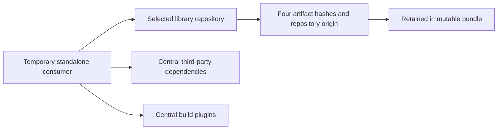

# Публикация переиспользуемых платформенных библиотек

[English version](../library-publication.md)

Выбор и использование инструмента начинайте с [каталога библиотек](libraries/README.md).
Переиспользование, изменения API и владение версиями описывают
[разработка библиотек](libraries/development.md) и
[релизная политика](../../ru/RELEASE-PROCESS.md#версии-переиспользуемых-библиотек).

**Текущая реализация публикации:** исходные версии библиотек и правила допуска
публикации сохраняют общую версию продукта. Независимые версии приняты
[ADR 0048](../../ADR/0048-independent-library-versions-and-reuse.md), но переход
Maven/CI остаётся задачей TOOL-9. Здесь описана действующая процедура. Глобальный
`-Drevision` или другое значение `LIBRARY_VERSION` не реализуют отдельные версии;
версия компонента должна соответствовать допущенной релизной ветке продукта.
Публикация библиотеки не выпускает приложение.

## Выбор операции и свидетельств

| Этап | Что подтверждает | Что остаётся |
|---|---|---|
| Локальный комплект и изолированный потребитель | Собранные API/POM/примеры работают из явно выбранных файлов в отдельном проекте | Проверка публичных репозиториев и подписание релиза |
| Сборка workflow без привилегий публикации | Исходники тега проходят полный verify, проверку отдельным потребителем и профиль PMD | Защищённое согласование, подписи и операции репозиториев |
| `operation=validate` | Подписание после согласования и проверку загрузки USER_MANAGED в Central | Публичная публикация и проверка потребителем каждого репозитория |
| `operation=publish` | Публикацию/повторное использование комплекта, дозагрузку GitHub и обе проверки потребителями | Рассмотренные свидетельства и запись релиза компонента; приёмка сервиса и развёртывания остаётся отдельной |

`validate` — удалённая операция с учётными данными: она может создать deployment
в Central. Это не локальная пробная проверка. Для разработки используйте локальные
команды. Комплект разработки может содержать SNAPSHOT и отмечать незакоммиченные
изменения; подписание релиза их отвергает. Каждому кандидату нужен новый выходной
каталог. Подписи, координаты и теги опубликованного RC так же неизменяемы,
как у окончательного релиза.

Для нового выпуска: настройка доступа → идентичность релиза → защищённая проверка
→ сохранение → публикация/восстановление → потребители репозиториев. При прерванном
выпуске начинайте с сохранённых подписанного комплекта и deployment ID, а не
с новой сборки. Исторические записи ниже сохраняют границы проверки компонентов.

Неизменяемые свидетельства первых выпусков находятся в записях
[concurrency](../../../.github/release-notes/ru/ioc-platform-concurrency-0.3.0-rc.1.md),
[diagnostics](../../../.github/release-notes/ru/ioc-platform-diagnostics-api-0.3.0-rc.1.md),
[configuration](../../../.github/release-notes/ru/ioc-config-spring-boot-0.3.0-rc.1.md),
[logging](../../../.github/release-notes/ru/ioc-platform-logging-slf4j-0.3.0-rc.1.md),
[events core](../../../.github/release-notes/ru/ioc-platform-events-0.3.0-rc.1.md) и
[Spring adapter](../../../.github/release-notes/ru/ioc-events-spring-0.3.0-rc.1.md).
Они фиксируют исходный код, подписанные файлы и отдельные проверки загрузки
из каждого репозитория. Configuration сохраняет первоначальную ошибку CI Central
и локальное восстановление; events — передачу проверенного core и восстановление
пары из исходных неизменяемых комплектов.

Проверенные компоненты используют Java 21 и точные контракты зависимостей:

| Селектор | Артефакт (`io.github.xorex-lc`) | Модуль | Обязательные зависимости основного POM |
|---|---|---|---|
| `concurrency` (по умолчанию) | `ioc-platform-concurrency` | `platform/platform-concurrency` | Нет |
| `diagnostics` | `ioc-platform-diagnostics-api` | `platform/platform-diagnostics-api` | Нет |
| `logging` | `ioc-platform-logging-slf4j` | `platform/platform-logging-slf4j` | `org.slf4j:slf4j-api:2.0.18`, compile JAR |
| `configuration` | `ioc-config-spring-boot` | `adapters/adapter-config-spring-boot` | `org.springframework.boot:spring-boot:4.0.8` и `org.springframework:spring-core:7.0.9`, compile JAR |
| `events` | `ioc-platform-events` | `platform/platform-events` | Нет |
| `events-spring` | `ioc-events-spring` | `adapters/adapter-events-spring` | `ioc-platform-events` той же версии, Spring Context 7.0.9 и SLF4J API 2.0.18, compile JAR |

Основной репозиторий — Central; GitHub Packages получает те же файлы релиза.
Модель публикации закрепили [ADR 0028](../../ADR/0028-pilot-library-publication.md)
и правила релизной ветки [ADR 0029](../../ADR/0029-release-branch-library-publication.md).
См. справочники модулей [concurrency](../../../platform/platform-concurrency/README.md) и
[diagnostics](../../../platform/platform-diagnostics-api/README.md).
Границы diagnostics приняты [ADR 0044](../../ADR/0044-reusable-diagnostics-contract.md),
logging — [ADR 0045](../../ADR/0045-reusable-slf4j-logging-contract.md): обязательный
SLF4J допускается, провайдеры и Boot остаются вне переиспользуемого JAR.
Проверка репозиториев относится к свидетельствам конкретного выпуска. Добавление
компонента не разрешает публикацию или повторную публикацию существующей версии.
Новые зависимости/версии требуют рассмотрения контракта, а не расширения списка
разрешений. Прежние контракты без внешних зависимостей сохраняются. До проверки
репозиториев ни одна версия не объявляется опубликованной.

Logging `0.3.0-rc.1` прошёл защищённую публикацию и отдельные plain/Boot проверки
из Central/GitHub с пустыми кешами в [запуске 39455105300](https://github.com/xORex-LC/ioc-extractor/actions/runs/39455105300).
[Руководство потребителя](libraries/logging-slf4j.md) задаёт опубликованную зависимость,
[справочник модуля](../../../platform/platform-logging-slf4j/README.md) — проверенные
границы API и backend. Это не квалифицирует следующую версию.

## Подготовка комплектов events

Два селектора готовят отдельные комплекты и запускают изолированных потребителей:

| Селектор | Координата в `io.github.xorex-lc` | Обязательные compile JAR в POM потребителя |
|---|---|---|
| `events` | `ioc-platform-events` | Нет, только JDK 21 |
| `events-spring` | `ioc-events-spring` | `ioc-platform-events` точной версии комплекта, Spring Context 7.0.9, SLF4J API 2.0.18 |

Оба пока наследуют общую версию и настройки сборки реактора. При переходе на
независимые версии семейство сохранит одну версию. Итоговый POM разрешает настройки
и удаляет родительский POM, тестовые зависимости и настройки сборки через
[Flatten plugin](https://www.mojohaus.org/flatten-maven-plugin/flatten-mojo.html).
Проверка требует точных обязательных compile-зависимостей и отвергает API
в optional/provided, диапазоны версий, неразрешённые свойства, лишние зависимости,
репозитории, BOM и внутренние родительские POM. Основной JAR содержит тот же POM,
лицензию MIT и классы Java 21 только своего публичного пакета. Исходники и строгая
проверка Javadoc сверяются с реальными публичными типами.

```sh
make library-bundle LIBRARY_COMPONENT=events LIBRARY_BUNDLE=.dev/events-bundle
make library-bundle LIBRARY_COMPONENT=events-spring LIBRARY_BUNDLE=.dev/events-spring-bundle
python3 tools/ci/library-publication.py check --component events --bundle .dev/events-bundle --version 0.3.0-SNAPSHOT
python3 tools/ci/library-publication.py check --component events-spring --bundle .dev/events-spring-bundle --version 0.3.0-SNAPSHOT
make library-consumer LIBRARY_COMPONENT=events LIBRARY_BUNDLE=.dev/events-bundle
make library-consumer LIBRARY_COMPONENT=events-spring LIBRARY_BUNDLE=.dev/events-spring-bundle LIBRARY_DEPENDENCY_BUNDLE=.dev/events-bundle
```

У каждого комплекта четыре основных файла, собственные идентичность и хеши.
Комплект Spring содержит только адаптер: core остаётся обычной зависимостью,
без встраивания или скрытого копирования. Core публикуется и проверяется первым
в **каждом выбранном репозитории**, затем адаптер той же версии. Теги компонентов —
`ioc-platform-events-v<version>` и `ioc-events-spring-v<version>`; существующие
теги и комплекты не меняются.

Тестовый JDK-проект не зависит от фреймворков. В Spring-проекте только **основной**
POM адаптера поставляет core/Context/SLF4J; зависимости с classifiers исключают
эти API. Оба потребителя компилируют и исполняют реальные Java-блоки руководств
с событием постороннего сервиса. Проверки Spring покрывают упорядоченные синхронные
обработчики, частичную доставку, идентичность прямого и обёрнутого Spring Error,
ошибки публикации/наблюдателя и выбор конфигурации диспетчеризации сервисом.
Контексты закрываются; исполнитель в вызывающем потоке не создаёт рабочих потоков.

Каждый запуск начинается вне checkout с пустым кешем и пустыми пользовательскими/
глобальными settings. Локальная проверка создаёт временный выбранный репозиторий
из двух явно переданных комплектов, не меняя их и не вызывая `mvn install`.
Для `events-spring` обязателен `--dependency-bundle` с `events` той же версии;
остальные селекторы его отвергают. Все четыре файла **каждого** собственного
артефакта должны совпасть с manifest и иметь только `library-target` как источник.
Удалённый потребитель сверяет оба комплекта с тем же выбранным репозиторием
до запуска Maven.

Проверяется весь граф: core не имеет сторонних JAR, адаптер имеет core той же
версии и десять публичных JAR замыкания Context/SLF4J. Обычное разрешение и Boot
4.0.8 BOM приложения сохраняют Context 7.0.9/SLF4J 2.0.18; BOM выбирает Commons
Logging 1.3.6 и JSpecify 1.0.1 вместо 1.3.5/1.0.0 и не добавляет Boot во время
исполнения. Обычный Java-запуск использует разрешённый classpath, без загрузчика
Maven-плагина и путей checkout. Это проверка точных версий, а не произвольных
обновлений или новое сканирование CVE.

Отрицательные профили отдельно исключают core/Context/SLF4J и выбирают недоступные
версии в offline-режиме. Компиляция/разрешение должны завершаться ошибкой
отсутствующего API; другая ошибка сети или инструмента не считается успехом.
Несовместимый Spring Core должен нарушить правило верхней границы версии.
Библиотека не устанавливает BOM приложения и не контролирует версии зависимостей
во время исполнения.

Проверки маршрутизации с пустым кешем удаляют весь выбранный компонент, затем
только core при сохранённом адаптере. Альтернативный репозиторий содержит точные
копии обоих комплектов. Фильтры должны запрещать обход в обоих случаях; контроль
без фильтров разрешает те же четыре/восемь файлов с ожидаемыми источниками,
включая альтернативный core во втором случае. Прогретый кеш или другой репозиторий
не должны скрывать отсутствие опубликованного core. Проекты, репозитории и кеши
временные и удаляются при выходе. Любой неуспешный сценарий завершает команду
ошибкой; автоматических повторов нет.

Обычный CI собирает оба артефакта один раз и выполняет проверки потребителей
без учётных данных публикации; library gate требует эту job и четыре проверки
ранее допущенных компонентов. Все шесть селекторов допущены в защищённый workflow.
Пустой список тестовых проектов или нерассмотренный дескриптор всё равно
останавливают допуск. Локальный результат не подтверждает публичный репозиторий
или развёрнутый сервис.

### Владение events API и версией

Библиотека поддерживает семь публичных JDK-типов и один явный Spring publisher,
включая проверку входов, наблюдение, отказы и поведение при конкуренции. Сервис
владеет содержимым событий, каталогами типов/версий, временем, ID, обработчиками,
безопасным текстом исключений и восстановлением. Metadata `eventVersion` — версия
данных события, определяемая сервисом, а не версия Maven.

Текущие POM/workflow используют общую версию, включая RC. ADR 0048 принимает
независимые версии после TOOL-9; events остаётся семейством core/adapter с точным
равенством версий. Изменение сигнатур, проверки входов или отказов требует
рассмотрения контракта, регрессионных тестов, проверок потребителями и release notes.
Опубликованная координата неизменяема: исправление требует новой версии/тега.
По [правилам версионирования](../../ru/RELEASE-PROCESS.md) совместимые исправления
используют PATCH, несовместимые изменения поддерживаемого контракта в 0.x — MINOR.
RC имеет собственные неизменяемые координаты и теги.

Проверенная база — Java 21, Context 7.0.9, SLF4J 2.0.18 и описанные выше графы
обычного разрешения/Boot 4.0.8 BOM. Интеграцию Boot, провайдер, multicaster
и исполнитель выбирает сервис. Другие версии платформы, ожидание завершения
всех асинхронных обработчиков и второй развёрнутый сервис этими потребителями
не квалифицированы.

### Порядок выпуска events и сохранённый core

1. Выпустите `events` с аннотированным тегом по процедуре нового выпуска ниже.
   Нужен успешный запуск **publish** с обоими потребителями и пустыми кешами;
   одной проверки validate недостаточно.
2. Запустите `events-spring` той же версии с отдельным аннотированным тегом
   и `events_core_run_id` успешного выпуска core. При первой попытке оставьте
   `resume_run_id` и `central_deployment_id` пустыми. Допуск скачивает
   `signed-library` и `repository-consumers`; `qualification.json` связывает
   запуск, ветку, координаты, commit, хеш manifest, два URL назначения и хеши логов.
   До привилегированного согласования проверяются тег/предок core, происхождение
   workflow и все 20 подписанных файлов core в **обоих** репозиториях. Отсутствие
   или изменение файлов либо свидетельств останавливает допуск.
3. Исходные подписанный core и свидетельства сохраняются как `events-core`
   для всех jobs адаптера. Сборка использует его для локального потребителя
   с пустым кешем; подписание требует свидетельств; каждая запись в репозиторий
   вновь проверяет core по месту назначения. Удалённый потребитель адаптера
   сверяет восемь основных артефактов с двумя manifests и выбранными источниками.
4. Для staged/частично опубликованного адаптера задайте исходные `resume_run_id`
   и deployment ID Central; оставьте `events_core_run_id` **пустым**. Восстановление
   берёт `signed-library` и `events-core` из запуска адаптера, перепроверяет
   идентичность обоих исходных комплектов и свидетельства core, пропускает сборку
   и подписание. Нельзя заменить core другим запуском. Сохраните оба артефакта
   и свидетельства вне Actions до истечения 90 дней хранения.

Другие селекторы отвергают `events_core_run_id`. Операции CLI подписания/публикации
для `events-spring` также требуют `--dependency-bundle` с этим проверенным core;
только потребитель допускает неподписанные локальные комплекты разработки.
`record-qualification` выполняется после обеих успешных проверок под `pipefail`;
неуспешные логи сохраняются без записи об успехе. Как и manifest, эти свидетельства
зависят от доверенного происхождения артефактов Actions и защищённого согласования;
они не удостоверяют произвольный локальный JSON.

Сам допуск ничего не публикует. Сначала нужны слияние изменений, CI релизной
ветки и чистые неизменяемые входы, затем — явно разрешённые подписание, проверка
и публикация. SNAPSHOT с незакоммиченными изменениями остаётся локальным входом.
Core/adapter `0.3.0-rc.1` опубликованы и проверены в обоих репозиториях:
[запуск core 40160627532](https://github.com/xORex-LC/ioc-extractor/actions/runs/40160627532)
и [запуск адаптера 40162675262](https://github.com/xORex-LC/ioc-extractor/actions/runs/40162675262)
повторно использовали исходные подписанные комплекты после защищённой проверки.
Логи и свидетельства рассмотрены. Это проверка указанной базы Java/Spring,
а не второго развёрнутого сервиса.

## Допуск библиотеки конфигурации

Configuration `0.3.0-rc.1` прошла защищённую публикацию и проверку GitHub Packages
с пустым кешем в [запуске 40088095516](https://github.com/xORex-LC/ioc-extractor/actions/runs/40088095516).
Первый потребитель Central завершился ошибкой: Resolver сгруппировал одинаковые
URL Central под ограничивающим фильтром. Кроме того, `tee` скрыл отказ, поэтому
зелёный workflow не подтверждает Central. Локальное восстановление 2026-10-24
прошло с исправленной маршрутизацией, исходным подписанным комплектом и пустыми
кешами. Workflow теперь передаёт ошибки конвейера; PR 19 перенёс исправления
в `release-0.3.0`. Защищённое восстановление CI остаётся задачей
[TOOL-8](../../KNOWN-ISSUES.md); исходный неуспешный лог сохранён.
[Руководство потребителя](libraries/config-spring-boot.md) задаёт опубликованную
зависимость, [рецепт ограниченного контекста](libraries/config-spring-boot-check.md) —
проверки связывания и валидации, принадлежащие сервису. Свидетельства относятся
к этой версии и базе Boot, а не ко второму развёрнутому сервису.

`io.github.xorex-lc:ioc-config-spring-boot` реализована в реакторе; ответственность
принята [ADR 0046](../../ADR/0046-reusable-spring-boot-configuration-inspection.md).
Селектор `configuration` готовит POM без родителя ровно с двумя обязательными
compile JAR: Boot 4.0.8 и Spring Core 7.0.9. Встроенный POM обязан совпадать
с ним. Внутренние родители, импорты BOM, утечки build/profiles/repositories,
стартеры, лишние зависимости и исполняемая упаковка Boot отвергаются. Версии пока
централизованы и совпадают с продуктом; независимая версия остаётся целью
с критериями активации из релизной политики.

[Отдельный потребитель](../../../tools/fixtures/configuration-consumer/README.md)
проверяет инспекцию/миграцию и точное
[руководство закрытых входов](libraries/config-spring-boot-check.md) по собранным
артефактам. Он квалифицирует замыкание из десяти JAR библиотеки плюс SnakeYAML 2.6
приложения, затем повторяет руководство с BOM Boot 4.0.8 приложения. Обычное
разрешение выбирает Commons Logging 1.3.5/JSpecify 1.0.0, BOM — 1.3.6/1.0.1;
полные графы проверяются. Несовместимый Core 5.3.39 должен нарушить правило
Enforcer upper-bound, недоступная версия Boot — завершить разрешение ошибкой.
Другие версии требуют собственных проверок. Библиотека не устанавливает BOM
приложения и не навязывает версии во время исполнения.

### Маршрутизация выбранного репозитория

Каждый потребитель использует Maven 3.9.9 со встроенным Resolver 1.9.22. Групповой
фильтр требует входного файла для каждого репозитория; без него фильтр воздерживается
от решения — см. [документацию Resolver](https://maven.apache.org/resolver-1.x/remote-repository-filtering.html).
Инструмент создаёт явные правила для `central`, `library-target`,
`public-dependencies`, `public-plugins`, `public-fallback`. Локальная цель и GitHub
допускают только `io.github.xorex-lc`, публичные маршруты — только рассмотренные
буквальные [внешние группы](../../../tools/ci/library-publication-groups.txt).
Зеркало с wildcard направляет другие ID на разрешённый маршрут Central;
нефильтруемых маршрутов в проверочных settings нет.

При выборе Central целевой репозиторий также допускает те же внешние группы:
Resolver 1.9.22 [группирует загрузки по URL](https://github.com/apache/maven-resolver/blob/maven-resolver-1.9.22/maven-resolver-impl/src/main/java/org/eclipse/aether/internal/impl/DefaultArtifactResolver.java#L649-L653),
поэтому разные ID одного URL Central не могут иметь противоречащие фильтры.
Публичные маршруты всё ещё исключают собственные группы; собственные артефакты
обязаны иметь только `library-target` как источник. Новые внешние группы
не допускаются.

Зависимости Spring и плагины приходят из Central, собственные артефакты — только
из выбранного локального/Central/GitHub репозитория. Все четыре собственных файла
обязаны совпасть с manifest и источником. Configuration добавляет две проверки
с пустыми кешами: пустой выбранный репозиторий должен вызвать отказ даже при
заполненном альтернативном; контроль без фильтра должен скомпилироваться
и записать альтернативный источник. Новые группы или собственные транзитивные
зависимости требуют расширения и рассмотрения проверок. Порядок репозиториев
не является механизмом изоляции.

Локальная проверка упаковки не публикует версию и не подтверждает второй
развёрнутый сервис. Сначала интегрируйте рассмотренные изменения в релизную ветку,
затем отдельно разрешайте защищённую проверку/публикацию. Сохраняйте существующие
версии компонентов, подписанные комплекты и теги.

## Локальная проверка упаковки

Нужны полный JDK 21 с `javadoc`, Python 3, GnuPG 2, Maven wrapper и сеть для
инструментов сборки и потребителя с пустым кешем:

```sh
make library-publication-test
make library-bundle
make library-consumer

make library-bundle LIBRARY_COMPONENT=diagnostics LIBRARY_BUNDLE=.dev/diagnostics-bundle
make library-consumer LIBRARY_COMPONENT=diagnostics LIBRARY_BUNDLE=.dev/diagnostics-bundle

make library-bundle LIBRARY_COMPONENT=logging LIBRARY_BUNDLE=.dev/logging-bundle
make library-consumer LIBRARY_COMPONENT=logging LIBRARY_BUNDLE=.dev/logging-bundle

make library-bundle LIBRARY_COMPONENT=configuration LIBRARY_BUNDLE=.dev/configuration-bundle
make library-consumer LIBRARY_COMPONENT=configuration LIBRARY_BUNDLE=.dev/configuration-bundle
```

По умолчанию `LIBRARY_VERSION` — `0.3.0-SNAPSHOT`, `LIBRARY_BUNDLE` —
`.dev/library-bundle`. Выходной каталог не должен существовать; для новой сборки
выберите другой путь. Создаются основной JAR, исходники, Javadoc и итоговый POM
без внутреннего родителя. Проект потребителя копируется вне checkout, использует
пустой кеш Maven и сравнивает четыре разрешённых артефакта с manifest.
Проверки concurrency по умолчанию покрывают FIFO, отказ переполненной очереди,
независимые ключи, остановку, синхронные вложенные вызовы и передачу ошибок.
Diagnostics исполняет три [примера руководства](libraries/diagnostics.md)
с собственными кодами: результаты/решения политик, ограниченные счётчики этапа/
запуска и обратные вызовы при ошибках доставки. Оба POM независимы от родителя
IOC и каталогов классов реактора.

Фасад собирает выбранный модуль и его предшественников с профилем публикации,
затем готовит комплект; полный релизный gate он не выполняет. `LIBRARY_VERSION`
передаётся через общую revision реактора. Подготовка и потребление допускают
незакоммиченные изменения разработки, фиксируя их в идентичности. Приватный ключ,
токен публикации, создание тега и запись в реестр этой локальной процедуре не нужны.

Logging запускает два отдельных потребителя, каждый с пустым кешем. Обычный SLF4J
исполняет три класса руководства. Провайдер и зависимости sources/Javadoc
исключают SLF4J API, чтобы его поставлял только основной POM библиотеки. Затем
два offline-сценария на прогретом кеше проверяют: исключение API ломает компиляцию,
выбор недоступной версии — разрешение. Посторонняя ошибка не считается успехом.
Boot-потребитель компилирует [рецепт](libraries/logging-slf4j-boot.md), читает
YAML/XML, проверяет пять JSON-записей и состояние кодировщика. Boot/Logback
выбирает сам потребитель; это не зависимости библиотеки.

Тестовый проект проверяет упаковку/API, а не реализует feeds-collector. Его плагины
разрешаются из Central независимо от репозитория библиотеки. Проверки требуют сеть
и не заменяют `make verify`/`make pmd-analysis`. CI запускает отдельную job матрицы
для каждого компонента без привилегий публикации. Селектор входит в закрытый список;
CLI `--component` по умолчанию равен `concurrency`. Передавайте
`--component diagnostics` на каждой операции diagnostics, включая check/signing/
восстановление; аналогично `--component logging` и `--component configuration`.
Комплект другого компонента отвергается до подписания или доступа к репозиторию.
Manifest хранит артефакт, версию, source commit и хеши; существующие manifests
concurrency не переписываются.

Подготовка и каждое чтение комплекта проверяют разрешённый POM до подписания/
доступа к репозиторию. Logging требует точный обязательный compile JAR;
optional/provided/runtime/test, classifiers, exclusions, неразрешённые свойства,
лишние зависимости, провайдеры и зависимости IOC отвергаются. Связи с parent,
dependencyManagement, build, profiles и repositories запрещены всем компонентам.
Встроенный POM совпадает с отдельным при упаковке. Новых полей manifest не нужно:
идентичность старых подписанных комплектов сохраняется.

Для logging выбранный репозиторий поставляет библиотеку, `public-dependencies` —
сторонние зависимости Central, плагины разрешаются отдельно. В Maven 3.9.9
`_remote.repositories` должен показывать `library-target` для каждого POM/main/
sources/Javadoc, а хеши — совпадать с комплектом. Обход через Central не подтверждает
загрузку из GitHub. Изменение/отсутствие формата происхождения останавливает
проверку и требует рассмотрения инструментария при обновлении Maven. См.
[владение локальным репозиторием](https://maven.apache.org/resolver/local-repository.html).



Manifest, репозиторий и файлы артефактов должны быть обычными файлами/каталогами,
без символических ссылок в цепочке каталогов репозитория и файлах восстановления.
Иначе запись при подписании/восстановлении может уйти за пределы сохранённого
комплекта. Эти проверки выполняются до импорта ключа или доступа к репозиторию.
Хеши и отпечаток подписанта не удостоверяют произвольный JSON: восстановление
также зависит от исходного доверенного артефакта Actions и защищённого
согласования. Сохраняйте происхождение вместе с комплектом.

`check --signed` проверяет состояние signed, заданный отпечаток, чистую
идентичность, состав файлов и хеши, но не выполняет повторную проверку GPG
каждой сохранённой подписи. Подписание проверяет подписи при создании.
Восстановление требует и целостности файлов, и доверенного происхождения;
`identity.json` не может сам удостоверять своё происхождение.

При HTTPS-прокси потребитель переносит `https_proxy`/`HTTPS_PROXY` во временные
settings Maven. Кеш остаётся новым, глобальные settings — пустыми; зеркала
и репозитории разработчика не импортируются. Учётные данные прокси, если есть,
удаляются вместе с временным каталогом. Ошибка сети или загрузки плагина
не считается успешной проверкой потребителя.

## Настройка доступа и workflow

Владелец предоставляет подтверждённое пространство имён Central `io.github.xorex-lc`
и GitHub Environment **`LIBRARY PUBLISHING`** со следующими секретами:

- `MAVEN_CENTRAL_USERNAME`, `MAVEN_CENTRAL_PASSWORD`: пара пользовательского токена Central.
- `GPG_PRIVATE_KEY`, `GPG_PASSPHRASE`: ключ в текстовом armored-формате и парольная фраза.

Заданный публичный отпечаток — `F69BA7E0F7494982E6E1B483DF54073D8BBFA9F9`;
подписание сверяет с ним импортированный ключ. Первоначальные записи отмечали
истечение ключа `2027-03-06T12:39:38Z` и токена Central `2027-03-07`; это
исторические даты, а не текущая проверка доступа. До использования проверьте
фактические сроки и отзыв, обновляйте доступ вовремя и явно рассматривайте смену
отпечатка. Опубликуйте открытый ключ на поддерживаемом сервере ключей и проверьте
доступность для Central. Приватные ключи и значения токенов запрещены в Git,
входах workflow, свойствах командной строки и приложениях к свидетельствам.

До первого реального запуска настройте Environment: reviewer `xORex-LC`,
**Selected branches and tags** с `release-*`. При одном сопровождающем оставьте
prevent-self-review выключенным, иначе инициатор не сможет согласовать запуск;
пересмотрите настройку при появлении второго доверенного сопровождающего.
Не используйте **Protected branches only**, пока правил защиты веток нет:
GitHub трактует такое состояние как разрешение всех веток. До согласования
секреты Environment недоступны.

Защиту основной ветки задаёт управление проектом. Для ручного запуска файл
workflow должен существовать на основной ветке. Выбирайте `release-X.Y.Z`:
`main` и ветки разработки не проходят допуск. Каждый новый компонент требует
своего защищённого запуска и проверки репозиториев; успех concurrency
не квалифицирует diagnostics. Для GitHub используется `GITHUB_TOKEN`
с `packages: write`, отдельный PAT публикации не нужен. Существующий
`SECURITY CHECKS` остаётся независимым.

## Первый выпуск версии

Последовательность применяется к первой публикации каждой новой координаты/версии.
Связи входов workflow:

| Вход | Правило |
|---|---|
| `component` | Допущенный селектор, по умолчанию concurrency; выбирайте явно |
| `release_tag` | Аннотированный тег выбранного артефакта; commit — предок выбранной релизной ветки, базовая версия совпадает с веткой |
| `operation` | По умолчанию `validate`; `publish` выполняет публичную публикацию |
| `resume_run_id` | Пусто для нового комплекта; при восстановлении — завершённый запуск этого workflow на той же релизной ветке |
| `central_deployment_id` | Пусто без resume, обязательно с resume и связано с именем deployment этого комплекта |
| `events_core_run_id` | Успешный проверенный запуск core только для первой попытки адаптера; пусто при восстановлении и для других компонентов |

1. Слейте реализацию в `release-X.Y.Z` и пройдите обычные проверки CI. Обновляйте
   копию workflow на `main`, чтобы GitHub регистрировал ручной запуск и выбор
   компонентов; это не переносит код приложения в `main`.
2. Создайте аннотированный `<artifactId>-vX.Y.Z` или `<artifactId>-vX.Y.Z-rc.N`
   на рассмотренном commit релизной ветки, например
   `ioc-platform-diagnostics-api-v0.3.0-rc.1`. Не перемещайте существующий тег
   и не используйте опубликованный тег concurrency для другого компонента.
   Версии продукта/библиотек пока совпадают, хотя теги и моменты выпуска раздельны.
3. Вручную запустите **Library publication** на соответствующей `release-X.Y.Z`,
   выберите компонент, его тег и `operation=validate`, оставьте входы восстановления
   пустыми. Для `events-spring` задайте запуск core, как описано выше. Сборка
   и проверки выполняются без учётных данных публикации; после отдельного
   потребителя комплект подписывается один раз и сохраняется как `signed-library`
   до обращения к репозиториям. Build job не имеет учётных данных публикации;
   подписание/загрузка выполняются позже в защищённой publish job, в том числе
   при `operation=validate`.
4. Скачайте и сохраните `signed-library`/`central-deployment`, source SHA, run ID,
   хеши manifest и deployment ID Central. `VALIDATED` означает успешную подготовку
   на стороне Central, а не публичный выпуск.
5. Снова запустите workflow на той же ветке с теми же компонентом/тегом:
   `operation=publish`, исходные `resume_run_id` и `central_deployment_id`.
   Workflow проверяет происхождение и идентичность, повторно использует
   подписанный комплект, публикует Central, зеркалирует недостающие файлы GitHub
   и запускает отдельных потребителей каждого репозитория с новыми кешами.
6. Сохраните оба URL репозиториев, успешные логи, `qualification.json` и хеши
   в свидетельствах релиза. Только эти реальные загрузки подтверждают публикацию.

Прямой `operation=publish` без входов восстановления поддерживается для явно
разрешённого нового выпуска: те же сборка и сохранение предшествуют публикации.
Для первого выпуска предпочтительна предварительная проверка. Точный
закоммиченный кандидат также проходит актуальный security gate из
[SECURITY-ENGINEERING](../../SECURITY-ENGINEERING.md); старый кеш NVD не заменяет
этого требования.

## Частичный отказ и восстановление

Не исправляйте существующую версию новой сборкой или подписями. Используйте
исходный подписанный артефакт и deployment ID Central. Actions хранит артефакты
90 дней; сохраните их вне Actions вместе со свидетельствами релиза. Обычный
повтор старой job не является интерфейсом восстановления: запустите новый workflow
с нужными входами. Неуспешный запуск допустим как источник артефактов, если
он завершён, относится к этому workflow и той же релизной ветке.

Первая попытка выполняет инструментарий из неизменяемого тега компонента.
При восстановлении может потребоваться исправление транспорта, обнаруженное
только при работе с реестром. Тогда привилегированные jobs выполняют инструментарий,
зафиксированный на SHA выбранной релизной ветки после согласования
`LIBRARY PUBLISHING`. Скачанный подписанный комплект всё равно обязан совпадать
с исходными тегом, commit, версией и manifest. Восстановление не пересобирает,
не переподписывает и не перемещает тег. Исправление инструментария рассмотрите
и проверьте обычным CI ветки до согласования запуска.

Если Central принял загрузку, но ответ потерян, до повтора найдите deployment
в Portal по имени из артефакта/версии/хеша manifest. При отказе проверки изучите
диагностику Portal и сохраните deployment. Если файлы должны измениться,
подготовьте новую версию/тег. Частичная видимость Central останавливает операцию
до распространения; совпадающие опубликованные файлы пропускаются. GitHub
сравнивает существующие файлы и отправляет только недостающие; любое несовпадение
останавливает операцию. Скачивание GitHub может перенаправлять на внешнее HTTPS
хранилище: клиент следует только перенаправлениям чтения, удаляет authorization
при смене origin и сверяет файлы с manifest. Перенаправления записи запрещены.

Успешная загрузка без обоих потребителей не завершает квалификацию публикации.
`set -euo pipefail` передаёт отказ потребителя даже через `tee`. Рассматривайте
логи вместе с итогом job; при восстановлении сохраняйте неуспешный лог отдельно.
Первый реальный запуск должен подтвердить поведение реестра, принятие подписей
и видимость пакета.

## Подключение потребителем

После подтверждённой публикации добавьте:

```xml
<dependency>
  <groupId>io.github.xorex-lc</groupId>
  <artifactId>ioc-platform-concurrency</artifactId>
  <version>0.3.0-rc.1</version>
</dependency>
```

Пример использует проверенный первый выпуск concurrency. Опубликованные
зависимости других компонентов даны в руководствах
[diagnostics](libraries/diagnostics.md) и [configuration](libraries/config-spring-boot.md).
Central не требует дополнительной настройки репозитория. Для GitHub Packages
используйте `https://maven.pkg.github.com/xorex-lc/ioc-extractor` и согласованные
учётные данные Maven server с правом чтения пакета. Даже публичные Maven-пакеты
GitHub требуют аутентификации; для обычного публичного потребления выбирайте Central.

Вне Actions используется classic PAT с `read:packages` и доступом к пакету.
Передавайте учётные данные из окружения через settings; server ID должен
совпадать с repository ID в POM. Не помещайте секреты в POM:

```xml
<settings xmlns="http://maven.apache.org/SETTINGS/1.0.0">
  <servers>
    <server>
      <id>github-ioc</id>
      <username>${env.PACKAGES_USER}</username>
      <password>${env.PACKAGES_READ_TOKEN}</password>
    </server>
  </servers>
</settings>
```

Для GitHub Packages добавьте в POM потребителя фрагмент репозитория:

```xml
<repositories>
  <repository>
    <id>github-ioc</id>
    <url>https://maven.pkg.github.com/xorex-lc/ioc-extractor</url>
  </repository>
</repositories>
```

Выберите settings через Maven `-s`. Это обычные настройки потребителя, а не
проверочные настройки производителя с пустым кешем и изоляцией происхождения.
В Actions используйте `GITHUB_TOKEN`, когда репозиторий workflow имеет доступ
к пакету; доступ между репозиториями выдаётся явно. Публичность пакета не отменяет
аутентификацию GitHub; для публичного потребления проще Central.

## Диагностика неудачной операции

| Отказ | Действие |
|---|---|
| Выходной каталог уже существует или нет основного файла | Сохраните кандидата, выберите новый путь и профиль публикации; не меняйте manifest ради отсутствующих файлов. |
| Не тот селектор/тег/версия ветки, тег не аннотирован | Согласуйте рассмотренную идентичность и релизную ветку; не обходите допуск подменой revision. |
| Подписание отвергает SNAPSHOT или незакоммиченные изменения | Сохраните свидетельства разработки; после review подготовьте чистые допущенные входы. |
| Отклонён контракт POM/пакета/зависимостей | Исправьте соответствующие POM/исходники с тестами; не расширяйте список разрешений ради неожиданной зависимости/API. |
| Нет core или свидетельств его проверки | Передайте точный core той же версии с записями обоих репозиториев; восстановление адаптера сохраняет исходный core. |
| Ошибка ключа/токена/согласования/прав пакета | Проверьте текущую защиту Environment, идентичность и срок ключа, доступ к пространству имён/пакету, не раскрывая секретов. Старый успешный запуск не доказывает нынешний доступ. |
| Ошибка сети/прокси/загрузки плагина | Устраните причину и повторите проверку; это не успешный отрицательный сценарий разрешения или маршрутизации. |
| Потребитель не прошёл после загрузки | Публикация ещё не квалифицирована. Сохраните неуспешный лог, восстанавливайте из тех же подписанных файлов; не пересобирайте опубликованную координату. |
| Частичная видимость Central, ожидание deployment или потерянный ответ | Сохраните ID/свидетельства, проверьте Portal и распространение; найдите существующий deployment до новой загрузки. |
| Истёк срок артефакта Actions или недоступно происхождение | Восстановите исходный подписанный комплект и происхождение из внешнего архива либо остановитесь. Новая сборка/подписи их не заменяют. |

## Источники и сопровождение

Текущие механизмы задают [Makefile](../../../Makefile),
[инструмент](../../../tools/ci/library-publication.py),
[workflow](../../../.github/workflows/library-publication.yml),
[матрица CI](../../../.github/workflows/ci.yml), POM выбранных модулей и
[offline-контракты](../../../tools/tests/library-publication-test.py).
Выполняйте `make library-publication-test`, нужные проверки комплектов/потребителей
и `make docs`. Синтаксис shell/XML и тестовые подмены workflow не подтверждают
реальные настройки доступа, учётные данные, поведение реестров или новый выпуск.
Согласовывайте оба языка, постоянные факты выпуска храните в записях компонентов.
TOOL-6/7/8/9 имеют отдельные критерии и этим руководством не закрываются.

Авторитетная документация сервисов:
[Central Publisher API](https://central.sonatype.org/publish/publish-portal-api/) и
[GitHub Maven registry](https://docs.github.com/en/packages/working-with-a-github-packages-registry/working-with-the-apache-maven-registry).
