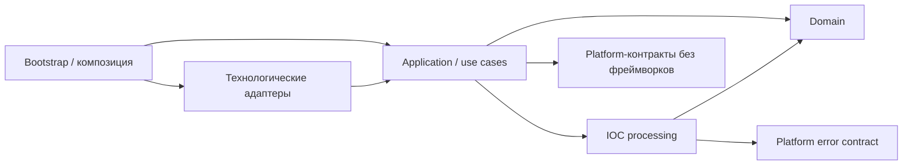

# Архитектура

[English version](../ARCHITECTURE.md)

IOC Extractor — модульное Java ETL-приложение с Clean Hexagonal
(порты и адаптеры) и Onion architecture. Оно превращает документы и управляемые
CSV-поставки в canonical IOC data, mutable CSV-проекции и immutable export slices.
Приложение работает как синхронный oneshot CLI или daemon с durable intake,
recovery и удалённой синхронизацией.

## Направление зависимостей и ответственность



Стрелки показывают направление зависимостей, а не порядок исполнения или все
Maven edges. [Карта модулей](MODULARIZATION.md) и POM определяют конкретный граф;
[BOUNDARIES.md](BOUNDARIES.md) описывает его исполняемые проверки.

| Ответственность | Владелец |
|---|---|
| IOC values, протоколы refang/extraction, attribution, features и classification contracts | Независимый от фреймворков domain |
| Общие IOC representations, composition классификации и декларативное заполнение полей | Независимый от фреймворков `ioc-processing` |
| Порядок стадий, policy checkpoints, use cases, identity/ordering и recovery contracts | Application |
| Parsing, regex engines, PSL, CSV, SQLite, SMB, CLI и локальное исполнение Camel | Соответствующие технологические адаптеры |
| Configuration binding/preflight, dependency injection, schedulers, startup и health | Bootstrap |
| Общая диагностика, keyed execution и local event contracts | Их независимые от фреймворков библиотеки |
| Typed logging, configuration inspection и Spring event publication | Отдельные библиотеки с явными границами SLF4J/Spring |

IOC diagnostic codes, event payloads, logging catalogs и persistence policies
остаются у сервиса. Общие библиотеки не владеют business commits или recovery.
[Каталог библиотек](../guides/ru/libraries/README.md) описывает публичные контракты.

## Runtime и владение данными

| Состояние или результат | Истина и время жизни |
|---|---|
| Dataframe SQLite DB | Canonical rows, lifecycle/history, observation ordering, identity, export slots и canonical commit receipts |
| Service SQLite DB | Durable coordination для ingestion runs, import deliveries, export formation и remote fetch/publish |
| Private document/import workspaces | Owned source pins, preparation/staging и повторяемые rows; disposable scratch отделён от sealed recovery pins |
| Mutable `*_generated.csv` | Восстанавливаемые проекции canonical state |
| Immutable profile slices | Согласованные export snapshots с manifest/hash evidence и completion marker; у удалённой доставки свой ledger |

У двух БД отдельные локальные транзакции. Receipts и coordination state соединяют
их окна отказов, но не создают общую distributed transaction.
Default storage paths и selectors принадлежат
[application.yml](../../bootstrap/ioc-app/src/main/resources/application.yml).
Поддерживаемые альтернативы file-ledger/journal остаются частью
[ingestion](../dev/ingestion.md), а не другим хранилищем canonical data.

### Обработка документа

```text
owned source -> read -> refang -> extract -> attribute
  -> required named processing plan -> observation selection
  -> sealed artifact rows -> failure-policy checkpoint
  -> canonical commit per artifact -> mutable projection
```

Application закрепляет порядок стадий. Конфигурация выбирает зарегистрированные
правила, representations, selection и mapping. Camel исполняет ограниченные
локальные processing plans за application port; он не владеет identity,
транзакциями или retries.
Attribution получает source label из ближайшего предшествующего настроенного
section marker.

Preparation владеет private workspace. Decoded/refanged text и extraction scratch
могут использовать дисковое хранение; чистое отображение rows остаётся без побочных
эффектов. Seal предоставляет повторяемые closeable row cursors. Policy checkpoint
предшествует canonical writes и ID reservation, даже при ограничении diagnostic
details. Private preparation I/O отличается от commit бизнес-состояния.

Обычная экстракция коммитит по одному артефакту. Отказ следующего артефакта или
проекции не откатывает предыдущий canonical commit. Run/receipt и projection
evidence направляют recovery вперёд.
[IocExtractionService](../../core/ioc-application/src/main/java/com/iocextractor/application/service/IocExtractionService.java)
владеет pipeline boundary; [processing](../dev/processing.md) и
[storage](../dev/storage.md) описывают механику.

Oneshot выполняет работу синхронно и накапливает canonical data между запусками.
Daemon intake выполняет короткие detection/admission и ownership operations,
готовит документы ограниченным числом workers и продвигает самый старый незавершённый
документ. Durable admission order и source-key exclusion сохраняют приоритет
независимо от порядка завершения подготовки. Полный polling является production
correctness path; filesystem notifications — дополнительное ускорение.

### Managed dataframe import

Выделенный local/SMB source захватывает одну delivery occurrence, закрепляет
immutable snapshot, распознаёт ровно один versioned contract и запечатывает staging.
`as-is` применяет объявленные source values и transforms; `processed` использует
явный именованный route и обычную IOC preparation.

Принятые branches и import commit receipt входят в одну cross-artifact dataframe
transaction. Затем service delivery ledger завершает projection, reports и
source disposition. Receipt-based replay обрабатывает crash после canonical commit.
Matching использует только active rows; отсутствие input rows не удаляет и не
продлевает canonical rows. См. [managed import](../dev/dataframe-import.md) и
[ADR 0024](../ADR/0024-managed-dataframe-import.md).

### Идентичность и lifecycle

Различайте следующие идентичности:

- Canonical row ID и lifecycle ID являются внутренними и не переиспользуются.
- Delivery/observation occurrence и её durable ordering отличаются от content
  identity; одинаковые bytes могут быть новой delivery.
- При активном lifecycle immutable export IDs артефактов со slots являются
  стабильными разреженными reusable slots в namespace `(profile, artifact)`.
  IDs mutable projection сохраняют canonical identity; surviving rows не
  уплотняются при export.

Fixed validity принадлежит одной canonical lifecycle. Принятое подтверждение до
deadline продлевает её; после expiry новое observation создаёт новую lifecycle.
Active reads используют `valid_until > asOf`: равенство означает expiry.
Expiry/history reconciliation и mutable projection work имеют durable backstops.
Одна expiry не запускает immutable slice.

Public time columns — mapping/import fields, а не lifecycle authority.
Activation и coordinated rollback имеют явные контракты в
[canonical lifecycle](../dev/canonical-record-lifecycle.md) и
[операторском guide](../guides/ru/canonical-record-lifecycle.md).

<a id="классификация-сетевых-масок"></a>
<a id="артефакты-и-заполнение"></a>

### Классификация и заполнение артефактов

Domain задаёт classification contracts; PSL различает registrable domains и
subdomains. RE2/J является default pattern engine с поддерживаемым JDK fallback;
настроенные patterns остаются совместимыми с обоими. Contract tests входного
адаптера покрывают HTML, PDF, DOCX и XLSX. Другие Tika formats обрабатываются
best-effort; parser coverage само по себе не доказывает одинаковое потребление
ресурсов для каждого формата.

Поставляемые mask rules используют первое совпавшее правило в следующем порядке:

| Вариант | Условие | `url_match` | `host_match` |
|---|---|---|---|
| 4 | Присутствует query | `u:hAS,pEX` | `NULL` |
| 3 | Присутствует path или port | `u:hEX,dEX` | `NULL` |
| 2 | Точный subdomain | `u:hEX` | `h:dEX` |
| 1 | Базовый host/IP (default) | `u:hAS` | `h:dAS` |

`NULL` означает отсутствие кода. Значения и приоритет принадлежат конфигурации;
evaluator не зашивает четыре случая в код.

Providers, transforms, predicates и artifact identity/mutation policies определяют
настроенный output. Поставляемые артефакты — `masks`, `ip_list`,
`address_blacklist`, `hashes` и `ioc_aggregate`. У них независимые схемы и
identity rules. `masks`, `ip_list` и `hashes` имеют IDs;
`address_blacklist` и `ioc_aggregate` — нет.
Выбор observations внутри запуска отличается от canonical identity matching
между запусками. Принятые обновления полей и lifecycle renewal следуют artifact
policy. Aggregate names могут обновляться по durable observation order; aggregate
не восстанавливается соединением других output tables.

Синтаксис правил, column mapping, charsets и CSV layout описаны в
[processing](../dev/processing.md), [CSV format](../dev/csv-output-format.md) и
[configuration reference](../guides/ru/configuration.md). Нормализацию или ID scheme
одного артефакта нельзя считать общим правилом для всех IOC.

### Immutable export и удалённая доставка

Export читает canonical state в согласованном multi-artifact snapshot и не
копирует mutable CSV. Data files одного profile, manifest и marker `_SUCCESS`
становятся видимыми вместе через atomic directory move. Manifest digests
идентифицируют точные файлы.

Formation и recovery сериализуются по profile через operation leases и service
ledger. Разные profiles могут работать параллельно в пределах ограничений workers
и readers. Принятые вставки или обновления публичных полей продвигают covered
revisions; новая revision может требовать новый slice даже при совпадении bytes
со старым slice.
Recovery staged/available work использует сохранённые ledger/filesystem evidence.
См. [export](../dev/artifact-export.md) и
[ADR 0037](../ADR/0037-profile-scoped-export-execution.md).

Remote fetch и publish сериализуются по endpoint через keyed execution.
Publish обнаруживает completed immutable slices и записывает durable delivery
work; retention закрепляет slices, ещё необходимые для доставки. Events,
SMB `CHANGE_NOTIFY` и scheduler nudges ускоряют detection. Ledgers, полное listing
и periodic reconciliation остаются correctness authorities.
[Sync](../dev/sync.md) и [event coordination](../dev/event-coordination.md) владеют
подробными протоколами.

## Spring composition и startup

Только `bootstrap/ioc-app` создаёт runnable Boot application.
[IocExtractorApplication](../../bootstrap/ioc-app/src/main/java/com/iocextractor/IocExtractorApplication.java)
обрабатывает lightweight CLI/config-check paths до запуска соответствующего
Spring context. `AppConfig`, `SyncConfig`, `EventCoordinationConfig` и configuration
preflight собирают сервис; use cases без фреймворков являются объектами с
constructor injection.

Typed configuration и строгие name/semantic checks отклоняют неподдерживаемые
effective settings. Configuration inspection предоставляет факты; IOC владеет
validation, diagnostics и startup decision. В daemon общий recovery-before-intake
barrier восстанавливает durable work и готовит lifecycle/import admission до
включения pollers и document dispatch. У export собственное formation recovery.
[Configuration](../dev/configuration.md) и [ingestion](../dev/ingestion.md)
объясняют startup boundaries.

Daemon по умолчанию предоставляет loopback Actuator health/info. Health отражает
intake, storage и delivery state; diagnostics и typed ECS logs объясняют failures.
Observability не заменяет receipts или ledger transitions.
См. [observability](../dev/observability.md) и [TESTING.md](../TESTING.md).

## Ограничения и компромиссы

Поддерживаемый daemon deployment — single-daemon; process-local guards не являются
distributed lease/fencing protocol. SQLite допускает одного writer на БД.
Fair admission не прерывает выполняющуюся transaction, а долгие snapshots могут
задерживать WAL reclamation. Workspace limits и ограниченные очереди сокращают
retained work, но не гарантируют heap/RSS или latency всего сервиса.

Native SQLite — поддерживаемый canonical backend
([ADR 0042](../ADR/0042-native-sqlite-production-storage.md)). Capacity evidence и
оставшиеся resource limits находятся в [native capacity](../dev/native-capacity.md),
операторский sizing — в [bulk sizing](../guides/bulk-resource-sizing.md).
Parser-level hostile-input budgets и SMB server-family qualification сохраняют
свои явные support limits.

Недоверенный document/CSV input, credentials, transport encryption и защищённые
release inputs пересекают разные trust boundaries.
[SECURITY-ENGINEERING.md](../SECURITY-ENGINEERING.md) и [THREAT-MODEL.md](../THREAT-MODEL.md)
владеют controls и residual risks;
[KNOWN-ISSUES.md](../KNOWN-ISSUES.md) фиксирует незавершённые обязательства.

Обновляйте эту карту при изменении runtime ownership, transaction scope,
dependency direction или поддерживаемого execution path. API/type inventories
находятся в module references и Javadoc; исторический rationale — в append-only ADR.
