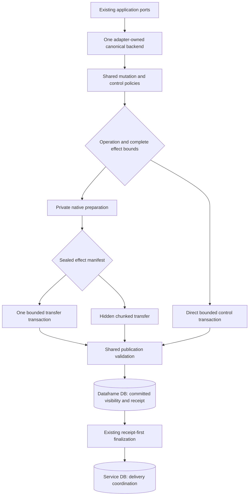

# SQLite hybrid storage: implementation seams and migration choices

Status: analysis and design proposal, 2026-10-11. Reviewed source HEAD:
`46cb4ab3b1347c3fa713e9748e2f28c63bcacac3`, initially clean. No production
implementation, schema conversion, backend activation or capacity acceptance
is part of this assessment. Native remains the default; C5/G6 remain
NOT_ACCEPTED. PostgreSQL is outside release 0.3.0. Production workload sizes
and rates, and a replacement acceptance budget, are not established.

The proposal extends the [feasibility review](capacity-feasibility-review.md)
and the completed [staged transport cycle](cap-7c-staged-transport-cost.md).
It distinguishes existing reusable mechanisms, source-confirmed extra work,
and unmeasured optimization hypotheses. It does not supersede proposed
[ADR 0041](../../../ADR/0041-sqlite-staged-publication-experiment.md).

## Conclusion and limits

A hybrid is feasible inside one canonical backend: use direct, bounded SQLite
transactions for genuinely small operations; use hidden chunked publication
for large atomic effects; investigate a simpler physical representation for
immutable evidence than for repeatedly mutable canonical facts. All paths
must share publication visibility, semantic ownership, receipts and recovery.
The representation changes and general lane selection are conditional later
choices, not components of the first direct-control experiment.

The highest-value investigation is broader than choosing a writer from the
input row count. It includes removing per-effect transport metadata that
duplicates typed storage, avoiding private native preparation for small
controls, separating read dependencies from actual write invalidation, and
storing immutable receipt payloads without general latest-version machinery.
The first [bounded projection ACK experiment](projection-ack-experiment.md)
now measures a large local ACK gain, mixed workload cost and unchanged physical
effect count. It does not admit production activation or the other hypotheses.

The proposal cannot guarantee native total time and staged writer availability
for every large delivery. A direct 100k-row transaction still occupies one
SQLite writer. A large hidden publication still incurs storage, durability and
cleanup work. Preparation followed by one native final apply is another valid
candidate, but its final apply is proportional to the effects, not a constant
publication marker. It cannot promise short writer occupancy.

## What the current comparison actually switches

The [qualification launcher](../../../../bootstrap/ioc-app/src/test/java/com/iocextractor/bootstrap/SqliteCapacityApplication.java)
starts the real application and replaces a coordinated set of canonical ports.
Its [test-only bridge](../../../../bootstrap/ioc-app/src/test/java/com/iocextractor/adapter/out/store/jdbc/StagedCapacityBundle.java)
is not an operator-selectable production backend.

| Responsibility | Native reference | Staged candidate |
|---|---|---|
| Extraction, attribution, classification, routing and mapping | Shared production path | Same path |
| Service delivery/admission/export/publish ledgers | Ordinary service DB transactions | Same transactions |
| Sealed document/CSV preparation | Private workspace | Same admitted workspace |
| Canonical mutation and confirmation | Existing kernel on canonical native tables | Same kernel on selectively hydrated private native tables |
| Canonical visibility | Native commit | Typed hidden effects plus committed unit marker |
| Expiry, history, receipt retention and slot reconciliation | Native canonical operations | Native operations in private state, then typed publication |
| Projection acknowledgement and terminal observation marking | Short native updates | Full private control preparation and publication |
| Publication IDs, epochs, fences, journals and physical cleanup | Not applicable, except shared allocator/control facts | Direct SQLite transactions over protocol tables |

Thus staged already combines native mutation, direct coordination writes and
versioned publication. The opportunity is to refine those boundaries, not to
add a second semantic engine.

Latest complete 100k unique cells are one pair each: document time is
68.127 s native versus 334.567 s staged, and aggregate import is 28.089 s versus
135.349 s. Maximum physical writer holds are respectively 13.076/0.953 s
and 16.611/0.204 s. Processed URL-to-host import completes three pairs with
median times 16.668/16.698 s. These measurements establish the availability
tradeoff and workload dependence, not hybrid performance or an accepted budget.
All source/binary identities and scopes remain in the transport report.

## Hard contracts

- Canonical values, aliases, lifecycle identity, origins/provenance, revisions,
  required projection generations, slots and commit receipt stay under
  dataframe-owned authority.
- Ordinary confirmation remains atomic per artifact; import remains atomic
  across its admitted artifacts and canonical receipt. There is no per-row
  public commit or independent backend choice for branches of one import.
- The existing key resolver, mutation engine, import merge planner, registration
  precedence and slot policy remain the semantic owners. No IOC-specific
  deduplication or second merge implementation belongs in storage dispatch.
- Committed receipt recovery works without the source file or private stage.
  Complete row payloads, field positions, diagnostic counts/details, warnings
  from COALESCE participants and slot results remain exact.
- Shared reads see only committed facts and use one owned snapshot. Old
  versions must not reappear after deletion, retention or expiry.
- Hybrid confirmation uses the owner-approved publication UTC boundary:
  equality is expired; an expired selected lifecycle cannot be renewed.
  Current native ownership-time and staged publication-time boundaries are
  different at deadline crossings. Switching paths must not switch semantics.
- ID reservations retain non-reuse, including rolled-back/rebuilt attempts.
  Public export slots remain independent of canonical/lifecycle IDs.
- Safe UTC, fencing, quota admission, cancellation and finite rebuilds remain
  mandatory. A small row count does not authorize a large fan-out transaction.

## Target arrangement

Every proposed direct-control execution creates committed typed effects through
the same publication protocol. There is no second publication or recovery
state machine. Moving an operational family outside that protocol is a separate
ownership redesign, excluded from the first candidate. Existing direct
allocator/protocol/cleanup coordination writes keep their present owners;
they are not a new lane for canonical business effects.

There are two independent design axes:

1. **Execution:** direct bounded computation, private preparation plus one
   transfer transaction, or private preparation plus multiple hidden chunks.
2. **Representation:** mutable versions, immutable typed payloads gated by
   publication/parent visibility, or independently writable operational state.

Optimizing only transaction count leaves generic version and transport cost.
Optimizing only representation leaves unnecessary private control setup.

## Review constraints and the first candidate

Executed follow-ups are recorded separately: [projection ACK](projection-ack-experiment.md)
and [typed chunk journal consolidation](typed-journal-experiment.md). The latter
retains complete typed receipts/provenance, improves bounded document writer and
storage cost, and does not prove a high-collapse import speed or broad read/cleanup
gain. Both remain isolated qualification mechanisms; production stays native.

The 2026-10-11 owner review identifies four admission requirements: one
publication/conflict/recovery model, explicit control ownership, qualification
of reads and cleanup as well as writes, and testable lane eligibility. These
requirements narrow the first experiment.

Keep the current versioned catalog, epoch scopes and chunk journal. Add only
projection acknowledgement/error execution that skips private native setup
and performs a bounded transition on the latest committed state. Both this
execution and existing prepared execution call the same connection-scoped
begin/append/seal/publish primitives, identity/pin/fence checks, effective-time
validation and rollback/recovery owners. The first candidate has no general
cost dispatcher, append-only conversion, epoch narrowing, cross-file state
move or prepared single-transaction promotion lane.

The existing unit/attempt states remain unchanged. Direct execution collapses
their physical work into one owned transaction; intermediate states are not
externally visible. Prepared execution persists hidden progress between short
transactions. Return a successful control outcome only after commit. A lost
commit response must use the existing durable outcome/idempotent transition
rules, not replay an unchecked mutation. Neither mode has lane-specific receipt
interpretation, lifecycle policy or source reprocessing during recovery.

The family catalog fixes one representation per physical family and layout;
it cannot be chosen independently for each operation. Later execution choices
are explicitly allowlisted per operation/catalog version. Do not expose an
arbitrary execution-by-representation product as operator configuration.
Shared semantic contract tests run against every admitted execution, with
focused physical-boundary tests for each transaction shape. A shortcut that
needs its own conflict checker or recovery interpreter is rejected.

## Source-confirmed migration and reuse inventory

| Seam | Existing owner and extra work | Candidate change | Gain and limitation |
|---|---|---|---|
| Small controls | `JdbcStagedControl` calls `JdbcStagedPublication`; each attempt opens a pool/private DB, initializes native schema, hydrates, captures and transfers | Allowlisted bounded control executor using the existing transaction/protocol owners | Removes fixed setup for small units; does not make all maintenance small |
| Projection state | `JdbcStagedProjectionStore` hydrates metadata and republishes the combined `artifact_projection_state` row | First use a direct typed control path; consider splitting required generation from installation acknowledgement/error | Avoids private DB and whole-row interference; separation needs migration and stale-ack tests |
| Terminal observation | `JdbcStagedReceiptStore.markTerminal` copies and republishes `canonical_observation` | Direct typed control first; audit whether terminal/retention fields merit a separate family | Small update; cannot blindly exclude the current combined row from conflict tracking |
| Dependency invalidation | `JdbcPublicationProtocol.publish` advances every declared dependency when contributions are nonzero | Persist read-set plus write-set; validate all reads, advance only proven written semantic scopes | Reduces false rebuild opportunities; scope mapping must cover negative lookup and metadata |
| Typed transport journal | `JdbcTypedPublicationChunk.append` writes a `publication_fact` checksum pointer per effect and inserts the actual typed version | Typed chunk journal with exact count/digest/deadline summary and atomic typed insertion | Removes a per-effect physical row and index maintenance; generic facts currently also enforce protocol safety |
| Immutable receipt evidence | `JdbcPublicationCatalog` sends receipt rows, field positions and import result children through generic version tables | Typed append-only family, committed-unit visibility and explicit parent visibility | Less version metadata/lookup/cleanup; never remove payload required by restart |
| Receipt/history purge | Retention hydrates selected parents and all children, runs native cascades, then publishes child tombstones | Logical parent retirement followed by bounded physical child reclamation, only for proven parent-owned families | Avoids huge visibility transactions and repeated copies; child readers and ownership must change together |
| Slots | `JdbcSelectedCanonicalBase.slotNamespace` copies the namespace; `JdbcPublicationSlotBase` streams all active membership headers | Preserve allocator policy; investigate selective persistent-state access behind its session boundary | Could help populated databases; small input alone does not bound namespace work |
| Private setup | `JdbcStagedPublication.initializeNative` runs migrations/reconciliation for every attempt | Validated empty schema template or smaller control layout | Fixed-cost candidate; no mutable canonical DB clone or unsafe workspace reuse |
| Matching and mutation | `JdbcCanonicalMutationEngine`, match sessions and import planner already shared | Extend their persistence seams only where required by a measured experiment | Keeps semantics unified; a generic direct writer for all mutations is substantial work |
| Import and publication workspaces | `JdbcImportWorkspace` owns sealed delivery admission; private canonical workspace owns a snapshot-dependent attempt | Share byte codecs, readers, quotas and disposal; keep admitted stage immutable and attempts separate | Reduces duplication of utilities; merging lifetimes can corrupt replay/pins |
| Health and migration | `JdbcStagedCanonicalOperations`, format checks, process lease and configuration pins already exist | Extend these owners for a declared hybrid layout | Reuses recovery/readiness; a new representation is not an invisible change to format 13 |

These are optimization candidates, not confirmed runtime data-loss defects.
The measured document rebuild counter is aggregate across promotions and
controls; it does not prove that projection or slot invalidation caused it.

## Small direct controls without a second policy engine

Start with projection acknowledgement/error recording. The
[current staged adapter](../../../../adapters/adapter-store-jdbc/src/main/java/com/iocextractor/adapter/out/store/jdbc/JdbcStagedProjectionStore.java)
uses the same full preparation machinery as larger work. The
[native store](../../../../adapters/adapter-store-jdbc/src/main/java/com/iocextractor/adapter/out/store/jdbc/JdbcArtifactProjectionWorkStore.java)
owns monotonic compare-and-set conditions and affected-row outcomes.

Extract the admissibility/state transition once, with native and typed
persistence behind it. Do not paste the SQL's business conditions into a new
unrelated writer. A direct typed operation reads the latest committed value
under real writer ownership, computes a byte/count-bounded change, and applies
begin/append/seal/publish in the same transaction. Initially it can retain the
existing digest framing, epoch scopes and version schema to isolate the change.

For a schema refinement, split the combined row into a published required
generation and a native operational acknowledgement/error row, both in the
dataframe DB. The load facade combines them in one snapshot. Generation
comparison remains monotonic: an older installation cannot acknowledge newer
data, regress an installed generation or overwrite a newer failure state.
Every prepared mutation must stop copying or overwriting the operational row.
Failure detail should be associated with the generation it describes.
This ownership split is conditional work after the unchanged-layout experiment;
it must not be bundled with the first execution change.

True no-effect controls may return without constructing a private publication,
after their decision is validated at the appropriate ownership boundary.
An import with zero public mutations still needs its receipt and diagnostics;
it is not an empty control and cannot take this shortcut.

## Control ownership and forced-order verification

Local writer admission serializes physical writes but does not protect a
staged snapshot prepared earlier. Direct controls must read and compute under
real SQLite writer ownership, publish their typed effects, and advance the
same affected epochs in that transaction. Promotions retain durable admission
ownership; controls retain their bounded physical ownership rules. A new global
promotion lease for controls would defeat their availability objective.

With the current combined projection row and coarse artifact scope, the safe
sequence is: staged preparation observes epoch E; direct ACK publishes and
advances E; the staged publish detects the stale dependency and rebuilds.
It must never overwrite the ACK with its earlier prepared whole-row value.
Avoiding that rebuild requires the separately reviewed state-ownership split;
epoch narrowing alone cannot make the stale whole-row effect safe.

Frequent successful controls may therefore increase conflict/rebuild pressure
even when their physical transactions become faster. Include a control-burst
case and the existing finite rebuild budget in qualification. Skipping a
repeated control is allowed only when the shared transition contract defines
it as a no-effect outcome; do not discard its timestamp/error effects solely
to improve the benchmark. Faster ACK latency with failed or starved promotion
is not an acceptable local optimization.

Extend the existing timed-latch fixtures in `StagedPublicationFaultIT`,
`StagedPublicationOperationsIT` and `SqlitePublicationExperimentIT`. Required
forced-order cases include:

| Forced order | Required observable outcome |
|---|---|
| Prepare generation G; commit direct ACK for G; publish the prepared whole row | Conflict/rebuild preserves installed generation and the intended canonical change |
| Prepare an ACK/error intent for G; publish canonical generation G+1; execute the intent | Re-read current state and apply the shared generation predicate; no stale prepared replacement |
| Pause a direct transaction before commit; attempt concurrent publication | Correct physical serialization, bounded worker termination and no lost update |
| Direct control rolls back after typed append or publication validation | No visible effects or epoch advance; a later prepared publication remains valid |
| Direct operation is a genuine no-effect transition | No fabricated write invalidation, under the shared empty-effect protocol rules |
| Control changes an unrelated declared scope | Unrelated prepared work remains valid; negative lookup and blind writes remain protected in their actual scopes |
| Crash before commit, and after commit before returning the result | No partial visibility; restart observes the durable outcome or safely repeats the admitted idempotent control |

Use explicit timed barriers/latches and containing JUnit timeouts, with workers
released/cancelled in finally and bounded join. No sleeps or automatic retries
may conceal ordering failures. Assert database state, epochs, receipt/fence
outcomes, generations, IDs and provenance; equal projected CSV alone is
insufficient. The future read/write-set revision reruns these cases and adds
all family mappings, deletion/negative matches and reverse attempt ordering.

## Read dependencies are not all write invalidations

[Publication](../../../../adapters/adapter-store-jdbc/src/main/java/com/iocextractor/adapter/out/store/jdbc/JdbcPublicationProtocol.java)
currently validates dependencies and, if there are contributions, advances all
their epochs. For example, slot reconciliation declares both artifact and
slot scopes because it reads canonical membership. That does not establish
that it changed canonical values or membership. History purge also uses the
whole artifact scope despite working on retained history.

A refined manifest should declare observed epochs and actual semantic write
scopes separately. Validate observed epochs for the union of read and write
scopes when allocating the attempt stamp and at publication. Even a blind
insert needs its write-namespace pin to protect uniqueness and overlapping
writer order. Advance affected write scopes atomically with visibility.
Read-only scopes must remain validated; overlapping writers must still be
rejected/rebuilt, and negative matches still depend on the complete namespace.

Do not infer this write-set from the current `publication_fact.scope`:
`JdbcPublicationTransfer` assigns all typed pointers to the first sorted
dependency. Introduce explicit catalog/operation mappings and verify that each
typed effect belongs to declared write scopes. Unknown families fail closed.
Whole-row projection updates can overwrite an acknowledgement, so their read
and write scopes cannot safely be narrowed before separating state ownership.

## One journal for typed transport

Each existing typed effect creates a protocol pointer containing its table,
address and chunk checksum, as well as the typed physical row. The generic
fact table has its own primary key, lookup and deadline indexes. Consequently
256 distinct typed effects can require 256 pointer writes plus 256 typed writes,
in addition to chunk/header updates. This is a source-confirmed storage count,
not a measurement of their share of elapsed time.

A typed append primitive could retain one journal entry per ordered chunk:
digest, exact effect count, framing/layout version, deadline constraints,
renewal-anchor requirement and declared write scopes. Insert typed data and
acknowledge the journal in one transaction. Exact replay checks digest before
insertion; different values, order, NULL/BLOB, flags or attempt identity reject.
Seal still requires the complete manifest, with no row scan at publication.

The pointer table is not simply redundant bytes to delete. It currently checks
attempt/scope foreign keys, counts, deadlines and validity requirements, and
participates in cancellation/retention. Provide equivalent checks in typed
transport and typed references before removing it. Keep generic fact experiments
distinct from the production typed path; do not fork publication semantics.
Drained migration's zero-contribution literal-copy path is a separate special
case that must remain explicit, not become a runtime integrity bypass.

## Hybrid physical families and large immutable evidence

An operator-configured artifact is mutable even if a particular sample only
inserts. It therefore retains versions and tombstones. Classification of a
physical family is adapter-owned and persisted with layout pins, not inferred
from the current IOC or supplied as an arbitrary operator switch.

| Physical family | Initial disposition | Evidence for admission |
|---|---|---|
| Canonical rows, active aliases, current source summaries and field origins | Mutable versioned | Renewals, field mutation, expiry and aliases change across observations |
| Required revisions/generations and reusable export slots | Published transactional state | Must align with canonical visibility/namespace completeness |
| Receipt header/artifact markers | Published state transitions | Ordinary receipt can remain STAGING across several artifact commits |
| Artifact receipt rows and receipt field positions | Append-only candidate | Writer inserts each artifact's ordered payload; restart consumes exact immutable rows |
| Import rejection/warning/slot-result children | Append-only candidate | Admit only after auditing creation, purge and supported replay paths |
| History snapshots and history source/origin children | Later append-only candidate | Audit lifecycle closure, keys, cascades and references first |
| Projection installed generation/error | Independent native state candidate | Separate from published required generation and enforce stale-generation conditions |
| Ownership, epochs, allocator and cleanup progress | Existing direct coordination state | Preserve their current canonical authority and resource ownership |

For append-only evidence, native typed tables can use attempt-qualified physical
keys and a committed-unit predicate, without a mutable latest-version lookup
for every child. Logical-key uniqueness across committed attempts must still
be enforced. A cancelled attempt's rows cannot become visible on another fence.
Retry is exact, not last-write-wins replacement.

Receipt identity retains the existing receipt/artifact/ordinal/field keys;
it is not uniqueness by IOC row_key. Several prepared occurrences can have the
same IOC key while retaining different receipt ordinals and field positions.
Changing that would alter disabled-dedup behavior, ID reservation and provenance.

Children also require their owning parent to be logically visible. Do not gate
all ordinary children solely on receipt COMPLETE: earlier artifact payloads
are used while the header is STAGING, and completion validates their counts.
Keep that visibility and each artifact's own committed unit. After complete
commit, recovery must work with the original stage deleted.

Retiring a parent can hide its payload atomically; physical child deletion can
then proceed by persisted keyset pages. This only applies to strictly
parent-owned evidence. Field origins, aliases and active canonical provenance
must not disappear merely because an observation/receipt was purged. Readers,
in-flight attempts and anchors remain protected. Parent identities cannot be
reused in a way that resurrects old children. Cancelling hidden children also
requires cleanup coverage, not just committed-parent retirement.

This addresses a real granularity issue: selecting one receipt does not bound
its child rows or bytes. The current
[receipt retention](../../../../adapters/adapter-store-jdbc/src/main/java/com/iocextractor/adapter/out/store/jdbc/JdbcStagedReceiptStore.java)
copies all selected receipt payloads and field positions. Changing its lane
to direct native without changing effect bounds can recreate a long hold.

## Choosing one-transaction versus chunked transfer

After native preparation, the existing sealed `Description` provides chunk
and effect counts. Extend it with complete physical byte counts and footprint
before selecting a transfer lane. A one-transaction lane can reuse the same
typed insertion/protocol with fewer independent commits. It still pays private
preparation unless a separately admitted direct control operation is used.

Eligibility includes effect rows/bytes, field-position/provenance/history
fan-out, slot namespace work, dependency breadth and deadline constraints.
100k inputs collapsing to 20 keys is not automatically a 20-effect transaction.
Never select solely from file extension, incoming rows or public winner count.
No universal threshold is justified by the available workload information.

Persist physical lane/layout in the attempt descriptor before transfer. A
rebuild may recompute the manifest and lane under a new fence with unchanged
logical/business pins; it cannot silently switch semantics or splice another
writer into a partly transferred attempt. Never turn failed chunked publication
into an unbounded native fallback. Both lanes use the same logical promotion
admission, writer scheduler, publication UTC and receipt outcome.

The single-transaction writer must share one caller-owned canonical connection
for begin, every typed INSERT, seal, publication and owner release. Wrapping
existing callbacks in writer admission alone is insufficient: the current
TransferWriter callbacks each open and commit their own transaction. Expose
connection-scoped physical primitives rather than nesting another executor or
opening a second writer connection under an owned transaction.

## Eligibility limits and performance targets

General lane selection is not admitted until its limits are declared and
calibrated. Eligibility proves that a mode is permitted within a tested
envelope; it does not predict the fastest execution for every delivery.
Use explicit operation/catalog rules and conservative deterministic checks,
not a self-learning dispatcher or an input-row heuristic.

| Limit or target | Definition and enforcement |
|---|---|
| Effects per transaction: N_tx and B_tx | Exact typed effect count and encoded bytes, including receipt/provenance fan-out and protocol overhead; check the complete sealed manifest or the bounded direct operation before insertion |
| Writer hold: H_target | Measure from actual writer ownership through commit/rollback, including durability/checkpoint work; report maximum and tail distribution per operation class; this is a measured admission target, not a guaranteed timeout |
| Acknowledgement latency: L_ack | Measure command eligibility/enqueue to durable ACK, including queueing, conflicts and commit; separate writer execution from end-to-end control latency |
| Additional disk: D_extra | Bound admission through existing quota ownership and headroom checks; measure peak incremental canonical/version/index, WAL, private workspace and temporary bytes against the same baseline |
| Cleanup debt: Q_rows and Q_bytes | Measure reclaimable obsolete/cancelled rows and bytes separately from legitimately retained evidence and reader-pinned state, plus oldest age and catch-up time |

Encoded effect bytes are enforceable but do not equal physical WAL/page/index
bytes. Calibrate write amplification on populated state, retain actual disk
peaks, and include indexes and ancillary protocol writes. An isolated footprint
estimate is insufficient to prove D_extra. Cleanup must retain its reserved
resources and ability to drain already admitted work when new intake is
restricted; quota backpressure cannot block the cleanup needed to recover.

The existing transfer bound of 256 rows/1 MiB per chunk is a mechanism limit,
not an accepted ceiling for one combined transaction or an ACK SLO. No new
numeric H_target, L_ack, D_extra, Q_rows or Q_bytes is owner-approved. Calibrate
N_tx/B_tx against measured hold/read/disk/debt curves under declared hardware,
durability, database population and concurrent control load; record candidate
numbers and evidence before admitting general single-transaction transfer.

The first direct ACK/error candidate instead uses a code-audited operation
allowlist: one addressed projection state row, bounded identity/pins/scopes
and a known finite set of protocol writes. It still measures latency and
complete resource cost. Unknown operations or an exceeded pre-write footprint
use the existing prepared execution or reject admission under its established
resource policy. A general prepared fast lane remains disabled while its
budget is open. Separate resource-budget acceptance from correctness and
relative-cost qualification.

A byte/row bound cannot guarantee wall-clock writer time: disk stalls, commit
synchronization, checkpoints and scheduler delays remain outside that proof.
SQLite's [WAL documentation](https://www.sqlite.org/wal.html) explains both
commit synchronization and checkpoint variability. Timing uses a monotonic
clock; canonical lifecycle decisions continue to use safe UTC. If measurements
violate the declared target, disable the optional fast mode for future units
and investigate; never splice another writer into an in-flight attempt or
claim that an already committed operation was rolled back by a timeout.

## Two databases, workspaces and rejected shortcuts

Keep service coordination and canonical authority in their current files.
The service DB's writer is already independent of the dataframe writer. Joining
them puts delivery bookkeeping behind the same large canonical transaction.
Splitting canonical artifacts/receipts across the two WAL databases needs a
new crash-consistency protocol; ATTACH alone does not give multi-file atomicity.
This is not a cheap route to the current delivery contract.

A narrower cross-file option is to move only projection installation
acknowledgements/errors to the service DB, while the required generation stays
canonical and advances atomically with dataframe changes. This would remove
that operational write from dataframe writer contention even for native bulk
transactions. It is not a move of canonical generation or receipt authority.
It needs a separate admission decision: the current combined-state port
requires projected generation never to exceed required generation, and a
cross-file facade cannot assume an atomic snapshot. Preserve monotonic
generation validation, installed-file ownership, stale-error rules and the
reconciliation backstop; associate acknowledgements with the dataframe
incarnation so restore/reset cannot reuse a generation and suppress required
work. Migration and backup must cover both files. The initial direct-control
experiment keeps both families in the dataframe DB to isolate execution cost;
cross-file operational ownership remains a conditional later alternative.

Do not merge the admitted immutable CSV stage with a mutable snapshot-dependent
canonical attempt. The same delivery can need a new attempt after expiry or
dependency change. Reuse readers, framing, statement owners and quotas; preserve
separate seals, lifecycle and disposal. A private schema template can reuse
empty validated structure, but must not carry canonical rows, allocator state
or another attempt's pins.

| Alternative | Assessment |
|---|---|
| Current native writer plus current staged writer on one converted DB | Incompatible: native tables are replaced with views; separate writers would bypass or compete with visibility |
| INSTEAD OF triggers as a transparent kernel adapter | Not a drop-in replacement for existing UPSERT, uniqueness and affected-row contracts |
| Native base plus staged delta overlay | Possible larger design, but matching, indexes, uniqueness, compaction and reads need coherent base/overlay rules; not the initial candidate |
| Maintain a latest-row pointer for every effect in final publication | Adds effect-proportional final writer work; defeats the small-marker objective unless the pointer is a non-authoritative cache |
| Prepare a delta privately, then apply it to ordinary native tables | Useful middle candidate if its measured final hold is acceptable; validation and receipt must commit with it |
| RBU as a replacement | Its writer/WAL/constraint limitations conflict with the current control-availability and kernel contract |
| SQLite session changesets | Useful pattern for prepared deltas; native/JNI integration, primary-key coverage and canonical conflict/time semantics are unqualified |
| Weaker synchronous policy or visible chunk commits | Changes durability or atomicity; not admitted by this assessment |

## Bounded next investigation and stop conditions

The recommended first comparison admits only the unchanged-layout direct
projection control described above. It targets fixed control setup cost and
the forced-order safety contract. Typed chunk journal consolidation is a
separate subsequent experiment targeting effect-proportional transfer cost;
it must not change receipt representation, dependency granularity or lane
selection at the same time. Neither duplicates canonical mutation policies.

Before modifying production, retain per-unit preparation/hydration/transfer/
publication timing, transferred rows/bytes by family, pointer/typed inserts,
transaction count, rebuild reason and cleanup debt. Existing aggregate phase
counters cannot attribute one rebuild or large-window cost to a specific unit.
Use bounded diagnostic summaries, not per-IOC logs. Inspect real pinned-driver
query plans on empty and populated state before admitting a changed index or
lookup; this analysis does not claim new EXPLAIN or hybrid timing evidence.

Then compare controls alone and during a receipt-heavy unique publication and
a high-collapse import against frozen existing executables, with identical
semantics, inputs, limits, simultaneous controls and cleanup. If mechanism
cost does not improve, reject it without another automatic corrective cycle.
If it improves locally but worsens total cost, reader latency or cleanup debt,
do not activate it on that evidence.

Append-only receipt representation is the next conditional choice only if
family-level evidence shows material cost after those changes. Slot/session
refactoring follows only if populated namespace work dominates. No unconditional
roadmap of new stages or promise of eliminating every SQLite cost is proposed.

## Read, disk, cleanup and recovery qualification

The common committed-read facade owns the visibility contract. A later
catalog may implement a family using versions, parent-gated append-only data
or separately owned operational state, but callers such as
`JdbcSelectedCanonicalBase` select logical facts through that facade rather
than compose independent visibility predicates. Use the same read connection
and snapshot across dependent families, including hydration, matching, receipt
counts, aliases and slots. The first candidate retains existing views/readers.

Any representation change must qualify all of the following, not just publish
time or one control-write sample:

| Area | Required measurements and oracle |
|---|---|
| Writes and controls | Total time, throughput, whole-JVM allocations, heap/RSS, writer queue/hold tails and end-to-end ACK tails; exact resulting state and receipt |
| Reads | p95/p99 per fixed operation class and result-size profile: active lookup, match/alias lookup, hydration and receipt recovery; export scan duration/throughput separately; identical outcomes in pinned snapshots |
| Physical storage | Before, peak during work, after commit and after cleanup: canonical data/index, WAL, version/journal, workspace and temporary bytes; checkpoints and reader lifetime |
| Cleanup | Created/reclaimed rows and bytes, debt age and catch-up time under sustained input and open readers; distinguish reclaimable, retained and pinned data |
| Crash recovery | Forced process loss during transfer, before publication and after commit; reopen/readiness/finalization times, residue and exact receipt-only completion with source/stage absent |
| Continued operation | Repeated delivery, renewal, expiry, retention and slot reuse on populated state; no missing evidence, stale overwrite or resurrected versions |

Read percentiles require retained per-class samples, declared estimator,
sample counts and independent-fork uncertainty; three full-workload medians do
not establish a read p99. Insufficient samples remain unqualified. Warm and
cold conditions, population, input/output cardinalities, concurrent writers,
long-reader windows and cleanup cadence must be fixed before comparison.
Retain failed windows and measurement/source/binary identities.

Exercise cleanup while publications continue, then measure a declared catch-up
window after intake stops. One drained empty fixture does not prove sustainable
debt. Reader-pinned data must stay protected and its contribution reported;
classifying all physical growth as reclaimable debt would hide a snapshot or
retention cost. Long WAL readers can delay checkpoint/reset, as described in
[SQLite WAL](https://www.sqlite.org/wal.html).

Complexity is also an admission condition: one publication state machine,
one conflict validator, one recovery interpreter and one family visibility
contract, with no lane-specific business-policy copies. If the measured gain
requires a separate semantic implementation or cannot cover these shared
contracts, keep the existing execution.

## Migration, quality and recovery checks

Reuse the operational process lease and readiness barrier. Stop native writers,
drain both coordination ledgers, pin the new physical catalog and convert from
native format 12 directly into the chosen candidate layout. Do not require an
intermediate full conversion to format 13. Conversion of retained format-13
candidate fixtures is a separate compatibility path if needed. A materially
different representation needs an explicit format/capability discriminator;
never silently reinterpret existing format 13 or lower user_version.

Preserve absolute historical timestamps/deadlines, IDs, ranks, origins, receipts
and slots. Seed allocator high-water through the existing owner. Conversion
must not renew rows, clean URLs again or recompute operator-configured identity.
Validate row/count/key/parent relations and literal content, with rollback of
partial conversion. Restore a coordinated stopped backup of both DBs and owned
files for rollback. A configuration selector/activation is a later decision.

Required regression matrix:

- Direct controls versus prepared writes: stale acknowledgement, concurrent
  generation advance, error association, terminal marking and lost updates.
- Dependencies: read-only change does not invalidate unrelated writes; actual
  alias/provenance/expiry/slot changes do; negative lookup and reverse attempt
  ordering remain protected. Narrowing epoch scopes cannot bypass uniqueness.
- Typed journal: changed or reordered replay, NULL/BLOB/anchors, missing/extra
  rows, interruption, stale fence, incomplete seal and every rollback boundary.
- Receipts: earlier artifact payload with STAGING parent, complete counts,
  ordinals/positions, COALESCE warnings, cross-artifact import and receipt-only
  recovery after deleting all source/stage files.
- Occurrence semantics: disabled dedup and final-key collisions retain the
  supported receipt ordinals, ID reservations, whole-row/field precedence and
  provenance even when projected CSV bytes are equal.
- Retention: large child fan-out, parent retirement with open readers,
  in-flight attempts, cancelled children, bounded physical reclamation and
  absence of parent-ID reuse/resurrected data.
- Time: a lifecycle expires between private preparation and publication, and
  exactly at the deadline, in each eligible execution lane. Fresh lifecycle
  IDs and unchanged burned reservations are required.
- Migration and failure: native/candidate source states, mismatched catalogs,
  interrupted conversion, readiness/reopen, forced process loss before and
  after commit, and coordinated restore.

Implementation stays in `adapter-store-jdbc`; bootstrap composes one backend.
No new Maven module, database family, Router policy or framework is needed by
these changes. Existing port/TCK, physical publication and crash suites are
extended. Production changes require focused tests, final `make verify` and
`make pmd-analysis`, plus ownership watchlist review when applicable. Preserve
existing quality floors and failed capacity evidence.

## Primary references and borrowed mechanisms

Executed follow-up, 2026-10-12: the bounded
[immutable receipt-payload experiment](receipt-payload-experiment.md) attributes
ordinary receipt storage after direct ACK/compact journal, compares 12 service
forks and qualifies real-port reads, process-loss recovery and finite retirement.
The document payload pages decrease 24.4% and finite retirement cost decreases,
but whole-service elapsed time barely changes and receipt scan p95 increases
57.9%. The cycle is complete as an experiment; the new layout is not recommended
for activation on this evidence. Native remains the application default. No new
dispatcher, backend or automatic corrective cycle is admitted by this result.

- [SQLite WAL](https://www.sqlite.org/wal.html): one writer per file and commit/
  checkpoint costs; this is why transaction boundaries and total work are
  separate optimization dimensions.
- [SQLite isolation](https://www.sqlite.org/isolation.html): snapshot ownership
  and writer serialization support a shared committed-read facade.
- [SQLite ATTACH](https://www.sqlite.org/lang_attach.html): WAL commits are
  atomic per file, not a crash-atomic transaction across attached files.
- [SQLite triggers](https://www.sqlite.org/lang_createtrigger.html) and
  [UPSERT](https://www.sqlite.org/lang_upsert.html): view triggers and affected
  row/constraint semantics explain the current native-kernel boundary.
- [SQLite RBU](https://www.sqlite.org/rbu.html): borrow sealed bulk effects and
  deferred visibility; its no-other-writer, non-WAL and constraint restrictions
  prevent direct use for this service.
- [SQLite session extension](https://www.sqlite.org/sessionintro.html): borrow
  typed before/after changeset thinking; its declared-primary-key requirements
  and ignored NULL-key rows require a schema audit before any adoption.

External mechanisms are design references, not added dependencies or evidence
that a new hybrid satisfies this project's semantic and resource contracts.
