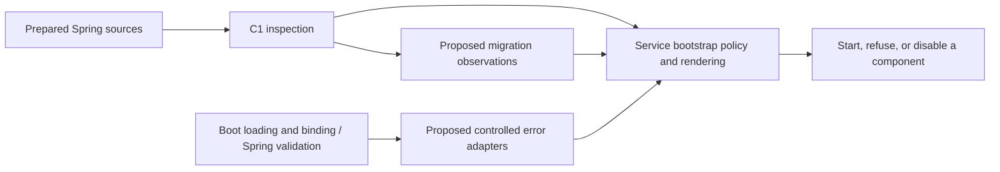

# Configuration reuse after C1

Status: analysis and proposed boundaries, 2026-10-21, followed by the
owner-authorized controlled-error and migration checkpoints below. This is not an accepted ADR
or publication admission. C1 remains the implemented name/declaration inspector;
C2–C4 keep their current scope.

## Scope and baseline

The owner asked which existing configuration mechanisms can give future services
a consistent approach beyond name inspection. This assessment follows the
[configuration proposal](configuration-library-design.md) and evaluates error
adaptation, configuration evolution, a configuration-only command, documentation
tests, selectors and named registries.

Source identity: `r030-libraries`, HEAD
`f693b1cd2938dfc98aac6e1652ed4e5d00fad0ae`, with the uncommitted C1 implementation.
Java 21, Boot 4.0.8 and Framework 7.0.9 are the actual baseline. There is no
implemented second production-service consumer.

Inputs: live bootstrap code/tests, the new
[module contract](../../../../adapters/adapter-config-spring-boot/README.md),
[ADR 0016](../../../ADR/0016-config-preflight-strict-binding.md),
[ADR 0027](../../../ADR/0027-rollback-safe-configuration-evolution.md), retained
test reports, an offline dependency tree and small synthetic probes. Production
Java, POMs, test sources and accepted ADRs are unchanged by this analysis.

## Candidate disposition

| Candidate | Existing mechanism | Recommendation | Required new work |
|---|---|---|---|
| Controlled error adaptation | YAML details, unknown-key analyzer, semantic-command fallback | First candidate for a small addition to the Boot adapter | Structured categories and phase coverage; controlled output; IOC codes remain service-owned |
| Configuration evolution notices | Migration catalog, compatibility annotation, startup warning, removed-key hints | Small declaration-based migration inspector | Path matching, instance identity, environment spelling and incomplete coverage; conversion/conflict policy stays local |
| Configuration-only validation | Explicit minimal Spring application | C2 integration example first | Qualify resource/bean isolation and permitted source expansion; do not publish the existing console-suppressing runner |
| Model/template/docs/IDE consistency | `ConfigurationDocumentationContractTest` | Reusable test recipe first | Full-path fixtures and parsed metadata; keep test dependencies outside the runtime API |
| Custom selector tokens | `ConfigSelector`, `ConfigSelectors`, converters | Defer a public helper pending a second real use | Compare with Boot conversion; qualify grammar, collisions and errors |
| Named registry references | `ConfigRegistryCatalog` and `ConfigRegistryPreflight` | Keep service-owned | Extract only if another consumer demonstrates a useful common contract |

Error adaptation and migration inspection require bounded new API work around
existing mechanisms, not mechanical moves of whole IOC classes. Services retain
schemas, semantic rules, migration windows, diagnostic codes, wording, severity
and recovery scope. IOC keeps strict startup refusal; a future collector may
choose to reject only one configured source.

## Findings that constrain extraction

The production classes below are under
[`bootstrap/.../bootstrap`](../../../../bootstrap/ioc-app/src/main/java/com/iocextractor/bootstrap/).

### F1: error output can disclose supplied input — reproduced

`IocYamlFailureDetails` copies `MarkedYAMLException.getProblem()`. Its `sanitize`
method only folds whitespace and truncates text. The semantic command's fallback
prints an informative exception message; `ConfigSelectors.parse` includes the
rejected input in its message. These are not value-free rendering boundaries.

| Synthetic input | Observed result against existing compiled C1 classes |
|---|---|
| YAML `password: *synthetic_secret_7d96` | Exit 78; output contains `Parser: found undefined alias synthetic_secret_7d96` |
| YAML `ioc.runtime.mode: synthetic_secret_7d96` | Exit 78; output contains `Invalid ioc.runtime.mode value 'synthetic_secret_7d96'` |

This demonstrates disclosure of synthetic input on two exact failure paths. It
does not establish exposure of actual deployed credentials or every converter's
behavior. Existing positive secret-output tests do not cover these cases. The
durable defect is [CFG-5](../../../KNOWN-ISSUES.md#надёжность-конфига-cfg).

### F2: restricted beans do not imply process isolation

`IocSemanticConfigurationCheck` explicitly registers the model and preflight
classes and closes a successful context. This composition is useful. It also
calls `System.setOut` and `System.setErr` while validating. Its monitor serializes
checker invocations but cannot protect unrelated threads' output. The existing
class cannot be admitted unchanged as a general embedded validation runner.

### F3: restricted beans do not imply a single isolated file — reproduced

The checker rejects configuration-loading switches supplied as CLI arguments.
However, a candidate containing `spring.config.import: file:<temporary file>`
loaded that imported file. An invalid selector in the import produced exit 78
and the imported marker appeared in failure output.

Imports may be intentional Boot behavior; this is not proof that IOC must reject
them. C2 must state whether it validates a candidate plus allowed imports and
overrides or a single isolated file. An isolation claim needs source-policy
enforcement before prohibited imports are loaded, with YAML, CLI, environment
and system-property tests. A check after context refresh cannot establish that
an imported resource was never read.

### F4: the unknown-key analyzer encodes an IOC protocol

`IocUnknownConfigurationPreflight` puts a raw environment name into a synthetic
`ConfigurationProperty` value. `IocConfigurationFailureAnalyzer` reads that value
to recover the name. This is an IOC adapter convention, not a generic value-free
error adapter. Shared adaptation should consume `PropertyInspection` names
directly; the old transport convention remains local until deliberately migrated.

### F5: migration declarations are not bound conflicts

The migration catalog has one temporarily accepted alias,
`ioc.sync.endpoints[].smb.encrypt`. Removed lookup and timeout hints live in the
failure analyzer. Boolean-to-policy mapping and dual-key rejection are separate
service rules; semantic validation checks the bound fields.

A name-only inspector can report both names being declared, including shadowed
and null-valued declarations. It cannot conclude that both survived Binder.
Lists, nulls and precedence must not become a second value-resolution engine.
Different endpoint indexes must not be paired into a false conflict.

### F6: documentation tests are weaker than a complete configuration contract

`ConfigurationDocumentationContractTest` has useful structural checks, but:

- template coverage searches for each terminal field name anywhere in YAML;
  a field under the wrong parent or in a comment may satisfy it;
- its Binder helper reads the first YAML document, omits unknown-name preflight
  and uses a separate conversion service rather than the production converter beans;
- hints are extracted from the additional metadata JSON using formatting-sensitive
  text/regex checks; sets hide duplicate values and the compiled merged metadata
  is not the input;
- guide coverage checks exact backticked tokens, not their explanation or defaults.

Generalizing these checks unchanged would reproduce their gaps in every service.
A reusable recipe needs full canonical paths, explicit supported schema shapes,
comment/example handling, multiple documents/profiles and actual service hooks.

## Proposed shared contracts

### Controlled error adaptation

Adapt structured framework results. Keep `PropertyInspection` intact: flattening
unknown, ambiguous and unsupported names into one error list would lose its
coverage and distinctions. The proposed error report carries:

- the phase: loading, name inspection, binding or semantic validation;
- a fixed category such as syntax, conversion or constraint violation;
- an optional qualified path and numeric line/column;
- a safe source reference only when it can actually be mapped;
- unsupported/unclassified outcomes and which later phases did not run.

Do not export `Throwable`, rejected values, error arguments, default messages,
parser text or arbitrary origin/source `toString()` output in a report intended
for controlled rendering. Custom validator codes require a trusted mapping.
Unknown exceptions produce a coarse unclassified result, not their message.
Names and map keys can themselves be sensitive; schema-qualified display and
arbitrary-name display need explicit service policies.

Do not catch `Error` or silently turn programming/resource failures into operator
mistakes. Preserve technical failure identity outside the exported report so the
service can handle it under its own controlled diagnostic policy.

Spring already provides `Validator`, `Errors`, field/global errors and binding
failure classification. Use public structured APIs, not another rule engine.
A semantic collect-all promise applies after successful binding and execution of
those validators. Parser/conversion failure may prevent later checks entirely.
A service may map reports to the diagnostics library without making it a mandatory
dependency. [Spring field errors](https://docs.spring.io/spring-framework/docs/7.0.9/javadoc-api/org/springframework/validation/FieldError.html).

### Migration observations

Accept explicit service descriptors for deprecated accepted names and removed
names, with an optional replacement. Return declaration facts tied to a descriptor
and source reference. Warning/error policy, compatibility dates, value conversion
and bound dual-key rejection remain service-owned.

Begin with fixed paths and numeric list instances using an explicit `[]` template.
Preserve concrete indexes in replacement paths. Arbitrary map wildcards, regex
callbacks, migration chains and automatic rewriting are outside this recommendation.
Invalid/overlapping descriptors must be rejected explicitly.

Removed names need a separate descriptor match over declarations, including
unknown names; do not put them back into the current schema as accepted fields.
Their environment spellings require separate qualification because the old name
is absent from the record schema. Ambiguity and incomplete inspection stay visible.

No value reads, Environment mutation, YAML rewrite or startup enforcement is
needed. Reuse one C1 traversal rather than rescanning mutable sources. This is a
proposed boundary; the later migration checkpoint records its implemented API.

## Framework alternatives and dependencies

Boot metadata already represents deprecation level, reason, replacement and
version; IOC supplies metadata for `encrypt`. Keep that format for IDE support.
Tests can align it with runtime descriptors instead of creating another annotation
processor. [Metadata format](https://docs.spring.io/spring-boot/specification/configuration-metadata/format.html).

`spring-boot-properties-migrator` is a real alternative for a different policy:
startup diagnostics plus temporary runtime migration. Version 4.0.8 source review
confirms it loads classpath metadata, reads values and inserts replacement sources.
Its helper classes are package-private. Its type check does not supply IOC's
Boolean-to-encryption-policy conversion. Indexed alias behavior still needs runtime
qualification; no migrator runtime test was run here.
[Boot migration facility](https://docs.spring.io/spring-boot/upgrading.html).

Use the metadata convention; do not enable that migrator implicitly or depend on
its internals for a name-only observer. Services wanting runtime remapping can
evaluate the standard facility separately. The moving Boot documentation identified
4.1.1; it establishes available mechanisms, not a tested support range. Local
dependency/source evidence is for 4.0.8 only.

The offline C1 dependency tree resolves:

| Area | Resolved artifacts |
|---|---|
| Direct | `spring-boot:4.0.8`, `spring-core:7.0.9` |
| Framework closure | Context, AOP, Beans and Expression: 7.0.9 |
| Observation closure | Micrometer Observation and Commons: 1.16.7 |
| Other | `commons-logging:1.3.6`, `jspecify:1.0.1` |

An `Errors` adapter must declare its direct `spring-context` dependency even
though that JAR is already transitive. SnakeYAML 2.5 is in IOC bootstrap, not the
C1 closure. A parser-specific adapter needs an explicit dependency decision;
keeping YAML integration in a recipe avoids requiring it for every consumer.
JUnit/AssertJ and metadata parsing stay in tests.

Reactor dependency management raises transitive commons-logging from 1.3.5 to
1.3.6 and jspecify from 1.0.0 to 1.0.1. Concrete direct Boot/Core versions alone
may lose this mediation in a standalone POM. C4 must compare consumer resolution
and deliberately preserve required overrides. This is a qualification risk, not
a tested defective publication. No update search, vulnerability scan or broader
version compatibility claim is part of this bounded dependency review.

All 14 current `ConfigSelector` enums use tokens equivalent to their normalized
enum names. Their parser still has different blank/punctuation semantics from
Boot's lenient enum conversion. A public helper is low priority; silently replacing
the parser would change IOC behavior. The registry preflight also compiles IOC
plans/routes and constructs product components. Its generic membership fragment
is too small to justify a registry framework.

## Composition and proposed decisions

Start with the existing Boot integration module if extensions are admitted.
There is no current need for an API/implementation split, starter, auto-scanning,
schema registry or reload subsystem. Domain/application acquire no Spring
dependency. Command and documentation recipes do not yet justify a new testkit.

| Proposed decision | Alternative | Trade-off |
|---|---|---|
| Adapt structured errors and render deliberately | Copy exception messages | Controlled output requires trusted mapping and phase-aware reports |
| Observe migration declarations | Rewrite Environment automatically | Preserves binding ownership; cannot establish bound-value conflicts |
| Ship restricted-context and test recipes first | Publish the checker/testkit immediately | Avoids console coupling/extra artifacts; service composition remains necessary |
| Keep semantic rules and registries local | Generic validation/registry framework | Preserves product boundaries; some small helpers remain local |

These are subjects for a later accepted-boundary ADR, not accepted decisions.
Existing ADRs remain unchanged. Public implementation and publication still need
their normal owner review and qualification.

## Qualification required for any admitted extension

| Area | Required observable cases |
|---|---|
| Errors | Both reproduced marker cases; custom converters/validators with marker-bearing messages, arguments and rejected values; unknown exceptions; rendering and `toString()` |
| Phases | Multiple semantic violations after successful binding; conversion/loading failure reports later checks as not run |
| Migrations | Accepted/removed/no-replacement paths; env spellings; multiple indexes; old/new from different sources; shadowed/null declarations; ambiguous/unsupported coverage |
| Migration semantics | No value reads or source mutation; same-instance pairing; real Binder counterexamples; preserved IOC conversion, conflicts and rollback window |
| Command recipe | Non-IOC schema; runtime beans never created; cleanup on success/failure; permitted imports/profiles/source channels; forked timed console qualification |
| Documentation recipe | Wrong-parent same-terminal name fails; unknown template keys; comments; multiple documents/profiles; actual converters; parsed compiled metadata, duplicates and deprecations |
| Packaging | Declared-only non-IOC consumer; no unintended YAML/JUnit requirement; standalone transitive mediation; C4 cold-repository positive/negative cases |

## Suggested sequence and evidence

1. Fix CFG-5 with permanent regressions and review the controlled error contract
   before exporting those paths. Preserve stable IOC codes and trusted guidance.
2. Qualify migration observations with an unrelated schema and real Binder
   counterexamples before fixing a public API.
3. Complete C2's restricted-context recipe with an explicit source policy and
   demonstrate documentation checks in that consumer.
4. Revisit token/registry helpers when another service demonstrates duplication.
   C3/C4 documentation admission and publication remain separate.

Entry `make context` reported verify/PMD fresh for C1: verify finished at
2026-10-21T12:16:31Z, PMD at 12:17:55Z. These gates do not qualify the proposed
extensions. Full verify/PMD were not rerun for this analysis-only change. Existing
reports show semantic checker 7, YAML syntax checker 5, YAML analyzer 1 and
unknown-key analyzer 5 tests with no failures; these were inspected, not rerun.
`make docs` and `git diff --check` pass for the analysis documents. Final
`make context` reports verify/PMD freshness false after the documentation changes;
the earlier C1 gates are historical evidence, not a final-worktree pass.

The Java 21 probe uses the existing Surefire classpath.
`python3 .dev/config-extension-analysis/probe.py` reproduces the three observations.
The ignored directory retains source, output, UTC timestamp, HEAD/dirty identity
and source/class SHA-256 values. The exact Boot 4.0.8 migrator source JAR is also
retained there for source review, not installed as a dependency. Local diagnostics
do not establish cold consumption, deployed behavior or a compatibility range.

## Controlled-error checkpoint, 2026-10-21

The owner authorized the first suggested step. IOC now omits raw parser and
exception text, validation messages/arguments/codes and rejected values from its
controlled check reports. Structured binding and validation paths stop at dynamic
map keys. Registry rejection retains `CONFIG.REGISTRY` through a typed local
failure, and environment-name transport no longer mistakes arbitrary rejected
strings for names. Owned YAML and unknown-name Boot analyses omit their original
cause, including on the DEBUG reporting path.

The [failure-report contract](../../../dev/configuration-failure-reports.md) fixes
allowed facts, ownership, incomplete phases and rendering limits. It distinguishes
unclassified technical failure from a known constraint violation. This checkpoint
changes IOC handling; the C1 public library API and dependency graph are unchanged.
Public adapter signatures and non-IOC qualification remain later work.

The YAML-alias regression was first run against the old behavior and failed with
the synthetic marker in output. Permanent tests cover both original disclosures,
field/global validator messages and arguments, map-key conversion, registry and
unclassified failures, migration hints and owned DEBUG reporting. Local logs use
`.dev/cfg5-*`; they do not establish deployed behavior or whole-process secrecy.
The earlier probe results and F1–F6 remain the pre-fix analysis. Imports, console
coupling and the C2 command recipe remain separate work. Migration observations
were implemented in the following owner-authorized checkpoint.

## Migration checkpoint, 2026-10-21

The owner authorized step 2 of the suggested sequence. The existing adapter now
provides `PropertyMigration`, `MigrationInspector` and `MigrationInspection`.
The [published capability contract](../../../dev/configuration-inspection.md#configuration-evolution)
and module Javadoc define the implementation; this execution note records its
qualification and pending admission.

### Proposed decision and alternatives

Keep descriptors explicit and service-owned, and inspect only the immutable C1
snapshot. Matching uses the same internal name matcher against old-path trees;
only full descriptor matches become observations. Removed names are not restored
as accepted record fields. Results retain the original declaration, source
reference, ambiguity and coverage. No new runtime dependency or Maven module is
introduced. Explicit calls preserve the existing composition boundary.

The alternative Boot properties migrator also reads values and changes runtime
property sources. It does not meet this observer's name-only contract. Scanning
sources again would create competing snapshots. Inferring conflicts from name
co-occurrence would be wrong for Binder's list replacement. Neither alternative
is enabled here. These proposed decisions will enter C3's accepted-boundary ADR;
accepted historical ADRs are unchanged.

### Qualified behavior and IOC integration

An unrelated collector model with real Boot 4.0.8 Binder covers accepted and
removed keys, canonical/camel/dashless and compact/split environment spellings,
fixed paths and indexed instances. Replacement hints retain all concrete indexes
in order; templates require matching index counts and one canonical namespace.
Invalid templates, duplicate/equivalent/overlapping old paths and exact migration
chains are rejected before observations. Dynamic map entries are not migration
targets; there is no pattern/callback SPI.
Supplying declarations from another namespace is a programming error, rather
than an empty successful migration report. With no declarations the caller must
still select the appropriate catalog; the C1 snapshot has no namespace field.

Shadowed and null declarations remain visible. In the counterexample, a high
source declares `connections[0].request-timeout`; a lower source declares
`connections[0].legacy-timeout`. Both names are observed, but Binder drops the
lower legacy field from the bound list. Services must decide conflicts after
binding. Removed/current environment-path collisions remain ambiguous, while
equivalent record spellings do not create false ambiguity. Parent container
declarations never imply old child declarations. Opaque and unqualified sources
retain incomplete/unsupported coverage; an unreadable value getter proves that
neither inspector reads values.

IOC's existing accepted `smb.encrypt` notice now uses these observations from
the original traversal and reports a concrete replacement index. IOC's local
matcher still authorizes the displayed path, preserving custom environment-source
conventions the generic inspector cannot qualify. Regressions check one source
enumeration, shadowed aliases, concrete endpoint hints and those legacy source
conventions. The original conversion, dual-bound-field rejection and rollback
window stay local. Existing removed-key failure hints are not migrated here.

One new module test class changes the reviewed source universe from
233/308 to 234 fast/309 deterministic classes; integration80/external5 are unchanged.
The test inventory and TESTING documentation change together. No coverage floor,
ratchet, analyzer exclusion or verifier policy is weakened.

### C2 follow-up — 2026-10-22

The [C2 checkpoint](configuration-library-design.md#c2-restricted-context-checkpoint--2026-10-22)
now implements two explicit policies: IOC retains effective Boot loading in its
configuration-only context; the independent collector recipe takes one YAML
document and explicit literal overrides, rejects imports/profiles/placeholders
and never invokes ConfigData. Indexed extra bean sources exposed an actual
checker defect and are now rejected across loaded channels before instantiation.
Lifecycle flags belong to the checker. The guide is compiled and run without
IOC classes; actual IOC binding qualifies whole-list replacement. Shared API
and dependencies are unchanged. Final gates and scope limits are recorded in
the checkpoint, not inferred from guide compilation alone.

### Remaining work

Generic error-adapter admission and a second production-service consumer remain
unqualified. C3 owns the accepted ADR and remaining documentation promotion; C4 owns
standalone dependency mediation, cold repository consumers and publication.
This checkpoint does not claim publication, deployed behavior or compatibility
outside the reactor's Java 21 / Boot 4.0.8 baseline.
