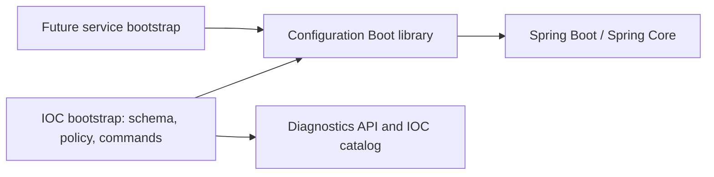

# Spring Boot configuration library proposal

Status: C1 implemented, 2026-10-21; C2–C3 implemented, 2026-10-22;
C4 implemented and locally qualified, 2026-10-24. Version `0.3.0-rc.1` is published
to Central and GitHub Packages; GitHub CI and local Central recovery consumers
passed. Tooling integration and a protected CI recovery run remain pending. The owner
selected configuration after logging publication. This worknote is not an accepted
ADR, publication admission or new numbered LIB commitment.

C0 update, 2026-09-13: [independent qualification](configuration-c0-analysis.md)
reproduced 54 scenarios. The proposed boundary remains useful, but copying the
current classes unchanged is not qualified. The C0 support matrix and required
corrections refine the initial API sketch below; C1 implements the bounded
inspection API and retains IOC compatibility policy locally.

Post-C1 review, 2026-10-21: the
[additional reuse analysis](configuration-extension-analysis.md) evaluates
controlled error adaptation, migration observations and reusable command/test
recipes. It reproduces input disclosure in two existing checker failure paths
(CFG-5) and distinguishes restricted beans from restricted configuration sources.
These are proposed extensions and qualification requirements, not changes to the
implemented C1 API or automatic additions to C2–C4.

The owner subsequently authorized the first step: CFG-5 correction and the
[controlled failure-report contract](../../../dev/configuration-failure-reports.md).
This is an IOC-local checkpoint; C1 public types and C2–C4 scope remain unchanged.

Migration checkpoint, 2026-10-21: the owner authorized the next extension-analysis
step. `PropertyMigration`, `MigrationInspector` and `MigrationInspection` now add
name-only old-path observations to the same adapter. An unrelated schema and real
Binder qualify the boundary; IOC reuses the observer for its existing accepted
alias notice. Conversion, conflict rules and compatibility windows remain local.
See the [inspection contract](../../../dev/configuration-inspection.md#configuration-evolution)
and the extension checkpoint. This does not admit publication.

C2 now qualifies restricted contexts and explicit source policies as recorded
[below](#c2-restricted-context-checkpoint--2026-10-22). Shared public types and
runtime dependencies are unchanged; no generic runner is exported.

C3 promotes the accepted ownership and source-policy boundary to
[ADR 0046](../../../ADR/0046-reusable-spring-boot-configuration-inspection.md),
completes the consumer/reference/map links and records publication prerequisites.
The [checkpoint](#c3-build-and-documentation-checkpoint--2026-10-22) separates
reactor quality evidence from C4 packaging and repository qualification.

## Recommendation and scope

Extract a small Spring Boot integration library for **configuration property-name
inspection and ordered source observations**. Keep schema, validation of values,
severity, startup refusal, operator messages and command composition in each
service. This is a narrower boundary than moving the existing bootstrap classes.

C1 module: `adapters/adapter-config-spring-boot`; publication coordinates:
`io.github.xorex-lc:ioc-config-spring-boot`; package:
`com.iocextractor.config.boot`. These names identify the local implementation. Keep product/library
lockstep versions. Do not create a generic configuration engine, API/implementation
module pair, starter, reload subsystem or mandatory diagnostics dependency.

The [interview](shared-library-exploration.md#configuration-interview-checkpoint)
confirms interest in source reporting, a separate configuration-check command,
service-selected severity and Spring integration. Named-handler checking is
potentially useful, not a confirmed shared framework. Future collectors are
intended consumers; none is an implemented second consumer yet. A small independent
consumer fixture must demonstrate that the proposed boundary works without IOC.

Disposition: **genericity-review**, with a concrete extraction sequence below.
The existing library goal is already satisfied by LIB-1. This proposal does not
reopen that goal or change the published concurrency artifact.

## C0 evidence and pre-extraction behavior

Baseline: `release-0.3.0`, commit
`0df7183fcc02cfd010104733c3608e710b059be9`; Java 21, Boot parent 4.0.8.
This section characterizes the C0 baseline before extraction; the C1 checkpoint
below describes the implementation. C0 did not change production code or build
files. Existing untracked discussion
notes were preserved. An independent read-only boundary review corroborated
the source traversal, schema and reporting limitations.

Project contracts consulted:
[configuration capability](../../../dev/configuration.md),
[ADR-0016](../../../ADR/0016-config-preflight-strict-binding.md),
[architecture](../../../ARCHITECTURE.md),
[module map](../../../MODULARIZATION.md),
[publication guide](../../../guides/library-publication.md),
[LIB-1 worknote](../lib-1-concurrency-worknote.md), and
[diagnostics proposal](lib-2-diagnostics-design.md).

The following paths are relative to
[`bootstrap/ioc-app/src/main/java/com/iocextractor/bootstrap/`](../../../../bootstrap/ioc-app/src/main/java/com/iocextractor/bootstrap/).

| Existing implementation | Observed responsibility | Proposed disposition |
|---|---|---|
| `IocConfigurationPropertyShape` | Reflects records; tokenizes names and indexes | Internal library helper after supported-shape qualification; not public reflection API |
| `IocEnvironmentPropertyMatcher` | Maps reserved IOC environment names against a record schema | Internal library matcher parameterized by prefix/schema; retain explicit naming contract |
| `IocUnknownConfigurationPreflight` | Enumerates names and rejects unknowns before binding | Extract inspection; retain IOC lifecycle adapter, strict rejection and exception translation |
| `IocConfigurationOverrideReporter` | Selects first declared external occurrences and logs migration notices | Extract observations; retain logging, defaults classification and migration handling |
| `IocProperties`, `ConfigPreflightConfiguration`, converters | Product schema, binding and validation wiring | Service-owned |
| `IocConfigPreflight` | Collects semantic problems about storage, lifecycle, import, sync and other IOC features | Service-owned; reuse Spring Validator/Errors |
| `ConfigRegistryCatalog`, `ConfigRegistryPreflight` | Resolve product provider/transform/predicate references, including name/argument syntax | Service-owned; reconsider a tiny membership helper only with demonstrated duplicate consumers |
| `IocConfigurationMigrationCatalog`, `IocConfigurationFailureAnalyzer` | Product migration knowledge, CONFIG codes and operator guidance | Service-owned |
| `IocYamlSyntaxCheck`, `IocYamlFailureDetails`, YAML failure analyzer | Boot YAML loading plus parser-error formatting and product instructions | Reuse framework loader; retain wrappers locally in v1 |
| `IocSemanticConfigurationCheck` | Restricted command context, argument guard, exit convention and output isolation | Service-owned command; document an integration recipe using the extracted inspectors |

### Findings that constrain extraction

1. **The shape checker is not a complete Boot Binder model.** It recognizes
   nested records, resolvable indexed `List<T>` elements and a single map tail.
   JavaBean nesting, indexed sets/arrays, nested map values, dotted/bracketed map
   keys, generic type variables, `@Name` aliases and scalar-converted records
   are not generally modeled. Non-environment container terminals are accepted
   more broadly than environment terminals. An unsupported shape must not become
   a confident claim that an operator supplied an unknown parameter.

2. **Environment naming has an IOC-specific subset.** The matcher recognizes
   `IOC_INGESTION_STABILITY_QUIET_PERIOD` by splitting record component words;
   compact `..._QUIETPERIOD` does not match that algorithm. Boot documents
   removing dashes when deriving environment variable names. Whole-container
   environment assignments are another gap. Freeze compatibility with the
   installed Boot version through actual binding fixtures before claiming
   relaxed-binding equivalence. Do not silently broaden IOC's accepted names.
   [Boot external configuration](https://docs.spring.io/spring-boot/reference/features/external-config.html).

3. **Name inspection has limited coverage and mixed error aggregation.** The
   preflight scans enumerable sources, skips the `configurationProperties`
   aggregate and examines lower-priority declarations even when shadowed.
   Nonenumerable sources are invisible; arbitrary composite traversal is not
   implemented. Unknown names accumulate, whereas environment ambiguity throws
   immediately. The shared result should distinguish unknown, ambiguous and
   uninspected input. Its IOC adapter must preserve current rejection behavior.

4. **The reporter does not establish final bound-value provenance.** It skips
   baseline sources before choosing the first external occurrence of each key.
   It does not resolve null entries, nonenumerable winners or collection binding.
   A reported lower-source list field need not survive binding. Preserve IOC
   behavior during migration, but name the shared contract accurately: ordered
   declarations/source observations. A future effective-provenance contract
   would require additional implementation and Binder-backed tests.

5. **Value-free scanning is narrower than safe arbitrary error output.** The
   scanner and reporter enumerate names without reading values. However, the
   reporter can return arbitrary `PropertySource.getName()` text. The semantic
   command's fallback prints an informative cause's message; YAML formatting
   normalizes/truncates the parser's problem text rather than redacting it.
   Custom validators, converters or parser messages may include sensitive input.
   This is a code-backed exposure risk, not a reproduced secret leak. Do not
   export those paths with a universal safe-to-log promise. Generic output reuse
   requires separate synthetic-secret tests and an explicit redaction contract.

6. **The command is not a general embedded validation service.** Its restricted
   configuration binds `IocProperties` and imports preflight configuration without
   normal application scanning. It also temporarily replaces process-wide
   `System.out`/`System.err`. Synchronization serializes checker calls, but cannot
   protect unrelated threads' output. Keep this behavior in the isolated command
   path; do not publish the existing class as an in-process utility.

7. **Existing publication tooling admits a different dependency shape.** The
   original concurrency-only script rejected consumer POM dependencies. Logging
   added one exact SLF4J dependency, but a Boot library needs a wider third-party
   closure and application mediation. Its local/GitHub consumer cannot rely on that repository also
   hosting Spring. Removing isolation would allow a different repository to hide
   an incomplete publication. Tooling qualification is a prerequisite, not a
   post-publication cleanup task.

## Use the framework where it already provides the mechanism

Boot continues to load configuration, order sources, bind values and convert
types. The library supplements name inspection; it must not introduce a second
value parser or precedence engine. Collection behavior must be checked against
actual Binder results, not inferred from the reporter or historical worknote
wording. [Boot external configuration](https://docs.spring.io/spring-boot/reference/features/external-config.html).

Spring's `Validator` and `Errors` already provide validation and error collection.
Service-specific semantic rules should continue using them. They do not require
a new generic rule registry or mandatory startup failure policy.
[Spring validation](https://docs.spring.io/spring-framework/reference/core/validation/validator.html).

Use explicit service registration for the initial library. A schema and enforcement
policy must be supplied deliberately; scanning arbitrary application beans would
weaken startup-order guarantees. If later needed, Boot provides conditional
auto-configuration and `AutoConfiguration.imports`; that is a separate justified
integration step. [Boot auto-configuration](https://docs.spring.io/spring-boot/reference/features/developing-auto-configuration.html).

These are official reference sources, not proof of a tested compatibility range.
The moving Boot reference inspected during this review identified 4.1.1, while
this repository uses 4.0.8. Initial qualification targets the project's actual
version. No Boot 3.x, all-4.x or Framework-only support is promised.

## Proposed public contract

Illustrative API, to be finalized in the first extraction slice:

```java
PropertyNameInspector.inspect(PropertySchema schema,
        Iterable<PropertySource<?>> sources) -> NameInspection

PropertySourceInspector.inspect(PropertySchema schema,
        Iterable<PropertySource<?>> sources) -> OverrideInspection
```

These are separate entry points over shared internal traversal, not two parsing
engines. Callers supply sources from a prepared Spring Environment in precedence
order. The second method observes declarations; its result must not be named
`effectiveValues` or claim actual Binder provenance.

| Contract | Initial rule |
|---|---|
| `PropertySchema` | Explicit canonical prefix and record root type; begin with the single-segment prefix already exercised by IOC |
| Schema support | Document records, resolvable indexed lists and flat-map scope; reject unsupported schema preparation explicitly or mark inspection coverage incomplete |
| `NameInspection` | Immutable findings for unknown and ambiguous names, plus coverage information; expected operator mistakes are data |
| `OverrideInspection` | Ordered canonical-name/source observations, including shadowed declarations where recognized; service selects baseline/external presentation |
| Source reference | Safe kind and encounter ordinal; no raw arbitrary source name, source object or property value in public results |
| Ambiguity | Return candidate canonical names; never silently select one |
| Exclusions | Explicitly identify the known aggregate-source exclusion; distinguish unsupported sources from intentional exclusions |
| Ordering | Preserve source precedence; make per-source finding ordering deterministic independently of unordered sets |
| Immutability | Defensive copies of lists/sets; do not expose the matcher's existing mutable set |
| Errors | Programming/schema errors have explicit exceptions; unknown operator names do not trigger shared startup refusal |
| Lifecycle | Stateless inspectors; no retained Environment, background work, bean creation or cached mutable source values |

Unknown-name facts may contain the supplied parameter name. A malformed name or
dynamic map key can itself contain sensitive text; value-free is not a universal
redaction guarantee. Service rendering remains responsible for its output policy.
Inspection describes one traversal of a prepared environment, not an atomic
snapshot under concurrent configuration mutation. Reload is outside this contract.

Before finalizing the API, exercise an unrelated prefix and small independent
record schema. Expose only the result distinctions needed by both IOC and that
consumer. Do not add strategies, factories or SPI interfaces for hypothetical
extensions. In particular, no `ConfigManager`, global singleton or handler registry.

### Severity and diagnostics integration

The library reports configuration facts without choosing WARNING/ERROR, generating
service diagnostic codes or throwing an IOC exception. The service maps them to
its diagnostics and decides whether to reject startup, disable one connection or
continue. Existing IOC strict startup remains the default IOC adapter policy.
This extraction does not implement per-aggregator isolation in the current service.

No required dependency on the proposed diagnostics library is necessary for these
small configuration results. An IOC adapter maps findings to its CONFIG catalog.
That keeps diagnostics JDK-only and avoids making configuration publication wait
for an unpublished project-owned dependency. Do not duplicate a general-purpose
diagnostic/result framework inside this module.

## Dependency direction and SOLID review



Application/domain modules acquire no Spring dependency. The new adapter module
has no dependency on IOC bootstrap, domain, application, catalog, logging adapter
or the executable application. The parent retains `com.iocextractor`; the new
library overrides its module group with `io.github.xorex-lc`, as LIB-1 already
does. Reactor dependencies use that actual module coordinate.

| Principle | Concrete design consequence |
|---|---|
| Single responsibility | Inspect names/observations in the library; enforce and render in the service |
| Open/closed | Accept a service schema and prefix instead of embedding `IocProperties`; no speculative plugin framework |
| Liskov substitution | Claim only a tested subset of Boot naming/binding; unsupported input cannot masquerade as a valid complete inspection |
| Interface segregation | Name checking and source reporting can be used independently; consumers need no CLI, logger or registry SPI |
| Dependency inversion | Product policy consumes technical findings; shared mechanics never call IOC rules or construct IOC exceptions |

Production imports imply explicit Spring Boot and Spring Core dependencies;
generate and review the exact transitive closure from the implementation POM.
Do not shade Spring, declare its necessary runtime classes `provided`, or depend
on a starter to obtain unrelated web/logging behavior. Keep internal build version
management centralized. The published consumer POM must resolve without the IOC
parent and must contain concrete third-party dependency versions.

## Configuration-only command integration

Confirmed reuse need does not imply copying the whole command into the JAR.
Provide a small independent-consumer example of the existing composition pattern:
explicit configuration-properties registration, the service validator, the shared
name inspector and a restricted Boot context that closes after checking.

IOC retains `--ioc.validate-config`, candidate-file/override semantics, syntax
precheck, source/argument guards, exit 78, CONFIG messages and packaging integration.
Preserve the early name check before property binding and existing daemon bypass.
Retain override reporting on `ApplicationStartedEvent`; it is after context
refresh, not a generic guarantee that all application work has finished.

The command checks local configuration, not endpoint reachability or credentials.
No component scanning of the normal application is allowed in the example.
Tests must prove that runtime connector/scheduler beans never start, the context
closes on failure and forbidden source/argument routes stay rejected. Existing
process-output suppression is not part of the public library API. A reusable
embedded runner can be reconsidered only after its isolation contract is solved.

## Publication tooling work required

Review targets:
[`library-publication.py`](../../../../tools/ci/library-publication.py),
[`library-publication.md`](../../../guides/library-publication.md) and the existing
LIB-1 publication profile/consumer fixture and protected workflow.

1. Replace concurrency-specific coordinates, target path and class markers with
   reviewed per-library descriptors. Keep the default/explicit LIB-1 descriptor's
   zero-dependency rule. A new descriptor may allow only the reviewed configuration
   library dependencies; do not remove the dependency guard globally.
2. Produce a standalone POM with concrete versions and no unresolved properties,
   private parent, embedded repository credentials, reactor artifacts or executable
   Boot packaging. Retain sources/Javadoc, exact manifest, checksums, signatures
   and source identity validation. Reject unexpected dependencies and BOM imports.
3. Separate target-library resolution from public third-party resolution. For a
   local or GitHub test, own coordinates must resolve only from the chosen target;
   Spring and build plugins may use approved public repositories. Evaluate Maven
   Resolver's repository group filtering on the Resolver bundled with the current
   Maven 3.9.9 wrapper;
   configure all relevant repository IDs explicitly and verify negative cases.
   Do not assume filters without input fail closed or copy newer filter syntax
   into an older wrapper. [Resolver filtering](https://maven.apache.org/resolver-1.x/remote-repository-filtering.html).
4. Use an empty isolated Maven repository and a standalone consumer outside the
   reactor. Assert that missing own artifacts fail even when another repository
   could supply them; assert third-party dependencies still resolve. Include
   transitive own-artifact negatives if such dependencies are later admitted.
   Repository-order preference alone is insufficient evidence of isolation.
5. Re-run LIB-1 bundle/consumer regression fixtures after generalizing the tool.
   Exercise preparation and local consumption before any protected publication.
   Never replace `ioc-platform-concurrency:0.3.0-rc.1` or its component tag.

Repository-filter qualification is an implementation checkpoint, not a claim
that this review tested a multi-library publisher. If the pinned resolver cannot
enforce the required routing, resolve that limitation before publication admission.

## Implementation slices and acceptance criteria

C1 is implemented with the C0 corrections below; C2–C3 have checkpoints below.
C4 implementation and qualification are recorded in its checkpoint below.
This document authorizes no publication action.

| Slice | Work | Exit evidence |
|---|---|---|
| C0: contract qualification | Independent schema fixtures; map documented names to actual Boot Binder behavior; choose the supported subset and truthful source-report wording | Compatibility/unsupported-case matrix; no unreviewed IOC behavior changes; named capability/release owner recorded |
| C1: module extraction | Add one adapter JAR, internal matcher/traversal and immutable results; parameterize prefix/schema; IOC delegates to inspectors | Non-IOC consumer compiles; unknown/ambiguity/coverage contracts pass; no product imports or core-to-Spring dependency |
| C2: preserve integration | Retain IOC strict preflight/reporters and local validators/analyzers/commands; qualify explicit source policies and a restricted-context consumer example | Existing codes/output plus imports, profiles, scalar/indexed source rejection, actual IOC list binding, closed-input guide compilation and bounded command cleanup |
| C3: build and documentation | Update module/root maps, capability doc, module README and publication guide; review an ADR for the accepted extraction boundary | Maven/analyzer/coverage scope reviewed together; focused tests, `make verify` and `make pmd-analysis` on final code/build tree |
| C4: publication qualification | Descriptor/POM changes, repository routing, independent consumer and LIB-1 regression evidence | Local bundle and cold-consumer positives/negatives; dependency closure, protected trigger and immutable artifact identity reviewed before publication |

Add tests for behavior and boundaries, not internal reflection method structure:

- Canonical, camel/dashless and both environment spellings against real Binder;
  nested records, flat maps, whole/indexed lists, malformed indexes and explicitly
  unsupported shapes. Preserve IOC's existing documented semantics or review any
  correction separately.
- Unknowns plus ambiguity in one inspection; lower shadowed unknown names;
  nonenumerable/custom sources and accurate coverage; deterministic immutable
  findings under a non-IOC prefix.
- Source-order observations with baseline, null entries and list overrides;
  explicitly show where declaration observation differs from a bound winner.
- An enumerable source whose value getter fails if called, proving name inspection
  reads no values; synthetic secret-bearing source labels and rendering inputs.
- Before-binding rejection, semantic collect-all, existing converters and migration
  hints; command success/failure exit behavior, forbidden configuration routes and
  no runtime connector/scheduler creation. Test process-wide output behavior in
  an isolated command fixture, not parallel in-process tests.
- Standalone consumer dependency resolution and publication negatives described
  above. A passing reactor build is not external-consumer evidence.

Rollback before publication is reverting module wiring and retaining the original
service implementation. Do not leave two active validators/reporters. After a
public release, API changes require normal compatibility review and a new immutable
version; unpublished internal types have no separate external compatibility promise.

## Verification performed for this proposal

Source, existing tests, documentation and publication script were reviewed.
Two focused existing suites were run sequentially through the repository facade:

| Command | Result on 2026-09-13 |
|---|---|
| `make test-one MODULE=bootstrap/ioc-app TEST=IocSemanticConfigurationCheckTest` | BUILD SUCCESS; 7 tests, no failures/errors/skips |
| `make test-one MODULE=bootstrap/ioc-app TEST=IocConfigurationOverrideReporterTest` | BUILD SUCCESS; 4 tests, no failures/errors/skips |

These 11 tests confirm their existing covered behaviors, not the proposed public
API, complete binding compatibility, absence of secret exposure, or publication
support. No new production implementation or test was added. Full verify/PMD
were not rerun for this documentation-only proposal; local freshness still points
to an older commit and is not represented as current release evidence.

The C0 analysis records the correction requirements used by C1 below. Generic
admission depends on those corrections and actual API tests. No additional
future-service feature interview is needed to define that bounded work.

## C1 implementation checkpoint — 2026-10-21

The owner selected configuration after completing logging publication and merging
its release records. Source baseline is `f693b1cd` on `r030-libraries`.

The implementation uses three public top-level types in
`com.iocextractor.config.boot`: `PropertySchema`, `PropertyInspector` and
`PropertyInspection` with nested immutable result records/enums. The two proposed
inspection entry points are consolidated into one traversal/result: names and
ordered declarations share source coverage and schema gaps. Reflection and name
matching remain package-private. There is no severity, enforcement, Binder value
provenance, global registry, starter or mandatory diagnostics dependency.

C0 corrections are implemented as explicit outcomes. Canonical/camel/dashless
names and compact/split qualified environment words map to record paths;
ambiguity retains all candidates and does not discard other unknowns. Dynamic
map keys retain their original qualified identity. Unsupported schema shapes,
record-as-scalar declarations, whole scalar record-list declarations, broader
map grammar and source conventions disclose incomplete coverage. Source
references contain only fixed categories and encounter ordinals. Collections
are copied; a value-read trap and an enumeration-failure identity test protect
the boundary. Boot remains responsible for conversions and list semantics.

IOC preflight and the override reporter delegate source inspection. The IOC
spelling/environment matcher remains a service policy; unsupported generic shapes,
including `IdStart`, retain the existing local compatibility check. This is an
intentional migration seam for C2, not a second generic-library implementation.
IOC also retains its enumeration failure for an opaque composite; shared
inspection reports the child's incomplete coverage instead.
The reporter still selects first external declarations and retains local labels;
its name does not promise final aggregate provenance. Public capability/module
documentation describes these limits.

Three normal module suites cover an unrelated collector schema and real Binder
behavior, including lower list fields that remain observable but do not survive
binding. The shared API accepts relaxed names that IOC still rejects; bootstrap
regressions explicitly preserve that delta. These are reactor/module consumers,
not cold Maven consumers or another production service. C4 owns independent
packaging and repository qualification.

Build/coverage/analyzer manifests admit 30 Maven projects, 25 functional JARs,
24 production aggregate groups and 23 local reports. Three added suites change
the source universe to 233 fast / 80 integration / five external shells /
308 deterministic classes. The new per-module ratchet is measured from C1's
focused tests (220/225 lines, 193/204 branches, 20 missed instructions); existing
ratchets and fixed floors are unchanged. Verifier synthetic tests cover the new
public coordinate and reject the old product coordinate.

### C1 verification and limits

The three module suites pass 23 tests. The IOC regression suite checks strict
spellings, split environment names, converted leaves, enum-map keys and both
enumerable/opaque composites. A separate differential characterization compares
85 inputs with the pre-extraction IOC implementation; all outcomes agree. Its
local source and results are retained under `.dev/config-c1-differential/`.

The full deterministic reactor gate passes with 308 classes, 24 production
aggregate groups and 23 local coverage reports. Raw SpotBugs retains its 137
accepted findings with zero visible findings; the new module has no raw findings.
CPD retains the same 22 groups, membership and fragments. PMD's 19 finding
identities also match the published logging baseline. These comparisons do not
broaden the accepted analyzer scope or hide findings behind new suppressions.

A standalone Java consumer outside the checkout compiles and runs using the
packaged library JAR and resolved third-party JARs, without IOC artifacts.
Strict Javadoc uses `-Werror -Xdoclint:all`. This is local classpath/package
evidence, not cold Maven resolution, publication or a second production service.

PMD policy retains 19 existing findings; its separate ownership/size watchlist
has 73 findings. Neither reports findings in the new module or changed IOC
inspection classes. No analyzer count, accepted finding, exclusion or existing
coverage floor/ratchet is relaxed. An initial complexity finding was fixed by
separating source traversal from name enumeration.

Full `make verify` and `make pmd-analysis` are mandatory on the final unchanged
worktree before C1 is accepted. Retained local commands/results are
`.dev/config-c1-verify-complete.log`, `.dev/config-c1-pmd-final.log`,
`.dev/config-c1-watchlist.log`, `.dev/config-c1-docs-final.log`,
`.dev/config-c1-packaged-consumer.log` and `.dev/config-c1-javadoc.log`;
`make context` owns their current freshness. Earlier failing checks remain
separate logs, not successful qualification. The C2 checkpoint below records
restricted-context and real IOC aggregate-binding qualification; C3 owns ADR/publication-guide
promotion; C4 owns independent POM/dependency/repository qualification.

## C2 restricted-context checkpoint — 2026-10-22

### Proposed decision and alternatives

Context: the existing check restricts beans but deliberately loads effective
Boot configuration. Conflating that with checking one isolated file would hide
imports, profiles and host overrides. Future services also need a concrete
example without importing IOC bootstrap or changing process-wide streams.

Decision for review: retain `SpringApplication.run` for IOC, with the explicit
configuration/preflight source only. Preserve Boot's source preparation and
reject extra `spring.main.sources` declarations before bean loading. Publish an
application-owned closed-input recipe separately; it prepares one YAML source
and explicit overrides, then creates an explicit `AnnotationConfigApplicationContext`.
It never invokes ConfigData and rejects imports, profiles, placeholders and
non-collector namespaces before refresh. This is an execution checkpoint, not
an accepted ADR; C3 owns the accepted extraction decision.

Alternatives considered:

- Exporting IOC's command as a library runner would retain IOC codes/model,
  validators and global console suppression. That is not a reusable boundary.
- Replacing IOC startup with manual ConfigData application would require parity
  code for Boot's profile environment, JSON/random sources, post-processors and
  lifecycle cleanup. It brings no needed C2 behavior and is deferred.
- Restricting IOC imports to one file would break deployment checks that rely
  on defaults, profiles or imports. A closed-input policy is opt-in application
  code instead of a silent change to IOC's command.

Consequences: source policy belongs to the consuming service. The library still
only inspects prepared names. There is no new JAR, public API, runtime dependency,
starter, auto-configuration or generic exception adapter. SnakeYAML and Spring
Context are direct dependencies of the example application, not additions to
the library POM. Imports in IOC remain trusted deployment inputs, without path
or network allowlisting. Third-party logging remains outside owned-report secrecy.

### Implementation and qualification

A regression first reproduced a real source-expansion defect: an indexed
`spring.main.sources[0]` candidate returned success instead of `78`. The retained
red run is `.dev/config-c2-before.log`. The fix detects scalar/indexed names
through prepared configuration sources and uses name-only Binder fallback for
opaque sources. The guard runs after source preparation and before Boot binds
its source set. Exact Boot 4.0.8 binds `sources` through its application-properties
object; initializers, listeners and context factories are not environment-bound
execution controls in that baseline.

IOC also rejects relaxed/indexed CLI config loading controls and pins eager
initialization, no keep-alive, no shutdown hook and no startup-info. The explicit
context still closes after checking. Existing syntax, strict IOC spelling,
conversion, migration, semantic collect-all and registry failure ownership stay
local. No existing accepted converter or failure code is intentionally changed.

`IocConfigurationContextIT` runs separate JVMs and checks required/optional
imports, the optional deployment overlay, active profile documents/files, CLI
precedence and indexed bean-source rejection from candidate, import, CLI,
environment, system and JSON channels. A trap bean proves rejection precedes
instantiation. Both valid and invalid commands return normally from the child
harness so a leaked non-daemon worker cannot be hidden by `System.exit`.
Temporary runtime DB/projection paths remain absent; the model context has no
DataSource or application composition root and is explicitly closed.

The actual `IocProperties` context replaces a six-rule default refang list with
one complete overlay rule. A partial indexed element loses the lower `to` value
and is rejected. Published configuration guidance is corrected to whole-list
replacement, rather than the older claim that indexes merge across sources.
The existing test-runner helper's comment now distinguishes its source adapter
from ordinary ConfigData behavior; test fixtures are not framework authority.

`ConfigurationCheckRecipeIT` compiles the exact
[consumer guide](../../../guides/configuration-library-check.md) and runs it with
only shared configuration classes and third-party JARs. It checks the unrelated
collector schema, scalar/list overrides, semantic/conversion/name failures,
malformed/missing YAML, multi-document/profile/import/placeholder rejection,
ambient environment/system/JSON/classpath isolation, immutable results and no
runtime component scan. Imports are rejected before malformed target data can
be read. Failed checks do not contaminate a later successful check.

The source universe deliberately adds two Failsafe suites:
234 fast / 82 integration / 5 external / 311 deterministic classes.
The inventory and TESTING explanation change together. No verifier, report group,
coverage floor, baseline, exclusion or analyzer policy is relaxed.

### Evidence and limits

Focused logs: `.dev/config-c2-checker-final.log`,
`.dev/config-c2-context.log` and `.dev/config-c2-recipe-final.log`.
The first full run passed its tests and analyzer integrity but failed the
bootstrap branch-missed ratchet (503 versus 496). Its evidence remains in
`.dev/config-c2-verify-coverage-failed.log`. Command-boundary regressions now
cover allowed pass-through arguments, missing/repeated/empty requests and an
invalid path with safe output; no baseline is changed.
Final acceptance requires full `make verify`, separate `make pmd-analysis`, the
resource/exception watchlist and changed-finding review on the completed tree.
Their retained logs are `.dev/config-c2-verify.log`, `.dev/config-c2-pmd.log`
and `.dev/config-c2-watchlist.log`; `make context` reports freshness.

These are deterministic reactor checks on Java 21 / Boot 4.0.8. They do not
establish a second deployed service, cold repository resolution, filesystem or
network sandboxing, a reusable embedded runner, or publication admission.
C3 owns the accepted ADR and remaining build/documentation promotion; C4 owns
dependency mediation, packaged/cold consumers and protected publication.

## C3 build and documentation checkpoint — 2026-10-22

The owner authorized C3 after C2. Source identity remains
`ea640f2b49f1b445595920850d339a961339fb1a` on `r030-libraries`, with the C2 and
C3 worktree changes. No commit, push, PR or publication is part of this slice.
Historical checkpoint hashes above remain historical evidence.

[ADR 0046](../../../ADR/0046-reusable-spring-boot-configuration-inspection.md)
accepts the six-type inspection/migration surface, service ownership and both
source policies without rewriting earlier accepted decisions. The new
[consumer guide](../../../guides/configuration-library.md) connects source
selection, result/coverage interpretation, migration hints and bound-model
validation. The executable C2 recipe remains the complete context example.
Module reference, capability docs, root maps, guide/ADR indexes, release notes
and the publication guide link the durable outcomes. Published documentation
does not depend on this worknote.

### Dependency and scope review

The module retains two required direct compile dependencies: Boot and Spring
Core. The offline Maven compile tree resolves Boot 4.0.8 and Spring 7.0.9, with
Spring Context/AOP/Beans/Expression, Micrometer Observation/Commons 1.16.7,
Commons Logging 1.3.6 and JSpecify 1.0.1. There are ten external compile JARs in
that mediated graph. No IOC, starter, SnakeYAML or logging provider is introduced
by this library's main POM. Retained tree:
`.dev/config-c3-dependencies.log`. This is a local dependency-closure review,
not a new vulnerability scan or an independently resolved publication POM.

The root reactor, parent dependency management, bootstrap dependency and report
POMs agree on the adapter coordinates and lockstep version. JaCoCo, SpotBugs,
CPD and PMD registries include it; CPD/PMD source roots include its production
Java. It has a local coverage report and aggregate group. The topology stays
30 Maven projects, 24 production groups and 23 local coverage reports, with the
TCK excluded from production. Architecture rules keep shared code limited to
JDK/Spring and prevent framework-free layers from importing it.

No POM, verifier, registry, dependency contract, coverage floor, ratchet, exclusion
or test-universe change is needed in C3. The stale build-quality paragraph that
omitted this reactor-only coordinate is corrected. Public Javadoc receives only
wording corrections; no signature or production behavior changes.

### Verification and next gate

Run the module's focused tests, the executable context recipe and strict Javadoc
(`-Xdoclint:all -Werror`), then final `make verify`, `make pmd-analysis`, the
resource-ownership watchlist, documentation links and diff hygiene. Evidence
paths are `.dev/config-c3-focused.log`, `.dev/config-c3-recipe.log`,
`.dev/config-c3-javadoc.log`, `.dev/config-c3-verify.log`, `.dev/config-c3-pmd.log`,
`.dev/config-c3-watchlist.log` and `.dev/config-c3-docs.log`; final freshness comes
from `make context`. Review analyzer identities against the retained C2 baseline,
including findings intersecting the checker and recipe ownership paths.

C4 remains the next slice: descriptor/parent-free POM qualification, full
dependency mediation, selected-repository routing with positive/negative cold
consumers, the LIB-1 regression and protected release admission. The
[publication guide](../../../guides/library-publication.md#configuration-library-admission)
defines those prerequisites without adding a component selector or authorizing
publication. Existing concurrency, diagnostics and logging release identities
remain immutable. No second deployed consumer or provisioned external check is
claimed by C3.

## C4 standalone packaging and consumer checkpoint — 2026-10-24

Source: `r030-libraries`, HEAD `2f17923e31e06d1ccd961bee06af64d6b125657a`
plus this C4 worktree. Local bundles use `0.3.0-SNAPSHOT`, are unsigned and record
`dirty=true`. This is preparation for review, not a frozen release identity or
permission to publish. No production Java API or reactor membership changes.

The `configuration` descriptor and workflow selector now admit only the reviewed
artifact. Flattening emits a concrete POM with Boot 4.0.8 and Core 7.0.9 as required
compile JARs. Packaging checks all six public types in main/sources/Javadoc,
Java 21 bytecode, the license and identical embedded/external POMs. Bundle reads
retain exact dependency contracts and additionally reject duplicate POM fields,
non-JAR packaging, unknown root fields and invalid model versions. Every element
must use the Maven POM namespace: an unqualified dependency container or
scope/optional element must not evade these guards. The older
zero-dependency and exact-SLF4J contracts are preserved.

The standalone application compiles outside the checkout, with no reactor class
directories. It checks name-only inspection, unknown/shadowed declarations,
removed-name observation and concrete list-index replacement. It compiles the
exact closed-input guide plus its existing independent driver and runs a bounded
child JVM. Explicit overrides/list replacement, safe failures, rejected imports,
profiles/placeholders, ambient-input isolation and absence of component scanning
are exercised both with default mediation and an application-owned Boot BOM.

The complete library graph contains ten external JARs. The application adds
SnakeYAML 2.6 explicitly. Both mediated graphs are asserted:

| Dependency | Default mediation | Application Boot 4.0.8 BOM |
|---|---|---|
| Spring Boot | 4.0.8 | 4.0.8 |
| Spring Core/Context/AOP/Beans/Expression | 7.0.9 | 7.0.9 |
| Micrometer Observation/Commons | 1.16.7 | 1.16.7 |
| Commons Logging | 1.3.5 | 1.3.6 |
| JSpecify | 1.0.0 | 1.0.1 |

The last two differences were hidden by reactor management. They are not silently
promoted into extra library dependencies or an exported BOM. A deliberate Core
5.3.39 downgrade must fail Enforcer's Spring upper-bound check; an unavailable
managed Boot version must fail dependency resolution. Enforcer 3.6.2 qualification
uses explicit `groupId:artifactId` includes: the earlier group-only setting failed
to detect the downgrade and its evidence is retained. This supports the tested
baselines, not arbitrary Spring substitutions or a new vulnerability-scan claim.

Maven 3.9.9's actual Resolver 1.9.22 is qualified using explicit literal-group
files for every original/mirrored repository ID. Public rules include the reviewed
plugin and imported-BOM/parent model groups, and exclude own groups. Other IDs
are mirrored to approved Central with its own filter. The selected target admits
only own coordinates. Empty caches and empty user/global settings prevent local
installation from masking missing artifacts. All four own files must match the
manifest and have only `library-target` as recorded origin.

Two additional cold probes place the exact four files in an alternate repository
and leave the selected target empty. Filtering must reject fallback; disabling it
must compile and record the alternate origin. This control also works when the
version is already in Central because the alternate precedes the public route.
No own transitive dependency is admitted; admitting one requires additional
missing-transitive-artifact cases. GitHub credentials remain scoped to the selected
target's server ID.

Local evidence:

- `make library-publication-test`: 119 offline contract cases, including all four
  components, wrong-component/tag rejection, POM/dependency/archive guards,
  immutable recovery, origins, signing with disposable keys and credential scope.
- Configuration bundle and cold consumer: `.dev/config-c4-bundle.log`,
  `.dev/config-c4-consumer.log`; the final six-type archive check in
  `.dev/config-c4-final-bundle` retains exactly the same four hashes.
- Concurrency/diagnostics/logging bundle and cold-consumer regressions:
  `.dev/config-c4-<component>-bundle.log` and
  `.dev/config-c4-<component>-consumer.log`; summary
  `.dev/config-c4-qualification.log`. Five standalone fixtures plus two routing
  probes start with separate empty caches. No published RC is overwritten.
- Final release-gate commands: `make verify`, `make pmd-analysis`, `make docs` and
  `git diff --check`; logs `.dev/config-c4-verify.log`, `.dev/config-c4-pmd.log`,
  `.dev/config-c4-docs.log`. Current context and ignored handoff retain exact
  outcomes/freshness. Analyzer identities are compared with retained C3 XML;
  no floor, ratchet, exclusion or lifecycle registry is changed.

Retain discovery/failure evidence: `.dev/config-c4-consumer-*-failed.log`,
`.dev/config-c4-record-groups.log` (record mode, not filtering qualification),
`.dev/config-c4-bom-models.json`, `.dev/config-c4-resolver.txt` and
`.dev/config-c4-debug-mediation.log`. These explain dependency-model admission,
actual mediation differences and the corrected downgrade check.

## Protected publication record — 2026-10-24

The owner merged [PR 18](https://github.com/xORex-LC/ioc-extractor/pull/18) and
authorized protected publication. Annotated tag
`ioc-config-spring-boot-v0.3.0-rc.1` fixes source commit
`68679dd18ed251b71c4c0f4480b440a270dc1e71`, whose tree equals reviewed PR head
`0764e711`. Merge CI [run 40086508961](https://github.com/xORex-LC/ioc-extractor/actions/runs/40086508961)
passed. Existing concurrency, diagnostics and logging release identities are unchanged.

Protected [validation run 40087127800](https://github.com/xORex-LC/ioc-extractor/actions/runs/40087127800)
passed the clean RC reactor build, strict Javadoc, 119 publication contracts,
the standalone configuration consumer and separate PMD analysis. The consumer
qualified the packaged API and exact closed-input guide with default dependency
mediation and the application's Boot BOM, including incompatible/unavailable
dependency negatives and selected-repository routing probes. Central validated
deployment `90e22519-418d-4b74-ac5a-cadcc3d2c559`. The signer fingerprint is
`F69BA7E0F7494982E6E1B483DF54073D8BBFA9F9`.

The signed manifest SHA256 is
`e57f1f52f53cc95ff5290943d9c5cd790928ea063fc726ca7388c7fe021f74f2` and covers
20 files. Its four primary artifacts match the unsigned build. Publication
[run 40088095516](https://github.com/xORex-LC/ioc-extractor/actions/runs/40088095516)
resumes the original validation run and deployment; its build is skipped.
The owner performed both protected-environment reviews. Publication succeeded in
both registries. The GitHub consumer passed, but the Central consumer failed:
Resolver treated identical selected/public Central URLs as one route and applied
the own-group filter to third-party dependencies. The workflow's default shell
also concealed the first pipeline failure behind `tee` and the later successful
GitHub command. Its green status does not qualify Central. Retain the original
failed log; fix qualification tooling without changing signed release bytes.

Primary artifact SHA256 values:

| Artifact | SHA256 |
|---|---|
| POM | `26a24702b248c75559ddafb843e7335a026d9b843e36718846c549e808e6dfa8` |
| Main JAR | `07bf49086f3d551ed5b4f66c0a95d1ed9edf791550327cddf4230e3344dd673c` |
| Sources JAR | `42a5d492056dad80d58aaf09794315e9cf914053fcc9a8742f98037f501803d4` |
| Javadoc JAR | `f9177c01f661c73be7424c6139e4f7f082e70c3fb431f2c594074dfa04263f03` |

The tagged RC CI retained 137 accepted SpotBugs findings with zero visible,
CPD 22/22 and PMD blocking 0, advisory 19/19. Coverage integrity passed for
24 production aggregate groups and 23 local reports: 27121/29427 lines and
10289/12003 branches. These are remote RC counters, distinct from the earlier
local snapshot runs. The recovery changes below affect publication tooling and
documentation; the published library and its dependency contract are unchanged.

Signed bytes, manifest, workflow provenance and Central deployment evidence are
retained under `.dev/configuration-release-0.3.0-rc.1/`. Its `signed-release.tar.gz`
has SHA256 `9b996a88e698155dfb9ea603f32b239da2652dd5ac5acdc552057b3564adc30e`.
Validation artifacts `signed-library` `12557752813` and `central-deployment`
`12557742874` expire on `2027-01-22T10:44:49Z`; local copies preserve recovery
bytes beyond that expiry. Never rebuild/resign this version or move its tag.

### Local qualification recovery

The corrected tool admits the existing reviewed public groups at the selected
Central endpoint because Resolver 1.9.22 groups downloads by URL. Local/GitHub
targets remain own-group-only, public routes reject own groups, and all four own
artifacts must record only `library-target` as origin. No external group or
dependency was added. The workflow now uses `set -euo pipefail` around both
consumer pipelines.

`make library-publication-test` passes 121 cases. The two new regressions fail
against the previous routing/workflow and pass with these corrections: the
selected Central filter admits reviewed dependencies, and failures from either
consumer propagate through `tee` with the original exit code. A Central failure
also prevents the GitHub consumer from starting.

The local recovery command uses the original signed bundle:

```bash
make library-consumer LIBRARY_COMPONENT=configuration \
  LIBRARY_BUNDLE=.dev/configuration-release-0.3.0-rc.1/validated/signed-library \
  LIBRARY_REPOSITORY=central
```

It passed with an empty cache, packaged inspection/migration API, the exact guide
under default and application-BOM mediation, both dependency negatives, filtered
missing-target rejection and its successful unfiltered alternate control. All
four resolved primary files match the signed manifest and selected origin. The
local log is `recovery-central-consumer.log`; the original failed
`repository-consumers/central.log` and successful GitHub log remain separate.
All are retained under `.dev/configuration-release-0.3.0-rc.1/`.
`recovery-receipt.json` records tooling-file hashes, the recovery patch and log
hashes separately from the immutable library source. `make ci-packaging`,
`make docs` and `git diff --check` also pass. Production Java, Maven scope and
analyzer/coverage membership are unchanged; the earlier reactor/PMD results
describe their recorded source commits, not fresh recovery-worktree runs.

These local results used working-tree tooling based on `0764e711`. The tooling
corrections are now recorded in `18ce6eae`; no repaired Actions run is claimed.
Integrate the corrections into `release-0.3.0`, then
dispatch protected recovery using validation run `40087127800`, the original
deployment ID and unchanged component tag. Skip rebuilding and signing; matching
published bytes must be reused. A second deployed service, live external checks
and other Boot baselines remain unqualified. Events remain deferred.
