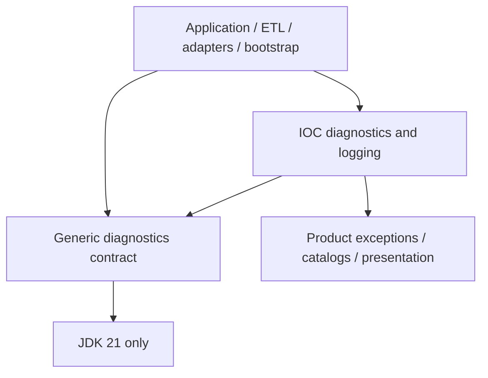

# ADR draft: Extract a JDK-only diagnostics contract

Status: Proposed for promotion during LIB-2 D4, 2026-10-18. The owner requested
fixing the D0 implementation contract; this unnumbered draft records its
architectural rationale. It is not an accepted published ADR or publication
authorization. The [contract and extraction plan](lib-2-diagnostics-design.md)
owns exact API requirements and qualification criteria.

## Context

IOC already uses diagnostics, results, failure decisions and bounded detail
across application, ETL, adapters and bootstrap. The planned feeds collector
needs the same mechanics while owning its own codes, categories and text.
Publishing the existing module unchanged would expose IOC catalogs, rendering
metadata and `IocExtractorException`. The existing resilient delivery wrapper
also imports SLF4J.

Java 21, inward dependencies, lockstep product/library versions and the existing
protected immutable publication process are constraints. There is no requirement
for a remote diagnostic protocol, concurrent registry, logging framework or
durable audit store.

## Decision to promote

Create one artifact `io.github.xorex-lc:ioc-platform-diagnostics-api` in
`platform/platform-diagnostics-api`, using
`com.iocextractor.platform.diagnostics` with `result` and `sink` subpackages.
The artifact contains the 18 selected types, including small implementations,
and has zero non-JDK production dependencies. Misyurkeev Denis (`xORex-LC`),
the current project publication maintainer, owns its API and releases.

Keep IOC categories, catalogs, context vocabulary, text rendering, logging
composition and exceptions local. A local `IocDiagnosticCode` extension provides
metadata; generic codes require only ID, default severity and processing impact.
Use one diagnostic value model throughout the IOC migration.

Policies return pure decisions at caller-owned checkpoints. Diagnostic equality
uses code object, context and effective severity, excluding time/cause. Counters
count occurrences without deduplication. Preserve both existing bounded-retention
algorithms, rejecting signals, exact severity totals and OPERATION exemption.
Reject inconsistent batches, configured synthetic markers as real observations,
and count overflow at the new public boundary. Batch creation uses a validating
factory with private construction and a consumer-owned suppression code.

The aggregation flow shares one stable suppression marker. The caller owns
catalog uniqueness and the truth of omitted counts; severity summaries cannot
prove their provenance or detect an unrelated marker hidden in omitted detail.
The resilient synchronous sink contains RuntimeException from delegate and
fallback, preserves the original processing outcome and propagates Error.
Callers own callback latency, redaction and service recovery.

Retain lockstep `${revision}`. Public signature or documented behavior changes
receive compatibility review; during 0.x, breaking changes require a minor
version and migration notes, and patches preserve the contract. Relocation of
unpublished reactor types is a coordinated internal migration; later relocation
of published Java packages is a breaking change.

Use Maven Central as primary and GitHub Packages as the identical-byte mirror.
Extend explicit publication component selection while preserving concurrency's
fixture, checks and existing tag. Diagnostics uses its own annotated
`ioc-platform-diagnostics-api-vX.Y.Z[-rc.N]` tag on the corresponding release
branch. Packaging, independent consumers, full gates and explicit release
authorization precede any publication claim.

Deliver API Javadoc/package documentation, module reference and a consumer guide
with extraction in D1. Keep them aligned with D2 hardening; D3 exercises the
guide examples outside the reactor and qualifies complete sources/Javadoc
archives. D4 performs the final documentation review and ADR promotion. The
documentation must explain supported behavior and limits with executable
examples, so an independent service can integrate without reading IOC internals.

## Alternatives considered

- **Publish the current module unchanged.** Smaller migration, but every consumer
  inherits IOC taxonomy, presentation metadata and product exception ancestry.
- **Duplicate the mechanics in each service.** Avoids release coordination, but
  makes the confirmed common result/decision/count semantics diverge separately.
- **Use only JDK collections and logging.** Provides building blocks, but leaves
  result/policy/retention behavior and its tests duplicated in callers.
- **Introduce a general validation or logging framework.** Adds dependencies and
  changes the existing contracts without resolving service ownership by itself.
- **Split interfaces from implementations.** Adds coordinates and a release
  edge without dependency isolation or a confirmed second implementation need.
- **Make categories, renderers or a shared suppression code generic.** Couples
  service catalog evolution to the library or expands a focused API into a
  presentation/registry framework.
- **Compare diagnostics by code ID alone.** Equates unrelated code objects and
  changes existing identity semantics. The owner requested severity sensitivity,
  not a global catalog identity scheme.

## Consequences and trade-offs

Independent services can reuse existing mechanics without IOC or framework
dependencies. IOC must update imports, POMs, category checks, exception enforcement,
stage batches, runner continuation and catalog generation together. The public
validation changes need new tests; existing focused tests establish only the
unchanged implementation baseline.

The budget limits retained ELEMENT/RUN detail, not all memory or total sink
traffic. Stage and run algorithms preserve different samples. OPERATION detail,
context values and collecting sinks remain unbounded; containers are shallow
copies. Lossy compaction cannot support arbitrary policies over original codes.
Raw callback failure can leave partially advanced mutation/delivery state, so
retry and rollback are not guaranteed. No wire compatibility, persistence,
throughput target or secret-safe representation is promised.

The extra artifact adds support and compatibility work. The project must qualify
its flattened parent-free POM, source/Javadoc/license archives and an independent
consumer; publication tooling must bind recovery to the selected component.
Actual repository consumption is separate from local packaging evidence. The
published concurrency artifact remains unchanged.

## References

- [D0 contract and D1–D5 plan](lib-2-diagnostics-design.md)
- [Shared-code inventory](../evidence/shared-code-inventory.md)
- [Existing diagnostics outcome decision](../../../ADR/0017-diagnostics-first-class-outcome.md)
- [Pilot publication decision](../../../ADR/0028-pilot-library-publication.md)
- [Release-branch and component-tag decision](../../../ADR/0029-release-branch-library-publication.md)
- [Current publication guide](../../../guides/library-publication.md)
