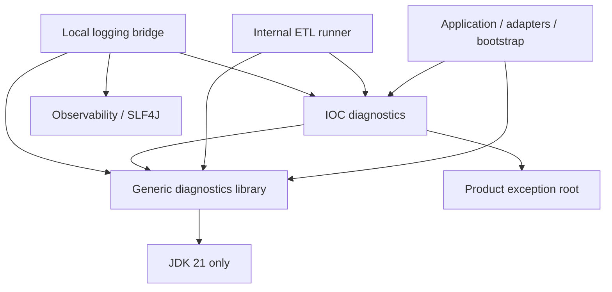

# LIB-2: Diagnostics library contract and extraction plan

Status: D0–D4 are complete and locally qualified, 2026-10-18. Extraction, IOC
migration, public-boundary tests, independent packaging and final admission are
recorded below; [ADR 0044](../../../ADR/0044-reusable-diagnostics-contract.md)
owns the accepted architectural decision. The owner authorized preparing and
opening the integration PR into `release-0.3.0`. D5 remote publication and
repository-consumer qualification will follow PR approval and merge; they have
not been performed. The original review was dated 2026-09-13; the current
inventory replaces its sixteen-type selection.

Execution checkpoint, 2026-10-18: the owner selected diagnostics as the next
implementation target after closing events design. Complete its extraction,
IOC migration, independent-consumer qualification and release preparation before
starting another library. Events E1–E5 remain deferred. This update reconciles
the proposal with current sources. The owner subsequently authorized D1 without
reopening the usefulness interview.
The D0 decisions below now fix naming, ownership and the API adaptations.

The current selection is **17 types from diagnostics plus the adapted resilient
sink: 18 shared types**. It includes `DiagnosticBatch` and
`BoundedDiagnosticCollector`. Their exact-count, validation and delivery
contracts are part of the extraction, not optional follow-up hardening.

## D0 decision record

| Concern | Fixed implementation target |
|---|---|
| Responsibility and category | Cross-service platform: structured in-process diagnostics, results, pure failure decisions, optional bounded detail and observational sinks |
| Artifact and module | `io.github.xorex-lc:ioc-platform-diagnostics-api`; `platform/platform-diagnostics-api` |
| Packages | `com.iocextractor.platform.diagnostics`, `.result`, `.sink`; no split package with local IOC types |
| Maintainer and release owner | Misyurkeev Denis (`xORex-LC`), the project's current named publication maintainer; same identity as the concurrency POM/publication guide |
| Public surface | The 18 types selected below; small implementations remain in the same artifact; no separate implementation JAR |
| Dependency budget | Java 21; zero non-JDK production dependencies, including optional/provided dependencies; no project-owned transitive closure |
| Product extension | Local `IocDiagnosticCode` supplies category/message metadata; no category field/accessor or throwing enforcement in generic diagnostics |
| Value equality | Code object equality + context + effective severity; exclude time/cause; no automatic deduplication |
| Suppression | Caller-owned code supplied explicitly to both accumulators and validating batch creation; one marker throughout an aggregation flow |
| Delivery failure | Raw failures propagate; resilient wrapper contains delegate/fallback RuntimeException and propagates Error |
| Version and compatibility | Lockstep `${revision}`; review public signatures and observable behavior; during 0.x, breaking changes require a new minor version and migration notes; patches preserve the contract |
| Release destinations | Maven Central primary, GitHub Packages mirror of the same immutable bytes; diagnostics component tags `ioc-platform-diagnostics-api-vX.Y.Z[-rc.N]` on the matching release branch |
| Admission state | `design-admitted`; source closure reviewed, implementation/consumer/release evidence pending |

Existing consumers are the ten direct functional JAR consumers inventoried below.
The confirmed nearest external consumer is the planned `feeds-collector`; its
business integration is not implemented. The shared reason to change is the
diagnostic/result/policy/retention contract, while service code catalogs and text
evolve independently. JDK collections and logging alone do not provide this
combined behavior. Adopting a general validation or logging framework would
change these semantics and add dependencies without resolving the IOC seams.

If consumers later need different categories, text, persistence or reactions,
keep those differences in their services/adapters. A change to shared retention
or decision semantics requires explicit contract review and compatibility
assessment; do not grow a configuration or extension framework preemptively.
The [ADR draft](lib-2-diagnostics-adr-draft.md) records alternatives and trade-offs
for promotion during D4. No publication run, version/tag creation or code move is
part of D0. Independent consumer and release checks remain mandatory in D3–D5.

## Fixed boundary

One JDK 21 library owns structured in-process diagnostics, results, failure
decisions, optional bounded retention and observational delivery. These needs
are confirmed in the [interview](shared-library-exploration.md). IOC categories,
catalogs, text rendering, exceptions and logging composition stay in the service.
No reload, messaging protocol, Spring starter or API/implementation split.

Selected coordinates (not yet built/published):
`io.github.xorex-lc:ioc-platform-diagnostics-api`, new reactor module
`platform/platform-diagnostics-api`. The JAR includes small implementations,
despite its API suffix. Keep existing `ioc-platform-diagnostics` as the
unpublished IOC catalog/exception layer. Both retain lockstep `${revision}`.

Selected Java package: `com.iocextractor.platform.diagnostics`, with `result`
and `sink` subpackages. Product types retain `com.iocextractor.diagnostics`.
Separate packages avoid split packages between JARs. Update internal imports
together; do not promise binary compatibility with unpublished reactor types.
The published concurrency contract remains unchanged.

Current consumers are application, ETL, adapters and bootstrap. Future collectors
are confirmed intended consumers, not implemented integrations. The D0 record
names the maintainer and release owner; this does not grant publication access
or replace the existing protected release review.

## D0 baseline review evidence and findings

Current source baseline: `r030-libraries`,
`d98bf415377bbcd86e43f04dcbd21c5fefe96b34`, inspected on 2026-10-18 with
pending documentation changes. Production/build sources are unchanged by this
refresh. Historical September evidence belongs to `0df7183f` and does not
qualify this baseline or the proposed API.

The live diagnostics module contains **38 public top-level production types**,
excluding `package-info.java`: 9 root, 3 catalog, 12 code enums, 3 rendering,
8 result and 3 sink types. The disposition below accounts for all 38:
17 move after adaptation and 21 remain local. The resilient sink comes from
the separate diagnostics-logging module.

Ten functional JARs directly declare diagnostics in compile scope: application,
application TCK, ETL, diagnostics-logging, CLI/CSV/ingest/Tika/JDBC adapters and
bootstrap. Four report POMs also reference it for report membership/order;
root dependency management is not a runtime consumer. Domain and
`ioc-processing` do not directly depend on diagnostics.

| Priority | Existing code | Impact and disposition |
|---|---|---|
| High: extraction blocker | `DiagnosticCode` requires category, message key and template; `Diagnostic` stores category | Excluding only `render/` leaves service taxonomy and presentation in the API |
| High: extraction blocker | `Notification.throwIfRejected` constructs final `DiagnosticException extends IocExtractorException` | Keep throwing enforcement local; generic policies return decisions |
| High: extraction blocker | `BoundedNotification` creates the IOC suppression code; `DiagnosticBatch` rejects that code in retained observations; `PipelineRunner` filters it by enum identity | Supply the original service code to creation and validation; preserve marker rejection, identity and fields |
| High: migration risk | `IngestionService` and `LoggingIngestionStartupObserver` inspect INGEST category | Preserve behavioral ownership checks, not just log text |
| High: migration risk | Stage collectors, envelope batches and runner carry retained samples separately from exact counts | Preserve local encounter order, rejecting signals, summary deltas and preparation/continuation delivery |
| Medium: API limitation | `Diagnostic` shallow-copies context and compares code object + context | No deep immutability, code-ID equality or occurrence identity |
| Medium: retention limitation | OPERATION bypasses budget; collector and run accumulator have different retention algorithms | Budgeted runner delivery is bounded, but OPERATION volume, raw sinks and arbitrary caller allocations are not |
| Medium: dependency seam | `ResilientDiagnosticSink` depends on SLF4J Logger | Factor existing containment around a caller-supplied fallback |
| Medium: exposure risk | Diagnostic `toString`, exception messages and causes may expose values | No universal redaction or safe-to-log guarantee |
| Medium: public count boundary | Summary arithmetic currently uses unchecked `long` addition/subtraction | Validate exact counts without overflow and reject unrepresentable arithmetic during D2; no saturation or silent wraparound |

These are extraction blockers and contract limitations, not claims of newly
reproduced production defects. No unrelated fixes are authorized.

## Existing-type disposition

Every production type in `platform-diagnostics` is covered below.

| Types | Disposition | Contract/change |
|---|---|---|
| `Diagnostic`, `DiagnosticBuilder`, `DiagnosticFactory` | Extract after adaptation | Remove category storage/accessor; preserve explicit Clock, builder, context, cause, severity |
| `DiagnosticCode` | Extract reduced interface | Only `id()`, `defaultSeverity()`, `impact()` |
| `DiagnosticSeverity` | Extract | Six existing levels and ERROR/FATAL classification |
| `DiagnosticImpact` | Extract with precise documentation | ELEMENT/RUN budgeted, OPERATION unbudgeted; classification alone authorizes no side effect or skipping |
| `Result<T>` | Extract | Copied diagnostic list, existing null/map behavior |
| `Notification` | Extract without `throwIfRejected` | Per-task accumulation, queries, snapshots and `toResult` |
| `FailurePolicy`, `FailureDecision` | Extract | Existing `evaluate(Notification)`, factories, stop reason, custom policies |
| `DiagnosticSummary` | Extract | Counts including suppressed occurrences and validation |
| `BoundedNotification` | Extract with suppression-code parameter | Preserve existing retention/summary algorithm |
| `DiagnosticBatch` | Extract with service-supplied suppression validation | Immutable retained detail plus exact totals; reject synthetic markers and invalid or hidden rejection counts |
| `BoundedDiagnosticCollector` | Extract with suppression-code parameter | Stage-local ordered samples plus first ERROR/FATAL; construct validated batches without synthetic occurrences |
| `DiagnosticSink`, `NoopDiagnosticSink`, `CollectingDiagnosticSink` | Extract | Observational port, no-op, single-thread collecting implementation |
| `DiagnosticException` | Keep local | Preserve product exception ancestry and catches |
| `DiagnosticCategory`, `DiagnosticContextKeys` | Keep local | Product taxonomy and context vocabulary |
| All twelve `*DiagnosticCodes` enums | Keep local | Source, Extraction, Classification, Sink, Ingest, Import, Storage, Schema, Export, Sync, Lifecycle, Pipeline |
| `DiagnosticCatalog`, `DiagnosticCatalogEntry`, `DiagnosticCatalogs` | Keep local | Product enumeration, message metadata and documentation generation |
| `DiagnosticRenderer`, `TemplateDiagnosticRenderer`, `DiagnosticContextFormatter` | Keep local | Text presentation stays service-owned |

Also extract the algorithm of `ResilientDiagnosticSink` from diagnostics-logging,
replacing Logger with a caller-supplied
`BiConsumer<Diagnostic, RuntimeException>`. Bootstrap supplies the existing log
action. Contain RuntimeException from delegate and fallback, avoid recursive emit,
reject null before delivery, and allow JVM Errors to propagate. This callback
removes a dependency from existing behavior; it adds no asynchronous delivery,
retry or persistence. `LoggingDiagnosticSink` and redacting formatter stay local.

## Fixed API and product extension

Required signature adaptations; specification only, not compiled implementation:

```java
public interface DiagnosticCode {
    String id();
    DiagnosticSeverity defaultSeverity();
    DiagnosticImpact impact();
}
// Existing public methods otherwise preserved where listed above:
// Diagnostic.builder(code, clock); DiagnosticFactory.create(code)
// Result<T>(T value, List<Diagnostic> diagnostics)
// FailurePolicy.evaluate(Notification) -> FailureDecision
// BoundedNotification(int limit, DiagnosticFactory factory,
//                     DiagnosticCode suppressionCode)
// BoundedDiagnosticCollector(int limit, DiagnosticCode suppressionCode)
// DiagnosticBatch.of(List<Diagnostic> retained, DiagnosticSummary summary,
//                    DiagnosticCode suppressionCode)
// ResilientDiagnosticSink(DiagnosticSink delegate,
//     BiConsumer<Diagnostic, RuntimeException> deliveryFailureHandler)
```

Require stable, nonblank code IDs unique within the caller's catalog; code,
severity and impact must be non-null. Generic IDs need no IOC prefix or mandatory
`GROUP.CODE` syntax. Validate nonblank ID and required code metadata at diagnostic
builder/factory entry and suppression-code construction boundaries; catalog-wide
uniqueness and stable metadata/equality remain the implementor's responsibility.
Enum implementations fit existing usage.
Keep equality based on code object equality, not silently on string IDs.
Owner-approved change: diagnostic equality and hashing additionally include
effective severity, giving `code object + context + severity`. Time and cause
remain excluded by this D0 contract; no occurrence ID or deduplication is added.

Preserve the current public method set of the selected types except for the
listed adaptations: package relocation, category/message removal from generic
types, removal of `Notification.throwIfRejected`, explicit suppression parameters,
validated batch factory and the resilient fallback callback. `DiagnosticBatch`
becomes a final value class instead of a public record. Its only public creation
path is `of`; retain value equality/hashCode over retained detail and summary.
Public `DiagnosticSummary` and `Result` record construction remains supported.
The type-disposition table plus this section define the D1/D2 API scope; new
public overloads or types require an explained contract change.

Null arguments/elements/keys/values are rejected with NullPointerException,
except the nullable `Result.value`. An absent cause is represented by an empty
Optional; omitting `cause` is supported, passing null to `cause` is rejected.
Invalid limits, blank IDs, inconsistent batch/count inputs or marker occurrences
are rejected with IllegalArgumentException. Count arithmetic that overflows
`long` throws ArithmeticException; validation must not accept a wrapped severity
sum. These checks are future implementation requirements.
No general all-or-nothing mutation guarantee is added to collection operations.

Define local `IocDiagnosticCode extends DiagnosticCode` with `category()`,
`messageKey()` and `defaultMessageTemplate()`. IOC enums implement it; catalog
generation uses local codes. A local metadata helper recognizes this interface
for ingest ownership checks and logging. Generic codes have no IOC category:
do not blindly cast them or classify them as INGEST. Local rendering can fall
back to their code ID. Preserve all current behavior for actual IOC codes.

```java
// Product-owned: com.iocextractor.diagnostics, never in the shared JAR.
public interface IocDiagnosticCode extends DiagnosticCode {
    DiagnosticCategory category();
    String messageKey();
    String defaultMessageTemplate();
}
```

Local helpers are implementation details. For unrelated generic codes, category
ownership checks return false, logging omits unavailable category metadata and
rendering uses the ID fallback. IOC codes retain their existing metadata and
rendered text. This makes the required behavior explicit without admitting a
generic category lookup or presentation SPI.

Keep DiagnosticImpact because the existing retention algorithm uses it. It is
processing scope, not IOC taxonomy. OPERATION must remain low-cardinality.
Introducing arbitrary impact frameworks or configurable retention policies is
outside this extraction.

### Batch validation and suppression marker

There are two catalog edges to remove: summary creation in `BoundedNotification`
and marker rejection in `DiagnosticBatch`. Supply one consumer-owned suppression
code explicitly to both accumulators and to batch construction. IOC uses the
SAME existing `PipelineDiagnosticCodes.DIAGNOSTICS_SUPPRESSED` enum constant;
unrelated consumers supply their own code. Match code objects, not a reserved
string ID or an IOC category. No global marker registry or new code taxonomy is
introduced.

Fixed construction shape: an immutable `DiagnosticBatch` value class with a
validating `of(retained, summary, suppressionCode)` factory and private
construction. Preserve its `retained()`, `summary()`, `suppressedBySeverity()`
accessors and retained-detail/summary value equality. This replaces the current
public two-argument record constructor so callers cannot bypass marker
validation. The supplied code is validation configuration, not an observed
occurrence or a new component of diagnostic equality. This API adaptation is
fixed by D0, not an already implemented signature.

The factory must preserve all current checks:

- copy retained detail and require `retained.size() == total - suppressed`;
- reject the supplied synthetic marker among retained observations;
- require each retained severity count to fit its exact observed count;
- require retained ERROR-or-FATAL and FATAL signals when totals contain them;
- reconstruct exact omitted counts by severity without retaining omitted detail.

Collectors and run accumulators pass the same code when creating batches and
reject that marker as a real occurrence before counting it. Batch merges validate
all retained entries against the recipient's marker before mutating its state.
Use `DiagnosticCode.equals` consistently; IOC enums retain their existing enum
identity. The caller must use the same stable marker across one aggregation
flow. A batch does not carry an independently trusted catalog or marker identity:
validation can check detail/count consistency, but cannot prove the contents of
omitted observations. Combining independently configured marker conventions is
unsupported. No catalog mismatch detection is promised from severity totals.
This makes the existing synthetic-summary prohibition explicit at the new public
boundary. Preserve IOC summary fields `limit`, `suppressedCount`,
`suppressedBySeverity` and the highest
suppressed severity. Field names/types are generic contract: positive `int`
`limit`, `long` `suppressedCount`, immutable `Map<String, Long>`
`suppressedBySeverity` keyed by enum names; no localized message or category.
Marker default severity/impact do not determine retention: the marker is built
after accumulation with effective severity equal to the highest suppressed one.
Snapshots append exactly one marker only when suppression is nonzero; `batch()`
never includes it. Repeated snapshots neither add occurrences nor emit to a sink;
their synthetic timestamps may differ with the factory Clock.

## Behavioral contracts and limits

- `Result.success(null)` remains valid. Null does not mean failure; `map` skips
  null, retains diagnostics and propagates mapper exceptions.
- Container copies are shallow. Context values, result value, code implementation
  and Throwable are not deep-copied. Keep context stable if relying on hash/equality.
  These objects are neither a wire schema nor a secret-safe representation.
- Target equality includes severity (an explicitly approved change from current
  code), but still ignores time/cause. Sets can retain WARN and ERROR separately;
  repeated equal-severity occurrences can still collapse, so do not use sets
  for occurrence counts. Accumulators do not deduplicate.
- Builders, Notification, bounded and collecting sinks are per-task mutable
  objects, not concurrent registries. Snapshot getters do not synchronize access.
- Failure policies run at caller-selected checkpoints. They neither cancel work
  nor roll back writes. A mutable Notification is exposed to custom policies,
  whose contract requires purity; no new framework is needed to enforce this.
  `failFast()` stops at evaluation on the first retained ERROR/FATAL;
  `collectAndContinue()` stops on FATAL and continues for ERROR. A stop decision
  always carries a non-null diagnostic; continue carries none. Custom policies
  must return a non-null decision, perform no I/O/mutation and not throw; their
  violations are not silently converted into a continue decision.
- Budget one can replace an ERROR detail with FATAL. Severity signals survive,
  not every original reason. A custom policy matching individual codes must see
  full observations before lossy compaction; retained samples cannot guarantee
  arbitrary lossless decisions.
- Stage and run budgets are deliberately different. `BoundedDiagnosticCollector`
  retains the first N budgeted occurrences plus the first rejecting error and
  fatal if needed, in encounter order: at most N+2 budgeted details, plus exempt
  OPERATION details. It does not create a synthetic summary. `BoundedNotification`
  instead replaces its lowest-severity budgeted detail for a first ERROR/FATAL;
  its budgeted sample stays within N. Do not implement one by silently changing
  the other's algorithm.
- Direct-stream versus batch-merge sample/delivery equivalence is qualified for
  matching stage/run limits. Smaller stage budgets may discard details that a
  larger run budget could have kept; exact counts still survive, but omitted
  detail cannot be reconstructed. Such batches remain valid. Preserve IOC's
  common `maxDiagnosticsPerRun` wiring rather than silently changing either limit.
- `DiagnosticSummary.plus`, `since` and `plusDiagnostics` preserve exact totals;
  negative deltas, severity mismatches and hidden rejecting signals are rejected
  by the summary/batch boundary. The synthetic summary is excluded from totals.
  Totals and severity counts must fit nonnegative `long`; overflow is rejected.
  A summary validates arithmetic, while a batch additionally validates retained
  rejection evidence. Neither proves the provenance of caller-supplied counts.
- Batch merge delivers each newly retained occurrence once, then combines omitted
  counts. A raw delivery callback failure propagates; mutation/delivery is not
  transactional and has no retry or rollback guarantee. Production uses the
  resilient wrapper for observational failure isolation.
- A raw sink may violate its delivery contract; a fallible observer needs the
  resilient wrapper. No audit, durable delivery or remote protocol is implied.
  Delivery is synchronous on the caller's thread. The wrapper calls its fallback
  once after a delegate RuntimeException, supplies that original failure, and
  makes no fallback call after successful delivery. It owns no workers/resources
  and cannot bound callback latency. Noop accepts non-null diagnostics; collecting
  sink retains all occurrences for its lifetime and returns copied snapshots.

### Retention examples

For budget 1 and budgeted occurrences `WARN(A), WARN(B), ERROR(C), FATAL(D)`:

| View | Retained real detail | Exact counts | Omitted detail |
|---|---|---|---|
| Stage collector batch | A, C, D in encounter order | WARN=2, ERROR=1, FATAL=1; total=4 | B; suppressed=1 |
| Run accumulator batch | D | WARN=2, ERROR=1, FATAL=1; total=4 | A, B, C; suppressed=3 |
| Run display snapshot | D plus one supplied-code summary at ERROR | Same run counts; marker excluded | Marker context reports WARN=2, ERROR=1 |

The run may deliver A, then C, then D when they are first retained; replacing
detail does not retract an earlier delivery. Thus the final sample bound N is
not a promise of at most N sink calls. An OPERATION occurrence remains outside
that budget. A producer allocating an unbounded list/context or a blocking sink
can still exhaust resources; callers own those limits and redaction.

## Dependency direction and migration



Catalogs contain PIPELINE codes but do not depend on ETL, so the local module
creates no reverse edge. The generic API imports neither local diagnostics nor
errors. Application stays framework-free under repository policy, including
where generic skill examples permit Spring.

Implementation migration checklist:

1. Move generic types/tests and update imports/direct dependencies in application,
   ETL, adapters, bootstrap and TCK. No duplicate old/new diagnostic models.
2. Replace `throwIfRejected` calls with evaluate then local exception construction.
   Preserve exception ancestry, causes, catch ordering and recovery contracts,
   including SourceReader/Tika paths.
3. Adapt category checks in IngestionService and LoggingIngestionStartupObserver
   through local metadata; preserve logging category/action/severity/text.
4. Supply the existing suppression enum to PipelineRunner; preserve append-only
   diagnostic deltas, delivery count/order and original-failure precedence.
   Update all stage collectors: `ExtractIndicatorsStage`,
   `ExtractSourceStreamStage` and `PrepareRoutedArtifactsStage`. Keep exact
   preparation outcome counts and rejection before ID reservation/canonical writes.
   `Envelope` copies must retain summaries; batch append merges them, not just
   the retained list. The runner must filter only its configured synthetic marker
   when resuming, compute detail-prefix plus summary deltas, compact both, and
   preserve `runPreparation`/continuation/`finishPreparation` terminal delivery.
5. Preserve bootstrap renderer/redaction wiring. Keep catalog tests and generation
   local: DiagnosticCatalogTest, DiagnosticCatalogDocumentationTest and bootstrap
   CatalogReferenceRatchetTest. Update generator invocation/classpaths if needed,
   and regenerate documentation rather than editing generated output.
6. Document the extracted API and changed IOC seams alongside their migration.
   Deliver the source documentation, module reference and consumer guide below
   during D1; keep them current through D2/D3. Update affected IOC capability docs
   and architecture/module maps when their boundaries change.

## Documentation delivered with extraction

Owner scope clarification, 2026-10-18: source and external documentation are D1
deliverables. D4 reviews and finalizes them; it is not the first documentation
pass. Use English Javadoc and Markdown under the existing
[documentation conventions](../../../CONVENTIONS.md). The D0 worknote remains
planning/evidence and must not become the consumer manual.

| Deliverable | Content and purpose | First required |
|---|---|---|
| Javadoc and `package-info.java` | Contracts for all 18 public types, public/protected constructors and methods, enum constants/record components and the three packages; meaningful links and inherited docs where appropriate | D1, updated with D2 changes |
| Implementation comments and executable examples | Explain non-obvious retention, replacement, marker validation, exact-count arithmetic and failure isolation; connect documented outcomes to behavior tests | D1, expanded for D2 boundary cases |
| Module `platform/platform-diagnostics-api/README.md` and significant package READMEs | Responsibility, structure, API map, dependency rules and links to Javadoc and usage guide | D1 |
| Consumer guide `docs/guides/diagnostics-library.md` | How an independent service adds and uses the library, with runnable examples, expected outcomes and integration limits | D1, independently exercised in D3 |
| Affected IOC documentation | Keep existing capability docs, module references and architecture/module maps consistent with the new ownership/import boundaries | D1, synchronized as implementation changes |
| Documentation qualification record | Review coverage of all 18 types and their declared public/protected members and packages; identify any missing/incorrect contracts, example sources and commands/results | D1, finalized in D4 |

Document semantics where the caller encounters them: parameter/return meaning,
nullability, immutability and shallow copies, equality, thread confinement,
encounter/delivery order, budget scope, exact counts, exceptions, callback failure
and side-effect ownership. Cover `Result` null/map behavior, custom-policy purity,
ERROR/FATAL preservation, OPERATION exemption, suppression-marker conventions,
merge limitations and RuntimeException/Error handling. Comments inside the
algorithms explain why an invariant is needed; avoid narrating obvious statements
or repeating signatures for simple accessors. Clear names and small focused
methods support the documentation but do not replace behavioral contracts.
Usage documentation must match implemented behavior at each checkpoint; identify
pending D2 guarantees explicitly until they are implemented and verified.

The consumer guide starts with Java 21 prerequisites, dependency coordinates and
the actual qualification/publication status. It walks through consumer-owned
codes and Clock, a result with diagnostics, failure-policy evaluation, bounded
collection/merge and a resilient sink with a service-supplied fallback. Include
expected values/counts, caller responsibilities, common integration mistakes and
compatibility/migration guidance. It must be usable without reading IOC source,
this worknote or the future feeds service. Keep the complete API reference in
Javadoc, module navigation in README, use cases in the guide and rationale in ADR;
cross-link instead of copying the same reference into all four.

Documentation acceptance follows the implementation:

- **D1:** generate and inspect module Javadoc with JDK 21; review missing API docs,
  broken references and generator warnings. Compile and run the guide's complete
  examples using ordinary module tests/example sources with generic codes, and
  link to those sources so prose examples have a reproducible origin. Record
  reviewed types/members and gaps; no undocumented public contract remains at
  D1 completion. A generated HTML file alone does not establish completeness.
- **D2:** keep Javadoc/guide outcomes aligned with hardening tests, including
  negative, boundary and callback-failure behavior. Resolve documentation/code
  disagreement as a contract issue, not by silently changing the D0 promise.
- **D3:** reuse the guide's examples in the outside-reactor consumer against only
  the packaged dependency. Verify that the sources/Javadoc archives contain the
  full admitted API and navigable package/type pages; review Javadoc diagnostics
  without silently inheriting a missing-documentation exemption from the pilot.
- **D4:** review completeness and consistency against the final API and consumer,
  finish ADR/index/release references, rerun documentation links and retain the
  documentation review/example/Javadoc evidence with the final quality gates.

These checks extend the existing tests and publication checks. They require no
new documentation portal, blanket comment quota or replacement test framework.
The paths above are D1 deliverables; their implementation evidence is recorded below.

## Independent consumer illustration

Proposed API usage, not an implemented feeds service or a compiled fixture:

```java
enum CollectorCode implements DiagnosticCode {
    ENTRY_REJECTED;
    public String id() { return "COLLECTOR.ENTRY_REJECTED"; }
    public DiagnosticSeverity defaultSeverity() { return DiagnosticSeverity.ERROR; }
    public DiagnosticImpact impact() { return DiagnosticImpact.ELEMENT; }
}

var problem = Diagnostic.builder(CollectorCode.ENTRY_REJECTED, clock)
        .with("entry", "example-17").build();
var result = Result.of(List.of("accepted-entry"), List.of(problem));
var decision = FailurePolicy.collectAndContinue()
        .evaluate(new Notification().addAll(result.diagnostics()));
// shouldStop() is false; failFast() would return stop for the same result.
// The caller owns text and whether/how to apply partial results.
```

No IOC category/template, Spring, logging or exception dependency is required.

## Maven, publication and validation

Keep lockstep versions and selected repositories. No independent train, BOM or
root-parent publication. Flatten the consumer POM; attach sources/Javadoc/license;
require a JDK-only runtime closure. The current tooling is concurrency-specific:
add an explicitly admitted component descriptor for coordinates, paths, archive
markers, tag and fixture. Preserve exact manifest checks, per-component recovery
identity and the concurrency fixture. Do not introduce unrestricted publication.

The new module changes reactor/report membership and module-local coverage
denominators. Review aggregate POMs, dependency management, test-quality/verifier
scope and evidence together; never lower floors or add exclusions merely to pass.
The current reactor has 27 projects: root, 22 functional JARs and four report
POMs. Coverage has 21 production groups and 20 local reports; errors is
aggregate-only and TCK is excluded from production scope. Adding one shared
production module while retaining IOC diagnostics is expected to yield 28
projects, 23 functional JARs, 22 production groups and 21 local reports. Confirm
the final shape against the live registries rather than treating these expected
counts as authority to update baselines automatically.
Deliver source/API documentation, module READMEs and the consumer guide in D1
as specified above; update affected IOC docs/maps alongside migration. D4 owns
the final documentation review and ADR promotion. The inventory now records
design admission; packaging and published-consumer qualification remain pending.

Before publication, qualify:

- Generic test codes independent of IOC catalogs; existing null/map contracts;
  approved severity-sensitive equality/hashCode, equal-severity time/cause
  invariance, set membership, and pipeline rejection of a replaced diagnostic
  prefix whose severity changed. Revise the old equality regression intentionally;
  unequal objects need not have distinct hash codes. Budget-one ERROR/FATAL
  orders, OPERATION bypass, counts and repeated
  snapshots; custom-policy limitations and externally supplied suppression code.
  Verify blank/null code metadata rejection and count validation/overflow at
  `Long.MAX_VALUE`, including severity sums that would otherwise wrap; these
  newly public boundaries are not established by the current focused baseline.
- Batch/collector contracts with unrelated generic codes: all invalid-batch
  checks, synthetic-marker rejection, stage encounter order, OPERATION exemption,
  immutable snapshots and exact suppressed counts. Preserve direct-stream versus
  batch-merge equivalence for matching limits 1/3/128 and seeded severity sequences;
  document/test the sample limitation with unequal valid limits;
  retain the 100k/late-error scenarios. Include a failed delivery callback without
  promising transactional retry. Verify preparation continuation/cancellation,
  resumed input and exactly one terminal summary in the runner.
- Resilient delegate/fallback RuntimeException containment and unchanged original
  outcome, null rejection before delivery, and unchanged propagation of Errors
  from either callback. Keep raw contract violations distinct from supported wrappers.
- IOC exception/Tika/recovery and category behavior; pre-write failure checkpoint;
  pipeline append-only deltas and suppression identity; redaction/logging and
  generated catalog/live-reference ratchet fidelity.
- Separate consumer resolving only the admitted dependency closure, exercising
  the guide's documented results, policies, retention and sink examples. Separate
  cold consumers from each repository after publication; local install/reactor
  tests are insufficient.
- Focused tests then final `make verify`, `make pmd-analysis`, raw analyzer review;
  exception-ownership changes also require the PMD watchlist review.

Pre-extraction evidence, 2026-10-18 (before D1):
`make test-module MODULE=platform/platform-diagnostics-logging` passed on unchanged production
sources at `d98bf415`: six reactor projects successful; 41 diagnostics,
22 ETL, 23 observability and 37 diagnostics-logging tests, **123 total**, zero
failures/errors/skips. This is a focused Surefire baseline, not Failsafe,
application/Tika integration, a compiled shared API, a packaging consumer or
publication qualification. The target signature sketches above are not
compiled examples. The former 34-test September result is historical.
At that checkpoint, full verify/PMD last passed at `ebed83a0` and were stale
for this HEAD. Later D1/D2 evidence is recorded below.

## Owner review: category ownership

The owner accepted service-owned categories and a common diagnostic format.
The generic API must not require a shared category enumeration or a library
release when a service adds a category. This confirms the category separation
above, not the exact local helper/interface implementation. Preserve existing
IOC category-dependent recovery and logging behavior during migration.

## Owner review: severity-sensitive equality

The owner explicitly requires otherwise identical WARN and ERROR diagnostics
to compare differently. Update both equals and hashCode during implementation,
with severity as the additional component. Current production code remains
unchanged. PipelineRunner compares diagnostic list prefixes through equals:
the new contract must detect replacing a previous warning with an error rather
than appending a new diagnostic. Existing correct append-only stages stay valid.
Time/cause exclusion and code-object comparison were proposal defaults at the
interview; D0 now retains them in the fixed contract. No automatic deduplication
is implied by this answer. Separate D0 count validation requirements do not
change the definition of an observed occurrence.

## D0 baseline dependency closure

The 17 selected diagnostics types have three explicit outside import edges:
`Notification -> DiagnosticException`,
`BoundedNotification -> PipelineDiagnosticCodes`, and
`DiagnosticBatch -> PipelineDiagnosticCodes`. Same-package inspection adds
`Diagnostic`/`DiagnosticCode -> DiagnosticCategory`, and the code interface
requires local message metadata. The eighteenth type, the resilient sink, adds
SLF4J Logger coupling. Removing all these seams as described above leaves only
JDK and candidate-owned types; checking import lines alone is insufficient.
This is a source-level dependency assessment, not an extracted-build result.

The only production `throwIfRejected` caller found is PipelineRunner; its
NotificationTest also needs intentional migration. Other direct construction and
catching of DiagnosticException remain local and retain the product hierarchy.
Changing equality strengthens the runner's existing prefix comparison; it does
not grant permission to mutate earlier diagnostic entries.

Publication review confirms that the current zero-dependency POM check is
appropriate for this candidate and should remain. Artifact selection, package
markers, tags, consumer fixture and recovery identity need per-component support;
dependency-bearing publication is unnecessary for LIB-2 and is not a prerequisite.

## Implementation slices and exit evidence

| Slice | Work and boundary | Exit evidence | Current state |
|---|---|---|---|
| D0 — current baseline and admission | Refresh inventory/closure; record artifact/package, metadata/batch API, maintainer and compatibility decisions | All 38 existing types disposed; 18-type target, named owner and admitted API/closure | Complete, 2026-10-18; implementation and local qualification recorded in D1–D4 |
| D1 — coherent extraction, IOC migration and documentation | Create the JDK-only module, local metadata extension and one diagnostic model; migrate all callers, batches and local exception enforcement; document source contracts and deliver module reference/consumer guide alongside affected IOC docs | Buildable reactor without local catalog/exception/logging dependency in shared code; preserved IOC behavior; reviewed Javadoc for all 18 types/members/packages, rendered API docs and compiled/executed guide examples | Implemented; qualification record below |
| D2 — public boundary hardening | Complete adversarial qualification of the implemented D0 contracts; extend the generic and IOC regression matrix and keep source/consumer documentation aligned | Generic-code tests, exact budget/merge/delivery regressions and IOC integration tests pass; documented boundary/error outcomes agree with tests | Complete, 2026-10-18; qualification record below |
| D3 — independent packaging | Add reviewed component selection to tooling/workflow and an outside-reactor consumer exercising the guide examples; retain concurrency qualification | Flattened zero-runtime-dependency POM, complete main/sources/Javadoc/license archives, manifest/recovery identity checks and isolated consumer pass | Complete, 2026-10-18; qualification record below |
| D4 — documentation review and final gates | Finalize ADR/docs/index references and review the documentation coverage/example evidence; review all analyzer/coverage/test registries and publication security boundary | Complete and consistent source/consumer docs and links; focused tests, final verify, PMD policy and exception-ownership watchlist reviewed; raw findings and exact-worktree evidence retained | Complete, 2026-10-18; admission record below |
| D5 — authorized publication | Integrate/release only under explicit owner instruction; publish immutable reviewed bytes, without changing concurrency's release/tag | Separate cold consumers and artifact identity from each claimed repository; retained release evidence | Integration PR authorized, 2026-10-18; publication follows PR approval and merge |

Do not advance a slice by lowering a floor, accepting unexplained finding drift,
or treating a local install as a published consumer. A new generic module with
no IOC references is necessary but does not by itself prove migration behavior.
The shared-code inventory's `design-admitted` state does not satisfy D3–D5.

## D0 completion checkpoint (before D1 authorization)

There are no remaining D0 design decisions. The owner request fixes the existing
proposal with the explicit validation/limit clarifications above. The next slice
is D1: coherent extraction, IOC migration and source/consumer documentation
against this contract, followed by D2 hardening. Existing tests cover unchanged
production sources, not the newly public API. D0 does not claim compiled
signatures, a consumer-resolvable artifact or release readiness and does not
start D1 or authorize publication.

D0 documentation checks: the live inventory/import/POM inspection reconfirmed
38 diagnostics types, the 17+1 shared selection and ten direct functional
consumers plus four report POMs. `make docs` and `git diff --check` passed,
including whitespace review of the new ADR draft. Production/build/test files
are unchanged. Full verify and PMD were not rerun for this documentation-only
checkpoint and their existing evidence remains stale at this HEAD.


## D1 implementation and qualification record — 2026-10-18

Implementation remains on `r030-libraries`, based on
`d98bf415377bbcd86e43f04dcbd21c5fefe96b34`, with the prior planning changes
preserved. This is an uncommitted implementation checkpoint; no component release,
publication, accepted ADR promotion or external stand qualification is implied.

The new module owns all 18 selected public types plus one package-private marker
validation helper. It has no production dependency, including optional/provided
ones, outside the JDK. Runtime `dependency:tree` prints only the API artifact.
IOC code enums implement the local `IocDiagnosticCode`; catalog generation,
exception ancestry and rendering stay local. All callers import the same shared
model. The throwing policy checkpoint remains in `PipelineRunner`.

D1 implements the fixed severity-sensitive equality and marker/fallback contracts
because a coherent caller migration needs them. D2 remains the separate adversarial
qualification step. Tests already cover generic metadata, synthetic marker
rejection before batch mutation, exact bounded merge counts, severity-only prefix
replacement, runtime callback containment, Error propagation and generic-code
INGEST recovery. A compact Long.MAX_VALUE batch exposed late overflow detection;
input now checks the observed total, including OPERATION occurrences, before
accepting the next occurrence.

### Source documentation review

Reviewed all 18 public types and their declared public/protected constructors and
methods, enum constants, record components and the three package descriptions.
Inherited method contracts are used where appropriate. No missing-documentation
exemption is applied. Context/value/cause copies are shallow and documented.

| Types reviewed | Member contracts reviewed |
|---|---|
| `Diagnostic`, `DiagnosticBuilder`, `DiagnosticFactory` | Clock and metadata validation, task ownership, context snapshots, equality, timestamp/cause exclusion, raw-context inspection |
| `DiagnosticCode`, `DiagnosticSeverity`, `DiagnosticImpact` | Consumer-owned stable identity, severity ordering/policies, impact versus side-effect authority, OPERATION memory limits |
| `Result`, `Notification` | Nullable values, mapping/error propagation, copied lists, ordered occurrences, no implicit enforcement |
| `FailurePolicy`, `FailureDecision` | Pure non-null decision, retained encounter order, first ERROR/FATAL selection and service-owned stopping |
| `DiagnosticSummary`, `DiagnosticBatch` | Exact counts, checked arithmetic, deltas, immutable snapshots, validating factory, retained rejecting signals and value equality |
| `BoundedDiagnosticCollector`, `BoundedNotification` | Different stage/run retention rules, matching budgets, replacement, marker provenance, callback order/partial mutation, snapshot versus occurrence counts |
| `DiagnosticSink`, `NoopDiagnosticSink`, `CollectingDiagnosticSink`, `ResilientDiagnosticSink` | Synchronous delivery, null rejection, thread/resource ownership, unbounded collection, fallback/runtime containment and unchanged Errors |

The module/package READMEs and
[consumer guide](../../../guides/diagnostics-library.md) explain the same contracts.
`DiagnosticsLibraryExampleTest` compiles and executes the guide's own code enum,
clock, Result/policy, stage/run count table and fallback examples. D3 still has to
exercise those examples outside the reactor against the standalone consumer POM.

Strict JDK 21 Javadoc generation uses:

```bash
java -m jdk.javadoc/jdk.javadoc.internal.tool.Main -quiet -Xdoclint:all -Werror \
  -d platform/platform-diagnostics-api/target/apidocs \
  $(rg --files platform/platform-diagnostics-api/src/main/java -g '*.java')
```

The reviewed output has 18 public types in three packages, no doclint warnings or
errors, and is rendered at `platform/platform-diagnostics-api/target/apidocs/`.
The private helper is not an additional public contract.

### Build and analyzer review

The reactor now contains 28 projects, 23 functional JARs, 22 production coverage
groups and 21 required local reports; errors stays aggregate-only and TCK stays
outside production analyzer/coverage scope. Exact suite inventory becomes
223 fast / 78 integration / 5 external / 296 deterministic-offline: eight suites
moved unchanged in class count, and the executable guide adds one new fast suite.
The API's focused cohort has 49 tests. Four report scopes/POMs, source roots and
two verifier admission rules include the new exact coordinate. Positive and
negative verifier fixtures preserve rejection of foreign and obsolete groups.

The first clean full verification passed the test cohorts but rejected the
initial API coverage reference and changed SpotBugs identities. Meaningful
value/configuration/lookup tests close the observed contract gaps. The initial
API ratchet is measured at 314/4 covered/missed lines, 124/2 branches and 27 missed
instructions. Existing module/aggregate ratchets, fixed floors and exclusions
are unchanged; no existing floor is lowered for the extraction.

SpotBugs review preserves all 137 accepted findings / 133 exact selectors:
`SB04-115` changes Diagnostic's field descriptor/hash; `SB04-101..103` move the
same catch anchors by three bytecodes; `DATA-TTL-P4-SB-006` and
`DATA-TTL-P5-SB-006` rename unchanged synthetic lambda methods after the new
fallback lambda. IDs, dispositions, owners and review triggers are retained;
exact selectors and rationales are updated. The API has no raw findings.

CPD remains 22 groups; the affected diagnostic clone is the existing
Schema/Storage code metadata block. Adopted PMD remains 19 findings:
7 CognitiveComplexity, 3 NPathComplexity, 2 UnusedAssignment and
7 ExcessiveParameterList. Four import-touched members retain their prior
complexity/parameter findings; their ownership did not change. Watchlist remains
73 findings, none in the API. Existing workspace/dispatcher resource handoffs
and PipelineRunner's original-cause propagation were reviewed where imports or
marker construction changed. No analyzer suppression was added.

Qualification commands and retained report locations:

- `make doctor-core`, `make clean`, `make test-module MODULE=bootstrap/ioc-app`;
- `make test-module MODULE=platform/platform-diagnostics-logging` (includes the
  API's 49 tests, local catalog/exception/rendering, ETL and logging bridge);
- `make verify`: deterministic offline gate, raw SpotBugs/CPD and aggregate
  coverage under `build-support/*-report/target/`;
- `make pmd-analysis`, `make pmd-watchlist`: adopted policy and explicit
  ownership diagnostic under `build-support/pmd-report/target/`;
- strict Javadoc command above, runtime `dependency:tree`, `make docs` and
  `git diff --check`.

Local run logs use `/tmp/lib2-d1-*.log`; canonical verification freshness is
recorded by `make context` for the current worktree. An offline external-suite
skip is not live SMB or release evidence. The next planned slice is D2; D3
packaging/publication tooling and D4 accepted ADR review remain pending.

## D2 public-boundary qualification — 2026-10-18

The owner authorized D2 on the existing D1 worktree, still based on `d98bf415`
on `r030-libraries`. The D0 API and the 18-type public surface are unchanged.
New tests extend existing suites; no suite is reclassified, no module/report
scope changes, and no coverage floor, analyzer rule or accepted finding is
relaxed. D3 independent packaging and D5 publication remain separate steps.

### Contract and regression matrix

| Boundary | Executable evidence |
|---|---|
| Consumer-owned code identity | `DiagnosticTest`: separate identity-based codes with equal ID strings remain distinct; consumer value equality is honored; severity participates while time/cause do not |
| Context and result ownership | `DiagnosticTest`, `ResultTest`, `NotificationTest`: builder/map/list snapshots, shallow value/cause references, duplicate occurrences, nullable result values, mapper failure identity and accepted prefixes after invalid bulk input |
| Nulls, metadata and counts | `BoundedNotificationTest`, `DiagnosticSummaryTest`, `FailurePolicyTest`: public constructor/add/merge nulls, blank/null marker metadata, inconsistent detail/severity counts, hidden ERROR/FATAL signals and immutable input copies |
| Arithmetic limits | `DiagnosticSummaryTest`, `BoundedNotificationTest`: checked constructor/plus/plusDiagnostics arithmetic, direct intake and compact-batch merge at Long.MAX_VALUE; overflow leaves valid earlier counts |
| Stage/run retention | `BoundedNotificationTest`: explicit budget-one ERROR/FATAL orders, empty and OPERATION-only inputs, mixed OPERATION errors, same-budget seeded 1/3/128 equivalence and 100k late-error regression |
| Unequal budgets | `BoundedNotificationTest.smaller_stage_budget_preserves_observed_counts_but_can_lose_run_samples`: stage 1/run 3 preserves observed totals/severity counts, with an independently asserted lost sample and higher suppression count |
| Snapshot versus delivery | `BoundedNotificationTest`: repeated displays use the clock without adding counts or callbacks; marker field types, severity, map immutability and exclusion from merge batches; equal marker objects are rejected |
| Partial raw delivery | `BoundedNotificationTest.raw_delivery_failure_leaves_the_accepted_prefix_without_retrying_or_counting_the_rest`: failing occurrence is retained/counts once, subsequent retained detail and omitted counts are not merged; no rollback/retry promise |
| Supported sink isolation | `ResilientDiagnosticSinkTest`, `PipelineRunnerTest`, `TypedMappingFailurePolicyTest`: original delegate failure, fallback runtime containment, null rejection, unchanged Errors; clean completion and typed stage failure remain unchanged under failing observation |
| Pipeline lifecycle | `PipelineRunnerTest`: preparation/continuation/cancellation, resumed counts, append-only diagnostic prefix, one terminal summary, rejected null/throwing custom policies and original-exception ownership |
| Pre-write checkpoint | `TypedMappingFailurePolicyTest`: a failing delegate and fallback do not change fail-fast rejection before ID reservation/write/projection or collect-and-continue commit of valid rows |
| IOC metadata and adapters | Existing catalog/exception/rendering, logging/redaction/MDC, INGEST recovery, Tika diagnostic and streaming contract suites remain in the full offline gate |

### Defect reproduced and fixed

The new runner regression first failed with `IllegalArgumentException:
Self-suppression not permitted`: a terminal-summary sink throwing the same
exception instance as the already failing stage caused `addSuppressed` to replace
the primary failure. `emitSuppressionSummary` now skips self-suppression, matching
the existing observer boundary's original-failure ownership. Distinct delivery
failures still attach as suppressed; delivery failure on clean completion still
propagates. The regression checks exception identity and one summary attempt.
This handles a raw sink contract violation; supported failing delegates should
still use `ResilientDiagnosticSink`.

Retained failure evidence: `.dev/lib2-d2/runner-before-fix.log`.

### Documentation and qualification

The guide now explains the tested stage-1/run-3 sample loss, custom policy limits
and exact partial-merge consequences. Javadoc states the same callback/overflow
contract and identifies total-count overflow; the builder documentation removes
a repeated sentence and clarifies how to omit a cause. The processing capability
doc records primary-failure ownership for terminal delivery. Existing executable
guide examples remain part of the API suite.

Qualification results:

- API: 77 tests, up from 49 in D1; all pass with no failures, errors or skips.
  Logging-focused upstreams also pass: 11 IOC diagnostics, 28 ETL (including
  24 runner cases), 23 observability and 37 diagnostic-logging tests. The CSV
  focused run includes the five mapping/policy cases, including both new
  failing-observation outcomes.
- Full `make verify` passes both deterministic cohorts, ArchUnit, generated
  catalogs/live-reference checks, report integrity, SpotBugs, CPD and coverage.
  Source inventory remains 223 fast / 78 integration / 5 external / 296
  deterministic-offline suites. The 28-project reactor and all report scopes
  remain unchanged. Aggregate coverage is 26631/28941 lines and 9965/11663
  branches; API local coverage is 314/318 lines and 125/126 branches. Ratchets
  and exclusions are unchanged from D1.
- Raw SpotBugs remains 137 findings / 133 exact selectors, zero filtered
  findings and zero API findings. The existing five `PipelineRunner`
  exception-policy identities are unchanged, including `emitSuppressionSummary`.
- CPD remains 22 groups. No clone intersects the D2 production edit; the
  diagnostic match remains the 102-token Schema/Storage metadata block.
- Adopted `make pmd-analysis` remains 19 findings: 7 CognitiveComplexity,
  3 NPathComplexity, 2 UnusedAssignment and 7 ExcessiveParameterList, with no
  API or runner findings. `make pmd-watchlist` remains 73: 63 CloseResource,
  8 PreserveStackTrace and 2 NcssCount. Its existing runner finding concerns
  propagation of the original diagnostic exception out of the internal wrapper;
  identity-preservation regressions cover that ownership. It remains a reviewed
  watchlist signal, with no new suppression or adoption/baseline change.
- Strict JDK 21 Javadoc generation for the 18 public types and three packages
  passes without warnings; executable guide examples, `make docs` and
  `git diff --check` pass. Runtime `dependency:tree` contains only the API
  artifact; JDK `jdeps` lists only `java.base`.

Logs are retained under `.dev/lib2-d2/`; canonical exact-worktree verification
and PMD freshness are reported by `make context`. Final verification and PMD
are repeated after this evidence/index update to retain fresh evidence for the
complete worktree. No standalone consumer, provisioned external test or published
artifact is claimed. D2 is complete; D3 independent packaging is next, with D4
ADR/documentation admission and explicitly authorized D5 publication still pending.


## D3 independent packaging record — 2026-10-18

The owner authorized D3 after committing the accumulated work. The retained
changes were separated into events design/E0 (`5325941c`), the ETL primary-failure
regression/fix (`2047f986`) and diagnostics extraction with D1/D2 qualification
(`8b913e69`). All work stays on `r030-libraries`; no release tag or publication
is part of D3. The owner confirms that the existing signing key and Central
user-token pair remain usable; this is not a new live credential test.

The publication tool now has an explicit two-component allowlist. `concurrency`
remains the default for existing commands and manifests; `diagnostics` selects
`ioc-platform-diagnostics-api`, its module, package/archive markers and standalone
fixture. Every bundle operation checks the selected component before signing or
repository access. Tag admission binds the component's artifact prefix to the
matching product release branch. Recovery keeps artifact/version/commit/file
hash identity and still reuses the original signed bundle and Central deployment.
The zero-runtime-dependency POM checks are unchanged. This does not admit a
Spring-dependent component or loosen the packaging contract for future libraries.

The diagnostics module now supplies publication metadata, an embedded MIT license,
a flattened parent-independent consumer POM, sources and strict Javadoc archives.
Plugin versions are managed by the parent without activating those plugins in
other modules. The existing concurrency module/POM and fixture are unchanged.
The regular unprivileged CI consumer job is a two-component matrix. The protected
manual workflow carries the component selector through preparation, identity
checks, signing, repository writes and separate repository consumers.

The diagnostics fixture resolves all four primary artifacts with a fresh cache
outside the checkout. Its own import codes exercise every guide example: result
mapping and pure failure decisions, bounded stage/run sampling with exact counts,
and synchronous delivery fallback. All four resolved artifacts must match the
manifest. This is an independent packaging/API consumer; use in another real
production service remains future validation. Public consumers from each target
repository remain D5 evidence after publication.

Local qualification:

- Snapshot and `0.3.0-rc.1` bundles and empty-cache consumers pass for diagnostics
  and concurrency. Diagnostics executes all three guide examples; concurrency
  retains FIFO, rejection, independent-key, shutdown and nested-exclusion checks.
- Forty-five offline publication tests cover both components, including signing
  with disposable test keys, immutable manifests, component/tag/branch mismatch,
  cross-component rejection before side effects, coupled POMs, incomplete/foreign
  archives, checksum conflicts and partial-release/deployment recovery.
- The first consumer attempt failed while downloading an exec plugin because
  Maven did not use the environment's HTTPS proxy. That failure remains retained.
  The consumer now translates `https_proxy`/`HTTPS_PROXY` only into temporary
  transport settings; it still imports no developer repositories/mirrors/cache.
  Three offline tests cover proxy translation, absence and invalid input.
- Runtime dependency-tree inspection contains only the diagnostics artifact;
  `jdeps --list-deps` reports only `java.base`. Both diagnostics archive builds
  pass strict Javadoc without warnings. Workflow YAML and embedded shell/Python
  syntax checks pass; workflows were not dispatched.
- Maven warns about missing repository checksum sidecars for unsigned local RC
  bundles. The consumer still independently verifies all four resolved artifact
  hashes against the manifest. Signed release bundles include the sidecars;
  missing/mismatched release files remain hard failures.

Logs and local bundles are retained under `.dev/lib2-d3/`, outside versioned
release evidence. Required full `make verify` and adopted PMD policy are run on
the final committed D3 tree; exact identity/freshness is recorded by `make context`
and the task report. No coverage/analyzer ratchet, accepted-finding identity,
production Java, suite universe or external-test classification changes in D3.
D4 remains the final ADR/documentation and publication-security admission review;
D5 repository publication is a separate explicitly authorized step.

## D4 final admission record — 2026-10-18

[ADR 0044](../../../ADR/0044-reusable-diagnostics-contract.md) promotes the D0
boundary and records the implemented API, service ownership, alternatives,
compatibility obligations, limits and publication admission. The former draft
path is now a promotion pointer. Accepted earlier ADRs are unchanged. Published
maps, the executable-boundary table, IOC observability capability and consumer
references link to the accepted decision. No published document links back to
this execution bundle. The existing observability capability owns the
cross-module mechanics; no duplicate capability document was introduced.

### Source and consumer documentation review

All 18 public types and their declared public members were reviewed against
implementation and tests. Three package summaries and package references cover
ownership and dependencies. Strict JDK 21 Javadoc passes without warnings;
archive inspection confirms source and rendered pages for every public type
and all package summaries. Rendered batch, accumulator and policy text was
checked after the ordering clarification below.

| Reviewed surface | Contract checked against implementation and tests |
|---|---|
| `Diagnostic`, `DiagnosticCode`, `DiagnosticBuilder`, `DiagnosticFactory` | Stable consumer metadata, explicit clock, effective-severity equality, null/blank validation, shallow context and optional cause, raw inspection output |
| `DiagnosticImpact`, `DiagnosticSeverity` | Scope independent of severity, OPERATION exemption, ERROR/FATAL policy meaning |
| `Result`, `Notification`, `FailurePolicy`, `FailureDecision` | Nullable result value, copied lists, mapper propagation, per-task mutation, pure decisions and caller-owned enforcement |
| `DiagnosticBatch`, `DiagnosticSummary` | Validated sizes/counts/rejecting signals, exact occurrence arithmetic, checked overflow, marker exclusion, snapshot ordering and shallow values |
| `BoundedDiagnosticCollector`, `BoundedNotification` | N+2 versus N retention, same-budget merge, smaller-stage loss, OPERATION growth, replacement order, exact suppression and partial callback failure |
| `DiagnosticSink`, `NoopDiagnosticSink`, `CollectingDiagnosticSink`, `ResilientDiagnosticSink` | Synchronous delivery, null input, unbounded collection, callback resource/latency/thread ownership, runtime-failure containment and Error propagation |

Review found an overly strong ordering claim: a run replaces a sample in its
existing slot. At budget 2, WARN A, ERROR B, FATAL C leave `[C, B]`, so a policy
over that sample chooses C. Batch order is the supplied list order, not an
assurance of original chronology. Source Javadoc, package reference, consumer
guide, IOC capability and ADR now agree. A new regression qualifies both
built-in policies on this sample; the API implementation and retention algorithm
are unchanged. Exact original first-failure identity is not promised.

The API's 78 tests and focused IOC diagnostics/ETL/observability/bridge cohorts
pass. The three main guide examples execute in module tests and the independent
Maven consumer; the ordering clarification has its own consumer-visible regression.
A fresh diagnostics snapshot bundle resolves outside the checkout with an empty
cache; its four resolved primary artifacts match the manifest. This bundle is
unsigned and records the dirty D4 checkout at `f2b1f83a`; it is local qualification,
not a release candidate. The D3 four-consumer snapshot/RC matrix remains historical
evidence; D4 does not rebuild or republish concurrency.

### Registry and publication-security review

The reactor has 28 projects, 23 functional JARs and 22 production JARs. Coverage,
SpotBugs, CPD and PMD registries match that exact production universe, exclude
TCK and include the diagnostics API. Both aggregate source-root lists contain
exactly those 22 production roots. All four report POMs order the API with its
public group ID. API coverage floors/ratchet, aggregate floors, accepted finding
identities, analyzer rules/exclusions and the 223 fast / 78 integration /
5 external / 296 offline suite inventory are unchanged. The added case belongs
to an existing test class. PMD POM formatting now separates two already-present
roots; it does not change scope. Stale explanatory project/root counts were
corrected without changing any gate.

The runtime dependency tree contains only the API artifact; JDK `jdeps` reports
only `java.base`. Parent-managed packaging plugin versions remain selected as in
D3. No dependency upgrade, NVD refresh or repository-wide CVE qualification is
claimed by this zero-runtime-dependency review.

Review confirmed explicit component/tag/release-branch admission, no publishing
credentials in the build job, protected signing/write jobs, pinned Actions,
component/source/version binding on recovery, preservation of the original signed
bundle and deployment, and separate repository consumers. The retained manifest
is hash evidence from a trusted workflow, not a separately signed JSON attestation;
protected review and Actions artifact provenance remain required.

A concrete path check gap was fixed: symbolic `identity.json` or the repository
root could pass the old reader even though linked artifact files were rejected.
Links in parent directories are now rejected explicitly before bytes are read;
linked Central archive/deployment recovery files are rejected before writes.
Offline regressions cover both components and assert no signing subprocess or
repository request on rejection, with recovery targets left untouched. The
original failing probe is retained; all 51 publication tests now pass, including
disposable-key signing, component mismatch and partial-publication recovery.
Existing concurrency manifests and deployment-name calculation remain unchanged.
The configured owner key was not imported and no protected workflow was dispatched.

### Final gates and evidence limits

Final `make verify`, `make pmd-analysis`, the exception/resource ownership
`make pmd-watchlist`, `make docs` and `git diff --check` are the admission gates.
Raw SpotBugs, CPD, adopted PMD and watchlist reports are reviewed for drift and
API/ETL intersections. No baseline/floor reduction, suppression or scope exclusion
is part of this change. Reviewed dispositions:

- Raw SpotBugs retains 137 findings / 133 accepted selectors, zero filtered
  findings and zero API findings. The five existing runner exception-policy
  identities remain accepted; no new identity or suppression was added.
- CPD retains 22 groups. The only diagnostic group remains the 102-token
  Schema/Storage catalog metadata match; no API clone is introduced.
- Adopted PMD retains 19 findings (7 CognitiveComplexity, 3 NPathComplexity,
  2 UnusedAssignment, 7 ExcessiveParameterList), with no API/runner finding.
- The ownership watchlist retains 73 findings (63 CloseResource,
  8 PreserveStackTrace, 2 NcssCount). Its existing runner signal concerns
  rethrowing the original diagnostic failure out of the internal wrapper;
  identity-preservation tests support the retained disposition. No API finding
  or new ownership finding is introduced.
- API coverage remains 314/318 lines and 125/126 branches. Reactor floors and
  per-module ratchets pass; exact aggregate counters remain in the generated
  report rather than being copied over earlier D1–D3 measurement records.

Exact commit/worktree freshness is held by `make context`,
not inferred from the earlier D3 report. Logs, registry/archive review and local
consumer output are retained under `.dev/lib2-d4/`.

D4 closes local architectural/documentation admission. D5 remains separately
authorized integration, tagging, protected publication and cold resolution from
each claimed remote repository. Another real production-service integration and
provisioned external service checks remain outside this evidence.
