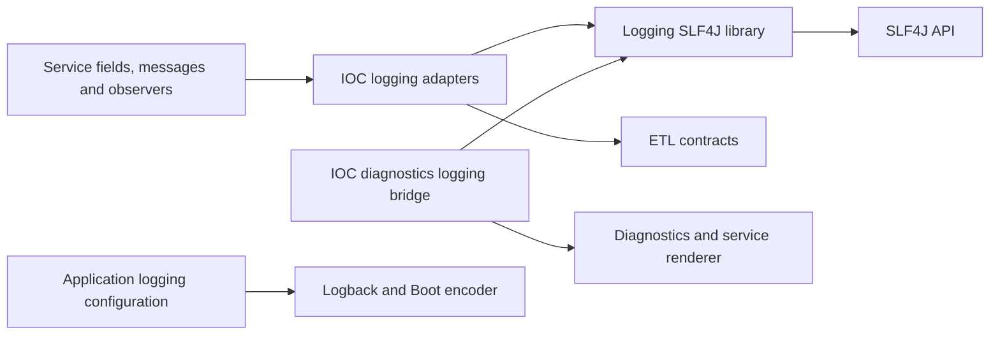

# LIB-3: SLF4J logging tools and ECS extraction plan

Status: **L3-0–L3-4 complete; `0.3.0-rc.1` published and qualified**, 2026-10-21. Initially
proposed 2026-09-13, refined for shared ECS after the owner's October request.
The [fixed contract](lib-3-logging-contract.md) owns the implementation target;
the [ECS analysis](lib-3-logging-ecs-analysis.md) retains the preceding findings.
The module and IOC migration are merged through PR 17 into `release-0.3.0`.
[ADR 0045](../../../ADR/0045-reusable-slf4j-logging-contract.md) owns the accepted
boundary; this worknote records implementation and release evidence.

## Recommendation

Create one small Java 21 library for restoring logging context, constructing
typed event fields and explicitly preparing selected values for logs. Include a
small common ECS profile with supported standard descriptors, outcome vocabulary
and field-ownership rules. Use SLF4J as the logging interface. Each service owns
custom field definitions, action values, messages, sensitivity policy and logging
configuration; standard field meanings are shared.

Fixed target coordinates: `io.github.xorex-lc:ioc-platform-logging-slf4j`;
module: `platform/platform-logging-slf4j`;
package: `com.iocextractor.platform.logging`, with `redaction` and `ecs` subpackages.
Keep lockstep `${revision}`. Tag `ioc-platform-logging-slf4j-v0.3.0-rc.1`
fixes the reviewed release source. Separate Central/GitHub consumers qualified
the released artifacts; the release record below retains their exact identity.
Retain `platform-observability` as the internal IOC catalog/integration module;
new generic types use a separate package to avoid split packages.

Do not publish the existing observability module unchanged. Do not add a starter,
logging backend, metrics/tracing system, general execution-context framework,
automatic secret detector, separate redaction artifact or API/implementation split.
The library does not require the diagnostics or configuration libraries.

Disposition: **published-qualified**. Protected publication and separate cold
plain Java/Boot consumers passed against Central and GitHub Packages.
Confirmed future consumers are the planned collectors; they are not implemented
external consumers. The repository owner maintains/releases the library, matching
existing platform-library metadata. Independent local consumers are part of
L3-4; the public-repository qualification is recorded below.

## Confirmed requirements

The [interview, sections 16–20](shared-library-exploration.md) establishes:

- Logging metadata can be set around an operation and restored afterwards.
- Each service defines custom field names/types; shared tools process those
  definitions. The 2026-10-19 refinement adds common ECS meanings and integration
  conventions for consistent use across services.
- Wrong field types continue throwing; producer correctness and handling remain
  developer responsibilities. Containment is deferred as
  [OBS-6](../../../KNOWN-ISSUES.md#4-наблюдаемость-obs), not an extraction blocker.
- URL credential/query sanitation is useful as an explicit helper.
- Other selected sensitive values need a constant full mask. Fingerprint-based
  correlation is unnecessary. The service selects values to hide.
- L3-0 fixes the extraction contract. L3-1/L3-2 implement production extraction
  and the selected wire corrections; their dated records retain the evidence.

Constant whole-value masking is the requested extension implemented by
`LogRedaction.fullMask()`. Existing IOC diagnostic fingerprinting and DEBUG/TRACE
rendering remain a separate migration decision.

## Evidence and findings

Original September baseline: `release-0.3.0`,
`0df7183fcc02cfd010104733c3608e710b059be9`.
Resolved test dependencies: SLF4J 2.0.18, Logback 1.5.38; project Boot parent 4.0.8.
The working tree already contained the interview/C0 worknotes and the OBS-6 debt
entry. This analysis preserves those changes and does not change production code.

Reviewed: observability production types and tests, diagnostic logging/formatting,
bootstrap listeners and observers, encoder wiring, architecture/catalog checks,
module POMs and publication tooling. Project references:
[observability capability](../../../dev/observability.md),
[ADR-0018](../../../ADR/0018-typed-ecs-structured-logging.md),
[ADR-0019](../../../ADR/0019-spring-boot-4-nested-ecs.md),
[module map](../../../MODULARIZATION.md),
[publication guide](../../../guides/library-publication.md), and
[diagnostics proposal](../../../../.github/release-notes/ioc-platform-diagnostics-api-0.3.0-rc.1.md).
Historical ADR status/version prose is not treated as current implementation state.

The 2026-10-19 refresh uses `r030-libraries` at
`662aa880587e11cea08204c250d89894abf1834c`, with the same resolved logging versions.
It adds actual encoder/appender characterization and standard-field producer
review. The [analysis](lib-3-logging-ecs-analysis.md#findings) records two concrete
IOC corrections: invalid `event.type` meanings (OBS-9), and `error.type` plus
Throwable causing loss of a JSON record (OBS-10). It also records dataset,
reserved-field and nested-path collision limits. These findings supersede any
inference that preserving current wire output alone qualifies a shared ECS profile.

| Priority / seam | Evidence | Design consequence |
|---|---|---|
| High: API coupling | `MdcScope.put/hide` and `LogEvent.field` accept IOC `LogField`; action/outcome helpers embed that vocabulary | Introduce immutable service-supplied descriptors and the small shared ECS vocabulary; keep IOC conveniences locally |
| High: dependency coupling | `LoggingPipelineObserver` pulls `platform-etl` and its diagnostics/errors closure into observability | Keep observer local; generic JAR needs only SLF4J API |
| High: masking/type conflict | `LogValueNormalizer` rejects strings for LONG/BOOLEAN | A constant textual mask requires a STRING log field; never silently change a numeric field's wire type |
| High: scope of redaction | URL helper preserves path/fragment; diagnostic formatter selects only three IOC keys and permits raw DEBUG/TRACE values; sink passes Throwable separately | No universal safe-output promise; selected-value masking does not scrub messages, causes, other fields or ambient MDC |
| Medium: mutable scope ownership | `MdcScope` stores prior values without thread/order enforcement | Support same-thread, nested LIFO scopes only; no worker/service propagation contract |
| Medium: partial scope construction | Fluent scope population may throw before try-with-resources acquires it; `collisionScope()` populates before returning | Open the resource before population and put collision hiding inside its protected body; retain exception propagation |
| Medium: new descriptor identity | Current enum inherently prevents duplicate key/type definitions; arbitrary descriptors will not | Normalize event identity by key; reject conflicting types and collapse equivalent declarations |
| Medium: asymmetric STRING handling | MDC path uses `String.valueOf(Object)`; event path only accepts specified textual types | Specify distinct public contracts and preserve old IOC conversion through a local adapter |
| Medium: omission is not hiding | `field(key, null)` removes the event field, so same-key ambient MDC remains visible | Do not use null omission as a security mask; explicit hide/full-mask paths have different semantics |
| Medium: test lifecycle | Async log test uses a timed latch but lacks containing `@Timeout`; appender stop follows assertions rather than finally | Repair ownership discipline when migrating this suite; assertions must not strand async resources |
| Deferred by owner | Type mismatch throws during construction, before disabled-level filtering | Preserve strict behavior; do not implement OBS-6 during extraction |

These are extraction constraints and reviewed risks from the original proposal.
The October refresh reproduces an encoder failure using a production-shaped
call; it does not establish a production incident or a new secret leak. Ordinary
supported scope behavior and typed delivery still pass the focused tests below.

## What SLF4J already provides

SLF4J 2 already provides level-specific fluent event builders, object-valued
key/value pairs, causes and backend dispatch. Retain those facilities; our
wrapper should add field-contract checks and collision handling, not a second
logging engine. Library dependencies should contain the API and leave provider
selection to the application. [SLF4J manual](https://www.slf4j.org/manual.html).

`MDC.putCloseable` removes its key on close; it does not restore a previous
overwritten value. The current `MdcScope` adds restoration of touched keys and
nested scope semantics. Copying/restoring the entire MDC map would also overwrite
unrelated changes, unlike the current scoped behavior.
[SLF4J MDC contract](https://www.slf4j.org/apidocs/org/slf4j/MDC.html).

The shared event facade must continue following the builder returned by
`addKeyValue`/`setCause`, rather than assuming a mutable builder returning itself.
The existing copy-returning-builder test protects this boundary.
[LoggingEventBuilder API](https://www.slf4j.org/api/org/slf4j/spi/LoggingEventBuilder.html).

MDC availability and final rendering depend on the provider. A compatible API
dependency does not guarantee JSON output, nested ECS shape or context inclusion
with every backend. The initial actual provider fixture is Logback; backend-free
construction can work without proving event delivery.
[SLF4J MDC contract](https://www.slf4j.org/apidocs/org/slf4j/MDC.html).

The moving manual currently illustrates SLF4J 2.0.19. This project was inspected
and tested with 2.0.18; no dependency upgrade or universal version compatibility
is inferred from the reference documentation. Boot/Logback format ownership
remains in the application, as required by the project's ADR-0019.

## Existing-type disposition

Paths below are in
[`platform-observability`](../../../../platform/platform-observability/src/main/java/com/iocextractor/observability/)
unless another module is named.

| Type | Disposition |
|---|---|
| `MdcScope` | Extract restoration/hiding mechanics; replace the IOC parameter type |
| `LogValueType` | Extract STRING/LONG/BOOLEAN vocabulary; these are log representation types, not domain types |
| `logging.LogValueNormalizer` | Keep internal to the new library; retain current supported conversions |
| `logging.LogEvent` | Extract typed fields, collision scope and SLF4J delivery; remove IOC convenience vocabulary |
| `logging.LogEvents` | Retain the five small level factories as the entry point; no new logger abstraction |
| `SensitiveLogValueSanitizer` | Move its narrow URL-component transformation behind explicitly named `LogRedaction.urlComponents`; qualify partial-input behavior |
| `LogField` | Keep IOC names/descriptions and generated catalog local; reference shared standard descriptors and hold generic custom descriptors |
| `EventAction` | Keep service event vocabulary/metadata local |
| `EventOutcome` | Share ECS outcome values in `ecs`; IOC may retain a delegating compatibility enum |
| `ObservabilityMode` | Keep oneshot/daemon vocabulary local |
| `logging.LoggingPipelineObserver` | Keep ETL-to-IOC-logging integration local |
| `diagnostics.LoggingDiagnosticSink` in diagnostics-logging | Keep bridge, severity mapping and renderer composition local |
| `diagnostics.RedactingDiagnosticContextFormatter` | Keep IOC key/severity/fingerprint policy local; do not extract the fingerprint merely because it exists |
| `ResilientDiagnosticSink` in diagnostics-api | Already owned by LIB-2; do not duplicate it or infer resilience of all LogEvent calls |
| Bootstrap encoder and logback XML | Keep backend code/configuration local initially; provide tested integration recipe and ownership rules; assess a Boot adapter only if a second consumer needs the custom code |
| Decision/import/startup observers | Keep messages, IOC schema extensions and business lifecycle mapping local |

Package-info and READMEs follow the resulting ownership. A generic redaction
helper does not need a separate JDK-only module without a demonstrated independent
consumer. Its methods remain independent of IOC and do not use Spring.

## L3-0 public API and contracts

Fixed signatures, not implemented declarations. The complete eight-type surface,
validation rules and error contracts are in the
[L3-0 contract](lib-3-logging-contract.md#public-surface).

```java
record LogFieldSpec(String key, LogValueType valueType) { }
enum LogValueType { STRING, LONG, BOOLEAN }

MdcScope.open()
MdcScope.put(LogFieldSpec field, String value)
MdcScope.hide(LogFieldSpec field)
MdcScope.close()

LogEvents.trace/debug/info/warn/error(Logger logger) -> LogEvent
LogEvent.field(LogFieldSpec field, Object value)
LogEvent.action(String action)
LogEvent.outcome(ecs.EventOutcome outcome)
LogEvent.durationNanos(long durationNanos)
LogEvent.message(String message)
LogEvent.log()
LogEvent.log(Throwable cause)

LogRedaction.urlComponents(String value) -> String
LogRedaction.fullMask() -> String
```

The field descriptor is an immutable record, not an implementation interface
whose key/type can change during an event. A service can keep descriptors in an
enum or static catalog with its own descriptions and units. Validate the fixed
dot-separated key grammar and non-null keys/types. Global catalog uniqueness,
reserved encoder names and nested-name conflicts such as `task` versus `task.id` remain service
schema checks under the shared profile's rules; the library does not become a
catalog registry or JSON mapper. The initial scalar API excludes optional ECS
type/category arrays; a future consumer must justify and qualify that extension.

### Shared ECS profile

The `ecs` package will contain the five `EcsFields` descriptors and shared
`EventOutcome` vocabulary. L3-0 fixes the supported scalar paths
already used: `event.action`, `event.outcome`, `event.duration`, `error.type` and
`file.path`. `event.type` must not be extracted as an unrestricted STRING field.
Their public names/helpers are fixed in the contract.

The profile includes meaningful outcome omission, nanosecond duration semantics
and nonnegative duration validation, custom namespace rules and encoder-owned
paths. Generic `.field(...)` checks representation; raw descriptors or direct
SLF4J calls do not establish ECS conformance. Profile helpers and service schema
checks must state what they validate and where callers can bypass them.

Boot still owns JSON serialization, runtime/service metadata and Throwable error
fields. A type-only error can use `error.type`; a Throwable record must let the
encoder supply its error object rather than also contributing explicit `error.*`.
Dataset injection and MDC follow the fixed
[ownership rules](lib-3-logging-contract.md#ownership-and-backend-recipe) and
[migration contract](lib-3-logging-contract.md#ioc-migration-fixed-for-l3-2).

Existing internal event names move to `ioc.event.type`, not the ECS classification
path. The two informational skipped records use `ioc.operation.disposition` and
omit outcome. These are deliberate wire corrections with fixtures/documentation,
not incidental renames
hidden in an extraction. Accepted ADR-0018/0019 remain immutable.

### Typed event fields

- Retain normalization of CharSequence, Enum, Path and UUID to STRING;
  Byte/Short/Integer/Long to LONG; Boolean to BOOLEAN. Null omits a field.
  Floating point, arbitrary objects and numeric/boolean strings are rejected.
- The generic enum conversion is `toString()`. IOC `.action(...)` must still
  pass `EventAction.value()` explicitly to preserve its lower-case wire value.
- Same key and same type identifies one event field, with last supplied value
  winning. Different types for one key are a programming error, including when
  declarations came from different descriptors. Retain per-event type identity
  when a null removes the emitted value. Do not key the event map solely by
  record equality, which includes type and would allow duplicate wire keys.
- Wrong types throw before logging-level filtering, as agreed in OBS-6. Do not
  silently coerce strings or add automatic retry/fallback.
- Preserve empty default message and nullable cause semantics. The event builder
  is mutable and not thread-safe; construct one per record. Calling `log()` twice
  is two log attempts, not an exactly-once or durable-delivery guarantee.
- A local event field temporarily hides the same MDC key for that emission,
  regardless of its scalar type, and restores it afterwards. Follow returned
  SLF4J builders. Final serialization and async buffering belong to the provider.

### Logging context scopes

- `put` accepts STRING descriptors only; null removes that key for the scope.
  `hide` may hide a descriptor of any type because an ambient string can collide
  with a typed event field.
- Remember each touched key's first previous value; restore in reverse order.
  Leave untouched keys alone. Close is idempotent; writes after close fail.
- Open, populate and close on the same thread in nested LIFO order. No automatic
  capture/restore across executors, async methods, services or network boundaries.
  The current bootstrap listeners reconstruct MDC inside workers from explicit
  event metadata; preserve that pattern.
- The proposed String-only argument narrows the current `put(LogField,Object)`
  convenience. The IOC compatibility wrapper can keep its existing null and
  `String.valueOf` behavior; changing those existing callers is not implicit.
- Open the scope directly in try-with-resources, then populate inside the body.
  Apply the same structure to collision hiding so failures during preparation
  still attempt cleanup. This is resource ownership, not OBS-6 containment:
  normal Java exception propagation/suppression remains intact. No guarantee
  of successful restoration can be made if the MDC provider itself fails.

### Masking without corrupting field types

`fullMask()` will return the fixed constant `[redacted]` without accepting or
stringifying a secret. It conveys no secret prefix, suffix, length or fingerprint.
It has no severity-dependent escape hatch. The service selects where to use it;
absent/null input handling remains its decision.

```java
// Service-owned log schema; TOKEN describes its logged representation.
var taskId = new LogFieldSpec("collector.task.id", LogValueType.STRING);
var token = new LogFieldSpec("collector.auth.token", LogValueType.STRING);
var count = new LogFieldSpec("collector.items", LogValueType.LONG);

try (var context = MdcScope.open()) {
    context.put(taskId, "task-42");
    LogEvents.info(logger)
            .field(token, LogRedaction.fullMask())
            .field(count, 12)
            .message("operation completed")
            .log();
}
```

Do not send a textual mask to a LONG/BOOLEAN field. If a service needs a masked
numeric secret, define its **log representation** as STRING consistently from
the outset, or omit the numeric field and use a separate service-owned STRING
field. Changing an existing numeric field's type needs a deliberate consumer
schema migration. Raw domain values and their types remain unchanged.

Null omission alone does not mask ambient MDC. For sensitive same-key context,
use an explicit mask or protected hide scope; otherwise omitting an event field
can expose the ambient value. Prefer never inserting raw secrets into MDC.
Masking one selected field also does not alter copies in the message, other
fields or Throwable. An automatic scrubber is outside v1.

`urlComponents` remains a different operation: it preserves useful URL parts
and hides user-info/query content under the current lexical algorithm. Paths
and fragments may remain visible. L3-0 pins twelve examples for scheme-less input,
delimiter ordering, multiple delimiters and null in the contract/probe. Preserve
those semantics; do not claim URI parsing or arbitrary-token detection.

## Dependency direction and SOLID



The new library has no dependency on ETL, diagnostics, configuration, application,
domain, Spring, Logback main classes or IOC field catalogs. Preserve inward
dependencies: core business modules use their existing observer/diagnostic ports,
not the SLF4J helper as a new business dependency. The local observability module
can delegate to the generic JAR and retain its existing outward integrations.

| Principle | Concrete consequence |
|---|---|
| SRP | Separate field normalization, scoped MDC restoration, event emission and explicit redaction methods |
| OCP | New service field definitions require no edits to the library's field enum/catalog |
| LSP | No claim of durable delivery, universal provider rendering, arbitrary field types or automatic propagation |
| ISP | No obligation to implement diagnostic sinks, ETL observers or security policies to use a scope or typed event |
| DIP | Depend on SLF4J's logging interface and immutable field data; IOC policy never becomes a shared dependency |

Only `org.slf4j:slf4j-api` is a required external main dependency; Logback remains
test-only in the library. The application selects/configures its provider. Do not
shade SLF4J or impose a provider transitively. A single artifact is sufficient;
additional SPI interfaces or modules would add compatibility surface without a
confirmed consumer need. [SLF4J library guidance](https://www.slf4j.org/manual.html).

## Migration and publication plan

| Slice | Work | Acceptance evidence |
|---|---|---|
| L3-0: complete | Eight-type API, five ECS scalar descriptors; outcome/duration/ownership; arrays deferred; descriptor identity; masking/null/MDC/URL contracts; OBS-9/10 migration fixed | [Contract](lib-3-logging-contract.md), [ADR draft](lib-3-logging-adr-draft.md) and [62-case probe](l3-0-probe/README.md); current mechanics/defects distinguished from future API requirements |
| L3-1: complete | Add fixed types/helpers; move normalization internally; fix key/type identity and resource acquisition; document the public API as it is implemented | Sole main dependency SLF4J API; no service imports; actual API boundary/helper regressions; English Javadoc/package docs, module README and executed plain Java examples |
| L3-2: complete | Delegate existing conveniences or migrate atomically; retain IOC catalogs and pipeline observer locally; implement qualified OBS-9/10 corrections | Preserve unaffected wire fields/actions, logger categories and context reconstruction; explicitly qualify/document changed keys/shapes and complete error JSON output |
| L3-3: complete locally | Consolidate generic tests; keep IOC catalog and Boot wire tests local; review L3-1 API docs and consumer guide; qualify Boot recipe; update architecture/module/analyzer maps; promote ADR | Focused suites then `make verify` and `make pmd-analysis` on final production/build tree; reviewed analyzer/coverage scope changes |
| L3-4: complete; local and protected release evidence below | Dependency-aware descriptors/POM, sources/Javadoc and independent consumers; protected publication after reviewed integration | Negative dependency-resolution checks and immutable bundle identity; `0.3.0-rc.1` published and cold plain/Boot consumers passed separately from Central/GitHub |

IOC compatibility wrappers must delegate mechanics, not keep independent copies
of the implementation. They can remain internal while preserving current imports,
logger categories and convenience methods. The existing diagnostic fingerprint
renderer does not switch to a constant mask as a side effect of moving the URL
helper; any such product policy migration is separate and explicit.

Preserve the existing LIB-2 sink contracts and local diagnostics logging bridge;
avoid competing sink APIs or an accidental dependency cycle. The shared LIB-3
JAR does not depend on diagnostics.
Keep library versions in product lockstep and use the public group override at
the library module, following LIB-1. Manage reactor versions in the parent.

The publisher admits concurrency, diagnostics and logging through separate
dependency descriptors. Concurrency and diagnostics retain zero-dependency
guards; logging requires exactly `org.slf4j:slf4j-api:2.0.18` as a compile JAR,
without a provider. L3-4 implements the dependency-aware publication work
identified in the
[configuration proposal](../../../../.github/release-notes/ioc-config-spring-boot-0.3.0-rc.1.md#extraction-outcomes-and-ownership):
parent-independent resolved POMs, explicit allowed dependencies and target-repository
isolation with separate third-party resolution. Future components still require
their own reviewed descriptor and qualification. Existing release identities stay immutable.

Update architecture rules to cover the new package, not just the old
`..observability..` pattern. Review coverage/analyzer group counts when adding a
module; do not weaken baselines or exclusions to accommodate the split.
Generated logging catalog remains derived from the IOC catalog and must not be
hand-edited or moved into a universal shared schema. Promote the accepted boundary
to an ADR and capability/module documentation during implementation.

## Verification requirements

In addition to existing behavior, qualify:

- Independent descriptors: duplicate same-name/same-type replacement; conflicting
  types; null omission; no accidental duplicate wire keys or catalogue inheritance.
- Normalization boundaries and wrong types with both enabled/disabled levels,
  preserving the owner's chosen throwing contract.
- Nested/repeated/hide scopes, body exceptions, untouched keys, close idempotence
  and cleanup attempts after collision preparation or provider-write failures.
  Document thread/order misuse rather than promising implicit propagation.
- STRING mask with a non-string source concept; rejected mask for LONG/BOOLEAN;
  mask unaffected by severity; no original value passed to or retained by the
  full-mask helper; same-key ambient context does not bypass selected masking.
- Existing IOC field names/types/actions, severity-to-level mapping, URL sanitation,
  legacy fingerprint rendering, event metadata reconstruction and nested ECS output,
  with separately documented OBS-9/10 corrections.
- Shared ECS meanings and ownership: allowed/omitted outcomes, nanosecond duration
  boundaries, reserved metadata and scalar/object conflicts, error fields with and
  without Throwable, dataset precedence and strict duplicate-member detection.
  Qualify immutable arrays before advertising type/category support.
- Async backend delivery with bounded coordination and a containing `@Timeout`;
  stop/detach owned appenders in finally and assert bounded termination. Preserve
  the existing copy-returning-builder regression.
- Standalone Java consumer with a real test provider; separate no-provider smoke
  must not be represented as successful log/context delivery. Broaden backend
  compatibility only with actual provider fixtures.

The maintainer/release owner is `xORex-LC`, consistent with existing library POMs.
L3-0 records exact Java/SLF4J/provider versions; no broad compatibility range is
inferred. Requalify the packaged consumer and its dependency closure before release.
Prior to publication, rollback is restoring IOC wiring without leaving duplicate
emitters. Published releases remain immutable; breaking descriptor/event behavior
requires normal version/API review rather than replacing existing artifacts.

## Evidence executed for this proposal

The following is historical September evidence, not the current suite count or
freshness claim. Current October results are recorded after it.

`make test-module MODULE=platform/platform-observability` passed: six local suites,
22 tests, zero failures/errors/skips. It also ran upstream module tests; their
counts are not counted as additional observability coverage.

`make test-module MODULE=platform/platform-diagnostics-logging` also passed:
four local suites, 37 tests, zero failures/errors/skips, covering the existing
bridge, redaction and resilience/MDC behavior. Upstream tests overlap the first
command; the two target modules contribute 59 distinct local test cases.
No new production API or tests were introduced by this proposal.

These checks do not qualify the proposed module, constant-mask extension, new
descriptor API, full Boot wire integration or publication. Full verify/PMD were
not rerun for this documentation-only task; local freshness still points to the
older `3307d1e2` commit. No new analyzer-finding claim is made from unrun checks.

That September outcome completed LIB-3 at design-proposal level. The October
records below supersede its sequencing and freshness observations.

### ECS refinement evidence — 2026-10-19

Current focused checks passed: observability six suites/23 cases; control-event
observer one case; Boot ECS integration two cases. Seventeen synthetic scenarios
confirm baseline behavior and the documented failure paths. The
[analysis evidence](lib-3-logging-ecs-analysis.md#executed-evidence-and-limits)
distinguishes test passes from reproduced defects and unqualified API proposals.
No production source or build/analyzer scope changed. Complete verify/PMD remain
stale for this HEAD; no independent logging consumer or new API is qualified.
That assessment left L3-0 open; the following qualification record closes it.

### L3-0 contract qualification — 2026-10-19

The owner authorized L3-0 after the ECS assessment. The
[fixed contract](lib-3-logging-contract.md) and
[ADR draft](lib-3-logging-adr-draft.md) now specify artifact ownership, the
eight-type API, five ECS descriptors, scalar-only v1, validated helpers, key-based
event identity, strict errors, MDC ownership and the two distinct redaction
operations. They fix the three-producer OBS-9 migration and the OBS-10 error
ownership correction for L3-2; neither debt is marked fixed yet.

The [versioned isolated fixture](l3-0-probe/README.md) passed 62/62 cases with no
failures, aborts or skips, using a `collector.*` catalog and no IOC JAR/reactor
output. Its source/dependency baseline is frozen by hash. This includes explicit
reproductions of record-key/type defects, scope acquisition risk and backend
collisions; a passing characterization does not mean remediation. Twelve URL
examples pin the actual lexical algorithm. The future descriptor/helpers and
full-mask implementation still need actual public API tests in L3-1.

`make doctor-core` and the focused observer test (one case) passed. No production
Java, Maven/analyzer scope or accepted ADR changed. Full verify/PMD remain stale
for HEAD `662aa880587e11cea08204c250d89894abf1834c`; there is no new packaged or
external consumer qualification. L3-1 is the next implementation slice.


### L3-1 implementation and qualification — 2026-10-19

Implemented on `r030-libraries` over HEAD
`662aa880587e11cea08204c250d89894abf1834c`, in the working tree. No commit,
push, publication, existing release-tag movement or accepted-ADR edit belongs
to this slice. Earlier TOOL-6 and logging/ECS worknotes are retained.

The new `platform/platform-logging-slf4j` module exposes the eight contracted
public types. Main code imports only JDK and SLF4J API. IOC field/action catalogs,
ETL observer, diagnostics integration and backend configuration remain local and
are not yet wired to this module. The normalizer is package-private. Key identity
survives null omission, rejected field calls leave the previous declaration and
value intact, and the collision scope is acquired before population.

Seven suites exercise 112 cases through the public API: accepted and rejected
scalars, snapshot/replacement behavior, first/repeated/later null, conflicting
types, helper vocabulary and duration boundaries, explicit masking, lexical URL
boundaries, MDC nesting/first-touch restoration, partial provider failure,
Java suppression, copy-returning builders, disabled filtering, worker context
reconstruction and a real asynchronous Logback handoff. Owned workers have timed
coordination and bounded cleanup. Architecture tests admit exactly eight public
types and only JDK/SLF4J/self dependencies.

A final review found a deterministic defect in the initial key validator:
10,000 valid dotted segments exhausted the regex call stack. The focused test
first failed with `StackOverflowError`; possessive repetition now accepts that
valid path and rejects its trailing-dot variant without changing the grammar.
The regression remains in `LogFieldSpecTest`. This was a corrected failure, not
an automatic flaky-test retry.

Every public type/member has English Javadoc, with package documentation and a
module README. The [consumer guide](../../../guides/logging-library.md) contains
three complete Java examples compiled directly from its Markdown and executed
by `LoggingLibraryExampleTest`. These tests use an unrelated `collector.*`
catalog. They are in-checkout consumers, not empty-cache repository evidence.
The publication profile builds main/source/Javadoc JARs with doclint and warning
failure enabled. The flattened POM has no parent and retains exactly the compile
dependency `org.slf4j:slf4j-api:2.0.18`; no backend or test dependency is published.

The module joins all four report POMs, explicit source roots and scope manifests.
The reactor now has 29 Maven projects: 24 functional JARs, including the excluded
TCK, and four report POMs plus the root. Production coverage/analyzer membership
is 23 modules, with 22 required local JaCoCo reports and one downstream-only
module. Source inventory deliberately grows from 223 to 230 Surefire suites;
78 Failsafe suites, five external shells and 303 deterministic suites are
reconciled by the late integrity gate. Existing fixed floors and all prior
ratchet entries are retained. The new measured baseline is 140/140 lines,
67/67 branches and zero missed instructions. Both verifier fixture matrices
accept the new public coordinate and reject its retired project-group variant.

Qualification commands are the focused module test, the `library-publication`
package profile, compile dependency tree, `dependency:analyze-only`, a scoped
offline Dependency-Check, `make verify`, `make pmd-analysis`, `make pmd-watchlist`
and `make docs`. The first whole-reactor Maven run passed, but its local evidence
was invalidated because documentation changed while it ran. Final verify and
regular PMD evidence must therefore be collected after freezing this change;
`make context` is the current evidence/freshness authority, not the earlier pass.
The initial module invocation also exposed an unmanaged plain ArchUnit test
artifact; parent dependencyManagement now supplies the existing ArchUnit version.

Analyzer review: SpotBugs has the same 137 accepted raw findings and zero visible
findings; CPD retains 22 groups; adopted PMD retains 19 findings. The new module
adds none to these reports. The diagnostic watchlist reports 73 findings
(63 CloseResource, eight PreserveStackTrace, two NcssCount), all outside the new
module. MDC resources are acquired before population, and test/provider workers
have explicit owners. No analyzer baseline or exclusion was relaxed.

Dependency analysis reports only inherited Jupiter aggregate/API/params test
relationships, consistent with the existing test dependency convention; there
is no undeclared or unused production dependency. Offline Dependency-Check
analyzes the sole main SLF4J JAR with zero reported vulnerabilities, using NVD
last checked on 2026-07-19. That stale local dataset is diagnostic evidence, not
a current security clearance or a replacement for release security checks.
No dependency upgrade or data refresh is part of this slice.

Next: L3-2 replaces/delegates the old mechanics and migrates the selected IOC
producers. OBS-9 and OBS-10 remain open. Boot JSON/encoder-status qualification,
ADR promotion and final integration consolidation remain L3-3; independent
publication-tool integration and cold consumer admission remain L3-4. No live
Elasticsearch, external collector, additional backend, load or public repository
qualification is claimed.


### L3-2 IOC migration and qualification — 2026-10-19

The IOC observability module now depends on `ioc-platform-logging-slf4j`.
Existing imports and producer-selected logger categories are retained through
thin facades. `LogField` stores shared descriptors and reuses all five shared
ECS constants; its old scalar-type enum is removed. Event emission, scalar
normalization, MDC state/restoration and lexical URL preparation delegate to the
library. The old generic normalizer and its algorithm copies are removed.
IOC actions/catalogs, ETL observer, diagnostics bridge, fingerprint disclosure
policy and Boot backend/configuration remain local.

IOC scope factories now acquire an empty scope before populating it. The local
callback convenience closes a partly populated scope on RuntimeException/Error,
with ordinary Java suppression if cleanup also fails. ETL, event listeners and
router workers still construct their own explicit correlation fields. No
context propagation or change to task/event recovery is introduced.

OBS-9 is fixed: the control observer uses `ioc.event.type`; completed legacy
import replays and current-schema no-ops use `ioc.operation.disposition=skipped`
and omit `event.outcome`. The unrestricted STRING `EVENT_TYPE` descriptor is
removed. OBS-10 is fixed: the local watch failure retains its Throwable and lets
the encoder own `error.*`. Type-only errors remain supported. The catalog is
regenerated through `LoggingCatalogDocumentationTest`, not edited by hand.
The capability doc and release notes describe exact query migrations.

Focused evidence: six observability suites cover IOC catalog binding, delegated
scalar behavior, all five levels, helper duration boundaries, MDC restoration
and async handoff. The old private-normalizer suite becomes an observable
`IocLogFieldBindingTest`; no suite is lost. `LoggingMigrationIT` passes five real
producer-to-appender cases: all control-event observer callbacks; current schema;
completed legacy import replay; watch-provider failure; and type-only recovery
failure. It parses actual JSON bytes and checks appender/encoder status. The watch
worker has bounded cleanup and a containing JUnit timeout. An initial legacy
fixture expected one record but the producer correctly emits both the skip and
its aggregate summary; the regression now verifies that pair explicitly.

A concurrent focused Maven attempt collided on root verifier-class cleanup and
is discarded as technical evidence. Subsequent commands run sequentially.
The first full run exposed an overly broad new architecture package matcher:
`..observability..` also matched the application's own neutral decision ports.
The rule now targets `com.iocextractor.observability..` while still banning the
new shared logging package from core. A provider-fault regression additionally
checks partial IOC context initialization with failed restoration: the original
failure stays primary and restoration is suppressed. No ratchet relaxation is
used for the smaller delegating module.

Final release evidence requires `make verify`, `make pmd-analysis` and resource
`make pmd-watchlist` on the frozen final tree; `make context` owns their freshness.
The production/report topology stays 23 aggregate groups and 22 local reports.
The source universe becomes 230 fast / 79 integration / 5 external shells,
304 deterministic classes. No coverage floor or ratchet is lowered.

Next is L3-3: consolidate generic/IOC tests, qualify the reusable Boot recipe,
review final integration docs and promote the Proposed ADR. L3-4 retains
publication tooling and cold independent-consumer admission. No external
collector, live Elasticsearch, load, additional provider or publication is
qualified by these repository tests. No commit or push was requested.


### L3-3 integration, documentation and qualification — 2026-10-20

Test ownership is consolidated without copying IOC vocabulary into the library.
The shared module owns generic fields/events, ECS helpers, masking, provider
failures, async snapshots and executable plain Java examples. IOC observability
owns catalog binding, ETL correlation and callback cleanup; bootstrap owns real
IOC producer JSON and the consuming application's backend recipe. The eight-type
API and package Javadoc were reviewed against the fixed contract. Existing
examples still compile; publication-profile packaging passes full doclint with
warnings treated as errors and produces main, sources and Javadoc JARs. The
resolved parent-independent POM has only SLF4J API as a required main dependency.
No dependency version, provider, report membership or coverage floor changes.

The new [Boot integration guide](../../../guides/logging-library-boot.md) contains
complete YAML, XML and an application-owned dataset encoder. Its qualified path
is Java 21 / Boot 4.0.8 / Logback 1.5.38 / SLF4J 2.0.18 with synchronous mutable
LoggingEvent input. The file appends across restarts; rotation, retention and
resource budgets remain service-owned. The encoder restores the source event's
key/value list and rejects immutable snapshots or producer/MDC dataset overrides.
Reserved metadata, prefix conflicts and Throwable/error ownership remain explicit
service schema constraints, not new generic library checks.

`LoggingBootRecipeIT` compiles the actual guide Java blocks and loads the actual
YAML/XML through Boot in a separate JVM. Its classpath contains only shared
logging classes and third-party JARs; explicit checks reject leaked IOC classes.
Seven cases check five supported JSON records and six invalid-input scenarios:
event/MDC dataset overrides, immutable snapshots, Throwable/error collision,
scalar/object prefix collision and reserved metadata. Assertions parse output
with duplicate-key detection and inspect appender status, native scalar types,
omission, masking, metadata and source-event/MDC restoration. Owned processes
have timed termination and finally cleanup under a containing JUnit timeout.
This is in-checkout integration evidence, not a cold repository consumer.

The callback cleanup review found one additional defect: a provider reusing the
same exception object caused Java self-suppression to replace the original
failure with `IllegalArgumentException`. A red regression reproduced it. The
local facade now suppresses only a distinct cleanup exception; both failure
shapes pass. The focused observability run passes 29 cases. The shared contract
and public API do not change.

[ADR 0045](../../../ADR/0045-reusable-slf4j-logging-contract.md) promotes the fixed
boundary, backend responsibilities and selected IOC wire corrections. The draft
is retained as a historical promotion record; accepted ADRs 0018/0019 are not
rewritten. Module references, guides, architecture/boundary maps, testing/build
ownership and release notes are updated together. One new Failsafe suite changes
the exact source universe to 230 fast / 80 integration / 5 external shells,
305 deterministic classes. Production/report topology remains 24 functional JARs,
23 aggregate groups and 22 local coverage reports. No analyzer baseline,
suppression, exclusion or test/coverage ratchet is relaxed.

Acceptance requires `make docs`, `make verify`, `make pmd-analysis` and resource
`make pmd-watchlist` on the final frozen tree. Current command receipts and
`make context` own pass/freshness; earlier focused results do not substitute for
the complete gate. Analyzer identities and findings intersecting changed code
must be reviewed against the preceding accepted reports.

Next is L3-4: dependency-aware publication descriptors/guards, cold independent
consumers and immutable bundle admission. This slice does not publish, move a
component tag, qualify a live collector/Elasticsearch, load or another provider,
or claim a second production consumer. No commit or push was requested.

### L3-4 packaging and independent consumers — 2026-10-20

The owner authorized committing L3-3 and starting L3-4. L3-3 is preserved as two
commits: `721e5093` fixes callback cleanup; `0d32551f` adds the Boot recipe and
integration qualification. L3-4 does not change production Java, library
dependencies, versions, reactor membership, JUnit inventory or analyzer scope.

The existing publication tool and workflows now accept the `logging` component.
Its flattened POM must contain exactly the required compile JAR
`org.slf4j:slf4j-api:2.0.18`. IOC dependencies, providers, optional/runtime/test
scopes, ranges, classifiers, exclusions, inherited parents, repositories and
build/profile coupling are rejected. The concurrency and diagnostics descriptors
retain their zero-dependency rule. The same validation runs when preparing a
bundle and when reading a retained bundle before signing or repository access.
Manifest format, recovery, protected-environment review and immutable release
identities remain unchanged. CI adds logging to its existing consumer matrix;
publication adds a choice to the existing manual workflow.

Two independent Maven fixtures have no IOC parent or reactor classpath. Both use
fresh local caches and compile the actual consumer-guide Java blocks. The plain
fixture checks typed fields, omission, masks, Throwable delivery and MDC
restoration with a consumer-owned Logback provider. The Boot fixture also loads
the guide's actual YAML/XML and dataset encoder, writes five JSON records and
checks duplicate keys, native numbers/Boolean, metadata, masks, omission and
Throwable encoding with no appender errors or IOC classes. The six invalid Boot
recipe scenarios remain in the L3-3 integration suite rather than being copied.

The provider and classifier dependencies exclude SLF4J API so that they cannot
hide a missing transitive dependency in the library POM. After the positive plain
consumer, two offline negative compilations must fail for the expected reason:
excluding the API causes compilation errors; requesting a known unavailable API
version causes dependency resolution failure. Unexpected success or an unrelated
failure fails qualification. Every consumer also compares the resolved POM/main/
sources/Javadoc SHA-256 values and checks that Maven 3.9.9 attributes each file to
the selected repository. Resolving the same library from the public dependency
fallback cannot qualify a GitHub consumer. Resolver-marker changes fail closed
and require an explicit wrapper/tooling review.

Local evidence is retained under `.dev/l3-4/`: snapshot and RC packaging with full
Javadoc doclint; the six-case cold matrix for logging, concurrency and diagnostics
at snapshot/RC versions; 83 offline publication contract tests with disposable
test signing keys; and the shell tooling contract suite. Logging contributes two
fixtures per version, for eight cold consumer projects across that matrix.
The diagnostics RC input is the previously retained signed release bundle;
manifest hashes are checked before and after every case. The new unsigned logging
bundles identify the dirty qualification tree and must not be reused as signed
release inputs. These local checks do not establish public repository availability.

Final admission requires `make docs`, `make verify`, `make pmd-analysis` and the
resource watchlist review on the frozen tree. Command receipts and `make context`
own current pass/freshness. Analyzer identities must match the accepted reports;
no floor, baseline, suppression or exclusion is relaxed. No dependency upgrade
or fresh vulnerability clearance is claimed; the previously recorded stale NVD
limitation still applies.

Next is review/PR into `release-0.3.0`, followed by an explicitly authorized
protected publication of a clean tagged bundle and separate Central/GitHub cold
consumers. The manual workflow's default-branch discovery copy must expose the
new component choice. No push, PR, tag, signing with release keys or external
publication is performed in this slice. A live collector, Elasticsearch, load
qualification and a second production consumer remain outside this evidence.

## Protected publication record — 2026-10-21

The owner merged PR 17 and authorized protected publication. Annotated tag
`ioc-platform-logging-slf4j-v0.3.0-rc.1` fixes source commit
`5b9761b7ab0b3d6033e51a82fb735f1a3049ef08`, whose tree equals reviewed PR head
`716049cf`. Merge CI [run 39432555971](https://github.com/xORex-LC/ioc-extractor/actions/runs/39432555971)
passed all required gates. The existing concurrency/diagnostics release identities remain unchanged.

Protected [validation run 39433697620](https://github.com/xORex-LC/ioc-extractor/actions/runs/39433697620)
passed the clean RC reactor build, strict Javadoc, 83 publication contracts,
plain/Boot isolated consumers, PMD and owner-key signing. Central validated
deployment `c03543e6-6ce0-426a-905b-b9e18197f4e0`. The signer fingerprint is
`F69BA7E0F7494982E6E1B483DF54073D8BBFA9F9`.

The signed manifest has SHA256 `36d37dac0a91454c7e306003d433aa8da912040166ebd99b22780b2876020ca0` and covers 20 files.
Its four primary artifacts match the unsigned build. Publication
[run 39455105300](https://github.com/xORex-LC/ioc-extractor/actions/runs/39455105300)
resumes the original validation run and deployment; its build is skipped.
Both protected-environment reviews were performed by the owner.

Publication and the GitHub Packages mirror passed. Both repository consumers
passed in separate temporary projects with empty Maven caches/settings: each
ran the three plain Java guide examples and the actual Boot Java/YAML/XML
recipe, checking five JSON records, encoder status and no IOC classes.
The plain consumer also rejected missing/unavailable SLF4J API for the expected
reasons. Every consumer checked all four primary SHA256 values and Maven origin
markers for the selected repository; resolving through the Central dependency
fallback could not qualify a GitHub result. Repository comparison covered all
20 signed/checksummed files. The publication run's retained manifest and all
20 files are byte-identical to validation; no rebuild or signing was repeated.
Four additional anonymous Central downloads matched the primary hashes.

Published repositories:

- [Central version directory](https://repo.maven.apache.org/maven2/io/github/xorex-lc/ioc-platform-logging-slf4j/0.3.0-rc.1/).
- [GitHub Packages Maven repository](https://maven.pkg.github.com/xorex-lc/ioc-extractor)
  (authenticated package reads).

Primary artifact SHA256 values:

| Artifact | SHA256 |
|---|---|
| POM | `8913a98ed2a639df62e62e152b5ae8d4c1d6bc2b04ed8cfd7e7698b5a8621d64` |
| Main JAR | `e11f4b6e14018317f9ce5866c531042a6e7d0ab7fd9c2b1c600d9098536f8a53` |
| Sources JAR | `89de9ff4ad6f525546a6813a765c5b6026bd5f76ce0e31d7382eded324213f6b` |
| Javadoc JAR | `61a90ecb428c4ef1c42b12b91ced58a350d11bffe69283bde1c34cd7c1a9119b` |

Local `make verify` and `make pmd-analysis` passed on the clean tagged source at
`2026-10-20T13:49:05Z` and `2026-10-20T13:49:37Z`; both are fresh in the retained
source context. Reviewed raw counts remain SpotBugs 137 / zero filtered, CPD 22,
PMD 19, with no finding identity/membership/message drift. The resource watchlist
was reviewed on the identical pre-merge source tree in L3-4. These release-record
edits change documentation only; they do not claim new analyzer execution.

Release bytes, manifest, workflow inputs/logs and source-check receipts are retained
under `.dev/l3-5-publication/`, including `signed-release.tar.gz` plus checksum.
Never rebuild/resign this version or move its tag for recovery. The two consumer
fixtures qualify packaging/API and the documented synchronous Boot recipe;
a deployed second service, live collector/Elasticsearch, load and another
provider remain outside this evidence. Existing OBS-6/7/8 dispositions remain.

Retained publication artifacts: `signed-library` `12281355410`, `central-deployment` `12280977687`, `repository-consumers` `12279819488`.
Their Actions expiry is `2027-01-18T16:10:38Z`;
local copies preserve signed bytes and both successful consumer logs beyond it.
