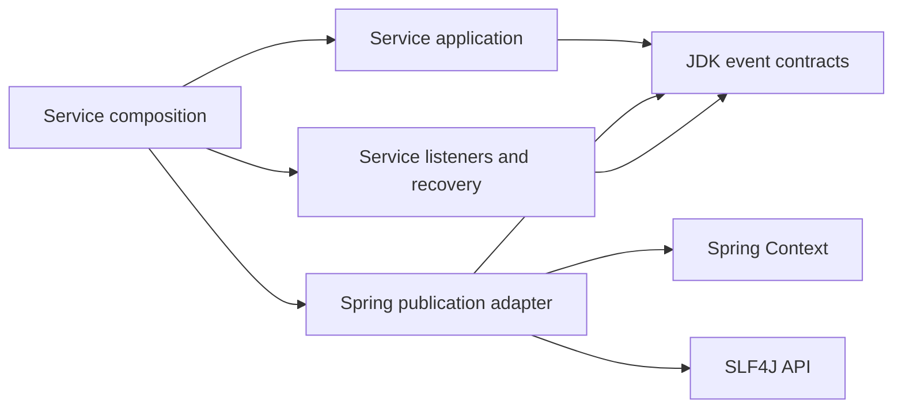

# LIB-5 E0: event contract and integration qualification

Date: 2026-10-17. Baseline: `r030-libraries`,
`d98bf415377bbcd86e43f04dcbd21c5fefe96b34`.
Scope: E0 of the [events proposal](lib-5-events-design.md).

Workflow update, 2026-10-18: the owner closed events design for the current
planning stage and selected diagnostics as the next implementation target.
The events slices below remain deferred; E1 is not the next active task.

## Disposition

E0 analysis is complete. The two-unit boundary is technically viable; unchanged
extraction of the Spring publisher is not qualified. Three corrections belong
in E2 before its external API is admitted: wrapped fatal-error propagation,
preservation of primary failure evidence, and containment of runtime fallback
logging failures. They are recorded as ARCH-4, OBS-7 and OBS-8 in
[the issue registry](../../../KNOWN-ISSUES.md).

The owner's boundary remains unchanged: each service configures handler
isolation with Spring; the library does not replace its multicaster. No extra
owner requirement question is needed. E1 is the next implementation slice;
E2–E5 and live publication remain subsequent work, not results of this analysis.

## Evidence and method

Read all eight events production files, three unit test classes, publisher and
observer implementations/tests, composition roots, all six concrete events,
eight publication callers and all five listener classes. Reviewed current
event coordination, module/architecture rules, ADR-0013 and publication tooling.
The event module and Spring publisher sources have no changes from `edca8d69`;
the inventory below was nevertheless refreshed against the current baseline.

Resolved `bootstrap/ioc-app`'s effective POM with the Maven wrapper. Independently
checked the selected dependency versions in its newly generated Surefire report.
Compiled the unchanged eight events sources plus the unchanged publisher and
local characterization fixtures using Java 21 `javac`, `--release 21`,
`-Xlint:unchecked -Werror`. The fixture uses unrelated event payloads and real
`AnnotationConfigApplicationContext` instances with ordered `@EventListener`
methods. No IOC application/domain classes, Spring Boot runtime or reactor class directories
are on its runtime classpath.

Logback's list appender captures fallback throwable evidence. A separate JVM
uses a synthetic throwing SLF4J provider to inject logging failure. This is not
a claim that normal Logback throws in the deployed service. No worker threads
or network delivery are introduced; contexts and appenders are closed/released.

The local runner and source/dependency identity manifest are retained under
`.dev/lib5-e0-probe/`, outside versioned documentation and Maven test discovery.
They are a design experiment, not a permanent regression suite or published
consumer. E2/E4 must turn the required supported outcomes into repository tests.
The first probe's fatal-propagation expectation failed against real Spring;
`initial-actual.tsv` retains that evidence. Final characterization records the
existing defect explicitly as `OBSERVED_GAP`, not a passing admission guarantee.

## Dependency and support boundary

| Item | Resolved / selected baseline | Meaning |
|---|---|---|
| JDK | Maven/test JVM 21.0.11; Java release 21 | Both library artifacts target class-file version 65 |
| Spring Boot | 4.0.8 | IOC composition/test host; not a required library consumer parent or starter |
| Spring Context | 7.0.9 | First proposed supported Spring baseline; no evidence for 6.x or an entire 7.x range |
| SLF4J API | 2.0.18 | Direct adapter API dependency; no bundled provider |
| Logback | 1.5.38 | Test evidence provider and IOC backend only |
| Spring transitive closure | AOP, Beans, Core, Expression 7.0.9; Micrometer Observation/Commons 1.16.7; Commons Logging 1.3.6; JSpecify 1.0.1 | Present in the isolated Spring probe; not evidence of a dependency-free Spring adapter |

The existing reactor events coordinate is
`com.iocextractor:ioc-platform-events:0.3.0-SNAPSHOT`; the proposed publication
coordinate changes its group to `io.github.xorex-lc`. Update dependency management
and both direct consumers together when implementing it. Keep lockstep versions.

For the new Spring module declare events contracts, Spring Context 7.0.9 and
SLF4J API 2.0.18 as ordinary required compile dependencies. Do not hide required
classes behind `provided`/`optional` or require a consumer to inherit the IOC
parent. External consumers may deliberately manage their own compatible versions;
that does not expand the project's qualified support matrix. Resolve and test
the actual release baseline again at E4 if dependencies change.

The consumer POM must retain those resolved direct dependencies and their normal
transitive resolution, while removing the private parent and inherited test
coupling. Sources/Javadoc, licensing and bytecode checks remain necessary. The
current script's dependency prohibition is correct for the concurrency pilot;
replace it with component-specific expectations rather than relaxing every
artifact's checks. Do not republish concurrency or move its existing tag.

## Current producers, payloads and consumers

Only `ioc-application` and `ioc-app` declare direct Maven dependencies on events.
`RemoteSourceMonitor` constructs remote-change batches but does not publish them.
The runtime publisher is supplied by `EventCoordinationConfig`; production direct
use of Spring's publication API is confined to the bridge and its composition.

| Event | Existing producers / publication caller | Spring consumer | Service-owned backstop |
|---|---|---|---|
| `CanonicalArtifactsChanged` | `IngestionService`, `EventPublishingCanonicalImportWriter` | `CanonicalArtifactsChangedExportListener` nudges export | Canonical revisions and periodic export scheduling |
| `CanonicalDeadlineScheduleChanged` | `EventPublishingCanonicalArtifactWriter`, `EventPublishingCanonicalImportWriter` | `LifecycleControlEventListener.onDeadlineChanged` | Durable deadlines and periodic scheduler refresh |
| `MutableArtifactProjectionRequired` | Both canonical writer decorators above, `LifecycleReconciliationService` | `LifecycleControlEventListener.onProjectionRequired` | Durable projection generations and convergence scheduler |
| `SliceCompleted` | `ExportService`, `ExportRunRecoveryService` | `SliceCompletedPublishListener` submits per-target work | Completed-slice catalog, publish ledger and reconcile |
| `RemoteChangeBatchDetected` | Constructed by `RemoteSourceMonitor`; published by `RemoteFetchDetectionCoordinator` | `RemoteChangeFetchListener` claims identities and submits per-endpoint work | Subsequent detection, remote-fetch ledger and consumer admission |
| `ImportDeliverySnapshotPinned` | `DataframeImportAdmissionService` | `DataframeImportSnapshotPinnedListener` nudges the drain | Durable delivery/snapshot state and periodic managed-import runtime |

This is six events, eight publication caller classes, and six handler methods
in five classes. Several constructors use no-op publishers for explicit local
composition/tests. Concrete payloads, factories and event IDs stay service-owned.
Remote detection uses a hash-derived event identifier; consumers must not treat
it as a globally unique deduplication key. Current durable identities, not the
metadata event ID, own idempotency.

Most publication callers protect their durable result locally as well as relying
on the bridge. `ExportService` publishes directly after the durable COMPLETED
transition and assumes producer-neutral delivery. Binding it to a throwing
replacement would therefore change post-commit caller behavior. Keep the
generic port's implementation-specific guarantees explicit, and require the IOC
composition to retain the best-effort adapter promised by ADR-0013.

## Review findings and required dispositions

### High: Spring-wrapped Error is contained as a delivery failure

`SpringControlEventPublisher.publish` catches every `RuntimeException` from the
underlying publisher. Spring 7.0.9's `ApplicationListenerMethodAdapter.doInvoke`
rethrows runtime exceptions directly, but wraps other target throwables in
`UndeclaredThrowableException`. An `AssertionError` from a real annotated listener
therefore arrives as a runtime wrapper and is swallowed by the bridge.

This is a reproduced runtime control-flow defect, not an OOM or production
incident. It invalidates the earlier blanket fatal-propagation claim. The same
reflection mechanism can wrap other `Error` subclasses, so a service may fail to
surface a fatal listener failure. No retry or recovery guarantee follows.

**E2 requirement:** before runtime containment, recognize the specific Spring
reflection wrapper containing an `Error` and rethrow the original `Error`.
Preserve direct `Error` propagation. Do not scan arbitrary exception/suppressed
graphs or add generic exception translation. The guarantee ends at exceptions
visible to the bridge; an application-owned error handler or executor may already
have handled a failure. Regression-test both a direct publisher and an actual
annotated listener; do not use real resource exhaustion to test this boundary.

### Medium: a failing observer hides the original publication error

`observePublishFailed` receives the original publication exception, but if the
observer throws, its fallback WARN contains only that observer exception. The
original cause is neither attached nor independently logged by the bridge. The
probe's deliberately non-recording failure observer exposes this evidence gap;
an observer that already logged the primary failure can avoid it by accident.

**E2 requirement:** retain the publication failure as the primary fallback
throwable; attach a distinct observation failure as suppressed when supported.
Guard the same-instance case and do not mutate or wrap a successful event.
When suppression is disabled, do not claim that attachment succeeded. Fallback
delivery remains best-effort, not durable diagnostics or guaranteed logging.

### Medium: fallback logger failure can escape or misclassify success

The existing WARN calls are outside their own runtime containment. A synthetic
SLF4J provider whose `warn` throws demonstrates two cases: after publication
failure its logging exception escapes to the producer; after publication success
the outer catch reclassifies that logging failure as publication failure, calls
the failure observer and can again escape through fallback logging.

**E2 requirement:** contain runtime exceptions from fallback logging without a
recursive logging attempt. Separate the underlying publication attempt from its
success observation so a telemetry failure cannot become a delivery failure.
Do not catch `Error`. If both observation and logging fail, producer protection
is possible but delivery of failure evidence is not guaranteed.

### Service-owned limits, not additional library features

- `published` reports a normal return of the underlying call, including when no
  listener matched or a service error handler suppressed a listener failure.
- A publication failure can follow completed handler side effects. Never retry
  automatically or claim atomic fan-out, ordering, or an all-handlers attempt.
- The publisher rejects a null event, not invalid concrete payloads. No-op and
  recording publishers do not inspect `metadata()`. Each service event must
  require non-null metadata and validate its own invariants/type/version.
- Dispatch callbacks in listeners are not uniformly contained. In particular,
  `dispatching` can throw before a nudge or worker command. Keep listener
  observation/recovery local; the extracted publisher cannot protect later
  executor-owned callbacks or promise cross-handler isolation.
- The recording publisher copies list membership, not payloads, and is
  unbounded. Metadata and event payloads are not automatically sanitized.

## Explicit contract table for implementation

| Trigger | Proposed supported bridge outcome | Observation boundary |
|---|---|---|
| Null constructor dependency / null event | Reject before publication | No delivery attempt; invalid input is not a best-effort delivery failure |
| Underlying call returns normally | Return normally unless an `Error` escapes observation | Attempt `published` once; no handler-completion claim |
| Ordinary publication RuntimeException | Contain and return | Attempt `publishFailed` once with the original object; partial dispatch is possible |
| Spring reflection wrapper directly containing Error | Rethrow the original Error | No ordinary publish-failure callback; no automatic retry |
| Direct Error from publisher or observer | Propagate | Producer-neutral policy covers runtime delivery failures, not fatal execution |
| Publication observer RuntimeException | Contain | One fallback attempt; success is not reclassified as failed delivery |
| Publication and observation both fail | Contain both runtime failures | Original publication cause is primary fallback evidence; distinct observation failure is secondary |
| Fallback logger RuntimeException | Contain | No recursive fallback or false success/failure callback |
| Service suppresses listener failure | Inherit normal publication return | Service owns failure evidence and continued multicast |
| Later asynchronous listener fails | Outside this bridge call | Service executor/listener owns reporting and recovery |

Observer methods remain four separate lifecycle hooks, with no subscriber SPI.
Implementations must be observational and should not throw; runtime containment
is the bridge's specific behavior, not a guarantee supplied by the interface
alone. Keep signatures, no-ops and recording support without a second test JAR.

## Architecture and migration decisions

The [proposed ADR draft](lib-5-events-adr-draft.md) records context, alternatives
and consequences without changing accepted ADR-0013. Proposed dependency flow:

Use `com.iocextractor.adapter.out.events.spring` for the proposed bridge package,
replacing the initial `com.iocextractor.events.spring` sketch. `ArchitectureTest`
defines the adapter layer by `..adapter..`; the original sketch would fall
outside that layer. This is a proposal correction, not a package move performed
by E0. Add an adapter-specific inward-dependency rule at E2; retain the JDK-only,
non-serializable events and concurrency separation rules.

Keep service events, logging observer, `ControlEventObservations`, configuration,
MDC, executors and ledgers where they are. The bridge should not depend on
`ioc-application`, diagnostics, observability, concurrency, Boot or bootstrap.
No cycle or framework dependency is required in the contracts module.

Nonfunctional constraints are explicit: no new threads, sockets, persistence,
buffered delivery or per-event lifecycle resources; publication latency remains
that of the supplied publisher/listeners. No throughput/latency SLA is claimed.
Concurrent use depends on the publisher and observer being safe for it. Test
recording is not a production memory budget. Payload/exception confidentiality
belongs to producers and the service logging policy; fallback must not stringify
event payloads. No new security provider or operational control plane is needed.

## Executed checks and retained observations

- `make doctor-core`: passed; Maven uses the full JDK 21.0.11.
- `make test-module MODULE=platform/platform-events`: 11 tests passed, no skips.
- `make test-one MODULE=bootstrap/ioc-app TEST=SpringControlEventPublisherTest`:
  3 tests passed, no skips. This selected no other bootstrap test classes.
- Local source-compiled characterization: 16 scenarios, including the two
  observed gaps for wrapped Error and lost primary failure evidence.
- Separate synthetic-provider fault injection: 2 further gap observations.

| Characterization | Observed current outcome |
|---|---|
| Null publisher, null observer, null event | Rejected before a publication attempt (three cases) |
| No matching listeners | `published` fires despite no business handler |
| Dispatcher ownership | Existing context multicaster remains installed |
| A succeeds, B throws, C follows | A/B called, C omitted, original failure observed, producer returns |
| Service installs a suppressing ErrorHandler | A/B/C called, service observes B's error, publication observer sees success |
| Delegate RuntimeException | Same object observed and contained |
| Success observer RuntimeException | One fallback WARN, no failure callback under working logging |
| Publication and observer both fail | WARN loses the original publication cause (gap) |
| Both throw the same exception instance | Current path returns; future suppression needs a self-instance guard |
| Direct publisher Error / observer Error | Original Error propagates (two cases) |
| Annotated handler Error | Spring wrapper is contained (gap) |
| Null metadata in a non-null event | Publisher does not enforce concrete event invariants |
| Recording mutable event payload | Membership snapshot stays fixed; mutated payload remains visible |
| Throwing logger after success | Misclassified failure callback, then logging exception escapes (gap) |
| Throwing logger after failure | Logging exception escapes (gap) |

The initial comma-separated `make test-one` selector was rejected by the facade
before test execution; the corrected exact selector above passed. The system
Java launcher lacks the compiler's release-21 platform data despite reporting
Java 21; the probe therefore used the full JDK path resolved from Surefire's
`java.home`, matching Maven. These are harness/environment observations, not
product defects or test retries hiding a flake.

Local logs: `.dev/lib5-e0-events-tests.log`, `.dev/lib5-e0-bootstrap-tests.log`;
effective POM: `.dev/lib5-e0-effective-pom.xml`; fixture output/identity:
`.dev/lib5-e0-probe/{actual.tsv,throwing-logger.tsv,identity.json}`.
The manifest includes source and dependency SHA-256 identities. Publisher source
SHA-256: `d2e6981f06a8603634a3614e2d6203dd86a2ed7ec79f33c3dde9b8c50848c132`.
It was compiled unchanged, not patched to make the characterization pass.

No new Maven module, production Java, build/analyzer scope, permanent test suite,
commit or publication is part of E0. Full verify/PMD were not rerun; their
existing commit evidence is stale and no new analyzer-clean claim is made.
Documentation checks and final worktree review are recorded in the discussion.

## Primary references

Checked 2026-10-17 against Spring 7.0.9:

- [ApplicationListenerMethodAdapter source](https://github.com/spring-projects/spring-framework/blob/v7.0.9/spring-context/src/main/java/org/springframework/context/event/ApplicationListenerMethodAdapter.java):
  reflection wrapping; confirmed against the resolved JAR bytecode and the real
  context experiment.
- [SimpleApplicationEventMulticaster](https://docs.spring.io/spring-framework/docs/7.0.9/javadoc-api/org/springframework/context/event/SimpleApplicationEventMulticaster.html):
  synchronous default and service-selected error handler.
- [ApplicationEventPublisher](https://docs.spring.io/spring-framework/docs/current/javadoc-api/org/springframework/context/ApplicationEventPublisher.html):
  publication hand-off, not a promise of immediate or completed processing.
